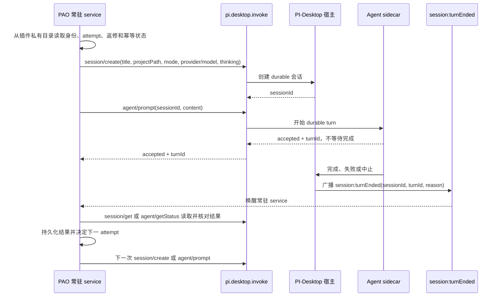
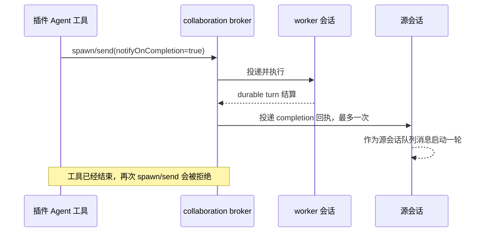

# PI-Desktop 插件公开能力评估

主控复核注：本报告为独立静态调查原稿。工作树隔离已进一步追踪到公开通用session/create经IPC透传isolated:true并由Rust创建工作树的可达路线，仍需确认契约与实际运行；便捷MCP工具schema不是通用desktop.invoke的完整字段限制。文档行号偏移及发行事件的陈旧字样也已复核。最终结论与证据以[宿主评估的主控复核](PI-Desktop宿主评估.md)为准。

## 结论

在固定提交 `d2c9fc44087f24260521c66530c4f92c04790105` 上，PAO **可以完全作为一个 PI-Desktop 插件接入，且不修改 PI-Desktop 或 pi 源码**，但不存在一种路线能无条件满足全部要求。当前分为三条路线：

| 路线 | 结论 | 保留的宿主能力 | 主要代价或缺口 |
|---|---|---|---|
| A. 常驻插件 service 调用普通 `desktop.control` 会话网关 | **有条件可行，推荐优先继续设计** | durable 会话、宿主 Agent sidecar、模型配置与凭证、transcript、统一 token 使用记录、精确回合中止 | 插件必须自建 PAO 身份、尝试记录、返修历史、幂等账本和重启对账；普通 `session/create` 的公开 schema 没有工作树参数，worker 独立工作树尚不成立；`session:turnEnded` 没有 ack/replay |
| B. 官方 `session/collaboration/*` | **不能独立完成后台自动链** | 宿主生成派发与回调账本、来源身份、完成回执、精确取消、目标会话保留 | `spawn/send` 只允许在当前活动的插件 Agent 工具调用内执行；工具结束后常驻 service 不能继续派发。可借助 A 路线在回执后接管 |
| C. 插件包自带官方 pi SDK/执行器 | **字面零源码修改技术上可行，但应视为独立保底路线** | 插件自有业务代码和自有依赖可打包在插件内 | 形成第二套执行器；PAO 自己负责会话、提示、重试、取消、成本、transcript、工作树和退出回收，失去宿主统一保证。插件继承的环境变量被白名单裁剪，不能假定可直接使用宿主凭证 |

因此，最合适的架构判断是：**宿主普通会话网关负责派发、执行、回执和恢复；官方 collaboration 只作为工具调用期间的受限增强；自带执行器作为无法满足隔离要求时的备用方案，而不是把三者混成“完全复用宿主”。**

本报告只做静态源码核对，没有安装依赖、启动宿主、运行模型或基准、读取正式 PAO_HOME、提交或合并。以下“可行”均指源码契约和调用链支持，不等于已经做过端到端运行验证。

## 最短调用路线

### A. 常驻 service 的普通会话网关

最少公开操作是：

1. `session/create` 创建 durable 会话；
2. `agent/prompt` 提交提示并取得 `{accepted, turnId}`；
3. 订阅 `session:turnEnded`，按 `sessionId + turnId` 配对；
4. 用 `agent/getStatus` 和 `session/get` 读取状态及有界 transcript；
5. 用 `agent/abort` 精确取消当前回合；
6. 将 PAO 自己的 attempt、返修、身份和幂等状态写进 `pi.plugin.getDataPath()` 指向的插件私有目录。

这条路线的后台性成立：常驻 service 不依赖页面或工具调用存活；插件来源的 `session/create` 和 `agent/prompt` 不会切换用户当前界面。见 `docs/spec/07-plugins/03-plugin-api.md:918-933`、`apps/desktop/electron/main/mcp-control.ts:717-743`、`apps/desktop/electron/main/plugin-runtime.ts:4096-4216`。

### B. 官方 collaboration 的完成回执

这条路线能产生可靠回执，也能唤醒源会话；但源会话被唤醒后，PAO 若要在工具调用之外继续派发，仍然需要 A 路线的普通 `desktop.control` 操作。若希望完成回执之后继续执行插件代码，可以监听 `session:turnEnded`，但这仍是在常驻 service 中通过普通网关派发，不是第二次调用 collaboration。

### C. 插件自带执行器

插件目录可以包含自己的 PAO 业务代码、官方 pi SDK 和执行器，并由插件常驻 service 启动。打包规范要求第三方库随插件打包，不依赖宿主安装依赖，见 `docs/spec/07-plugins/06-plugin-packaging.md:94-104`。插件宿主进程实际通过 `utilityProcess.fork` 启动，见 `apps/desktop/electron/main/plugin-runtime.ts:1354-1373`。因此“完全不改源码”在技术上不能排除。

但这条路线的边界必须明确：

- 宿主只给插件进程提供白名单环境变量，不提供宿主 `process.env`；见 `apps/desktop/electron/main/child-process-env.ts:1-20,27-63`。
- 模型凭证、会话库和宿主成本账本对插件私有 API 不可见，见 `docs/spec/07-plugins/11-plugin-storage-isolation.md:89-102`。
- 若自带执行器需要宿主凭证，目前没有公开的通用“代模型调用带工具会话”接口。`agent.complete` 是 `tools: []` 的一次性完成，不能替代编码执行器，见 `docs/spec/07-plugins/03-plugin-api.md:883-902`。
- 应用退出时插件清理总预算只有 3 秒，`onUnload` 单插件 1.5 秒；见 `docs/spec/07-plugins/05-plugin-lifecycle.md:100-122`、`apps/desktop/electron/main/plugin-runtime.ts:651-662`。执行器的子进程回收必须在这个预算内完成，或依赖插件自行设计持久化恢复。
- 因此路线 C 的零源码修改是字面成立，代价是 PAO 承担第二套宿主的执行、取消、成本、身份和退出语义。

## 文档承诺、已实现公开契约、内部实现和未验证

### 已实现的插件公开契约

| 能力 | 证据 | 结论 |
|---|---|---|
| 插件可声明 Agent 工具、Agent 扩展、常驻 service、设置、MCP、bus、视图 | `packages/plugin-sdk/src/index.ts:128-188` | manifest 公开能力存在 |
| 公开 `pi.agent.registerTool`、`pi.agent.complete`、`pi.session`、`pi.services`、`pi.bus` | `packages/plugin-sdk/src/index.ts:1395-1479` | 插件 SDK 提供对应 API |
| `agent.tool.register`、`agent.extension`、`desktop.control`、`background.service` 等权限 | `packages/plugin-sdk/src/index.ts:1558-1617` | 能力受权限审查控制 |
| `desktop.control` 公开 `session/create`、`agent/prompt`、`agent/abort`、`agent/getStatus`、`session/get` 等 | `apps/desktop/electron/main/mcp-control.ts:189-264` | 普通后台网关是实际公开契约 |
| 插件发起创建和提示不会切换当前界面 | `docs/spec/07-plugins/03-plugin-api.md:918-933`、`apps/desktop/electron/main/mcp-control.ts:717-743` | 符合后台派发需要 |
| `session/create` 公开字段只有 title、projectPath、mode、provider/model、thinking | `apps/desktop/electron/main/mcp-control.ts:299-312` | 没有公开 worktree 字段 |
| `agent/prompt` 返回接受状态，不等待完成 | `apps/desktop/electron/main/mcp-control.ts:340-351` | 宿主执行与插件后台解耦 |
| `agent/abort` 取消指定会话当前回合，保留会话 | `apps/desktop/electron/main/ipc/agent-ipc.ts:644-695` | 精确取消的主链路存在 |
| `session/get` 读取会话和有界 transcript | `apps/desktop/electron/main/ipc/session-ipc.ts:313-355` | 结果读取有公开路径 |
| 回合结束事件携带 `sessionId/turnId/reason`，无 ack、无 replay | `docs/spec/07-plugins/03-plugin-api.md:954-971` | 可唤醒，但不能保证插件崩溃期间不丢事件 |

### 实际执行链

| 链路 | 证据 | 结论 |
|---|---|---|
| 工具实际派发到插件子进程 | `apps/desktop/electron/main/plugin-runtime.ts:2926-3012` | 不是只读 SDK 声明 |
| 工具身份通过 `AsyncLocalStorage` 绑定，调用结束即失效 | `apps/desktop/electron/main/plugin-tool-invocations.ts:23-107` | 工具结束后不能冒充活动工具上下文 |
| `desktop.invoke` 由宿主注入 plugin/session/turn/invocation 身份 | `apps/desktop/electron/main/plugin-runtime.ts:5611-5744` | 参数不能覆盖来源身份 |
| `session/create` 转到宿主 `session.create` | `apps/desktop/electron/main/ipc/session-ipc.ts:228-238` | 使用宿主持久会话 |
| `agent/prompt` 启动 Agent sidecar，返回 durable turn | `apps/desktop/electron/main/ipc/agent-ipc.ts:187-588` | 实际进入宿主执行链 |
| 回合结算后发布 `session:turnEnded` | `apps/desktop/electron/main/runtime/plans.ts:269-315` | 事件位于 durable 回合结算附近 |
| service 与插件主模块在同一子进程，事件可进入 service | `apps/desktop/electron/main/plugin-host-process.mjs:480-500,708-717` | 常驻监听链成立 |
| `broadcastSessionEvent` 将回合事件发给插件进程 | `apps/desktop/electron/main/services/plugin-services.ts:585-632` | 不是仅有文档 |
| service 由宿主启动，崩溃后有限重启 | `apps/desktop/electron/main/plugin-runtime.ts:3337-3410,4096-4216` | 后台生命周期有宿主管理 |

### 官方 Session Collaboration

| 能力 | 证据 | 结论 |
|---|---|---|
| 六个公开操作和输入形状 | `docs/spec/07-plugins/03-plugin-api.md:809-882` | 官方公开契约存在 |
| 六个操作是 plugin-only | `apps/desktop/electron/main/session-collaboration-control.ts:3-47` | 不暴露给普通 MCP |
| `spawn/send` 要求活动工具中的 session、turn、invocation | `apps/desktop/electron/main/services/session-collaboration.ts:107-114` | 来源身份由宿主认证 |
| 每次 `spawn/send` 执行前再次校验 `sender()` | `apps/desktop/electron/main/services/session-collaboration.ts:271-315` | 工具结束后常驻 service 不能继续派发 |
| spawn 继承父会话的 project、thinking、permission | `crates/host-core/src/session_collaboration/mod.rs:148-175` | 有宿主统一执行语义 |
| completion 回执 durable、最多一次 | `crates/host-core/src/session_collaboration/settlement.rs:49-135` | 回执不依赖一次性事件 |
| completion 回执投递到源会话并启动一轮 | `apps/desktop/electron/main/services/session-collaboration.ts:193-236` | “结果回调后唤醒源会话”成立 |
| 回执不会继续触发另一层 completion | `docs/spec/07-plugins/03-plugin-api.md:868-878` | 有界自动跳转，不会无限回声 |
| cancel 精确取消队列或当前回合并保留会话 | `crates/host-core/src/session_collaboration/settlement.rs:137-195` | 取消和恢复保证较完整 |
| 重启时运行中消息标为 `interrupted`，不自动重放 | `crates/host-core/src/session_collaboration/settlement.rs:198-205` | 恢复是状态对账，不是自动重跑 |

**关键否证点：** 官方 collaboration 的“完成回执能唤醒源会话”不等于“常驻插件可以在回调后再次 `spawn/send`”。`sender()` 的 `getActiveTurn(...) === turnId` 是硬门禁；工具结束后再次调用会返回 `PERMISSION_DENIED`。因此，PAO 若要在回执后继续自动链，必须由普通 `desktop.control` 路线接管。

### 可信 pi 扩展

`contributes.agentExtensions` 是 PI-Desktop 的受限 ExtensionAPI 子集，在 Agent sidecar 内运行，属于高信任代码；见 `docs/spec/07-plugins/16-trusted-extensions.md:1-61`。实际支持的事件和注册函数见 `packages/agent-runtime/src/extensions/event-capabilities.ts:1-76`、`packages/agent-runtime/src/extensions/runner.ts:834-1017`。

它可以用于单会话内的回合钩子、工具注册和 `sendUserMessage`，适合 PAO 的会话内自动推进。它不能替代宿主常驻 service 管理多个后台会话：可信扩展绑定具体 Agent sidecar 和会话生命周期；`sendMessage`、`switchSession` 等仍在文档中标记为延期，见 `docs/spec/07-plugins/16-trusted-extensions.md:274-287`。

文档列出的 `session.create/fork/queuePush` 是 sidecar 到宿主的内部代理入口，见 `docs/spec/07-plugins/16-trusted-extensions.md:477-485`。不能把这些内部协议当作插件公开 API 来承诺。

### 持久会话、身份和恢复

插件私有数据目录是 `~/.pi-desktop/plugins/data/<plugin-id>/`，见 `docs/spec/07-plugins/11-plugin-storage-isolation.md:51-102`；实际 `getSettings/setSettings/getDataPath` 见 `apps/desktop/electron/main/plugin-runtime.ts:5499-5523`。

普通网关能保证宿主持久会话和回合记录，但不能自动把任意会话识别成 PAO 的“真实身份”。PAO 必须在插件私有账本中持久化：

- PAO 项目、任务、阶段和 attempt 身份；
- 对应 `sessionId`、`turnId`、消息 id；
- 返修历史、最后一次成功状态和下一动作；
- 幂等键、取消状态和已结算标记。

`session:turnEnded` 是 fire-and-forget；崩溃、重载和宿主退出期间可能丢失。恢复时应以 durable 状态为准：用 `agent/getStatus` 判断是否仍在运行，用 `session/get` 读取 transcript 和终态，再继续或标记中断。该对账设计目前只是源码上的可行路线，尚未写成最小实现。

### 工作树和 cwd

宿主确实支持隔离会话：若会话自身带 `worktree`，启动时会调用 `worktree.location` 并从隔离根执行文件操作，见 `apps/desktop/electron/main/runtime/session-launch.ts:304-321,447-458`。

但当前证据不支持“插件普通 `session/create` 自动获得工作树”：

- 公开 `session/create` schema 没有 worktree 字段；
- collaboration 的 `SessionCreateOptions` 只有项目、模式、模型、thinking、permission，见 `crates/host-core/src/session_collaboration/mod.rs:148-170`；
- 因此普通网关只能复用同一项目，不能据现有公开证据为每个 worker 创建独立工作树。

这是一项**未满足的隔离要求**，不是可以忽略的实现细节。若 PAO 必须并发修改同一项目且彼此隔离，需要继续搜索公开的工作树创建入口；找不到时，A/B 路线条件不成立，C 路线由 PAO 自带执行器自行创建工作树。

## 可复用的非 UI 机制

| 机制 | 可复用内容 | 实际局限 |
|---|---|---|
| 常驻 service | 插件启用后后台启动，有限崩溃重启，卸载/退出时停止 | 最多 4 个；启动预算 5 秒；崩溃最多重启 5 次；不能依赖无限运行 |
| 普通 `desktop.control` | durable 会话创建、提示、状态、transcript、精确中止 | 需 `desktop.control` 权限；创建 schema 无工作树；后台创建不切界面 |
| `session:turnEnded` | 回合结束定向唤醒，带精确 turn id | 无 ack/replay，事件可能丢失，需要 durable 对账 |
| 插件私有设置与数据 | 持久化 PAO 业务账本、配置和身份映射 | 插件卸载默认可能删除数据，见 `docs/spec/07-plugins/11-plugin-storage-isolation.md:104-109` |
| 模型列表与宿主完成接口 | `models.list` 选择已配置模型；`agent.complete` 用宿主凭证做一次性模型调用 | `agent.complete` 无工具、90 秒超时，不能替代完整编码回合 |
| 官方 collaboration | 工具调用内派发、最多一次 completion 回执、精确取消、会话保留 | 工具外再次派发被阻断；不能单独驱动后台长链 |
| 可信 pi 扩展 | 单会话内事件、工具、provider、队列消息 | 绑定 sidecar 会话，不是跨会话常驻调度器 |
| 插件打包 | 可把 PAO 业务库和自有 pi SDK 放进插件包 | 宿主不替插件安装普通依赖；会引入第二套执行器成本 |

UI 面板、设置页、主题和全局布局由主控另行核对，本报告不展开。

## 未核实项和继续搜索的公开入口

1. **工作树公开入口：** 需搜索是否存在 `desktop.control` 未列入 `session/create` schema、但可通过其他公开操作在创建后附加 worktree 的路径。不能只凭当前 schema 缺失就断言宿主永不支持。
2. **取消边界：** 已确认 `agent/abort` 的精确 turn guard 和会话保留，但尚未核实目标 turn 已结束、仍在队列、宿主重开时的全部返回语义。
3. **重启对账：** 尚未形成“事件丢失后，通过 `agent/getStatus + session/get + 私有账本”恢复的最小状态机。
4. **自带执行器加载：** 尚未实际验证插件包内的官方 pi SDK、模型请求、子进程取消和孤儿回收。打包与进程入口只证明字面可行，未证明运行成功。
5. **自带执行器凭证：** 尚未确认能否通过 PI-Desktop 的插件 provider 扩展或其他公开能力让自带执行器安全复用宿主凭证；当前证据显示插件环境不继承宿主秘密。
6. **退出预算：** 自带执行器在 1.5 秒 `onUnload` 和 3 秒总清理预算内能否完成回收尚未验证；若不能，需要 PAO 自己设计持久中断恢复。
7. **版本门槛：** `session:turnEnded` 的文档说明发布版本尚未包含该事件，插件必须声明需要实际交付该事件的 PI-Desktop 版本，见 `docs/spec/07-plugins/03-plugin-api.md:954-971`。

## 否证点

- 若“真实身份、返修历史、取消关闭与恢复保证”要求由宿主统一拥有，而不是由 PAO 私有账本拥有，则纯插件 A 路线不能成立。
- 若“工作树隔离”必须在宿主普通 `session/create` 中自动完成，则当前公开 schema 是阻断证据；在找到另一公开入口前，A/B 路线条件不成立。
- 若“后台自动链”要求工具结束后继续使用官方 collaboration 的 `spawn/send`，则 `sender()` 的活动 turn 校验是明确阻断证据。
- 若要求所有模型成本、transcript、取消、进程退出都继续进入宿主统一账本，则自带执行器路线 C 不满足。
- 若要求插件完全无长驻进程、无需持久化恢复状态，仅靠回调事件推进，则 `session:turnEnded` 的无 replay 特性是阻断证据。

## 证据边界

本报告核对的是固定提交的源码和公开规范，包含文档承诺与实现代码的对应关系；没有运行宿主或模型，没有验证操作系统层面的退出、子进程回收和供应商凭证行为。结论中的“可行”是“当前源码存在完整公开调用链”，不是“已完成真实集成验收”。
