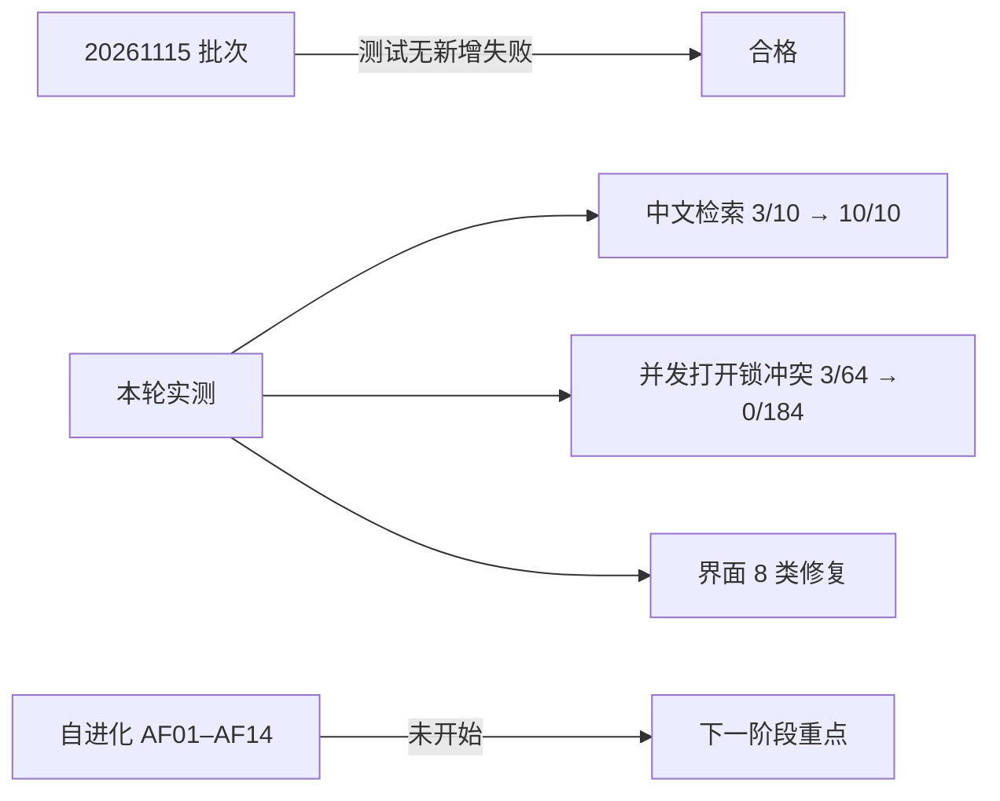

# 全面优化复审报告（2026-11-18）

审核对象：`.pao/全面优化审核-20261115` 批次（K 内核 / D 主进程 / U 界面 / S 拆分 / E 工程）。
本轮另外检查了桌面界面、记忆检索和自进化的实际效果，发现的重要问题已直接修复。
所有改动都未提交。

## 一、结论

| 方面 | 结论 |
|---|---|
| 20261115 批次本身 | 合格。内核全量测试 3869 个用例，没有新增失败。剩余 3 个失败在批次前的基线版本上同样存在，属于测试没跟上代码（见第三节） |
| 记忆检索 | 发现并修复两个实际问题：中文口语问法几乎搜不到记忆（10 条只中 3 条，修复后 10 条全中）；多个进程同时打开记忆库会偶发「数据库被锁」 |
| 自进化 | **主要缺口仍未处理**。AF01–AF14 不在 20261115 批次范围内，至今全部待修。当前的自进化还不能真正证明「新版技能比旧版好」，详见第四节 |
| 桌面界面 | 修了记忆页和工作流页 8 类体验问题，均在真实 Electron 截图中确认；另有 6 项建议没有改，需要你定（见第五节） |
| 需要你决定 | ① 是否启动 AF 系列自进化修复；② 全局按钮样式要不要统一加底色；③ 是否提交本轮与批次改动 |

## 二、本轮直接修复

### 2.1 记忆检索（内核）

| 问题 | 原因 | 修复 | 证据 |
|---|---|---|---|
| 中文口语问法搜不到记忆，例如「注释用什么语言写」查不到「注释统一用中文」 | 全文索引按连续 3 个字切词，中文问句和记忆原文很少有 3 字完全重合 | 新增 `memory/lexical-terms.ts`：把中文拆成相邻两字的词组，按词组在全部记忆中的稀有程度打分，作为模糊补充通道，与原有通道合并排序 | 探针 10 条真实问法：修复前 3/10，修复后 10/10（`experiments/cjk-probe-*.txt`） |
| 模糊补充一度过度匹配：常见词组也能把无关记忆拉进结果 | 只要求「命中几个词组」，没要求命中的词组足够少见 | 加「证据下限」：得分必须达到「只出现在约 10% 记忆里的词组」的分值，且不低于最高分的 35% | 新增 `memory-search-cjk.test.ts`（14 个用例，含反面场景） |
| 桌面、命令行和定时任务同时打开记忆库时，偶发 `database is locked` | `busy_timeout`（遇锁等待时间）设在了 `journal_mode=WAL`（切换日志模式）之后，切换模式本身要取锁，这一步没有等待就直接失败 | `store.ts` 先设等待时间，再切日志模式 | 8 进程并发打开：修复前 3/64 失败，修复后 0/184（`experiments/wal-open-race.mjs`） |

验证：内核记忆相关测试全量 563/563 通过（`checks/kernel-memory-final.log`）。修复前全量跑过一次，有 2 个失败：超过 200 条的分页计数、两个进程同时纠正同一记忆。现在都通过。
内核产物已重新构建，桌面端读到的是修复后的代码。

### 2.2 桌面界面

| 页面 | 问题 | 修改 |
|---|---|---|
| 记忆列表 | 状态显示内部英文值；没有适用条件的记忆也留一行空白 | 状态改为「生效中 / 已停用」；空的条件行不再渲染 |
| 记忆详情·修订 | 修订行把作者、时间、结论挤在一行，作者显示 `model` 等内部值 | 改为左侧版本号，右侧上方结论、下方「作者 · 时间」；作者显示「用户 / 模型 / 系统」 |
| 记忆详情·操作 | 纠正、合并、使用记录按钮在面板底色上看不出是按钮；「彻底删除」样式类名存在但从未定义 | 前三个用次要按钮样式；新增红色危险按钮样式 `.button--danger`，删除确认框、定时任务删除确认也随之生效 |
| 记忆·自进化页签 | 关键词、使用状态、版本范围对自进化列表不起作用，却照常显示并计入筛选数 | 该页签只保留「类型」；隐藏项不计入筛选数 |
| 记忆·空列表 | 左边已经说明「没有记忆」，右边还提示「请选择一条记忆」；自进化页签同样提示「请选择一个进化问题」 | 列表为空且没有选中项时，右侧不再显示提示；切换页签时收起上一页签打开的详情（否则从记忆页签切到自进化后提示仍会出现） |
| 工作流画布 | 画布内的「列表」按钮和工具条上的「列表」同名，功能不同（一个打开节点列表，一个切换列表视图） | 画布内改名「节点列表」 |
| 工作流节点详情 | 底部四个操作按钮看起来像普通文字 | 改用次要按钮样式 |
| 工作流 / 计划历史 | 右上角「当前工作」悬浮条压住页签行和画布工具条 | 该页把悬浮条移进顶栏右侧空白处，并声明不参与窗口拖动（否则 Windows 上点击会变成拖窗口）；窄窗时自动缩短 |

## 三、批次复核

| 项目 | 结果 |
|---|---|
| 内核检查（biome / tsc / 门禁） | 与实施方回报一致：biome 128 错 44 警告、tsc 1 处、门禁 B5 两处，均为既有问题，本批没有新增 |
| 内核全量测试 | 3869 个用例，3859 通过、3 失败、1 跳过。3 个失败在批次前基线上逐字复现：两处是注册表期望 13 项、实际 15 项；一处是命令注册多了第 4 个参数 `"/pao action"`。代码已经加了新工具和参数，测试期望没更新 |
| K03 清理守卫 | 读了实现：没动现场就释放守卫，动过现场或状态未知就继续握住，与用户认可的方案一致；「有未提交改动」在拿守卫之前就被拒绝，不会卡住后续派发 |
| K04 重复散场 | 读了实现：成功后保留结果，失败才清空以便重试；散场成功后会话从登记表移除，不会留下旧结果 |
| 桌面仓 `f1` 文件被删 | 上游误提交的测试文件（内容是数字 1 到 20），删除无害 |
| 桌面仓大量文件显示修改 | `.gitattributes` 新增统一换行规则。去掉换行差异后，实际有改动的文件 174 个 |

桌面检查结果（格式、架构边界、类型、单元测试、e2e、lint、真实 Electron 截图）：见第六节。

## 四、自进化：主要缺口

20261112 审核列出的 AF01–AF14 全部未处理（`.pao/memory-evolution-audit-20261112/优化任务.md`）。影响最大的几项：

| 编号 | 问题（通俗说明） | 后果 |
|---|---|---|
| AF01 | 验证候选技能时没有真正加载该技能，也没用冻结的判据 | 「验证通过」不代表技能真的更好 |
| AF02 | 不要求同时具备「原问题、正常、独立保留」三组用例 | 可能只凭原问题一组就发布新版 |
| AF03 / AF05 | 验证请求不走宿主的模型路由和用量账本 | 用量无法统计，也无法限额 |
| AF04 | 许可按唤醒时的会话判断，而不是作业来源项目 | A 项目的作业可能按 B 项目的许可执行 |
| AF06 / AF07 | 使用记录不按「实际参与的版本」统计；工人子进程会加载全部技能 | 退步无法准确回退，无关技能混入 |
| AF10 | 重建全文索引时漏掉历史修订 | 只在旧版本里出现的词，在「包含历史」模式下搜不到 |

建议顺序（沿用原审核）：先做 AF04 / AF05 / AF08（来源和用量基础）→ AF01 / AF02 / AF03 与 AF06 / AF07 并行 → AF09–AF12 做集成验证 → AF13 打包 → AF14 真实效果验收。
其中 AF14 需要真实模型调用，会产生费用，要你授权后才能做。

## 五、界面建议（未改，需要你定）

| 建议 | 原因 | 为什么没直接改 |
|---|---|---|
| 全局 `.button` 加浅底色或描边 | 默认按钮背景与面板同色，看板「刷新」、工作流工具条「专注画布 / 更多 / 建立主控会话」、空态「新建工作流」等都像普通加粗文字 | 影响全应用的设计规范，需要统一决定 |
| 运行中时「启动工作流」不再用主按钮样式 | 有运行在进行时，最醒目的按钮仍是新建 | 它是页面级入口，优先级低 |
| 节点详情的「编辑此配方」与工具条入口重复 | 同一功能出现两次 | 工具条入口是有意设计（控制面板读取失败时仍可用），有测试锁定 |
| 深色模式下未激活节点对比度偏低 | 截图 30 中灰色节点难以辨认 | 需要调主题色，影响面广 |
| 工作流图默认不自动适配画布 | 节点较多时要手动缩放 | 交互改动，需要先确认期望 |
| 窄窗时节点详情覆盖画布 | 900px 以下详情盖住画布 | 属于合理的响应式布局，已有「隐藏」按钮 |

## 六、桌面检查结果

| 检查 | 结果 | 说明 |
|---|---|---|
| 类型检查 typecheck | 通过 | `checks/desktop-typecheck-2.log` |
| 架构边界 check:architecture | 通过 | `checks/desktop-architecture.log` |
| 构建 build | 通过 | `checks/desktop-build-2.log` |
| 格式 format:check | 1 个文件未通过 | `memory-merge-form.tsx`，本轮和批次都没改过它，已提交版本就是这样；本轮改的文件已全部格式化（`checks/desktop-format-check-2.log`） |
| lint | 209 错 2 警告 | 与批次前基线数量一致，无新增（`checks/desktop-lint.log`） |
| 画布单元测试 | 98/98 通过 | `checks/desktop-unit-canvas.log` |
| 全量单元测试 | 收集阶段失败 | `memory-bridge.spec.ts` 加载 `pi-sdk-driver` 时的 ESM/CJS 模块格式错误，批次第三阶段回报已记录，属既有问题 |
| 记忆 e2e（8 个文件，20 个用例） | 16 通过、4 失败 | 最终改动后重跑；4 个失败均为既有问题，见下（`checks/desktop-e2e-memory-final.log`） |
| 真实 Electron 截图 | 46 张 | `screenshots-after/`，覆盖 1280 / 900 / 700 宽、浅色 / 深色、工具面板打开 |

记忆 e2e 的 4 个稳定失败，批次改前基线日志（`全面优化审核-20261115/checks/U-core-remaining-baseline.log`）里已逐项存在，批次第三阶段回报也列为既有问题，不是本轮引起的：

| 用例 | 现象 | 归类 |
|---|---|---|
| `memory-management.spec.ts` 纠正冲突 | 纠正后来源期望 1 条，实际 2 条（旧来源被保留） | 内核纠正逻辑与测试期望不一致，需定哪边是对的 |
| `memory.spec.ts` 只读链 | 同上，来源数量多 1 | 同上 |
| `memory-usage-panels.spec.ts` 整理状态 | 期望 `failed`，实际 `done` | 测试构造的失败场景没有真正失败 |
| `memory-deletion-host.spec.ts` 恢复 | 期望文案「等待恢复」，实际「等待继续处理…」 | 文案改过，测试没跟上 |

这 4 项都在内核记忆逻辑或测试期望上，不在本轮界面改动范围；建议作为单独任务，逐项确认「代码对还是测试对」后再改。

## 七、文件与清理

- 本轮改动的内核文件：`memory/lexical-terms.ts`（新增）、`memory/search.ts`、`memory/source-fts.ts`、`memory/store.ts`、`test/pao/memory-search-cjk.test.ts`（新增）。
- 本轮改动的桌面文件：见 2.2 表格对应的样式、组件和 3 个 e2e 用例的选择器与文案。
- 检查日志：`checks/`；探针与实验：`experiments/`；截图：`screenshots/`（修改前）、`screenshots-after/`（修改后）。
