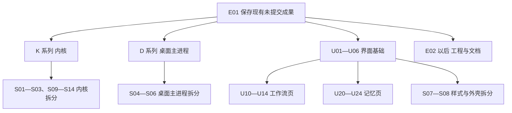

# 全面优化任务书：总览与通用规则

核实日期：2026-11-15。本任务书由审核方撰写，供实施方逐项执行。
范围是[记忆与自进化任务书](../memory-evolution-audit-20261112/优化任务.md)（O01—O15、AF01—AF14）**之外**的优化；那份任务书里的事项不在这里重复，也不许在本批顺手修改。

## 1. 文件导航

| 文件 | 内容 | 编号前缀 |
|---|---|---|
| 本文件 | 通用规则、执行顺序、回报格式 | — |
| [01-内核正确性与效率](01-内核正确性与效率.md) | `PAO/packages/coding-agent/src/pao/` 内的缺陷与效率 | K |
| [02-桌面主进程](02-桌面主进程.md) | `desktop/apps/desktop/electron/` 与驱动包 | D |
| [03-界面改版](03-界面改版.md) | 工作流页、记忆页、窄窗与其他界面问题 | U |
| [04-大文件拆分](04-大文件拆分.md) | 纯搬移式拆分 | S |
| [05-工程与文档](05-工程与文档.md) | 仓库卫生、测试残留、文档订正 | E |
| `ui-screenshots/` | 2026-11-15 实机截图，界面任务的“改前”对照 | — |

## 2. 三个仓库与路径约定

| 名称 | 路径 | 说明 |
|---|---|---|
| 开发根 | `D:\AI\workspace\pao-dev` | 外层仓：计划、文档、留档 |
| 内核仓 | `D:\AI\workspace\pao-dev\PAO` | 独立 git 仓，npm 工作区 |
| 桌面仓 | `D:\AI\workspace\pao-dev\desktop` | 独立 git 仓，pnpm 工作区 |
| 正式运行数据 | `D:\AI\workspace\pao` | **禁止读写**，任何任务都不碰 |

下文“内核源码目录”指 `PAO/packages/coding-agent/src/pao/`；“桌面应用目录”指 `desktop/apps/desktop/`。

## 3. 通用规则（每个任务都适用）

1. **一次只做一个任务。** 做完、验收通过、回报之后再开始下一个。不合并任务，不提前做后面的任务。
2. **只改任务“允许修改”清单里的文件。** 需要改清单外的文件才能完成时，停下回报，不自行扩大范围。
3. **不顺手改。** 不改名、不重排、不格式化无关代码，不修任务没提到的问题；发现新问题写进回报的“另外发现”。
4. **行号仅供定位。** 行号是 2026-11-15 的快照，工作区里有未提交改动，行号可能漂移。先用任务里写的函数名、字符串搜索定位，再对照任务里的“改前”片段确认是同一处。**找不到或片段对不上时停下回报**，不要去改“看起来差不多”的地方。
5. **不碰记忆与自进化在途工作。** 以下路径属于另一份任务书，本批任何任务都不得修改：
   `src/pao/memory/`、`src/pao/evolution/`、`test/pao/memory-*`、`test/pao/evolution-*`、`desktop/apps/desktop/tests/core/memory-evolution.spec.ts`、`tests/production/packaged-s9-evolution.spec.ts`。界面任务 U 系列对 `src/features/memory/` 的修改以任务清单为准。
6. **兼容契约不改名。** 卡片的中文 frontmatter 键、配置文件键（如 `保温.json` 里的键）、持久化字段、IPC 通道名、公开工具名、`data-testid` 都不得改名，除非任务明确写出“改为什么”。
7. **不削弱检查。** 不删除、不跳过、不放宽已有测试与门禁来换取通过。任务明确要求更新的断言除外，且只改任务列出的那几处。
8. **不提交、不推送、不删除。** 除非任务写明并且用户已授权。需要删除文件时移入系统回收站。
9. **依赖安装只在仓根做。** 禁止在 `PAO/packages/*` 成员包目录里执行 `npm install` 或 `pnpm install`。本批任务都不需要新增依赖；觉得需要时停下回报。
10. **测试使用隔离数据目录。** 运行任何测试前把环境变量 `PAO_HOME` 指向一个新建的临时空目录（例如 `D:\AI\workspace\临时文件夹\pao-test-home-YYYYMMDD`），不得指向 `D:\AI\workspace\pao`。
11. **新代码的写法。** 标识符用英文，注释和界面文案用中文；错误不得静默吞掉，至少记录原因；不为“以后可能用到”加开关、包装层或配置项。

## 4. 通用验收命令

每个任务的“验收”一节会写专项检查；除此之外，改动了哪个仓就必须跑该仓的基础检查，全部通过才算完成。

**内核仓**（在 `D:\AI\workspace\pao-dev\PAO` 执行）：

```
npx biome check --error-on-warnings packages/coding-agent/src/pao packages/coding-agent/test/pao
npx tsc --noEmit
npm run check:pao:kernel
```

单个测试文件（在 `PAO/packages/coding-agent` 执行）：`npx vitest --run test/pao/<文件名>`。

**桌面仓**（在 `D:\AI\workspace\pao-dev\desktop` 执行）：

```
pnpm format:check
pnpm lint
pnpm check:architecture
pnpm typecheck
```

- 单元测试单文件：`pnpm exec playwright test -c apps/desktop/playwright.config.ts apps/desktop/tests/unit/<文件名>`
- 界面测试单文件（在 `desktop/apps/desktop` 执行，会先构建）：
  `pnpm exec cross-env PI_APP_TEST_LANE=core PI_APP_REAL_AUTH=0 PI_APP_TEST_MODE=background pnpm run test:e2e:runner -- apps/desktop/tests/core/<文件名>`

**开发根**：改了文档链接时执行 `node scripts/check-doc-links.mjs`。

不要运行全量测试（内核 `npm test`、桌面 `pnpm e2e`），除非任务写明。全量结果里若有与本任务无关的既有失败，原样列出，不去修。

## 5. 停止条件（遇到任一情况立即停下回报）

- 按函数名和“改前”片段找不到目标代码，或目标代码与片段明显不同。
- 完成任务必须修改“允许修改”清单外的文件，或必须改动第 3.5 条列出的路径。
- 基础检查在**改动前**就失败（先在未改动状态跑一次并记录；改动后只对新增失败负责）。
- 任务写明的专项测试失败两次且原因不是自己能在允许范围内修的。
- 任务描述与代码现状矛盾，或两个任务的要求互相冲突。

停下时保留现场，不回滚别人已有的改动。

## 6. 回报格式

每个任务完成或停止后，按下面格式回报（纯文本即可）：

```
任务编号：
结果：完成 / 停止（原因）
改动文件：逐个列出，每个文件一句话说明改了什么
验收：逐条列出执行的命令与结果（通过/失败及关键输出）；反面场景逐条写“怎样构造、看到了什么”
未验证的内容：
另外发现：
```

“改了”“检查了”“实际运行通过”三者分开写，没有运行的不写成通过。

## 7. 执行顺序



- **E01 最先做。** 三个仓都有大量未提交成果，先保存成基线，后续每个任务的改动才看得清、退得回。用户已于 2026-11-15 授权，范围见工程与文档分册开头。
- K、D、U、E 四条线互不依赖，可以由不同实施者并行，但**同一个文件同一时间只允许一个任务在改**。各分册开头列出了本分册内部的先后顺序。
- 拆分任务（S 系列）排在同一文件的缺陷修复之后，避免搬完又改。
- 界面文件的拆分已并入对应的界面改版任务，S 系列不再重复拆它们。

## 8. 任务状态总表

状态由审核方在验收后更新；实施方不改本表。

| 编号 | 标题 | 优先级 | 状态 |
|---|---|---|---|
| K01 | 派工单影响分析读卡路径多拼一级目录 | P1 | 待实施 |
| K02 | 桌面注入审计写控制文件未加锁 | P1 | 待实施 |
| K03 | 工作副本清理失败后是否保留占用锁 | P1 | 待实施 |
| K04 | 散场成功后记录被清空 | P1 | 待实施 |
| K05 | 活动列表单项出错拖垮整体 | P2 | 待实施 |
| K06 | 系统通知子进程启动失败未处理 | P2 | 待实施 |
| K07 | 影响分析单项容错 | P2 | 待实施 |
| K08 | 计划目录解析单项容错 | P2 | 待实施 |
| K09 | 派工合同引用三步写入同锁 | P2 | 待实施 |
| K10 | 决策包未跟踪文件读取加上限 | P2 | 待实施 |
| K11 | 派发超时读取走缓存配置 | P3 | 待实施 |
| K12 | 定位卡片的单卡快路径 | P3 | 待实施 |
| K13 | 三处直写控制文件改走统一保存 | P3 | 待实施 |
| K14 | 删除无引用函数 | P3 | 待实施 |
| D01 | 停用指向上游项目的更新检查 | P1 | 待实施 |
| D02 | 两处 git 调用补超时与隔离环境 | P2 | 待实施 |
| D03 | 终端输出合并后再发送 | P2 | 待实施 |
| D04 | 用户可见的 `pi-gui` 字样改为 PAO | P2 | 待实施 |
| D05 | 状态推送与落盘频率：只测量 | P2 | 待实施 |
| D06 | 粘贴图片的同步通道：先查证 | P3 | 待实施 |
| U01 | 窄窗侧栏自动收起 | P1 | 待实施 |
| U02 | 时间显示改中文相对时间 | P2 | 待实施 |
| U03 | 上游文案与 macOS 通知设置 | P2 | 待实施 |
| U04 | 定时任务编辑器未保存确认 | P2 | 待实施 |
| U05 | 看板窄窗与坏卡提示 | P2 | 待实施 |
| U06 | 对比面板重试提示 | P3 | 待实施 |
| U10 | 工作流页顶部瘦身 | P1 | 待实施 |
| U11 | 画布占满、详情按需出现 | P1 | 待实施 |
| U12 | “步骤工作台”改为列表视图 | P1 | 待实施 |
| U13 | 状态颜色与名称统一 | P2 | 待实施 |
| U14 | 工作流界面文件拆分 | P2 | 待实施 |
| U20 | 记忆页顶部页签 | P1 | 待实施 |
| U21 | 筛选移到列表上方、改两栏 | P1 | 待实施 |
| U22 | 详情整理与内部字样中文化 | P1 | 待实施 |
| U23 | 操作按钮移到详情标题行 | P2 | 待实施 |
| U24 | 记忆界面文件拆分 | P2 | 待实施 |
| S01 | 拆 `worker/dispatch-core.ts` | P2 | 待实施 |
| S02 | 拆 `workflow/control.ts` | P2 | 待实施 |
| S03 | 拆 `host/host.ts` | P3 | 待实施 |
| S04 | 拆 `app-store.ts` | P2 | 待实施 |
| S05 | 拆 `session-supervisor.ts` | P2 | 待实施 |
| S06 | 拆 `electron/main.ts` | P2 | 待实施 |
| S07 | 拆 `main.css` | P3 | 待实施 |
| S08 | 拆 `App.tsx` | P3 | 待实施 |
| S09 | 拆 `cards/verifier.ts` | P2 | 待实施 |
| S10 | 拆 `cards/delivery.ts` | P2 | 待实施 |
| S11 | 拆 `worker/runner.ts` | P3 | 待实施 |
| S12 | 拆 `worker/index.ts` | P2 | 待实施 |
| S13 | 拆 `workflow/plan.ts` | P3 | 待实施 |
| S14 | 拆 `workflow/tools.ts` | P3 | 待实施 |
| E01 | 保存三个仓的未提交成果 | P1 | 待实施（用户已授权 2026-11-15） |
| E02 | 测试截图不再写进已入库证据目录 | P1 | 待实施 |
| E03 | 残留文件去留确认 | P2 | 待实施（按建议处理，用户已授权 2026-11-15） |
| E04 | 清理外层仓的垃圾对象 | P2 | 待实施（用户已授权 2026-11-15） |
| E05 | README 订正 | P2 | 待实施 |
| E06 | 计划文档矛盾订正 | P2 | 待实施（归档移动用户已授权 2026-11-15） |
