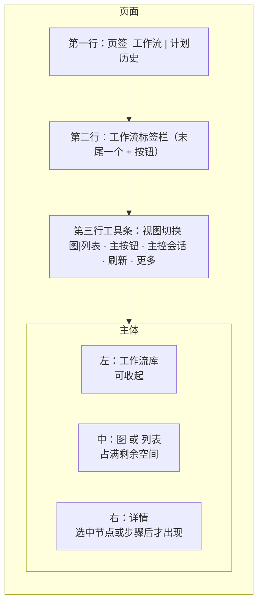
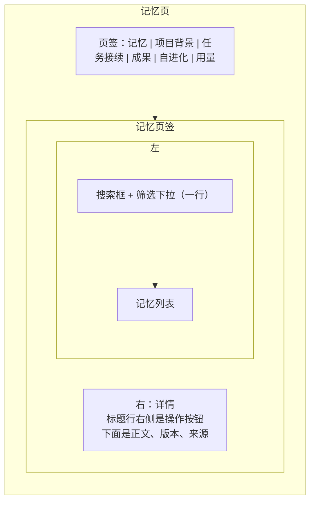

# 03 界面改版

核实日期：2026-11-15。先读[总览与通用规则](00-总览与通用规则.md)。
本分册所有路径相对 `D:\AI\workspace\pao-dev\desktop\apps\desktop\`（桌面应用目录）。“改前”截图在 [ui-screenshots](ui-screenshots/)。

本分册的版面与交互方案已由审核方定稿。实施方**按方案做，不重新设计**；觉得方案做不到或与测试冲突时停下回报，不自行换方案。

## 0. 本分册的专用规则

1. **`data-testid` 一律保留原名。** 元素换了位置，testid 跟着元素走。任务里明确写出的新增 testid 才可以新增。
2. **可以改测试的范围**只有每个任务“允许更新的测试”里列出的那几类改动（多点一次页签、改一句文案）。除此之外测试失败说明实现偏了，改实现不改测试。
3. **`tests/core/memory-evolution.spec.ts` 不许改。** 记忆页任务做完后它必须原样通过。
4. **只用已有的设计变量。** 颜色、间距、字号、圆角用 `src/styles/tokens.css` 里的变量（`--space-*`、`--text-*`、`--radius-*`、`--status-running/success/warning/error/neutral`、`--accent-tint-*` 等），不写新的十六进制颜色，不新增断点数值。窄窗断点统一用 `src/ui/narrow-viewport.ts` 的 `NARROW_VIEWPORT_WIDTH`（980）。
5. **只用已有的共享件。** 空状态用 `src/ui/empty-state.tsx`，字段展示用 `src/ui/detail-fields.tsx`，图标用 `src/ui/icons.tsx`，对话框焦点用 `src/ui/dialog-focus.ts`。不引入界面库。
6. **界面文字。** 产品已定为中文单语言。新增文字沿用所在文件的现有写法（该文件用 `t("English key")` 就继续用并在 `contracts/i18n-zh.ts` 补译文；该文件直接写中文就直接写中文）。不做全量文案迁移。
7. **每个界面任务完成后截图。** 在 1280×800 与 900×700 两个窗口尺寸、浅色主题下各截一张，深色主题 1280 再截一张，放到 `ui-screenshots/after/<任务编号>-<尺寸>.png`，回报里列出文件名。截图方式参照 `ui-screenshots/` 里现有的一次性 spec。
8. **与记忆任务书的协调。** U20—U24 会改 `src/features/memory/`。开始前在桌面仓执行 `git status -- apps/desktop/src/features/memory`：有别人未提交的改动时停下回报，等对方完成。

## 任务一览

| 编号 | 标题 | 优先级 | 依赖 |
|---|---|---|---|
| U01 | 窄窗时左侧栏自动收起 | P1 | — |
| U02 | 时间统一显示为中文相对时间 | P2 | — |
| U03 | 残留的上游文案与只适用于苹果电脑的设置页 | P2 | — |
| U04 | 定时任务编辑器：未保存时点背景不直接关闭 | P2 | — |
| U05 | 看板：窄窗布局与坏卡提示 | P2 | U01 |
| U06 | 对比面板的“重试”提示收拢成一个样式 | P3 | — |
| U10 | 工作流页：顶部瘦身，一行工具条 | P1 | U01 |
| U11 | 工作流页：画布占满，详情按需出现 | P1 | U10 |
| U12 | 工作流页：“步骤工作台”改为画布的“列表”视图 | P1 | U11 |
| U13 | 工作流页：状态颜色与状态名称统一 | P2 | U12 |
| U14 | 工作流页：拆分两个大组件文件 | P2 | U13 |
| U20 | 记忆页：顶部页签 | P1 | U01 |
| U21 | 记忆页：搜索与筛选移到列表上方，改两栏 | P1 | U20 |
| U22 | 记忆页：详情区整理与内部字样中文化 | P1 | U21 |
| U23 | 记忆页：操作按钮移到详情标题行 | P2 | U22 |
| U24 | 记忆页：拆分大文件 | P2 | U23 |

---

# 第一部分 界面基础

## U01 窄窗时左侧栏自动收起

**问题。** 窗口宽 900 时左侧栏仍占 236 像素，再加右侧面板，主区被挤到几乎看不见内容（截图 26、27：文字被挤成一字一行）。

**方案。** 窗口宽度不超过 980 时，左侧栏按“收起”显示；用户点侧栏开关时，侧栏以浮层方式盖在主区上方展开，点主区或按 Esc 收回。窗口变宽后恢复用户原来保存的展开/收起选择。**不改写用户保存的偏好。**

**允许修改：** `src/app/App.tsx`（`shellClassName` 附近与侧栏开关处理）、`src/styles/sidebar.css`、`tests/core/d5-workflow-layout.spec.ts`（仅新增用例）。

**实施步骤：**
1. `App.tsx` 里用 `useNarrowViewport()`（`src/ui/narrow-viewport.ts`）取 `narrow`。新增本地状态 `narrowSidebarOpen`（`useState(false)`），窗口从窄变宽时重置为 `false`。
2. 计算“实际是否收起”：`const sidebarCollapsed = narrow ? !narrowSidebarOpen : snapshot.sidebarCollapsed;`。`shellClassName` 以及传给侧栏、顶栏的收起状态都改用它；窄窗且展开时再追加类名 `shell--sidebar-overlay`。
3. 侧栏开关的处理函数：`narrow` 时只切换 `narrowSidebarOpen`，不调用保存偏好的接口；非窄窗时保持现有行为。
4. `sidebar.css` 新增：
   ```css
   .shell--sidebar-overlay { grid-template-columns: minmax(0, 1fr); }
   .shell--sidebar-overlay .sidebar {
     position: absolute; inset: 0 auto 0 0; z-index: <取值见下>;
     width: min(var(--sidebar-width), 80vw);
     box-shadow: var(--elevation-menu);
   }
   ```
   `z-index` 的取值：读 `src/styles/main.css` 里 `.extension-dialog-backdrop` 旁边的层级说明注释，选一个低于所有对话框、高于主区内容的值，并把这一层补进那段注释。
5. 窄窗展开时，点主区任意位置或按 Esc 把 `narrowSidebarOpen` 置回 `false`；在侧栏里选中一个会话或页面后也置回 `false`。

**验收：**
- 桌面基础检查通过；`tests/core/d5-workflow-layout.spec.ts`、`f-desktop-t22-a11y.spec.ts` 通过。
- 新增界面用例：窗口 900×700 → 侧栏不可见、主区宽度 ≥ 600 → 点 `sidebar-toggle` → 侧栏可见且主区宽度不变 → 按 Esc → 侧栏不可见 → 窗口调到 1280 → 侧栏按原偏好显示。
- 反面场景：在 1280 宽把侧栏手动收起，缩到 900 再放回 1280，侧栏仍是收起（偏好没被改写）。

---

## U02 时间统一显示为中文相对时间

**问题。** 会话列表显示英文 `now`、`1m`、`3m`（`src/lib/string-utils.ts` 约 21 行）；工作流库的运行记录直接显示 `2026-11-15T04:19:32.455Z`（截图 11）。

**方案。** 两处都用同一个函数，输出：不足 1 分钟“刚刚”，不足 1 小时“N 分钟前”，不足 24 小时“N 小时前”，不足 7 天“N 天前”，更早显示 `YYYY-MM-DD`；鼠标悬停提示显示完整本地时间 `YYYY-MM-DD HH:mm`。

**允许修改：** `src/lib/string-utils.ts`、`src/features/canvas/recipe-library.tsx`（运行记录时间那一处）、对应单元测试（`tests/unit/` 下测 `string-utils` 与 `recipe-library` 的 spec）。

**实施步骤：**
1. 找到 `string-utils.ts` 里返回 `"now"` 的函数，把它的各档输出改为上面的中文。函数名和签名不变。先搜索它的所有调用点，确认没有调用方拿返回值做比较（如 `=== "now"`）；有则停下回报。
2. 同文件新增 `formatAbsoluteTime(iso: string): string`，输出 `YYYY-MM-DD HH:mm`（本地时区）；无法解析时原样返回输入。
3. `recipe-library.tsx` 里显示运行记录时间的地方改用第 1 步的函数，并加 `title={formatAbsoluteTime(...)}`。运行记录名称（如 `临时-p-20261017-aa085d`）不动。

**允许更新的测试：** 断言里的 `now`/`1m` 等字样改为对应中文。

**验收：** 桌面基础检查通过；相关单元测试通过；新增单元用例覆盖五档边界（59 秒、60 秒、59 分、23 小时、6 天、8 天）与无法解析的输入。

---

## U03 残留的上游文案与只适用于苹果电脑的设置页

**问题。**
- 输入框占位文字的中文译文仍是“让 pi …”（`src/features/conversation/composer-panel.tsx` 约 211 行的英文键，对应 `contracts/i18n-zh.ts` 里的译文）。
- 设置 → 通知页（`src/features/settings/settings-notifications-section.tsx` 约 34—153 行）整页讲的是苹果电脑的通知授权，在 Windows 上没有意义，还写着 `pi-gui`。

**允许修改：** `contracts/i18n-zh.ts`（只改译文）、`settings-notifications-section.tsx`、因文案变化失败的测试断言。

**实施步骤：**
1. `i18n-zh.ts`：把该占位文字的译文改为“描述要做的事，或继续当前对话…”。再在该文件的**译文**里搜索“pi ”与“pi-gui”，把指代本产品的地方改为 PAO（与 D04 的范围不重叠：D04 管 `electron/`，这里管界面译文）。英文键不动。
2. 通知设置页：读 `window` 上已有的平台信息（搜索项目里现有的平台判断写法，如 `platform === "darwin"`，照用）。**不是苹果电脑时**，“System”这一组只显示一行说明：“通知由 Windows 的“设置 → 系统 → 通知”控制。”，不显示苹果电脑的授权状态和按钮。是苹果电脑时保持现状。

**验收：** 桌面基础检查通过；`tests/core/` 下文件名含 `settings` 的 spec 通过。在 Windows 上打开设置 → 通知，截图里没有“macOS”字样。反面场景：`i18n-zh.ts` 的差异里没有任何一行改动了冒号左边的英文键。

---

## U04 定时任务编辑器：未保存时点背景不直接关闭

**问题。** `src/features/scheduled-tasks/scheduled-task-editor.tsx` 约 216 行：`<div className="scheduled-editor-backdrop" onClick={onClose}>`。填了一半不小心点到对话框外面，内容全部丢失。

**方案。** 表单与打开时相比有改动时，点背景或按 Esc 先在对话框内显示一行确认：“有未保存的修改。[继续编辑] [放弃修改]”。没有改动时直接关闭。

**允许修改：** `scheduled-task-editor.tsx`、对应样式文件 `src/styles/scheduled-tasks.css`、`tests/core/` 下定时任务的 spec（新增用例）。

**实施步骤：**
1. 组件挂载时把初始表单值存进 `useRef`；用一个小函数比较当前表单值与初始值得到 `dirty`。
2. 新增 `requestClose()`：`dirty` 为假直接 `onClose()`；为真则把本地状态 `confirmingDiscard` 置真。背景点击、Esc、右上角关闭按钮都改走它。“取消”按钮也走它。
3. `confirmingDiscard` 为真时在对话框底部按钮区上方渲染确认行，两个按钮的 testid 为 `scheduled-task-discard-keep`、`scheduled-task-discard-confirm`。
4. 注意背景的点击事件：对话框内部的点击不得冒泡触发关闭（现有代码已处理则不动）。

**验收：** 桌面基础检查与定时任务 spec 通过。新增用例：改一个字段 → 点背景 → 对话框仍在且出现确认行 → 点“继续编辑” → 输入内容还在 → 再点背景 → 点“放弃修改” → 对话框关闭。反面场景：不改任何字段点背景，直接关闭、不出现确认行。

---

## U05 看板：窄窗布局与坏卡提示

**问题。**
- `src/styles/kanban.css` 工具条里搜索框最小宽 220、下拉框最小宽 160，窄窗时换行占掉大半屏；看板与详情并排（右栏最小 260），900 宽时卡片列只剩一列半。
- 坏卡提示横幅里同一个文件路径显示两遍（`kanban-board.tsx` 约 290—302 行、`src/features/task-status/task-status-rail.tsx` 约 551—555 行）。

**允许修改：** `src/styles/kanban.css`、`kanban-board.tsx`、`task-status-rail.tsx`（仅坏卡横幅）、看板 spec（新增用例）。

**实施步骤：**
1. `kanban.css`：在已有的窄窗媒体查询里（没有就新增 `@media (max-width: 980px)`）：`.kanban-search`、`.kanban-select` 的 `min-width` 改为 `0` 并 `flex: 1 1 120px`；`.kanban-layout` 改为单列，详情栏以覆盖层方式显示在看板上方（`position: absolute; inset: 0;` 加背景色），详情栏顶部要有“返回看板”按钮——先看组件里是否已有关闭详情的按钮，有就复用。
2. 坏卡横幅：先看两处渲染代码确认“路径显示两遍”的原因（多半是标题里拼了路径、正文又列了一遍）。改为：标题只写“N 张卡读不出来”，下面每张卡一行“文件名 — 原因”，完整路径放进 `title` 悬停提示。两处用同一个小组件，放在 `src/features/kanban/` 下，`task-status-rail.tsx` 引用它。

**验收：** 桌面基础检查通过；文件名含 `kanban` 的 core spec 与 `f-desktop-t21-tech-display.spec.ts` 通过。新增用例：900 宽下工具条高度不超过 96 像素；选中一张卡后详情可见、点“返回看板”后回到看板。反面场景：造一张坏卡，横幅文字里该文件名只出现一次。

---

## U06 对比面板的“重试”提示收拢成一个样式

**问题。** `src/features/workbench/diff-panel.tsx` 约 542—552 行与 717—737 行各有一段“说明文字 + 重试按钮”，样式不同；窄宽度下按钮文字被挤成竖排（截图 26）。

**允许修改：** `diff-panel.tsx`、`src/styles/main.css` 中 `.diff-panel__unavailable` 与 `.review-panel__issue` 相关规则（若在 `review.css` 则改那里）。

**实施步骤：** 两处都改用 `EmptyState`（`src/ui/empty-state.tsx`）渲染，把按钮作为它的操作项传入；`EmptyState` 不支持操作项时不改它，改为给两处套同一个类名 `panel-notice`，规则：`display:flex; flex-direction:column; align-items:flex-start; gap:var(--space-2);`，按钮 `white-space:nowrap; flex:none;`。两个 testid（`changed-files-unavailable`、`review-stale`/`review-issue`）和 `role="status"` 保留在原元素上。

**验收：** 桌面基础检查通过；`tests/core/changed-files.spec.ts` 与文件名含 `review` 的 spec 通过。900 宽截图里“重试”两字在同一行。

---

# 第二部分 工作流页

## 现状与目标版面

现状（截图 11、12、22）：页面顶部有三个页签“画布 / 步骤工作台 / 计划历史”。“画布”里从上到下是：工作流标签栏（含“＋新建工作流”）→ 大标题与说明 → 六七个按钮（又一个“新建工作流”）→ 左“工作流库”、中间画布、右“节点详情”三列。1280 宽时首屏看不到画布本身。“步骤工作台”是另一套页面：左列“主控会话 / 当前主控的计划 / 工作流库（又一份）”，右侧两行统计数字加步骤卡列表。两个页签都能暂停、恢复、确认、停卡、讨论，入口重复、状态名称是两套。

目标版面：



要点：
- 页面级页签从三个减为两个：“工作流”“计划历史”。原“步骤工作台”变成“工作流”页签里的“列表”视图，与“图”视图并列，是同一份工作流的两种看法。
- 标题和说明文字删掉。工具条只有一行。
- 一个主按钮，随当前选中内容变化：选中配方时是“启动工作流”，选中进行中的运行记录时是“暂停推进”，已暂停时是“人工恢复”。其余操作进“更多”菜单。
- 没选中节点时不显示右侧详情栏，画布占满。

U10—U13 分四步到达这个版面，每一步做完页面都可用、测试都通过。

## 工作流页的测试契约

以下内容被测试依赖，四个任务里都不得破坏（除任务明确列出的更新）：

- `tests/helpers/electron-app.ts` 的 `openWorkflowCards`（约 1909—1922 行）：依次点 `task-status-expand`、`task-status-open-workflow`、名字为“步骤工作台”的按钮，然后等 `workflow-cards` 可见。**U12 会改这个帮助函数的第三步**，其余 spec 不用动。
- `workflow-cards` 开头的全部 testid（`tests/core/workflow-cards.spec.ts` 用了六十多个）。
- `canvas-` 开头的全部 testid，以及 `recipe-library-filter-*`、`recipe-row-context-menu`、`workflow-owner-section`、`instance-edit-recipe`、`wizard-*`、`workflow-inspector`、`workflow-node`、`plan-*`。
- 单元测试直接渲染并断言文字的组件：`CanvasPageView`（`tests/unit/canvas.spec.ts`）、`RecipeLibrary`（`recipe-library.spec.ts`，断言“删除工作流”“在新标签中打开”“工作流运行中”“已打开的标签”“当前标签”“主控会话”“未登记”等）、`CanvasNodeDetailBody`（`canvas-node-detail.spec.ts`）。这些组件的导出名、属性名不改；这些文字不改。
- 这些导出的纯函数签名不改：`resolveEditorEntry`、`pullCanvasAfterStart`、`initialDetailSections`、`canvasWorkerAnchor`、`canvasSessionInput`、`canvasMinisterStatus`、`canvasInjectionPlan`、`canvasInjectionCommand`，以及 `workflow-cards-model.ts` 的全部导出。

每个任务开始前先跑一遍下面的“工作流回归集”并记录结果，完成后再跑一遍：

- 单元：`canvas.spec.ts`、`recipe-library.spec.ts`、`canvas-node-detail.spec.ts`、`workflow-cards-model.spec.ts`、`workflow-tabs.spec.ts`、`workflow-wizard.spec.ts`、`recipe-canvas-editor*.spec.ts`
- 界面：`workflow-cards.spec.ts`、`d5-workflow-layout.spec.ts`、`canvas-artifact-preview.spec.ts`、`batch3bu-script-editor.spec.ts`、`plan-recovery.spec.ts`、`f-desktop-t22-a11y.spec.ts`、`f-desktop-t23-instance.spec.ts`

---

## U10 工作流页：顶部瘦身，一行工具条

**允许修改：** `src/features/canvas/canvas-page.tsx`（仅 `CanvasPageView` 的页头部分，约 1470—1530 行）、`src/features/canvas/workflow-tabs.tsx`、`src/styles/canvas.css`、`tests/unit/canvas.spec.ts`（仅下述更新）。

**实施步骤：**
1. 删除页头的大标题和说明文字（`view-header` 里的标题与描述）。保留 `view-header` 这个容器作为工具条，高度一行。
2. “新建工作流”只留一个：保留工作流标签栏末尾的那个，改成只显示“＋”图标的按钮，`aria-label="新建工作流"`，`title="新建工作流"`，并把 testid `canvas-new-workflow` 挂到它上面。页头里原来的“新建工作流”按钮删除。标签栏按钮点击后调用的处理函数与原页头按钮相同。
3. 工具条从左到右排：
   - 主按钮（见第 4 步）
   - “主控会话”按钮（原 `canvas-open-master-session`，文字和行为不变）
   - 弹性空白
   - “刷新”（原 `canvas-refresh`，改成图标按钮，保留 `aria-label`）
   - “专注画布”（保留）
   - “更多”菜单按钮，testid `canvas-more`
4. 主按钮本任务先只做“启动工作流”（原 `canvas-start-workflow`，样式用主按钮样式）。运行记录的暂停/恢复仍在原来的 `WorkflowRuntimeControls` 里，本任务不动。
5. “画布最近读取 …”这类读取时间的小字移进“刷新”按钮的 `title` 悬停提示。读取失败的错误条（`canvas-top-error`）保留在工具条下方。
6. `canvas.css`：`.canvas-view` 的上下内边距改为 `var(--space-2)`，区块间距改为 `var(--space-2)`。

**允许更新的测试：** `canvas.spec.ts` 里若断言了被删除的标题或说明文字，删除那一条断言并在回报里列出；`canvas-new-workflow` 的断言不改（testid 还在，只是换了位置）。

**验收：**
- 桌面基础检查与工作流回归集通过。
- 1280×800 截图：从窗口顶到三列主体的顶边不超过 150 像素（改前约 300）。
- 页面里搜索可见文字“新建工作流”：只出现在一个按钮的悬停提示里。
- 反面场景：编辑器有未保存修改时点“＋”，仍弹出原来的“保存 / 放弃 / 取消”确认（离开守卫没被绕过）。

---

## U11 工作流页：画布占满，详情按需出现

**允许修改：** `canvas-page.tsx`（`CanvasPageView` 的三列布局部分，约 1590—1650 行）、`src/styles/canvas.css`（`.canvas-layout` 相关）、`tests/unit/canvas.spec.ts`（仅下述更新）。

**实施步骤：**
1. 右侧详情栏：**没有选中节点时不渲染详情栏的列**，`.canvas-layout` 用两列（库 + 画布）；选中节点后变三列。用一个修饰类 `canvas-layout--with-detail` 切换，不用内联样式。详情栏右上角加关闭按钮（testid `canvas-detail-close`），点击后取消节点选中。
2. 选中的是配方或运行记录、但没选节点时，原来详情栏里显示的“工作流级信息”（如运行控制 `WorkflowRuntimeControls`、归属信息 `workflow-owner-section`）改放到画布上方的一条窄信息条里（单行，可换行），不占右栏。**先核对**：若这些内容现在本来就只在选中节点时显示，则不需要这一步，在回报里说明。
3. 列宽：左库固定 `240px`，可收起（沿用现有的收起/展开，收起后留一个 `28px` 的窄条按钮）；右详情 `minmax(280px, 360px)`；中间 `minmax(0, 1fr)`。
4. 窄窗（`@media (max-width: 980px)`）：左库默认收起；详情栏以覆盖层显示在画布上方（占满主体区域），关闭按钮返回画布。
5. 空状态：什么都没选时，中间用 `EmptyState` 显示“选择左侧的工作流，或新建一个。”加一个“新建工作流”按钮（调用与“＋”相同的处理函数）；testid `canvas-dag-empty` 保留在原元素上。
6. 画布最小高度规则（`.workflow-graph { min-height: 380px }` 等）保留。

**允许更新的测试：** `canvas.spec.ts` 里断言“未选节点时详情栏存在”的用例，改为断言选中节点后存在；改了哪几条写进回报。

**验收：**
- 桌面基础检查与工作流回归集通过。
- 1280×800：选中一个有 5 个以上节点的配方，不滚动能看到完整的节点图；截图存档。
- 新增界面用例：未选节点时 `canvas-node-detail` 不存在 → 点一个节点后出现 → 点 `canvas-detail-close` 后消失、节点不再高亮。
- 反面场景：详情栏的“注入消息”输入框里有未发送内容时点关闭，仍触发原有的未保存确认（`injectionDirty` 的守卫没被绕过）。

---

## U12 工作流页：“步骤工作台”改为画布的“列表”视图

**方案细节。**
- 页面级页签改为两个：“工作流”“计划历史”。
- “工作流”页签的工具条最左侧加视图切换：`图 | 列表`（两个并排的小按钮，`aria-pressed` 标记当前项，testid `workflow-view-graph`、`workflow-view-list`）。
- “列表”视图里显示的就是现在的 `WorkflowCardsView`，组件本身保留，只做下面的减法。
- 两种视图继续同时挂载、用 `hidden` 切换（现状如此，保留，避免切换时丢失输入内容）。

**允许修改：** `src/features/workflow-cards/workflow-surface.tsx`、`src/features/workflow-cards/workflow-cards-view.tsx`（仅下述减法）、`src/features/canvas/canvas-page.tsx`（仅工具条接入视图切换）、`src/styles/workflow-cards.css`、`src/styles/canvas.css`、`tests/helpers/electron-app.ts`（仅 `openWorkflowCards`）、`tests/core/workflow-cards.spec.ts`（仅下述更新）。

**实施步骤：**
1. `workflow-surface.tsx`：
   - 页面级状态由 `"canvas" | "cards" | "history"` 改为两个：`tab: "workflow" | "history"` 与 `mode: "graph" | "list"`。
   - 页签按钮改为“工作流”“计划历史”两个。
   - `mode` 与设置它的函数经属性传给 `CanvasSurface` → `CanvasPage` → `CanvasPageView`，由工具条上的切换按钮使用。属性名 `viewMode`、`onViewModeChange`。
   - `mode === "list"` 时：隐藏画布的三列主体，显示 `WorkflowCardsView`；**画布的工作流标签栏与工具条保持显示**。实现方式：`CanvasPageView` 新增可选属性 `listView?: ReactNode`，`viewMode === "list"` 时在三列主体的位置渲染它（主体用 `hidden`）。
2. `workflow-cards-view.tsx` 做三处减法：
   - 左列第三节“工作流库”（约 657—670 行）删除。画布左侧已经有同一份。随之不再需要的 `getWorkflowCatalog` 请求与 `catalog` 状态一并删除；若 `catalog` 还被别处使用（例如“保存为模板”时检查重名），保留请求、只删这一节的显示。
   - 页头的大标题删除，面包屑（`workflow-cards-breadcrumb`）与流程状态（`workflow-cards-flow-status`）保留成一行。`workflow-cards-title` 这个 testid 被多个 spec 依赖：把它挂到面包屑里显示计划名称的那个元素上，文字内容保持与原标题一致。
   - 统计数字两行（步骤 / 运行中 / 等待前序 / 等待部长 / 待处理 / 待办）压成一行小号标签：数字为 0 的项不显示，“步骤总数”始终显示。各项的 testid（`workflow-cards-summary-{state}`、`-total`、`-open`、`-todos`）保留在各自元素上；为 0 时元素仍然渲染但加 `hidden` 属性。
3. “列表”视图里，原“打开主控会话 / 暂停推进 / 人工恢复 / 更多”按钮组保留在列表视图内部的右上角（testid 不变）。**本任务不把它们合并进画布工具条**，合并在 U13 之后单独评估。
4. 选中联动：在“图”视图选中一条运行记录后切到“列表”，列表应显示同一个计划。`WorkflowCardsView` 已有 `focus` 属性（跨页跳转到指定计划和步骤）。在 `workflow-surface.tsx` 里，当 `mode` 从 `graph` 切到 `list` 且画布当前选中的是运行记录时，按 `focus` 的现有类型构造一个值传入。对不上计划（例如选中的是配方）时不传，列表保持自己上次的选择。
5. `openWorkflowCards` 帮助函数：第三步由点名为“步骤工作台”的按钮，改为点 `workflow-view-list`。

**允许更新的测试：** `openWorkflowCards` 的那一步；`workflow-cards.spec.ts` 等 spec 里断言“工作流库”出现在工作台左列的断言（删除并列出）；直接按名字点“步骤工作台”“画布”按钮的地方改为点 `workflow-view-list`、`workflow-view-graph`（逐处列出）。

**验收：**
- 桌面基础检查与工作流回归集通过。
- 新增界面用例：在“图”视图点一条运行记录 → 点 `workflow-view-list` → `workflow-cards-title` 显示该运行对应的计划名 → 点 `workflow-view-graph` → 画布仍选中同一条运行记录。
- 在整个工作流页搜索可见文字“工作流库”：只出现一次。
- 反面场景：在列表视图的意见输入框里输入文字，切到图再切回，文字还在。
- 反面场景：选中配方（不是运行记录）切到列表，列表不报错，显示它原有的计划或空状态。

---

## U13 工作流页：状态颜色与状态名称统一

**问题。** `src/styles/canvas.css` 里节点状态色直接写十六进制颜色（约 281—297、639—665、730—747 行，`#2f80ed`、`#27ae60`、`#f2c94c`、`#f2994a`、`#d63031`），深色主题下不跟随；列表视图（`workflow-cards.css`）用的是 `--status-*` 变量。两边同一个状态颜色不同。状态名称也是两套：画布 `cardStatusLabel`（`canvas-model.ts` 约 570 行，六种）与列表 `STEP_CARD_STATE_LABELS`（`workflow-cards-model.ts`，十二种）。

**决定。** 列表的十二种状态判断（`resolveStepState`）保留不动，它是把内核的多个原始字段合成一个显示状态的最后一步，内核没有等价字段。本任务只统一颜色，以及两套名称里**含义相同的那几项**的用词。

**允许修改：** `src/styles/canvas.css`、`src/features/canvas/canvas-model.ts`（仅 `cardStatusLabel` 的文字）、因文字变化失败的断言。

**实施步骤：**
1. `canvas.css`：把上述三段里的状态色换成变量。对应关系：

   | 原颜色 | 含义 | 换成 |
   |---|---|---|
   | `#2f80ed` | 进行中 | `var(--status-running)` |
   | `#27ae60` | 已完成 | `var(--status-success)` |
   | `#f2c94c`、`#b98900` | 等待 | `var(--status-warning)` |
   | `#f2994a` | 需要处理 | `var(--status-warning)` |
   | `#d63031` | 失败 | `var(--status-error)` |
   | 灰色（未开始） | 未开始 | `var(--status-neutral)` |

   “等待”和“需要处理”换成同一个变量后颜色相同，靠图标和文字区分；若该处没有图标或文字、只靠颜色区分，停下回报。
2. 同文件里 `var(--accent, #4b7bec)` 这种“变量加备用颜色”的写法，去掉备用颜色只留 `var(--accent)`。`#8885`、`#8886` 这类半透明灰边框换成 `var(--border-light)`。
3. 名称：对照两张表，画布六种里与列表含义相同的项，文字改成与列表一致（以 `STEP_CARD_STATE_LABELS` 的译文为准）。逐项列出“画布原文字 → 新文字”写进回报；含义对不上的项不改。

**验收：**
- 桌面基础检查与工作流回归集通过。
- 在 `canvas.css` 搜索 `#[0-9a-fA-F]{3,8}`：剩余每一处都在回报里说明为什么保留（例如阴影）。目标是从 64 处降到 10 处以内。
- 深色主题截图：五种状态的节点边框颜色与列表视图同状态标签颜色一致。

---

## U14 工作流页：拆分两个大组件文件

`canvas-page.tsx` 2901 行，`workflow-cards-view.tsx` 2620 行。按下面的切分线**原样搬移**，不改逻辑。规则见[大文件拆分](04-大文件拆分.md)第 0 节“纯搬移规则”。

**`canvas-page.tsx` 拆成：**

| 新文件（同目录） | 搬入内容 |
|---|---|
| `canvas-page-model.ts` | `dagNodesFor`、`canvasNodeCardRefs`、`discussNodeInstruction`、`stopNodeCardsInstruction`、`initialDetailSections`、`CanvasSessionTarget`、`canvasWorkerAnchor`、`canvasSessionInput`、`canvasMinisterStatus`、`CanvasInjectionPlan`、`canvasInjectionPlan`、`canvasInjectionCommand`、`resolveEditorEntry`、`pullCanvasAfterStart`、`CanvasSelection` |
| `canvas-node-actions.tsx` | `CanvasNodeActions` |
| `canvas-dag-panel.tsx` | `CanvasDagPanel` |
| `canvas-detail-panel.tsx` | `CanvasDetailPanel`、`CanvasNodeDetailBody` |
| `canvas-page-view.tsx` | `CanvasPageView`、`CanvasPageViewProps` |
| `canvas-page.tsx`（保留） | `CanvasPage` 本体；文件末尾 `export * from` 上面五个文件，保证现有导入路径全部可用 |

**`workflow-cards-view.tsx` 拆成：**

| 新文件（同目录） | 搬入内容 |
|---|---|
| `step-card-list.tsx` | `StepCardList`、`StepCard` 及其属性类型 |
| `step-output-list.tsx` | `OutputGroup`、`OutputList` |
| `step-detail.tsx` | `StepDetail`、`FilePreview` 及其属性类型 |
| `plan-workspace.tsx` | `PlanWorkspace`、`PlanWorkspaceProps` |
| `workflow-cards-view.tsx`（保留） | `WorkflowCardsView` 与文件顶部常量 |

**顺带两处去重（唯一允许的逻辑改动）：**
1. `src/features/plans/temporary-plans-view.tsx` 约 21 行自己写的 `FEEDBACK_STATUS_ORDER` 删除，改为从 `workflow-cards-model.ts` 导入同名常量。先比对两份内容逐项相同；不同则停下回报。
2. `stopNodeCardsInstruction`（画布）与 `stopCardInstruction`（`workflow-cards-model.ts`）：比对两者生成的文字。完全相同则画布改为调用后者；不同则不动，回报里列出差异。

**验收：** 桌面基础检查与工作流回归集通过；`canvas-page.tsx` 不超过 1200 行，`workflow-cards-view.tsx` 不超过 900 行；用 `git diff --stat` 与抽查证明搬移的函数体没有改动（回报里写抽查了哪三个函数）。`pnpm check:architecture` 通过（新文件没有引入不允许的依赖方向）。

---

# 第三部分 记忆页

## 现状与目标版面

现状（截图 05、06）：三栏。左栏是搜索和一排下拉筛选。中栏从上到下堆了五样东西：提示条、删除恢复、项目背景（可折叠）、任务接续（可折叠）、成果（可折叠），最后才是记忆列表。右栏是详情，下面恒定挂着六个面板（管理、来源、使用情况、活动、任务用量、上下文用量）。“自进化”没有入口，要在左栏“类型”下拉里选才出现。

目标版面：



要点：
- 六个页签各管一件事。项目背景、任务接续、成果不再压在列表上面。
- “记忆”页签两栏：左边搜索、筛选和列表，右边详情。
- “自进化”有了看得见的入口；原来“类型下拉选自进化”的方式继续有效，两者是同一个状态。
- 详情只放与选中这条记忆有关的内容；整个项目范围的统计移到“用量”页签。

## 记忆页的测试契约

- `tests/core/memory-evolution.spec.ts` **不许改，且必须通过**。它通过标签为“类型”的下拉框选择 `value="evolution"` 的选项进入自进化，并使用 `evolution-*` 开头的 testid。
- 下列 testid 全部保留原名：`memory-page`、`memory-list`、`memory-list-item`、`memory-detail`、`memory-source-link`、`memory-source`、`memory-usage`、`memory-page-notice`、`memory-project-context*`、`memory-task-continuations*`、`memory-artifacts-toggle`、`artifact-detail*`、`memory-action-correct`、`memory-action-merge`、`memory-action-usage`、`memory-action-delete`、`memory-correction-form`、`memory-merge-form`、`memory-delete-preview`、`memory-delete-confirm`、`memory-deletion-status`。
- 这些可见文字被断言：“搜索”“加载更多”“返回列表”“筛选”“关闭筛选”“尚未设置项目目标”“本项目 1 条任务接续”。除 U22 映射表列出的以外，一律不改。
- `tests/unit/memory-page.spec.ts` 只测导出的纯函数，这些函数的名字和签名不改。

“记忆回归集”（每个任务前后各跑一遍）：
- 单元：`memory-page.spec.ts` 以及 `tests/unit/` 下其他文件名含 `memory` 的 spec
- 界面：`memory.spec.ts`、`memory-management.spec.ts`、`memory-evolution.spec.ts`、`memory-artifacts.spec.ts`、`memory-usage-panels.spec.ts`、`memory-deletion-host.spec.ts`

---

## U20 记忆页：顶部页签

**允许修改：** `src/features/memory/memory-page.tsx`、`src/styles/memory.css`、新增 `src/features/memory/memory-tabs.tsx`、`tests/core/memory*.spec.ts`（`memory-evolution.spec.ts` 除外，且仅下述更新）。

**页签定义：**

| 页签 | testid | 内容 |
|---|---|---|
| 记忆 | `memory-tab-memories` | 列表 + 详情（本任务先保持现有三栏，U21 再改两栏） |
| 项目背景 | `memory-project-context-toggle`（沿用原名） | `MemoryProjectContext` |
| 任务接续 | `memory-task-continuations-toggle`（沿用原名） | `MemoryTaskContinuation` |
| 成果 | `memory-artifacts-toggle`（沿用原名） | `MemoryArtifacts` 列表 + `ArtifactDetail` |
| 自进化 | `memory-tab-evolution` | `EvolutionProblemList` + `EvolutionDetail` |
| 用量 | `memory-tab-usage` | 见第 5 步 |

三个原有的“展开/收起”开关直接变成页签按钮，沿用原 testid，这样多数测试不用改。

**实施步骤：**
1. 新增状态 `tab`，取值 `"memories" | "project" | "tasks" | "artifacts" | "usage"`。**“自进化”不单独存状态**：当 `filters.kind === "evolution"` 时，显示上视为自进化页签被选中。点“自进化”页签等于把 `filters.kind` 设为 `"evolution"` 并把 `tab` 设为 `"memories"`；点“记忆”页签时若 `filters.kind === "evolution"` 则把它清回“全部”。这样“类型”下拉与页签始终一致。
2. 新建 `memory-tabs.tsx`：一行页签按钮，`role="tablist"`，每个按钮 `role="tab"`、`aria-selected`。三个沿用原 testid 的按钮另外加 `aria-expanded`（值等于是否选中），因为原测试可能断言它。
3. 页签栏放在 `memory-page` 容器内最顶部，占一整行。`.memory-page` 改为上下两行的网格：第一行页签，第二行内容。
4. 内容区按页签渲染：
   - `memories` 与自进化：现有的左栏、中栏（去掉下面三样）、右栏。
   - `project` / `tasks` / `artifacts`：把对应组件从中栏搬出来，在内容区单独渲染，内容区最大宽度 `960px`、居中。组件原来由“展开”状态控制的详情部分，在页签选中时一律按“已展开”渲染（把原来的展开状态变量换成 `tab === "..."`）。“成果”页签：左边成果列表、右边 `ArtifactDetail`，两栏。
   - 提示条（`memory-page-notice`）与删除恢复（`MemoryDeletionRecovery`）放在页签栏下方、所有页签都能看到。
5. “用量”页签：把右栏下方那些**不依赖当前选中记忆**的面板搬进来。判断方法：看 `MemoryUsagePanel`、`MemoryActivityPanel`、`MemoryTaskUsagePanel`、`MemoryContextUsagePanel` 各自的属性，属性里没有“当前选中的记忆或其编号”的就是项目范围的面板，搬进“用量”页签；有的留在详情下方。`MemoryManagement` 与 `MemorySourcePanel` 留在详情下方。搬了哪几个写进回报。
6. 页签上的数量提示：原开关上若显示数量（如“本项目 1 条任务接续”），这段文字保留在对应页签的内容区顶部，不放进页签按钮。

**允许更新的测试：**
- 原来点一次开关展开、再断言内容的用例：不用改。
- 原来点第二次开关断言“收起”的用例：改为点 `memory-tab-memories` 后断言内容不可见。
- 断言用量面板的用例（主要在 `memory-usage-panels.spec.ts`）：在断言前加一步点 `memory-tab-usage`。
- 逐处列进回报。

**验收：**
- 桌面基础检查与记忆回归集通过，其中 `memory-evolution.spec.ts` 未作任何修改。
- 新增界面用例：
  1. 点 `memory-tab-evolution` → “类型”下拉的值变为 `evolution`，自进化列表可见。
  2. 用“类型”下拉选回别的类型 → “记忆”页签变为选中。
  3. 切到“项目背景”再切回“记忆” → 之前选中的那条记忆仍然选中，详情还在。
- 反面场景：在“项目背景”页签的目标编辑框里输入未保存的文字，切到别的页签再切回，文字还在（实现方式：各页签内容用 `hidden` 切换而不是卸载；若现有组件卸载后本来就不保留，则保持现状并在回报里说明）。

---

## U21 记忆页：搜索与筛选移到列表上方，改两栏

**允许修改：** `memory-page.tsx`、`src/styles/memory.css`（三栏、左栏、中栏、断点几段）、`tests/core/memory*.spec.ts`（`memory-evolution.spec.ts` 除外，仅下述更新）。

**实施步骤：**
1. “记忆”与“自进化”页签的内容区改为两栏：`grid-template-columns: minmax(300px, 380px) minmax(0, 1fr)`。
2. 原左栏 `aside.memory-filters` 搬到列表栏的最上方，成为一个横向的筛选条：
   - 第一行：搜索输入框 + “搜索”按钮（原来是提交表单才搜索，行为不变，按钮文字“搜索”不变）。
   - 第二行：各个下拉筛选横向排列、可换行，每个下拉框上方的文字标签保留（“类型”这个标签必须保留，`memory-evolution.spec.ts` 靠它找下拉框）。
   - `aside` 元素与它的类名保留，只改它在页面结构里的位置和样式。
3. **宽度 1180 以下的现有行为不变**：筛选条收成一个“筛选”按钮，点开是抽屉，“关闭筛选”收回（现有 `filtersOpen` 逻辑和这两段文字都保留）。只需要把 1180 以上“左栏常驻”的样式改成“列表上方常驻”。
4. 宽度 760 以下的现有行为不变（列表与详情先后两屏，“返回列表”）。
5. 列表项：每项固定三行——第一行标题（单行截断），第二行摘要（最多两行截断），第三行小字（类型 · 状态 · 更新时间，时间用 U02 的中文相对时间）。现有列表项里的其他元素（如版本号标记）并入第三行。`memory-list-item` 的 testid 和点击行为不变。
6. 删除 `memory.css` 里因此不再使用的三栏规则。

**允许更新的测试：** 无预期更新。若某个用例因为筛选条位置变化找不到元素，先检查是不是实现改动了元素的标签或 testid；确实只是位置原因导致的可见性等待失败，逐条回报后再改。

**验收：**
- 桌面基础检查与记忆回归集通过，`memory-evolution.spec.ts` 未修改。
- 1280×800 截图：列表首屏能看到至少 6 条记忆（改前约 2—3 条）。
- 1100×700：出现“筛选”按钮，点开、关闭正常。
- 反面场景：筛选条件非默认时，筛选条上有可见提示（现有若已有“已筛选”标记则保留；没有则在“筛选”按钮文字后加数量，如“筛选（2）”）。

---

## U22 记忆页：详情区整理与内部字样中文化

**问题。** 详情标题字号过大（`memory.css` 约 263—267 行，最大到 `--text-2xl`）；界面上直接显示 `r1`、`r2`、事件类型英文名、会话编号、条目编号等内部字样；已经写好的中文映射函数没有接上。

**允许修改：** `src/features/memory/` 下的 `memory-detail.tsx`、`memory-list.tsx`、`memory-source.tsx`、`memory-management.tsx`、`artifact-detail.tsx`、`src/styles/memory.css`、`tests/core/memory*.spec.ts`（`memory-evolution.spec.ts` 除外，仅映射表内的更新）。

**文字映射表（界面文字与测试断言都按此改）：**

| 位置 | 改前 | 改后 |
|---|---|---|
| 列表项、详情、管理区的版本标记 | `r{n}` | `第 {n} 版` |
| 详情当前版本说明 | `当前修订 r{n}` | `当前版本：第 {n} 版` |
| 详情历史版本说明 | `历史修订 r{n} · 只读` | `历史版本：第 {n} 版（只读）` |
| 版本切换按钮（`.memory-revisions button`） | `r{n}` | `第 {n} 版` |
| 项目目标保存提示 | `目标已保存为修订 r{n}` | `目标已保存为第 {n} 版` |
| 成果版本标记（`artifact-detail.tsx`） | `v{seq}` | `第 {seq} 版` |
| 其余出现“修订”一词的界面文字 | 修订 | 版本 |

**实施步骤：**
1. 开始前先在 `tests/core/memory-evolution.spec.ts` 里搜索 `r1`、`r2`、`修订`、`v1`。**若该文件断言了映射表“改前”一列的任何文字，停下回报**（该文件不许改）。
2. 按映射表改界面文字。在 `src/features/memory/` 下新增一个小函数 `revisionLabel(n: number): string` 返回 `第 n 版`，各处统一调用，不各写一遍。
3. 来源面板（`memory-source.tsx` 约 145—146、216—218 行）：
   - 事件类型改用 `memory-detail.tsx` 里已有的 `sourceTypeLabel` 显示中文（把该函数移到一个两处都能导入的位置，或从 `memory-detail.tsx` 导出）。映射里没有的类型显示“其他来源”，并把原始值放进 `title`。
   - 会话编号、条目编号从正文移进一个默认折叠的 `<details>`，标题“技术信息”。
4. 删除预览里直接显示的枚举值，改用 `memory-management-model.ts` 里已有的 `describe*` 函数（约 45—99 行）。
5. 详情里用 `<code>` 直接显示的记忆编号：同样移进“技术信息”折叠区，并加一个“复制编号”按钮（用项目里已有的复制写法，搜索 `navigator.clipboard` 找先例）。
6. 详情标题字号：`.memory-detail__header h1` 改为 `font-size: var(--text-lg); font-weight: var(--font-semibold); line-height: 1.35;`，最多显示三行后截断，完整标题放 `title`。
7. 详情区从上到下的顺序固定为：标题行 → 一行属性小字（类型 · 状态 · 当前版本 · 更新时间）→ 正文 → 版本切换 → 来源 →（U20 判定为留在详情的面板）→ 技术信息。区块之间用 `var(--space-4)` 间距和一条 `var(--border-light)` 分隔线，不再给每个区块套带边框的卡片。

**验收：**
- 桌面基础检查与记忆回归集通过，`memory-evolution.spec.ts` 未修改。
- 在 `src/features/memory/` 下搜索模板字符串 `` `r${ `` 与 `` `v${ ``：除 `evolution-detail.tsx`（本任务不改它）外没有结果。
- 截图里详情首屏看不到英文事件类型名和长编号。
- 反面场景：造一条来源事件类型不在映射里的记忆，来源面板显示“其他来源”，不显示空白也不报错。

---

## U23 记忆页：操作按钮移到详情标题行

**问题。** 纠正、合并、停用、删除四个按钮在详情下方的“管理”面板里，内容一长就要滚到很下面才看得到。

**方案。** 四个按钮移到详情标题行的右侧。“纠正”“合并”是普通按钮；“停用/恢复”是普通按钮；“删除”用危险样式并排在最右。四个按钮的 testid 不变、都直接可见（不收进菜单，避免多一次点击，也让现有测试不用改）。点“纠正”或“合并”后，表单显示在标题行正下方、正文上方。删除的预览与确认保持现有流程。

停用是可以恢复的操作，不加二次确认；操作后在页面提示条里显示结果（现有行为）。

**允许修改：** `memory-page.tsx`、`memory-management.tsx`、`memory-detail.tsx`、`src/styles/memory.css`。

**实施步骤：**
1. `MemoryManagement` 现在既渲染按钮也渲染表单。给它加一个属性 `placement: "header-actions" | "forms"`：前者只渲染四个按钮，后者只渲染当前打开的表单或删除预览。状态（当前打开哪个表单）提升到 `memory-page.tsx` 或用一个小的自定义 hook 在两处共享。
2. `memory-detail.tsx` 的标题行接受一个 `actions` 插槽属性，由 `memory-page.tsx` 传入 `<MemoryManagement placement="header-actions" />`；标题行下方渲染 `<MemoryManagement placement="forms" />`。
3. 窄窗（760 以下）标题行放不下时，按钮换到标题下一行，横向排列可换行。
4. 查看历史版本（只读）时四个按钮的禁用规则保持现状。

**验收：**
- 桌面基础检查与记忆回归集通过，测试文件无改动。
- 1280×800：选中一条正文很长的记忆，不滚动能看到四个操作按钮。
- 反面场景：打开“纠正”表单并输入内容，切换到另一条记忆 → 行为与改前一致（改前会丢弃就丢弃，改前会提示就提示），回报里写明是哪种。

---

## U24 记忆页：拆分大文件

按下面的切分线**原样搬移**，规则见[大文件拆分](04-大文件拆分.md)第 0 节。`evolution-detail.tsx` 属于自进化在途范围，本任务不拆。

| 原文件 | 新文件（同目录） | 搬入内容 |
|---|---|---|
| `memory-page.tsx` | `use-memory-list.ts` | 列表加载、分页、筛选、选中相关的状态与副作用，做成一个自定义 hook，返回值是原来那些状态和处理函数 |
| | `memory-filter-bar.tsx` | 筛选条的渲染 |
| | `memory-page.tsx`（保留） | 页签、布局、把各部分接起来 |
| `memory-management.tsx` | `memory-correction-form.tsx` | 纠正表单 |
| | `memory-merge-form.tsx` | 合并表单 |
| | `memory-delete-preview.tsx` | 删除预览与确认 |
| | `memory-deletion-recovery.tsx` | `MemoryDeletionRecovery` |
| | `memory-management.tsx`（保留） | `MemoryManagement` 外壳；文件末尾重新导出 `MemoryDeletionRecovery` |
| `src/styles/memory.css` | `memory-management.css` | 管理与删除相关规则 |
| | `memory-context.css` | 项目背景与任务接续相关规则 |
| | `memory-usage.css` | 用量面板相关规则 |
| | `memory.css`（保留） | 页签、列表、详情、断点 |

样式文件拆出后，在 `src/styles/styles.css` 里紧跟 `memory.css` 那一行之后按上表顺序登记，保证先后顺序与拆分前在同一文件内的顺序一致。媒体查询里的规则跟着它所属的选择器走；一个媒体查询块里有多类规则时，在各新文件里各写一个同条件的媒体查询块。

**验收：** 桌面基础检查与记忆回归集通过；`memory-page.tsx` 不超过 450 行、`memory-management.tsx` 不超过 500 行、`memory.css` 不超过 900 行；1280 与 760 两个宽度的截图与 U23 完成时的截图逐像素一致或肉眼无差异（回报里附对比）。

---

## 审核发现但本批不立任务的事项

| 事项 | 位置 | 原因 |
|---|---|---|
| 界面文字一半走词典、一半直接写中文 | 画布相关组件为主 | 产品已定中文单语言，统一写法没有用户可见收益；新代码按所在文件现有写法即可 |
| 终端面板、工作流两种视图隐藏时仍然挂载 | `terminal-panel.tsx`、`workflow-surface.tsx` | 为保留输入内容与终端输出的有意设计；终端性能问题由 D03 解决 |
| 断点数值有十余种 | 各样式文件 | 逐个统一风险高、收益小；本批只要求新代码用 980 |
| 把暂停/恢复/确认并入画布工具条的唯一主按钮 | 工作流页 | U12 之后图与列表各有一组控制按钮，是否合并等用过新版面后再定 |
| 列表视图的属性传递过宽（单个组件八十多个属性） | `plan-workspace.tsx` | 需要引入共享上下文，属于重构而非搬移，等 U14 完成后单独评估 |
| `detectDraftConflict`、`canSubmitDraft`、`scopeStillExists` 在界面里未见调用 | `workflow-cards-model.ts` | 未确认是否只被单元测试使用；不在本批删除 |
