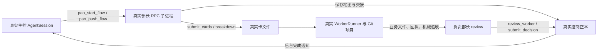

# G 四部门离线闭环

日期：2026-10-22

## 结论

完整四部门离线集成回归已通过：

```text
Test Files  1 passed (1)
Tests       4 passed (4)
Duration    210.17s
```

四个用例都从真实工具入口启动，经过真实 `AgentSession`、`MinisterHost`、部长 RPC 子进程、`WorkerRunner`、Git 业务项目、控制正本、卡、回执、机械验收、负责部长审核和最终 decision，最终进入 `completed`。

本轮覆盖：

| 场景 | 结果 | 用时 |
|---|---:|---:|
| 基线：侦察 → 规划 → 实施 → 审核 | 通过 | 45.436s |
| 非法验收 → 当场纠正 | 通过 | 49.164s |
| 侦察部长失联 → 原实例恢复 | 通过 | 49.539s |
| 业务地图变更 → 刷新并贯穿下游 | 通过 | 52.038s |

因此原修复计划要求的四条主线均已完成。当前没有阻碍完整四部门闭环的已知问题，也没有发现需要主控跨文件处理的新产品缺陷。

## 文件范围

本批只新增或修改以下测试与夹具：

```text
PAO/packages/coding-agent/test/pao/workflow-four-department-real.test.ts
PAO/packages/coding-agent/test/pao/fixtures/workflow-four-department-minister.ts
PAO/packages/coding-agent/test/pao/fixtures/workflow-four-department-worker.ts
```

三者在 `PAO` 仓库中均为未跟踪的新文件：

```text
?? test/pao/workflow-four-department-real.test.ts
?? test/pao/fixtures/workflow-four-department-minister.ts
?? test/pao/fixtures/workflow-four-department-worker.ts
```

专属类型检查配置位于本批临时目录：

```text
D:/AI/workspace/临时文件夹/PAO具体故障修复-20261022/G-四部门闭环-tsconfig.json
```

没有修改产品文件，没有修改现有测试，没有安装依赖，没有执行 build，没有使用正式 `PAO_HOME`。

## 真实链路



主控使用真实 PAO 扩展工具，包括：

```text
pao_start_flow
pao_push_flow
pao_query_flow
pao_inventory
```

`FourDepartmentMinisterHost` 继承真实 `MinisterHost`，只把子进程入口指向仓内部长夹具；RPC 启动、会话、后台任务、恢复、投递和关闭仍走真实宿主。

`FourDepartmentWorkerRunner` 继承真实 `WorkerRunner`，只把执行入口指向仓内 worker 夹具；worker 进程、Git 改动检测、业务文件、回执和机械验收仍走真实执行链。

没有：

- mock `host.executeTask`
- 替换 `runAutoChain`
- 替换 workflow、卡、回执、验收或 decision 控制函数
- 手写卡、回执或 `delivered` 状态
- 放宽 Git 越界检查

## 模型替身与隔离

主控、部长和 worker 都显式使用仓内 `fauxProvider`。模型运行时均设置：

```ts
allowModelNetwork: false
```

替身只产生确定的模型响应和工具调用。所有业务动作仍由真实内核执行。

本批没有：

- 联网
- 读取真实模型凭证
- 调用付费模型
- 使用正式 `PAO_HOME`

每次用例分别创建三个独立临时根：

```text
pao-four-department-project-*   Git 业务项目
pao-four-department-home-*      隔离 PAO_HOME
pao-four-department-control-*   RPC 协调与场景信号
```

隔离 `PAO_HOME` 不与 Git 业务项目共用根目录，避免宿主用量、监督账等文件被 worker 误判为业务改动。

## 确认过的关键修正

worker 夹具已导入 `ModelRuntime`，排除了启动阶段的未定义标识符错误。

模型替身的响应会追加下一轮 responder，不会因固定响应数量耗尽而在后台完成通知时失败。完整回归确认四个用例都收到了完成通知并产生明确结束文本。

工具调用判断使用“本次最新 user 任务之后的调用集合”，不只看最后一条 assistant 消息，也不依赖额外持久状态。这样能正确处理：

```text
侦察 map → breakdown → map
实施 submit_cards → breakdown → submit_cards
审核 review_worker → submit_decision
```

部长请求按四类互斥分支结束：

1. 初始化拆解；
2. 工人结果 review；
3. 节点 decision；
4. 普通结果通知。

每个工具成功一次后直接返回结束文本；普通完成通知只读取并结束，不会继续落入拆卡或交卡。

非预期工具错误会立即抛出。唯一例外是非法验收场景中精确匹配的正式 `[INVALID_CARD]` 绝对路径错误，用于验证“先拒绝、再由真实推流纠正”的恢复分支。

失败现场会先复制到证据目录，再尝试清理临时根。`stopAll`、`dispose`、证据复制和清理错误不会被吞掉；清理失败会显式抛出并保留现场。

## 场景证据

### 基线成功闭环

断言包括：

- 四个部门都真实运行；
- 侦察和规划地图按流程保存并形成交接；
- 部长真实调用 `submit_cards` 和 breakdown；
- worker 写出业务文件并产生真实回执；
- 卡正文包含机械验收；
- 实施结果只投直属上级；
- 负责部长完成 review；
- 审核部长提交 decision；
- 两张卡均为 `delivered`；
- worker registry 中无运行中实例；
- 控制状态最终为 `completed`。

证据目录：

```text
.pao/具体故障修复-20261022/G-四部门离线闭环-evidence/
  passed-success-2026-10-22T09-11-51.100Z/
```

### 非法验收后当场纠正

实施部长先通过真实 `pao_minister_submit_cards` 提交绝对路径验收。测试确认：

- 正式卡数量仍为 0；
- 实施节点 `拆解结束 === false`；
- 轨迹包含 `illegal-acceptance-rejected` 和 `禁绝对路径`；
- 主控随后真实调用 `pao_push_flow`；
- 部长提交修正卡；
- 后续 worker、回执、机械验收、review、decision 和完成均通过。

证据目录：

```text
.pao/具体故障修复-20261022/G-四部门离线闭环-evidence/
  passed-illegal-acceptance-2026-10-22T09-12-40.341Z/
```

### 部长失联后原实例恢复

侦察地图已写入控制正本，但尚未写入 breakdown。此时测试记录旧会话、轮次和 PID，然后通过真实 `host.teardown(...)` 终止侦察部长 RPC。测试确认：

- 旧 PID 已退出；
- `hotSession` 已消失；
- 主控真实调用 `pao_push_flow`；
- 新 PID 被重建；
- 会话标识与轮次保持不变；
- 新 RPC 从控制正本读到当前地图，没有误判为首次地图保存；
- 恢复后仍由同一实例完成全流程。

证据目录：

```text
.pao/具体故障修复-20261022/G-四部门离线闭环-evidence/
  passed-lost-minister-2026-10-22T09-13-29.855Z/
```

### 业务地图变更后刷新

侦察先保存第一版地图，然后修改受 Git 跟踪的业务输入 `业务/输入.txt`。主控真实调用 `pao_push_flow` 后，测试确认：

- 侦察保存第二版地图；
- 第二版 `previous_ref` 指向第一版；
- 第二版包含 `supersession_reason`；
- 规划地图事实包含修改后的输入；
- 实施卡 `frontmatter.inputs` 引用最新规划地图；
- 刷新后的流程继续完成四部门闭环。

证据目录：

```text
.pao/具体故障修复-20261022/G-四部门离线闭环-evidence/
  passed-map-refresh-2026-10-22T09-14-21.904Z/
```

四个最终成功现场共保留 434 个文件、约 1.19 MB。本批此前的失败现场也全部保留，没有删除。

## 实际命令与结果

工作目录：

```text
D:/AI/workspace/pao-dev/PAO/packages/coding-agent
```

完整回归：

```powershell
& 'C:\Program Files\nodejs\node.exe' `
  '..\..\node_modules\vitest\vitest.mjs' `
  run 'test/pao/workflow-four-department-real.test.ts' `
  --reporter=verbose
```

实际结果：

```text
Test Files  1 passed (1)
Tests       4 passed (4)
Duration    210.17s
```

定向 TypeScript 检查：

```powershell
$output = & 'C:\Program Files\nodejs\node.exe' `
  'D:\AI\workspace\pao-dev\PAO\node_modules\typescript\bin\tsc' `
  --pretty false `
  --project 'D:\AI\workspace\临时文件夹\PAO具体故障修复-20261022\G-四部门闭环-tsconfig.json' 2>&1
```

结果：

```text
TSC_EXIT=1
ALL_DIAGNOSTIC_LINES=51
TARGET_DIAGNOSTIC_LINES=0
```

三个 G 专属文件没有 TypeScript 诊断。命令整体仍为退出码 1，因为专属配置会解析到项目其他源码中的 51 条既有诊断；本轮没有修改这些产品文件，也没有运行或声称通过全包 typecheck。

清理核验：

```text
G_RELATED_NODE_PROCESS_COUNT=0
LEFTOVER_FOUR_DEPARTMENT_ROOTS=0
```

## 已验证与未验

已验证：

- 当前 `src` 入口上的基线四部门真实闭环；
- 非法验收后由真实推流纠正；
- 侦察部长失联后原会话标识和轮次恢复；
- 受跟踪业务文件变更后的地图刷新及下游交接；
- 可追加模型响应队列在后台完成通知下不会耗尽；
- 部长 RPC、worker 子进程、Git 项目、卡、回执、机械验收和最终 decision 的真实接线；
- G 专属文件的 TypeScript 标识符和类型。

本批未验，且不属于 G 测试授权范围：

- 全仓库 typecheck；
- 最终生产 build；
- 真实网络模型或付费模型；
- Docker 或其他生产宿主完成同一场景。

这些未验项没有被本报告当作已通过。最终 build、生产类型和七架构门的结果以主控现有记录为准。
