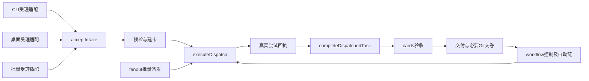

# S0 源码入口与兼容基线

核对日期：2026-10-30。路径均相对开发根。以下 `K` 为 `PAO/packages/coding-agent/src/pao/`。本文件只记录实施输入；阶段状态归执行总册 §10.23，运行结论归本目录验收记录。

## 调用链与事实归属

图中的完成链只适用于已选择自动完成的调用者；fanout 不因共享派发入口而自动进入该链。

| 规则/事实 | 当前生产者和消费者 | 持久化位置 | 本计划唯一目标归属 |
|---|---|---|---|
| 受理、重复请求、真实卡身份 | `K/intake/accept.ts:acceptIntake/acceptOne`；`intake/index.ts:acceptIntakeCli/acceptIntakeDesktop/acceptIntakeBatch` 仅适配 | intake ledger、任务书与卡 | intake；不得由CLI/桌面复制 |
| 派发保护、预算、名额和写锁 | `worker/dispatch-core.ts:executeDispatch`；消费者为worker/index、workflow/auto、fanout/execute | 认领基线、执行上下文、进程登记与尝试证据 | worker/host/worktrees |
| 原始结果 | runner与dispatch-core；完成器、监督、界面消费 | 卡回执与evidence | 尝试证据；模型自报不是验收结论 |
| 核查、验收、交付及Git交卷 | `worker/post-dispatch.ts:completeDispatchedTask` 调用cards baseline/verifier/delivery | 基线、验收及交付操作记录、Git实际提交 | cards与现有完成器 |
| 未达项登记 | post-dispatch的`onUnmetReports` → workflow/auto → `host-bridge.ts:#recordUnmetReports` → `control.ts:recordPending` | 同一工作流控制文件的待决及记录 | workflow控制 |
| 部长hold、直接任务语义验收 | post-dispatch hold分支；host-bridge `#reviewRequired` 的直接节点分支 | 当前只返回停因并追加自动链记录，未必产生待决 | S2接入统一判断请求，不能伪造not_run |
| 节点依赖与推进 | workflow driver/control，host-bridge驱动；工具/查询读投影 | `controlPath` 返回工作区下`工作流实例-<名字>.md` | workflow控制 |
| 停因与决定 | `control.ts:applyPending/requestRuling/decideNode/resumeControl`；driver、auto、host-bridge、status消费 | 同一控制文件的暂停/裁定/待决及节点事实 | S1读取/保存边界统一解释；不增第二状态文件 |
| 监督路由 | `worker/supervision.ts` 读卡、解析标记并导入workflow/control与minister | 进程登记含派发路由；监督状态另归host | S4由协作控制提供查询，执行实现不读workflow内部 |
| 装配与角色 | `K/index.ts:paoExtension`、`role.ts`，桌面runtime-supervisor/npm-package-fallback装配 | 会话内工具、事件和后台资源 | S5必需模块装配失败拒绝运行并清理 |
| 地图版本 | `dispatch-brief/workspace.ts:captureDispatchMap/recaptureDispatchMap` | 不可变地图产物和引用，内容摘要绑定真实Git/文件 | S6保留语义，改批量对象读取 |

关闭→恢复：`index.ts` 的 `session_shutdown` → `WorkflowHostBridge.shutdown` 置closing、取消信号、清到期任务；未完成且无暂停的实例落“主会话关闭，须显式人工恢复” → `host.stopAll` 并核残留。worker/runtime分别收敛自己的在途工作，停止未确认不得释放写占位。重开只查询旧现场；合法工具恢复须真实界面确认，再由 `resumeControl` 核实例、原owner、现场说明和在途卡，更新owner并落盘，不允许重启自动授权。

CLI/桌面/基准调用者：CLI产品入口装配`paoExtension`；桌面`desktop/packages/pi-sdk-driver/src/{npm-package-fallback,runtime-supervisor}.ts`同样装配该工厂，并使用`pao-worktree-runtime.ts`加载共享宿主；`bench/rehearsal/run-rehearsal.mjs`经正式CLI/RPC驱动同一内核，不自建产品状态机。

## 逐入口兼容表

| 入口/旧表达 | 当前行为 | 目标行为 | 必须保留的差异 | 拟替换的分支 |
|---|---|---|---|---|
| v1配方/旧实例 | driver处理卡清单、手动确认及可选自动链；格式拒绝冒充v2 | 保留原入口及格式 | v1没有v2轮次/部长协议，不能靠改版本升级 | 不删除v1业务，只统一等价完成与展示 |
| v2配方/控制文件 | startControl冻结配方、owner、运行方式和节点轮次；driver转交control | 保留磁盘协议；统一控制解释 | 旧实例缺运行方式按有人值守；未知版本拒绝 | 多消费者自行猜暂停/裁定含义 |
| 合法待决＋旧裁定/暂停 | applyPending写待决/暂停，普通裁定及人工确认另写裁定；决定时多处清除 | 一处校验身份/通道并编码回原字段 | 同一实例单活动待决、重复key幂等；第二key拒覆盖 | 多处独立写三项；业务精确匹配暂停文案 |
| 仅旧裁定 | 当前读取仍保留旧字段 | 校验节点、轮次、通道后解释 | 缺截止不伪造无人授权 | 散落旧裁定判断 |
| 仅旧暂停文本 | 暂停阻止推进，人工恢复可办理 | legacy_unknown只读展示、保守人工恢复 | 不从文字猜用户授权或自动放行；只读不迁移 | 自然语言决定自动动作 |
| 单卡普通派发 | `worker/index.ts`共享executeDispatch；是否completeTask由实际入口选择 | 共用等价完成步骤 | 回执受理不等于完整任务交付 | 不加另一套完成器 |
| 单卡自动完成 | completeTask分支调用completeDispatchedTask | 保留核查→验收→必要交付 | 语义待审不得冒充成功；无文件成果不空提交 | 完成器中的workflow判断移交控制层 |
| fanout批量 | executeDispatch后落回执、做越界核查、回调通知；未调用completeDispatchedTask/verifier/delivery | 保留回执级契约，共用相同执行保护 | 不增加自动验收/交付/Git提交，不把未受理项算成功 | 只替换真实重复，不强行接自动交卷 |
| v2部长工人未达 | 机械核查后登记普通偏差，逐项依据办理 | 继续复用 | 机械必需失败不可普通接受，保留attempt/证据绑定 | 不再绕回手工改卡 |
| 部长hold无未达项 | 完成器留停因；recordPending拒空items | 普通裁定登记并绑定真实任务证据 | 不伪造未达；保留专业理由 | 裸hold无办理出口 |
| 直接节点语义验收 | 无部长；有机械项全过后`#reviewRequired`直接返回hold | 控制层登记待决并完成合法后续手续 | 不强制部长；零机械项“无法机械判”也不能猜通过 | 直接节点仅return hold |
| 无卡节点裁定 | 普通裁定绑定实例/节点/轮次，无卡身份 | 共用权限、截止、重复决定检查 | 不调用卡交付/Git提交 | 不为共用代码伪造卡片 |
| 独立审核 | 当前版本核验，change走既定回边、reject停；副本证据不合入成果 | 保留 | 旧attempt/旧成果审核失效，返修额度不重置 | 只收敛相同控制约束 |
| pao_control_node | 七action共用宽对象schema；当前已拦confirm混用pending_key/decisions和resolve_pending多余身份 | S3同源动作定义及副作用前校验 | 保留公开名称、当前UI授权、key陈旧保护 | 其他动作无效参数组合；重复描述 |
| pause/resume/reopen | 暂停与真实停止分开；恢复/重开需可信交互 | 保留并消费统一停因 | 到期不等于停写、模型不能授权自身恢复 | 重复解释、未知状态错误放行 |

## R1—R7验收映射

| 问题 | 当前入口 | S0证据与后续目标案例 |
|---|---|---|
| R1 | post-dispatch、host-bridge、recordPending | 新增collaboration-baseline的无未达hold/直接语义验收，既有workflow-auto-chain部长hold；S2统一判断出口 |
| R2 | control:decideNode/releaseRulingPause/applyPending | 新增同结构化待决只改暂停文字对照；S1文案无关、旧格式、冲突拒绝 |
| R3 | workflow/tools:pao_control_node | 新增confirm混用反例确认已拒绝；既有resolve-tool身份与重放测试；S3覆盖七动作完整组合 |
| R4 | worker/supervision导入workflow/control、minister | 当前源码静态证据；已有loadout-role/host-bridge/runtime-background；S4需补结构门及CLI/桌面同义验证，S0不冒充动态复现 |
| R5 | index:paoExtension的register catch | 新增真实工厂注册pao_change_status时注入失败，证明仍注册pao_dispatch_card；S5应拒绝半装配 |
| R6 | workspace:fileState/captureDispatchMap | map-metrics真实Git计数及变更核验；dispatch-brief-artifacts；S6同输入对比 |
| R7 | bench/rehearsal正常场景与fault-matrix | 固定normal/kit及本轮实际彩排；故障组合仍属S7，正常链不能证明全部异常 |

## 代码图限制

工具 `codebase-memory-mcp 0.11.0`：PAO索引日期2026-10-23，desktop为2026-10-22，bench为2026-10-30。已尝试刷新PAO与desktop，均返回`aborted_previous_preserved`，PAO复试同样返回；守护进程日志只有worker正常退出，没有具体失败文件，未擅改系统服务或缓存。旧图搜索结果保留为`graph-chain.log`、`graph-desktop-chain.log`，只用于找符号；例如acceptIntake旧图为433行，当前源码为547行。上述结论逐项以当前源码核对，不声明图已刷新，也不据旧图行号证明现状。
