# A2 协作核心：状态、停点与交接

> 审核员 A2，只读。日期 2026-10-28。范围见任务书 §6.2。代码行号均为 `PAO/packages/coding-agent/src/pao/` 下当前工作目录（含未提交改动）的实际行号。r37 现场简称 `R37/` ＝ `.pao/地图简报与部门协作-20261020/benchmark/real-run-20261028-prepared-r37/jobs/pao-audit-first-20261028-r37-task-1/html-js-filter__QhDcwrN/agent/pao/worker-sessions/project-state/`。
> 术语：**控制正本**＝`工作流实例-<名>.md`，存一个流程实例的冻结配方、节点轮次、暂停与裁定；**停点**＝让自动推进停下、必须有人或模型做动作才能继续的状态；**出口**＝解除停点的入口函数或工具。

## 1 结论（按影响排序）

1. **r37 的死因是结构性的，不是配方开关**：实施部长调 `pao_request_ruling`，冻结配方里 `允许请求主控裁定: false`（R37/benchmark/工作流实例-基准开发流水线.md:20,65,110,156），程序把裁定通道定为“人工”（`workflow/control.ts:1706`）并写实例级暂停（:1708）。人工通道只能用 `pao_control_node action=rule` 或 `action=resume` 解除，两者都先要求 `ctx.hasUI` 加界面确认（`workflow/tools.ts:733-742,757-758,776-777`）。无界面宿主下**没有任何出口，也没有超时**。kit 改成 `true` 只修了这一个入口；同类“只有界面恢复才能解除”的暂停还有至少 8 种（§2.3 表中标“死角”者）。
2. **“无人值守”在协作核心里不存在**：只有启流时对 `人工确认` 节点做了无界面拒绝（`workflow/tools.ts:271-272`），其余人工出口全在运行中途才暴露；`requestRuling` 的 `ownerPresent` 参数在唯一调用处写死 `true`（`workflow/minister.ts:699`），参数形同虚设。流程实例也没有“失败结束/终止”终态（`FlowControl.状态` 只有 运行中/挂起/已完成，`control.ts:86`），无人值守运行遇到不可恢复情况只能永远“挂起”，外部观察器只能猜。
3. **同一个事实被做成两道停点**：工人自报 `not_run`（在基准里几乎必然：隐藏测试、浏览器等本就不能跑）→ 机械验收全过也判“全过停人工审”（`cards/verifier.ts:1186`）→ 卡留 `in_progress`、节点挂起等 owner（`control.ts:387-420`、`worker/post-dispatch.ts:241-244`）；部长看到同一事实又去请求裁定，叠加一个更强的实例级暂停。owner 走完逐项接受后，卡层停点消失，实例暂停仍在——r37 正是这样卡死。
4. **要模型按固定顺序完成的手续太多且有暗门**：owner 验收需 `pao_verify_card → pao_change_status(delivered, basis, accepted_deviations 精确覆盖全部索引) → pao_deliver_card → pao_push_flow`，若有裁定还要 `pao_control_node rule`（引用须匹配 `^.+:\d+`，理由 ≤400 词，`control.ts:1024-1032`）；独立审核零卡放行理由里**必须字面包含“未验证运行”**（`control.ts:367-372`），否则拒绝。这些规则只在报错时才告诉模型。
5. **状态塞在字符串和 Markdown 里，再用正则读回**：裁定匹配靠 `flow.暂停 === "等待X裁定:"+理由` 字符串相等（`control.ts:1044,1087`）；“当前尝试的最近验收”靠正则从卡正文“## 机械验收”段解析，至少在 `control.ts:271,400,467`、`workflow/minister.ts:142-165`、`cards/delivery.ts:707-716`、`cards/handoff.ts:117` 各解析一遍；工人审核请求/结论以 JSON 字符串塞进 `记录[].理由` 再 `JSON.parse`（`control.ts:433`、`minister.ts:97,120`）。
6. **同一事实多处保存**：一次尝试的执行绑定（执行根、输入快照摘要、工作树摘要、关联摘要）同时存在 `execution-contexts/*.json`、`基线/*.json`、`执行映射/*.jsonl` 和卡正文机械验收段，`control.ts:296-336` 专门四方对账；v1“实例清单”与 v2“控制正本”两套状态机并存，`workflow/auto.ts` 内两条完整分支（:239-369 与 :370-425）；节点完成规则写了两遍（`control.ts:484-491` 与 :555-569）。
7. **建议**：把协作核心重写为“一个实例目录＋一份结构化控制状态＋每次尝试一份结构化记录”，用一张显式迁移表驱动（§4.1），把 `运行方式: 有人值守|无人值守` 冻结进实例；无人值守下每个停点都有程序出口或明确终态（§4.2），owner 验收、交卷、推流、裁定匹配改由程序完成，模型只给判断；卡片 frontmatter 中文键原样保留，卡正文机器段改为由结构化记录渲染（§4.4）。

## 2 现状地图

### 2.1 持久状态清单（用 r37 实物核对）

“任务根”＝`/app`（r37 映射到 `R37/`）；“卡目录父”＝`/app/.pao/benchmark/`。

| # | 落盘物（r37 实例） | 写者（文件:行） | 主要读者 | 重复/问题 |
|---|---|---|---|---|
| 1 | 卡 `benchmark/卡/卡NNNN-*.md`（frontmatter 英文键+中文正文段：回执、机械验收、owner记录） | `cards/cardfile.ts:358 createCard`；状态 `cards/statemachine.ts`；回执 `cards/receipts.ts:118 appendReceipt`；验收段 `cards/verifier.ts`；owner记录 `verifier.ts:1524` | control/minister/delivery/handoff/post-dispatch/status 全部 | 卡正文既是人读日志又是机器数据，被正则多处回读（结论 5） |
| 2 | 卡号 `卡号.txt`（r37 值 `2`） | `cards/counter.ts`，路径 `cardfile.ts:368` | createCard | 有 legacy 路径回退 `counter.ts:16` |
| 3 | 控制正本 `benchmark/工作流实例-<名>.md`（YAML frontmatter，18.5 KB，其中冻结配方把任务全文复制 5 次） | `workflow/control.ts:212 saveControl`，经 `mutate` :683 | auto/host-bridge/minister/tools/status/desktop | 持久化派生字段 `状态`（:700）；`叫人`、`已派卡` 计数；`记录` 兼作事件日志和 JSON 载体 |
| 4 | v1 实例清单（v1 配方） | `workflow/driver.ts:137 manifestPath`、:402 | auto v1 分支 | 与 #3 同职能的第二套状态机 |
| 5 | 判定包 `benchmark/判定包/<实例>-<轮>-<uuid>.md`（r37 4 个，104–200 KB） | `control.ts:1804-1867 buildDecisionPackage` | 部长（工具回包） | 每次调用新建一份并整读未跟踪文件全文（:1845），从不清理；本可读时生成 |
| 6 | 黑板 `benchmark/黑板.md` | `cards/blackboard.ts`（工人自由写） | 工人 | 非状态；保留 |
| 7 | 执行上下文 `benchmark/execution-contexts/card-NNNN-attempt-N.json` | `cards/execution-context.ts:343 起` | control.ts:301、verifier、delivery | 与 #8 #9 #1 重复执行绑定 |
| 8 | 认领基线 `benchmark/基线/卡NNNN-尝试N-基线.json` + git ref `refs/pao-execution/baselines/...` | `cards/baseline.ts:165 起` | delivery、control.ts:314、post-dispatch | 含 bindingDigest/snapshotDigest，与 #7 重复 |
| 9 | 执行映射 `/app/.pao/执行映射/<run>.jsonl`（启动/运行/退出三行） | `worker/session-bridge.ts:32-49` | desktop read-model/canvas | 重复 #7 的绑定字段+pid |
| 10 | 输入快照 `benchmark/输入快照/{attempts,brief,map}/*.json` | `dispatch-brief/snapshot.ts:64,117`、`artifacts.ts:110,338` | executeDispatch、verifier | map 引用另记在 #3 `记录[事件=节点交接地图]` |
| 11 | 工人证据 `benchmark/worker-evidence/*.live.jsonl.gz`、`.receipt-format-recovery.json`、`.stderr.log` | `worker/runner.ts:1088`、`worker/cleanup.ts:277` | 回执 evidence 字段、判定包 | — |
| 12 | 工人会话 `/app/.pao/worker会话/*.jsonl`；部长会话 `benchmark/部长会话/<实例>/*.jsonl` | `worker/session-bridge.ts:32`；`host-bridge.ts:802` | desktop、观察器 | — |
| 13 | 派发日志 `/app/.pao/派发日志.jsonl`（r37 26 行，只记锁事件） | `worker/lock.ts:138,152`；`runner.ts:655` | 人工排查 | 名字叫派发日志，内容是锁日志 |
| 14 | 执行锁/共享锁 `/app/.pao/执行锁`、`共享锁`（+ `.lock` 目录） | `worker/lock.ts:131-132` | dispatch-core | A3 范围 |
| 15 | 控制锁 `<控制正本>.lock`、派发锁 `<控制正本>.dispatch` | `control.ts:688,1295,1340,1407` | control | 两把锁，锁序 .dispatch→主锁 |
| 16 | 四指标账 ×2：`benchmark/四指标账.txt`（卡级）与 `/app/.pao/四指标账.txt`（部长级） | `cards/metrics.ts:36`、`host/ledger.ts:26` | 复盘 | 同名两本账，口径不同 |
| 17 | 部长留证 `/app/.pao/部长留证/*.md` | `host/host.ts:816` | 人工 | A3 范围 |
| 18 | 受理账 `.pao/intake/受理账.json` | `intake/ledger.ts:30` | intake | 基准走工作流不经受理入口（r37 无此文件） |
| 19 | 临时计划 `.pao/临时工作流/<计划>/计划.md、意见.md、历史/、执行/<请求>/` | `workflow/plan.ts:109-147`、`plan-feedback.ts:33` | plan-tools、desktop | 临时计划执行时又生成一份控制正本（#3），基准不走 |
| 20 | 部门交接 `PAO_HOME/部门/<部>/交接/*.md`、监督审计 `部门/审查/监督审计.jsonl` | `host/handoff.ts:25`、`host/ledger.ts:77` | 部长 | A3 范围 |
| 21 | 侦察交接 `recon-handoffs/`、契约引用 | `dispatch-brief/recon-handoff.ts:43`、`artifacts.ts:384` | brief | 基准未用 |
| 22 | 工作流内容基线 git ref `refs/pao-workflow/<实例>/<i>-<轮>` + 节点 `基线` 字段 | `control.ts:770-808` | buildDecisionPackage | 与 #8 是两套基线（节点级与尝试级） |

小结：一次“四节点两卡”运行在协作核心层落了 **约 17 类**持久物；其中执行绑定 4 份、基线 2 套、指标账 2 本、实例状态机 2 套（v1/v2）、地图引用 2 处。

### 2.2 状态机清单（现状）

| 对象 | 状态（存放处） | 迁移与触发者 |
|---|---|---|
| 流程实例 | `状态` 运行中/挂起/已完成（控制正本，**派生后持久化**，`control.ts:498-500,700`）；`暂停?: string`；`裁定?: {节点,轮次,理由,通道 主控/人工}` | 启动=主控工具 `startControl` :705；挂起=程序（失败卡、owner 待裁、暂停）；暂停=部长请求裁定 :1708、审核 reject :1139、回边超限 :1162、返修中 :1179/:1505、主会话关闭 `host-bridge.ts:891`、异常 `host-bridge.ts:659`、主控 `pause`；解除=`resumeControl` :1712（人，界面）或 `decideNode` 裁定分支 :1035-1102（主控或人） |
| 节点 | 无显式状态字段；由 `轮次/卡[]/拆解结束/零卡理由/部长会话/判定/确认/放行修复/历史` 组合推导（`control.ts:50-64`）；视图值 delivered/in_progress/no_card/failed/canceled/读取异常（:599-605） | 绑定部长=程序 :809；交卡/结束拆解=部长模型 :952/:967；判定=审核部长模型 :998；确认=人 :1532；回边/重开/原卡返修=部长或主控+人 :1147/:1334/:1400 |
| 卡 | `status` unclaimed/in_progress/delivered/failed/canceled（frontmatter，`cards/types.ts:6`；迁移表 `cards/statemachine.ts:17-23`） | 认领=程序（executeDispatch）；交付=程序（全机械全过）或 owner 模型（`pao_change_status`）；失败=程序（验收未过/越界/未知结果）；failed→unclaimed=owner，**尝试数<2**（:26,:45-61） |
| 尝试 | `attempt` 整数（frontmatter）；每次认领 +1 | 程序 |
| 回执 | 卡正文 `## 回执 尝试N` 段，`任务态` completed/completed_with_deviations/blocked/checkpoint，`verification[].结论` pass/fail/not_run（`cards/types.ts:20-34`） | 工人模型写最终文本 → 程序解析 `worker/receipt.ts:565` → 程序落卡 |
| 机械验收 | 卡正文 `## 机械验收` 段，结论 全过自动交付/全过停人工审/未过/无法机械判（`verifier.ts:698,1183-1188`） | 程序 |
| 部长工人审核 | 控制正本 `记录[事件=工人审核请求/结论]`，结论 pass/hold，JSON 字符串存于 `理由` | 程序发请求（`host-bridge.ts:241`）→ 部长模型 `pao_minister_review_worker` → 部长回合结束未交=程序判 hold（`host-bridge.ts:358`） |
| 节点判定（审核） | `节点.判定 {结果 pass/change/reject, 失败轴, 引用, contentTree}` | 审核部长模型 `pao_submit_decision`；pass 绑定内容树，成果一变即失效（:226-235） |
| 裁定 | `裁定.通道` 主控/人工 + `暂停` 字符串 | 部长模型请求；主控模型或人解决 |

```mermaid
stateDiagram-v2
  direction LR
  state 实例 {
    运行中 --> 挂起: 卡failed/canceled、owner待裁、读卡异常(派生)
    运行中 --> 暂停: 请求裁定/审核reject/回边超限/返修中/主会话关闭/异常/主控pause
    挂起 --> 运行中: 卡状态变化后重算(派生)
    暂停 --> 运行中: resume[人+界面] / rule[主控; 人工通道需界面]
    运行中 --> 已完成: 全部节点complete(派生)
  }
  state 卡 {
    unclaimed --> in_progress: 认领[程序]
    in_progress --> delivered: 全机械全过[程序] / change_status[owner模型]
    in_progress --> failed: 验收未过、越界、未知[程序] / owner
    in_progress --> canceled: owner/用户
    failed --> unclaimed: owner, 尝试<2
    unclaimed --> canceled
    failed --> canceled
  }
```



要点：卡 `in_progress` 同时表示“工人在跑”和“工人已退、等 owner 验收”，两者在状态上不可区分；`resumeControl` 一律拒绝有 in_progress 卡的实例（`control.ts:1728`），因而“等验收”的卡也挡住恢复。实例没有失败终态。

### 2.3 停点清单（本路最重要产出）

“死角”＝无人值守（无界面、无人）时没有任何出口，且没有超时。

| # | 停点（判据位置） | 谁能解除 | 有人值守 | 无人值守 | 超时 | 结论 |
|---|---|---|---|---|---|---|
| S1 | 等待人工裁定：`requestRuling` 通道=人工（`control.ts:1706-1708`） | 人 | `pao_control_node rule` 或 `resume`，均需界面确认（`tools.ts:757-758,776-777`） | 无 | 无 | **死角**（r37） |
| S2 | 等待主控裁定（通道=主控） | 主控模型 | 同下 | 主控须被后台通知唤醒后调 `rule`，带 file:line 引用、≤400 词（`control.ts:1024-1032`）；普通节点还要求全部卡已 delivered（:1046-1054） | 无 | 依赖模型手续 |
| S3 | owner 待裁：当前尝试自报 fail/not_run 或部长 hold，且验收“全过停人工审”（`control.ts:387-420`） | 主控模型 / 原部长 | 主控按 S3 手续交付；或部长 `pao_minister_rework_cards` | 同左，全靠主控模型按 4 步手续完成 | 无 | 依赖模型手续（r37） |
| S4 | 部长工人审核 hold / 部长回合结束未判（`post-dispatch.ts:295-297`、`host-bridge.ts:358`） | 同 S3 | 同 S3 | 同 S3 | 部长回合结束即判 hold | 依赖模型 |
| S5 | 审核 reject → `暂停=审核拒绝:`（`control.ts:1138-1140`） | 人 | `resume`（界面），resume 会撤回 reject（:1731-1741） | 无 | 无 | **死角** |
| S6 | 回边超限且 `超限动作=停滞`（:1161-1163） | 人 | resume（界面） | 无 | 无 | **死角** |
| S7 | 普通节点裁定结果 reject/change → `暂停=X裁定拒绝/要求修改`（:1073-1078） | 人 | resume（界面） | 无 | 无 | **死角**（主控在无人值守下裁“change”就把自己锁死） |
| S8 | 返修写到一半中断：`暂停=审核返修正在更新原卡…`/`原卡返修正在更新…`（:1179,:1505） | 人 | resume（界面） | 无 | 无 | **死角**（仅崩溃时出现） |
| S9 | 主会话关闭：`暂停=主会话关闭，须显式人工恢复`（`host-bridge.ts:889-891`） | 人 | resume（界面），同时把 owner 换成新会话（`control.ts:1730`） | 无 | 无 | **死角**（任何宿主重启后） |
| S10 | 地图补正或驱动异常 → `pauseControlIfUnpaused`（`host-bridge.ts:651-666`） | 人 | resume（界面） | 无 | 无 | **死角** |
| S11 | owner 会话不匹配（`control.ts:218-222`，所有 mutate 都检查） | 人 | resume 换 owner（界面） | 无 | 无 | **死角**（主控会话换 ID 即触发） |
| S12 | 卡 failed（验收未过、越界、unknown_outcome；`post-dispatch.ts:193-238`）→ 节点挂起 | 主控模型 / 部长 / 人 | `pao_change_status failed→unclaimed`+推流；部长原卡返修；`reopen`（界面） | 尝试<2 时主控模型可重试；**尝试=2 后 `ATTEMPT_EXCEEDED`（`statemachine.ts:57`），只剩界面 reopen** | 无 | 第二次失败后**死角**；且无“失败结束”终态 |
| S13 | 越界核查“无法核对”（`post-dispatch.ts:203-210`），卡留 in_progress | 主控模型 | 手工交付/失败 | 依赖模型 | 无 | 依赖模型 |
| S14 | 地图过期 stale_map（覆盖内容变化，`dispatch-brief/workspace.ts:371`、`snapshot.ts:213-233`） | 程序（召回原只读部长复核，`host-bridge.ts:742-758`，每次推进每个引用只一次） | 自动；之后本次停止，须再推流（:640-643） | 需主控模型再 `pao_push_flow` | 无 | 自愈一次，之后依赖推流；r37 07:40 发生 |
| S15 | 地图交接缺失 missing_input（`host-bridge.ts:618-628`） | 原部长 | 推流重开部长 | 依赖推流 | 无 | 依赖模型 |
| S16 | 部长未提交结束信号/判定（`host-bridge.ts:872-878`）、部长会话已断（`control.ts:588-590`） | 程序/主控 | 推流按同会话重开一轮 | 依赖推流；若同时有暂停则落到 S9/S10 | 部长保温空闲熔断（A3） | 依赖模型 |
| S17 | 等待人工确认（节点 `人工确认: true`，`control.ts:596-597`） | 人 | `confirm`（界面） | 启流即拒绝（`tools.ts:271-272`） | — | 一致（唯一做了启动期检查的门） |
| S18 | 实例自动链卡数上限（`auto.ts:131,283-291`，50 张） | 主控 | 推流 | 推流；实例累计上限后的出口未查清 | 无 | 未查清 |
| S19 | 有 in_progress 卡时禁止 resume/reopen/rework（`control.ts:1728,1309,1373`） | 主控/人 | 先把卡落态 | 先走 S3 | 无 | 加重 S1/S5–S11 |
| S20 | 审核判定版本失效：成果内容树变化（`control.ts:226-235`） | 审核部长 | 重新判定 | 推流重开审核部长 | 无 | 依赖模型 |
| S21 | 零卡审核未写“未验证运行”、引用不合格式（`control.ts:367-372,1024-1032`）→ 工具报错 | 审核部长模型 | 改写重交 | 同左；部长回合结束未交 → S16 | 无 | 暗门，审核节点从未在真实运行中走到（推断：见 A1） |

**死角合计 9 个**（S1、S5–S11、S12 第二次失败后）；另 8 个依赖模型按顺序调工具。没有一个停点带超时或无人值守默认动作。

### 2.4 要模型按固定顺序完成的手续

| 编号 | 手续 | 角色 | 步骤与格式要求（证据） | 本可由程序完成 |
|---|---|---|---|---|
| H1 | owner 接受偏差并交付 | 主控 | `pao_verify_card` 查索引 → `pao_change_status new_status=delivered`，必须同时给总 `basis` 与 `accepted_deviations[{attempt=当前, verification_index, condition 原文, basis}]`，**数量与索引必须恰好覆盖**（`cards/verifier.ts:1467-1516`、`cards/tools.ts:304-323`） | 是：无人值守下按策略自动接受“环境不可跑”类 not_run，有人值守下一次确认 |
| H2 | 交卷 | 主控 | 手工交付后另调 `pao_deliver_card`（`cards/delivery.ts:1337`）；自动链路径由程序调 `deliverCard`（`post-dispatch.ts:353`） | 是：状态进 delivered 即由同一入口交卷 |
| H3 | 续跑 | 主控 | 每次停后 `pao_push_flow`（`workflow/tools.ts:893`） | 是：卡状态变化事件驱动续跑 |
| H4 | 裁定 | 主控 | `pao_control_node action=rule` + instance、node、round、result、reason（≤400 词/1600 字符）、references（`^.+:\d+`）、非 pass 须 failure_axis（`control.ts:1024-1034`、`tools.ts:753-775`） | 部分：身份字段应由程序绑定 |
| H5 | 恢复 | 人 | `resume` + instance + prev_owner + reason + 界面确认（`tools.ts:776-783`、`control.ts:1724-1727`） | 无人值守下应有程序出口 |
| H6 | 只读节点交接 | 部长 | `pao_minister_save_node_map`（coverage 等）→ `pao_breakdown_done(zero_cards_reason)`；顺序反了即拒（`control.ts:981-993`、`minister.ts:625-637`）；替代地图须同时给 previous_ref 与 supersession_reason（`minister.ts:459-476`） | 部分：结束拆解可由保存地图隐式完成 |
| H7 | 实施拆解 | 部长 | `pao_minister_submit_cards`（acceptance 逐行“跑:/存在:/包含:”）→ `pao_breakdown_done` | 部分 |
| H8 | 工人审核 | 部长 | `pao_minister_review_worker` 原样回填 request_id、card_ref、attempt（`minister.ts:582-626`） | 是：身份由程序绑定 |
| H9 | 审核判定 | 审核部长 | `pao_minister_decision_pack` → `pao_submit_decision`；零卡 pass 理由须含“未验证运行”（`control.ts:367-372`） | 暗门应删除，改为结构化字段 `unverified: true` |
| H10 | 工人回执 | 工人 | 最终回复里写 JSON（result、artifact_path、summary、任务态、verification、changes），程序严格解析，失败再从唯一围栏/裸对象恢复（`worker/receipt.ts:269-345,565-598`；r37 卡0002 即走恢复：`.receipt-format-recovery.json`） | 是：改为带类型的提交工具参数＋程序采集 changes/命令/退出码 |

### 2.5 程序解析自由文本或字符串编码状态的地方

1. 工人最终回执文本 → JSON：`worker/receipt.ts:565 parseWorkerFinalResult`，含围栏配对与恢复 :399-452。
2. 卡正文“## 机械验收”段 → 字段：`readLatestVerdict`（`verifier.ts:798`）后再用正则取“尝试/执行根/关联摘要/检查前后 tree”：`control.ts:271,400,467`；`minister.ts:142-165`；`delivery.ts:707-716,1037`；`cards/handoff.ts:117`。
3. 卡正文回执段（Markdown 行里嵌 JSON）：`cards/cardfile.ts:508,517`。
4. 控制正本 `记录[].理由` 里的 JSON：`control.ts:433`、`minister.ts:97,120`。
5. 状态用字符串相等判断：裁定匹配 `flow.暂停 === "等待…裁定:"+理由`（`control.ts:1044,1087`）；停因比对 `stoppedNode.hold === report.stop_reason`（`auto.ts:339`）；人工门识别靠 `挂起 === humanGateSuspendReason` 文案（`driver.ts:340-341`、`status/pending.ts:12`、`status/workflow-instances.ts:79`）。
6. 地图引用以 URI 字符串存在 `记录.理由`，`parseDispatchUri` 回读（`control.ts:985`、`minister.ts:471`）。

### 2.6 同一规则多处实现、同一事实多处保存

| 编号 | 内容 | 位置 |
|---|---|---|
| D1 | v1 实例清单 与 v2 控制正本两套状态机，自动链两条分支、叫人去重两套、派卡计数两套 | `driver.ts:137-461` vs `control.ts`；`auto.ts:239-369` vs :370-425；`driver.ts:367-421` vs `control.ts:1631-1681` |
| D2 | 节点完成规则两份 | `control.ts:484-491 complete` 与 :555-569 `controlView` 内联 |
| D3 | “当前尝试最近验收”解析 ≥5 份 | 见 2.5 第 2 条 |
| D4 | 执行绑定 4 份 + 四方对账代码 | `execution-contexts`、`基线`、`执行映射`、卡验收段；对账 `control.ts:296-336`、`delivery.ts:258,530,716` |
| D5 | 自报未达项“只拦不放行”规则 3 处 | `verifier.ts:1175-1188`、`post-dispatch.ts:241-244,287-293`、`control.ts:402-406,470-472` |
| D6 | 界面确认判断 3 份文案和条件 | `tools.ts:733-742`、`tools.ts:935-937`、`tools.ts:1159-1182` |
| D7 | 实例状态既持久化又每次读时重算 | `control.ts:700,1579,1745` 与 `controlView` :618-637 |
| D8 | 基线两套（节点级 git ref 与尝试级基线） | `control.ts:770-808` 与 `cards/baseline.ts` |
| D9 | 四指标账两本 | `cards/metrics.ts:36`、`host/ledger.ts:26` |
| D10 | “owner 待裁”同一事实形成两道停点（卡层 hold 与部长请求的实例暂停） | `control.ts:387-420` 与 :1682-1709（r37） |
| D11 | 冻结配方把同一任务原文复制进每个节点（r37 控制正本 18.5 KB，任务文本 5 份） | `control.ts:712-718` |

### 2.7 基准配方“四节点、实施两卡”完整调用链（彩排检查点）

| 跳 | 入口（文件:行） | 输入 → 输出契约 | 检查点断言 |
|---|---|---|---|
| 1 启流 | `pao_start_flow` → `startWorkflowCore` `workflow/tools.ts:264` | 配方名+参数 → 预检（部门/技能/参数 :283-291；独立审核要求宿主隔离能力 :273-279；人工确认门要求界面 :271） | 控制正本存在、`状态=运行中`、4 节点轮次 1 |
| 2 建实例 | `startWorkflow` `driver.ts:610` → `startControl` `control.ts:705` | 冻结配方、owner=主控会话 | `冻结配方.节点[*].允许请求主控裁定` 与 kit 一致 |
| 3 驱动 | `runAutoChainPhase` `tools.ts:245` → `options.driveDepartments` → `WorkflowHostBridge.drive` `host-bridge.ts:437` | 按拓扑序找就绪节点 | 侦察节点就绪 |
| 4 起部长 | `#runMinister` `host-bridge.ts:762` → `bindMinister` `control.ts:809`（捕获节点基线 :770）→ 部长子进程 :803-830 | 节点任务单文本（:828-853） | `节点.部长会话` 已写；git ref `refs/pao-workflow/...` |
| 5 侦察交接 | `pao_minister_save_node_map` `minister.ts:422` → `saveDispatchMapArtifact` + `记录[节点交接地图]` | 地图 URI `pao-map://…status=valid` | `输入快照/map/*.json` 存在 |
| 6 侦察结束 | `pao_breakdown_done` `minister.ts:627` → `endDecomposition` `control.ts:967`（只读+有后继须有地图 :981-993） | 零卡理由 | `拆解结束=true`；节点视图 delivered |
| 7 规划 | 同 4–6，部长输入含侦察地图 `host-bridge.ts:110,834` | 规划地图 | 同上 |
| 8 实施部长 | 同 4；`pao_minister_submit_cards` `minister.ts:502` → `addNodeCards` `control.ts:952` → `createNodeCards` :856 → `createCard` `cards/cardfile.ts:358` | 2 张卡，正文带 `pao-workflow-v2:实例/轮次` 标记 | `节点.卡=[卡0001,卡0002]`，`卡号.txt=2` |
| 9 实施结束拆解 | `endDecomposition` `control.ts:967` | — | `拆解结束=true` |
| 10 派卡 | `runAutoChain` `auto.ts:234`（v2 分支）→ `runChainForCard` :465 → `executeDispatch` `worker/dispatch-core.ts:1070`（workflowCheck `auto.ts:538`；`reserveControlDispatch` `control.ts:1638`） | 认领 unclaimed→in_progress、尝试+1、基线、输入快照 `snapshot.ts:117`、执行上下文、执行锁 | `execution-contexts/card-0001-attempt-1.json`、`基线/卡0001-尝试1-基线.json` |
| 11 工人运行与回执 | runner（A3）→ `parseWorkerFinalResult` `worker/receipt.ts:565` → `appendDispatchReceipt` `dispatch-core.ts:251` → `appendReceipt` `cards/receipts.ts:118` | 回执段 | 回执 `任务态`、`verification` |
| 12 完成链 | `completeDispatchedTask` `worker/post-dispatch.ts:102`：越界 :187-210 → `verifyCard` `cards/verifier.ts:1105`（结论 :1183-1188）→ 自报未达停 :241-244 / 部长审核 :246-330 → 交卷 `deliverCard` :353（`cards/delivery.ts:1019`） | 卡 delivered + git 提交，或停因字符串 | 卡0001：全过自动交付；故障注入：`not_run` → 停因 S3 |
| 13 通知部长 | `#deliverPostDispatchResult` `host-bridge.ts:169` → `#injectMinister` :224 | 回执摘要投递到部长会话 | — |
| 14 第二卡 | 同 10–12；地图过期 → `#refreshStaleMap` `host-bridge.ts:742` | 规划部长复核替代地图 | r37 07:40 在此停一次 |
| 15 owner 处置 | `pao_change_status`（`cards/tools.ts:581`）→ `reviewCardForDelivery` `verifier.ts:1432`；`pao_deliver_card` `delivery.ts:1337`；`pao_push_flow` `tools.ts:893` | H1–H3 | 卡 delivered、owner 记录两段 |
| 16 裁定（若部长请求） | `pao_request_ruling` `minister.ts:693` → `requestRuling` `control.ts:1682`；解除 `pao_control_node rule` `tools.ts:753` → `decideNode` `control.ts:998` 裁定分支 :1035-1080 | — | 无人值守必须走主控通道；r37 走了人工通道 |
| 17 审核节点 | `#runMinister` 判定模式 `host-bridge.ts:843` → `pao_minister_decision_pack` `minister.ts:682` → `buildDecisionPackage` `control.ts:1804` → `pao_submit_decision` `minister.ts:640` → `decideNode` `control.ts:998`（证据 `reviewEvidenceHold` :355） | pass 绑定内容树 | 历史上从未走到（r37 审核节点 no_card） |
| 18 结束 | `tickControl` `control.ts:750` / `controlView` :618 | `状态=已完成` | 彩排终点 |

## 3 问题清单

| 编号 | 严重度 | 问题 | 证据 | 根因类别 | 关联运行 | 修复方向 |
|---|---|---|---|---|---|---|
| A2-1 | P0 | 人工裁定通道在无界面宿主下无出口、无超时 | `control.ts:1706-1708`；`tools.ts:733-742,757-758,776-777`；R37 实例 :9,:323-340 | 人工门与策略 | r37 | 结构改：裁定通道由实例运行方式决定；无人值守下“人工”通道不可选 |
| A2-2 | P0 | 7 类实例暂停（审核 reject、回边超限停滞、裁定 reject/change、返修中断、主会话关闭、驱动异常、owner 变更）只能由界面 resume 解除 | `control.ts:1073-1078,1138-1140,1161-1163,1179,1505,218-222`；`host-bridge.ts:651-666,889-891`；`tools.ts:776-777` | 人工门与策略 / 生命周期 | r37 后续推断；历届“恢复门”停链（A1 核实） | 结构改：每种暂停登记出口与无人值守策略（§4.2） |
| A2-3 | P0 | 工人诚实自报 `not_run` 即使机械验收全过也必停；出口是 4 步模型手续（H1–H3）且须精确覆盖索引 | `verifier.ts:1175-1188,1467-1516`；`post-dispatch.ts:241-244`；`control.ts:387-420`；`dispatch-core.ts:123-124` 要求工人“没跑写 not_run” | 协议 / 交给模型的手续 | r37 卡0002（R37/benchmark/卡/卡0002…md:48-51,83-93） | 结构改：区分“必须跑的验收项”与“说明性未验证项”；后者记入结果不阻断；无人值守自动按策略处理 |
| A2-4 | P0 | 同一事实两道停点：卡层 owner 待裁 + 部长请求的实例级裁定暂停；前者解除后后者仍在 | `control.ts:387-420` 与 :1682-1709；`requestRuling` 对普通节点不要求卡已交付 | 状态一致性 | r37 | 结构改：裁定请求只能针对“程序无规则可判”的事项；owner 待裁时拒绝或合并为同一待决项 |
| A2-5 | P0 | 实例无失败/终止终态，第二次卡失败后（尝试上限 2）只剩界面 reopen | `control.ts:86`；`statemachine.ts:26,45-61`；`tools.ts:784-798` | 状态机缺口 | 推断（基准观察器需猜终态，A4 核实） | 结构改：增加 `已终止(原因)` 终态；无人值守达上限即终止并交给评分 |
| A2-6 | P1 | 只对 `人工确认` 做启动期无人值守检查，其它会落到人工的配置（`允许请求主控裁定:false`、`超限动作:停滞`）不检查 | `tools.ts:271-272` 对照 `control.ts:1706`、:1161 | 人工门与策略 | r37 | 局部修＋结构改：启动时按运行方式校验整张出口表 |
| A2-7 | P1 | `ownerPresent` 写死 true，参数无意义；通道只看配方开关 | `minister.ts:699`；`control.ts:1687,1706` | 设计残留 | r37 | 删除参数，改为实例运行方式 |
| A2-8 | P1 | 零卡独立审核 pass 理由必须字面包含“未验证运行”；理由 ≤400 词；引用须 `^.+:\d+` | `control.ts:367-372,1024-1032` | 交给模型的暗门 | 审核节点从未走到（推断） | 局部修：改结构化字段 `unverified_runs` |
| A2-9 | P1 | 卡 `in_progress` 混同“在跑”和“等验收”；resume/reopen/rework 见 in_progress 一律拒绝 | `control.ts:1728,1309-1312,1373-1374`；`statemachine.ts:17-23` | 状态机缺口 | r37 | 结构改：尝试记录里区分 running/awaiting_acceptance（卡 frontmatter 不变） |
| A2-10 | P1 | 地图覆盖整个项目根时，实施第一张卡一写文件，第二张卡就判地图过期，要召回规划部长复核 | R37 实例 :305-314（07:40 停、07:41 新地图）；`dispatch-brief/workspace.ts:296,371`；`snapshot.ts:213-233` | 状态一致性（自我失效） | r37 | 结构改：同一实例内本流程下游产生的改动不使上游地图失效（以节点基线为准），或地图只作参考不作硬门 |
| A2-11 | P1 | 状态编码在字符串里：裁定匹配靠 `暂停` 文案相等，停因、人工门靠文案相等 | `control.ts:1044,1087`；`auto.ts:339`；`driver.ts:340-341`；`status/pending.ts:12` | 协议 | — | 结构改：待决项结构化（类型、节点、轮次、通道、出口） |
| A2-12 | P1 | 卡正文 Markdown 当机器数据，≥5 处正则回读；控制正本 `记录.理由` 塞 JSON | 见 §2.5 第 2–4 条 | 协议 / 一个事实多个家 | — | 结构改：尝试记录 JSON 为正本，卡正文由程序渲染 |
| A2-13 | P1 | owner 手工交付后不自动交卷、不自动续跑，靠主控再调两工具 | `post-dispatch.ts:353` 只在自动链交卷；`delivery.ts:1337`；`tools.ts:893` | 交给模型的手续 | r37（主控顺序：接受偏差→交卷→confirm→resume） | 结构改：交付即交卷并触发续跑事件 |
| A2-14 | P1 | 执行绑定 4 份落盘＋四方对账代码，任一份写失败即“不可放行” | §2.6 D4；`control.ts:296-336` | 一个事实多个家 | 历史“状态文件发布/审核版本误判”类（A1 核实） | 结构改：一次尝试一份记录 |
| A2-15 | P2 | v1/v2 两套工作流状态机并存 | §2.6 D1 | 维护 | — | 删除 v1 解释器（旧实例只读展示） |
| A2-16 | P2 | 节点完成规则两份、界面确认三份 | `control.ts:484-491` vs :555-569；`tools.ts:733-742,935-937,1159-1182` | 维护 | — | 合并 |
| A2-17 | P2 | 判定包每次生成新文件并整读未跟踪文件全文，永不清理 | `control.ts:1842-1845,1861-1866`；r37 4 份共约 530 KB | 维护 / 上下文成本 | r37 | 读时生成、按需分页，不落盘 |
| A2-18 | P2 | 实例 `状态` 派生值持久化；每次 mutate 在锁内跑 git 内容树捕获 | `control.ts:694-700,1751-1754` | 维护 / 性能 | — | 状态只读时派生；版本证据只在判定时取 |
| A2-19 | P2 | 两本“四指标账”、派发日志实为锁日志、冻结配方复制任务全文 | `cards/metrics.ts:36`、`host/ledger.ts:26`；`worker/lock.ts:138`；`control.ts:712-718` | 维护 | r37 | 合并/改名/参数引用不展开 |

## 4 大刀阔斧的目标设计建议

### 4.1 单一状态迁移表（协作控制只认这一张表）

实例新增一等参数 `运行方式: 有人值守 | 无人值守`，启流时由调用方显式给出（基准、批处理=无人值守；桌面/终端交互=有人值守），冻结进实例，不再从 `ctx.hasUI` 临时推断。所有停点改为一个结构化 **待决项** `pending {种类, 节点, 轮次, 卡?, 尝试?, 通道: 程序|主控|人, 截止?, 默认动作}`，不再用 `暂停` 文案承载语义。

| 当前态 | 事件 | 下一态 | 触发者 | 有人值守出口 | 无人值守出口 |
|---|---|---|---|---|---|
| 节点 待前置 | 前置完成 | 待执行（直接）/ 待部长 | 程序 | — | — |
| 待部长 | 部长绑定 | 拆解中 | 程序 | — | — |
| 拆解中 | 交卡/交地图/结束拆解 | 执行中 / 节点完成（零卡） | 部长 | — | 部长回合结束无信号：程序重开一轮，N 次后实例终止 |
| 执行中(卡 running) | 回执+机械验收全过，无阻断性未达 | 卡 delivered（自动交卷） | 程序 | — | — |
| 执行中 | 有说明性未验证项 | 卡 delivered + 记“未验证”清单 | 程序 | 可选：主控一次确认 | 自动 |
| 执行中 | 机械验收未过/越界 | 卡 failed → 自动重试（尝试<上限） | 程序 | 主控可改派 | 自动重试；达上限 → 实例 **已终止(卡失败)** |
| 执行中 | 结果未知/无法核对 | 待决(主控) | 程序 | 主控判 | 主控模型判；截止后按“失败”处理 |
| 节点 全部卡 delivered | — | 待审核判定 / 待确认 / 完成 | 程序 | — | — |
| 待审核判定 | pass / change / reject | 完成 / 回边重开 / 待决(主控) | 审核部长 | — | reject：实例 **已终止(审核拒绝)**；回边超限同 |
| 待确认（人工确认节点） | 人确认 | 完成 | 人 | 界面 confirm | 启流即拒（保留现规则） |
| 任意 | 部长请求裁定 | 待决(主控) | 部长 | 主控或人 | 只能主控通道；主控截止未答 → 默认动作（继续到下游审核节点并记录） |
| 任意 | 宿主关闭/重启 | 待恢复 | 程序 | 人 resume | 同一运行令牌的新主控会话自动接管（核对无活进程、无在途尝试后） |
| 任意 | 不可恢复异常 | **已终止(原因)** | 程序 | 人可 reopen | 终态，交评分 |
| 实例 | 全部节点完成 | 已完成 | 程序 | — | — |

实例状态收敛为 `运行中 / 待决 / 已完成 / 已终止`；“挂起”只作派生展示。一个检查（G3）：遍历表中每个 `(状态, 运行方式=无人值守)`，断言存在程序出口或终态。

### 4.2 改由程序自动完成的手续

1. **验收与交付合一**：`completeDispatchedTask` 在机械验收全过后，按卡的验收条目判定是否交付；工人 `verification` 中 `not_run` 若不对应任何机械验收条目，记为“未验证项”随结果保存，不阻断（这正是 r37 卡0002 的情况）；对应机械条目的仍阻断。删除 `accepted_deviations` 精确索引手续，有人值守时改为一次性“确认交付”按钮/工具（无需索引）。
2. **交付即交卷、交卷即续跑**：任何入口把卡置 delivered（自动或 owner）都走同一个 `deliverAndAdvance`，内部做 `deliverCard` 并发出“卡状态变化”事件，驱动器自动续跑；删除主控“推流”手续。
3. **身份字段程序绑定**：rule/resume/review_worker 的 instance、round、prev_owner、request_id、attempt 由程序从当前待决项取，不再让模型回填。
4. **裁定**：部长只能对“待决(主控)”类事项请求；owner 待裁不再存在（见 1），所以 r37 那种叠加不会出现。
5. **工人回执**：改为 `pao_submit_result` 带类型参数（summary、自报结论、未验证项、偏差说明），changes/命令/退出码/用量由程序采集；删除最终文本 JSON 解析与格式恢复链（`receipt.ts:269-598`，与 A5 对接）。
6. **审核判定**：`unverified_runs: string[]` 结构化字段取代“理由必须包含未验证运行”；引用格式校验保留但由程序提示模板。

### 4.3 单一事实来源的数据布局

```text
<任务根>/.pao/<卡目录名>/
  卡/卡NNNN-*.md                 # 兼容契约：frontmatter 中文/英文键不变；正文由程序从 attempts 渲染
  卡号.txt                        # 保留
  实例/<实例ID>/
    control.json                  # 唯一可变控制状态：冻结配方(参数引用不展开)、运行方式、节点、待决项
    events.jsonl                  # 只追加的事件日志（取代 记录[] 与 自动链停因/叫人/已派卡）
    maps/<ref>.json               # 节点交接地图（取代 输入快照/map + 记录里的 URI）
  attempts/卡NNNN/尝试N.json      # 一次尝试的唯一记录：执行绑定、基线、输入快照摘要、简报、结果（结构化回执）、机械验收、交付与交卷
  evidence/                       # 工人证据与会话（只读证据，不是状态）
```

可删除的状态与文件：v1 实例清单（`driver.ts` 清单部分）；`execution-contexts/`、`基线/*.json`（并入尝试记录，git ref 保留）、`执行映射/`（桌面改读尝试记录）；`判定包/`（读时生成）；控制正本中的 `状态`、`叫人`、`已派卡`、`暂停` 字符串、`裁定` 字段（并入待决项与事件日志）；节点级 git 基线 ref 与尝试级基线二选一；第二本四指标账（由事件日志派生）。

### 4.4 保持卡片兼容契约的方式

- frontmatter 键（goal/dept/inputs/constraints/acceptance/depends_on/tier/priority/owner/attempt/created/completed/status）与 5 个状态值不变；“等验收”只在尝试记录中区分，不新增卡状态值。
- 卡正文的“回执/机械验收/owner记录”段继续生成（人可读、桌面可显示），但改为**从尝试记录渲染**，程序永不从正文回读；旧卡（无尝试记录）只读展示，写入时一次性迁移生成尝试记录（迁移前在隔离副本预演，任务书 §3.7）。
- `<!-- pao-workflow-v2:实例=…/轮次=… -->` 标记保留用于人工追溯，归属以 `control.json` 为准。
- 公开工具名保留为薄适配：`pao_control_node`、`pao_change_status`、`pao_deliver_card`、`pao_push_flow` 在新实现上调用同一入口；`pao_push_flow` 变为幂等“立即检查一次”。

### 4.5 重写与删除范围（建议）

- 重写：`workflow/control.ts`（按迁移表，预计可从 1868 行降到 600 行以内，推断）、`workflow/auto.ts`（删除 v1 分支）、`worker/post-dispatch.ts`（验收-交付-交卷-续跑一条路径）、`cards/delivery.ts`/`verifier.ts` 的回读部分。
- 删除：v1 驱动（`driver.ts` 中清单相关）、`ownerReviewPendingHold`/`latestWorkerReviewHeld`/`reviewPendingOriginalInput`（:387-473）、`accepted_deviations` 手续、`receipt.ts` 格式恢复、`判定包` 落盘、`requestRuling` 的 `ownerPresent`。
- 迁移步骤：①先写离线彩排与停点出口表检查（红）；②新数据布局与读适配（旧卡只读）；③新迁移表驱动替换 control/auto；④删旧路径；⑤基准配方去掉 `允许请求主控裁定` 等补丁开关，改 `运行方式: 无人值守`。
- 风险：桌面看板读 `执行映射`、`工作流实例-*.md`（`desktop/read-model.ts:168-463`、`status/workflow-instances.ts`）需同步改读；旧实例无法续跑只能展示（现行规则已如此，`control.ts:127-132`）。

## 5 离线验证方式

| 问题 | 离线抓法 |
|---|---|
| A2-1/A2-2/A2-5/A2-6 | 静态检查：从迁移表生成“(停点, 无人值守)”清单，断言每项有程序出口或终态；彩排用 `hasUI=false` 宿主分别注入：部长请求裁定、审核 reject、回边超限、宿主关闭重启、第二次验收失败，断言实例在限定时间内到达 已完成/已终止 |
| A2-3/A2-4/A2-13 | 彩排脚本化工人对卡0002 回报 4 条 `not_run`（与 r37 相同），机械验收全过；断言无需主控工具调用即交付并交卷，审核节点启动；再注入部长 `pao_request_ruling`，断言被拒或合并 |
| A2-8 | 脚本化审核部长零卡 pass、理由不含“未验证运行”，断言新接口接受并记录未验证项 |
| A2-9 | 单测：等验收尝试不阻塞恢复；在跑尝试阻塞 |
| A2-10 | 彩排：规划地图 coverage=项目根，卡0001 写文件后派卡0002，断言不触发 stale_map 召回 |
| A2-11/A2-12/A2-14 | 单测：删除卡正文后从尝试记录重渲染一致；对控制状态做属性测试（随机事件序列只经迁移表，状态始终合法） |
| A2-15/16/17/18/19 | 代码搜索门禁：无 `parseManifest`、无正文正则回读、无判定包落盘 |

彩排对 r37 的复现脚本：按 §2.7 的 18 个检查点逐跳断言，模型回应按 r37 真实会话改写（侦察/规划零卡+地图，实施两卡，卡0002 回执经围栏恢复、4 条 not_run，实施部长请求裁定），旧代码应停在 S1，新代码应走到审核节点与 已完成。

## 6 未查清项

1. 自动链实例累计卡数上限（`auto.ts:131`、`instanceLimitStopReason`）达到后的出口未逐行核实。
2. runner、部长子进程启动握手与等待预算、保温空闲熔断（`host/`、`worker/runner.ts`）归 A3，本文只记录其在停点表中的影响（S16）。
3. `fanout/`、`collab/`、`intake/` 在基准路径中未被调用（r37 无受理账），只核对了落盘位置，未逐行审其状态迁移。
4. 历史各轮在哪些停点停住（S5–S11 是否真实出现过）需 A1 的逐轮表佐证；本文对 r37 以外运行的判断均标“推断”。
5. 桌面读面（`desktop/read-model.ts`、`desktop/canvas.ts`）对 `执行映射`、控制正本的依赖面只做了检索，未评估改读成本。
6. `cards/integration.ts`、`cards/handoff.ts`、`dispatch-brief/impact.ts` 的契约影响与 checkpoint 机制未在本轮深入（基准未触发）。
