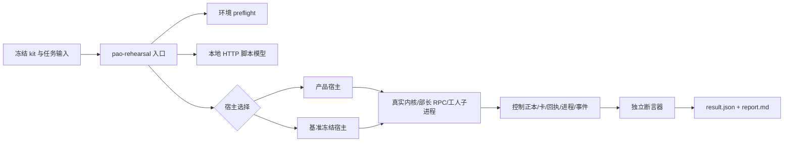

# A6 验证体系

> 审核日期：2026-10-29。范围按任务书 §6.6。代码行号取当前工作目录，包含未提交改动。本文只做只读审核；除本报告和 `A6-内核测试原始输出/` 中的测试日志外，没有修改项目。

## 1. 结论

1. **前次内核测试确实完整跑完了一次，但不是 `run-meta.txt` 记录的前 72 秒那次。** 完整运行从 07:57:31 开始，到 08:22:03 结束，外壳记录 24 分 32.316 秒；Vitest 自报 1,470.91 秒。07:33 那次的 72 秒只能认定为一次已失败的短尝试，具体命令和输出已被后一次覆盖，不能混入最终结果。
2. **完整运行的原始结果是：240 个测试文件，214 通过、26 失败；2,781 个用例，2,701 个被 JSON 记为通过、80 失败、0 pending、0 todo。** 其中 2,701 个“通过”按控制台口径拆成 2,699 个正常通过和 2 个 `it.fails` 预期失败；失败文件里还有一个四部门集成文件在导入阶段失败，执行了 0 个用例。
3. **默认命令目前不能给出单一结论。** 80 个失败中，35 个来自测试替身调用 `session_shutdown` 时未传事件，7 个来自 CLI/构建产物的模块解析，5 个是空白隔离 `PAO_HOME` 缺少档位夹具，8 个落在 Windows 链接/真实路径，2 个是测试夹具少传必要输入；其余 23 个是需逐项裁定的行为或接口断言。它们不能统一归为“安装依赖不足”，也不能统一归为“产品回归”。
4. **最关键的端到端测试没有执行。** `workflow-four-department-real.test.ts` 因相邻桌面工作区缺少 `@pi-gui/session-driver` 运行时链接，在收集阶段就失败，日志明确是 `0 test`。因此这次运行没有证明四部门真实主会话、部长 RPC、工人子进程、受管审核副本能够共同完成。
5. **现有四部门测试即使恢复运行，也不是“同配方、同宿主”彩排。** 它使用测试内自建的“四部门闭环”配方、`FourDepartmentMinisterHost` 和 `FourDepartmentWorkerRunner`，不是基准 `kit.json` 与 `benchmark-organized-entry.mjs`/`benchmark-child-entry.mjs` 路径；脚本模型只返回成功、合法回执，`允许请求主控裁定: true`，没有 r37 的人工通道、`not_run`、审核拒绝或真实模型偏差。
6. **类型检查另有真实失败。** 旧 `tsc.log` 只是命令路径错误；本次用根仓本地 TypeScript 重跑，标准 `tsc --noEmit` 退出 1，指出两处测试类型失配；四部门专用 `tsconfig.integration.json` 退出 0。跨仓类型可编译不代表运行时依赖可解析，本次完整测试的导入失败正是反例。
7. **建议把验证体系收口为一条离线彩排入口。** 同一个冻结 kit、真实宿主和真实子进程下，使用回环 HTTP 脚本模型跑快乐路径及故障矩阵；本机快速层用于每次提交，Linux 容器层用于发布前。成功判据必须来自控制正本、进程、卡、回执和终态账本，不能来自测试内的 mock 调用次数。

## 2. 实跑证据与真实结果

### 2.1 两次内核测试不能合并

| 记录 | 时间与耗时 | 退出码 | 能证明什么 | 限制 |
|---|---:|---:|---|---|
| `run-meta.txt` 第一次 | 2026-10-29 07:33:50 至 07:35:02，约 72 秒 | Vitest 1；后续 `tsc` 1 | 只证明留下记录的一次尝试失败 | 未保存这次 Vitest 的命令、日志和结果；随后日志被第二次运行覆盖，不能推算通过/失败数 |
| `timing.txt` 第二次 | 07:57:31 至 08:22:03，外壳 24:32.316；Vitest 1,470.91 秒 | Vitest 1；后续 `tsc` 1 | 完整跑过 `test/pao/` 并生成了 JSON 报告 | 元数据未保存 `--maxWorkers` 等准确参数；日志中的工作目录是 `PAO/packages/coding-agent` |
| 旧 `tsc.log` | 第二次测试后约 1 秒 | 1 | 只证明当时的 TypeScript 调用失败 | 命令指向不存在的 `PAO/node_modules/typescript/bin/tsc`，不能作为源码类型检查结论 |

README 正本给出的模块回归入口是 `PI_OFFLINE=1 PI_NO_LOCAL_LLM=1 npx vitest run test/pao/ --maxWorkers=4`（`PAO/README.md:17`）。第二次日志露出同一测试目录与默认环境，但没有把完整命令写入 `timing.txt`，因此报告不把“可能用了 4 workers”写成已证实事实。

### 2.2 `vitest.json` 的真实数目

| 口径 | 数值 | 说明 |
|---|---:|---|
| `testResults[]` / 日志 Test Files | 240 | 以文件为准；214 passed、26 failed |
| `numTotalTests` | 2,781 | 实际执行的用例数 |
| `numPassedTests` | 2,701 | JSON 把预期失败归入非失败 |
| 正常 passed | 2,699 | 控制台总行拆出的普通通过数 |
| `it.fails` | 2 | 位于 `f-results-files.test.ts:491,501`，仍是已知未满足功能 |
| `numFailedTests` | 80 | 分布在 25 个有断言失败的文件 |
| `numPendingTests` / `numTodoTests` | 0 / 0 | 没有跳过或待办用例 |
| 0 用例的失败文件 | 1 | `workflow-four-department-real.test.ts` 在导入阶段失败 |
| `success` | false | 退出码 1 |

日志的 `Test Files 26 failed | 214 passed (240)` 与 JSON 的 `testResults` 长度 240 完全一致（`vitest-default.log:4499`）。JSON 顶层的 `numTotalTestSuites=873`、`numFailedTestSuites=59` 是 Vitest 对文件与嵌套 describe/suite 节点的混合统计口径，不能理解为 873 个测试文件或 59 个失败文件。

最慢文件是 `workflow-auto-chain.test.ts`，JSON 记录的套件跨度约 884.099 秒，98 个 assertion result；并行执行时文件耗时之和远大于总墙钟时间，因此不能用 3,892.11 秒的 tests 汇总值冒充单次时长。

### 2.3 本次补做的正确类型检查

没有重跑全套。为了让旧 `tsc.log` 的无效证据闭合，补跑了两条只读类型检查，均在隔离 `PAO_HOME` 下执行，并写了原始日志：

| 命令 | 退出码 | 耗时 | 结果 |
|---|---:|---:|---|
| `PAO\node_modules\.bin\tsc.cmd --noEmit` | 1 | 6.179 秒 | 两处测试类型错误 |
| `PAO\node_modules\.bin\tsc.cmd --noEmit -p tsconfig.integration.json` | 0 | 3.632 秒 | 四部门集成类型配置通过 |

标准类型检查的两处错误是：

- `verifier-attempt-baseline.test.ts:137` 调用 `claimCardForDispatch` 时缺少必填字段 `time`（接口定义在 `src/pao/worker/dispatch-core.ts:398-405`）。
- `workflow-host-bridge.test.ts:172` 仍按旧签名调用 `createReadToolDefinition(root).execute(...)`；当前 `ToolDefinition.execute` 需要 5 个参数，函数创建入口见 `src/core/tools/read.ts:66-82`。

原始输出见 `A6-内核测试原始输出/tsc-root.log` 与 `tsc-integration.log`。integration 配置只包含四部门文件（`PAO/tsconfig.integration.json:8`），根配置则明确排除它（`PAO/tsconfig.json:56`）；因此两种类型检查不能互相替代。

## 3. 失败判因

### 3.1 80 个失败用例的分类

| 类别 | 数量 | 性质 | 代表证据 |
|---|---:|---|---|
| `session_shutdown` 替身未传 event | 35 | 测试夹具/API 调用契约错误，掩盖了原测试目标 | `worker/index.ts:1174` 读取 `event.onConfirmedShutdown`；`blackboard-upstream.test.ts:29`、`worker-tools.test.ts:17` 等清理钩子无参调用 |
| CLI/构建产物模块解析 | 7 | 环境或构建装配失败，发生在产品断言之前 | `cli-lifecycle-real.test.ts` 6 个；`host-lifecycle.test.ts` 1 个；均报 `dist/pao/memory/gbrain.js` 找不到 `@earendil-works/pi-mcp` |
| 空白 `PAO_HOME` 缺档位夹具 | 5 | 测试未自备输入，属于测试设计失败 | `loadout-tiers-config.test.ts:30,55,62,78,89,105`；错误路径为 `a6-iso-home/pao配置/档位.json` |
| Windows 真实链接/路径 | 8 | 目标平台上的真实差异，需保留并定性 | `desktop-plans` 1、`dispatch-brief-artifacts` 2、`index-wiring-artifact-path-probe` 1、`verifier-run` 3、`worker-inventory` 1 |
| 测试输入少传/替身不完整 | 2 | 测试夹具错误 | `patrol-shell-guard-wire.test.ts:145,153` 在 `buildWorkerPrompt` 遇到缺失输入 |
| 行为或稳定接口断言漂移 | 23 | 不是安装依赖问题，需逐项判断产品行为还是测试预期 | `dispatch-workflow-check` 7、`worker-budget` 3、`worker-dispatch` 5、`usage-gate-wiring` 2、其余 6 |

另外有 1 个文件级失败不属于上述 80 个用例：四部门集成文件在 import 阶段退出，执行 0 个 test。

### 3.2 “默认配置失败”到底是什么

`loadout-tiers-config.test.ts` 的 5 个失败既不是缺 npm 包，也不是默认配置代码在空目录中应自动生成。测试明确把 `PAO_HOME` 当成生产同源配置读取：设置了 `PAO_HOME` 后，`configPath = resolveTierConfigPath(PAO_HOME)`（`:29-30`），第一条断言就要求文件存在（`:55`），后面直接加载（`:62,78,89,105`）。任务要求的空白隔离 `PAO_HOME` 与这个测试前提冲突。正确修法是测试自己在临时目录写入最小档位夹具，或该测试只通过显式 `--config` 接收夹具路径；不应让审计操作去复制正式 `PAO_HOME`。

四部门导入失败是工作区依赖装配问题。`desktop/package.json:39` 和 `desktop/pnpm-lock.yaml:126-127` 声明了 `@pi-gui/session-driver: workspace:*`，源码在 `desktop/packages/session-driver/`，但 `desktop/node_modules/@pi-gui/` 当前只有 `extension-ui` 链接，没有 `session-driver`。`tsc.integration` 因 Bundler 类型解析通过，Vitest 运行时 import 却失败，说明它不能被类型检查替代。

CLI 失败的日志写的是 `@earendil-works/pi-mcp` 找不到，但当前 `PAO/node_modules/@earendil-works/pi-mcp` 是有效 workspace junction，且直接导入 `dist/pao/memory/gbrain.js` 可成功。鉴于测试发生在 08:22、之后未改动代码，而且报告只允许读现有证据，本文把它归为“当时构建产物的解析环境不稳定或装配不一致”，不把它改写成源码缺包，也不以重新安装依赖掩盖。

### 3.3 是否不稳定

现有证据不足以证明某个用例可稳定复现，也不能证明它随机波动。两次 Vitest 记录不是同一命令的重复运行，首次输出又已丢失；本次按要求没有重跑失败集。可以确认的是，失败签名高度集中：35 个同一 `onConfirmedShutdown` 调用错误、7 个同一 CLI 解析错误、5 个同一档位文件缺失。因此当前更应视为夹具和装配分类问题，而不是先标记为 flaky。只有在同一提交、同一依赖、同一 `PAO_HOME` 下连续两次得到不同结果，才能记录为不稳定。

## 4. 测试覆盖地图

### 4.1 内核 PAO 测试分布的规模

静态统计 `test/pao/*.test.ts` 为 240 个文件、83,670 行。下表按测试文件直接 import 的 `src/pao/` 模块归因；一个文件会引用多个模块，所以各行不是互斥总量。

| 模块群 | 直接引用的测试文件 | 归因用例数（含重复） | 覆盖判断 |
|---|---:|---:|---|
| `cards/` | 106 | 1,426 | 体量最大，覆盖卡文件、状态机、回执、交付；部分错误文案断言过细 |
| `worker/` | 85 | 926 | 覆盖派发、预算、锁、暂停、回执；大量测试停在替身 API |
| `workflow/` | 41 | 725 | 覆盖控制正本、计划、自动链、审核；多个数万行级文件且 mock 较多 |
| `dept/` | 27 | 384 | 部门目录、配方、工具和视图覆盖较完整 |
| `dispatch-brief/` | 13 | 300 | 快照、地图、路径安全覆盖较深，但 Windows junction 用例失败 |
| `host/` | 29 | 272 | 宿主生命周期覆盖广；真实 CLI 用例受构建依赖阻断 |
| `worktrees/` | 12 | 295 | 真实 Git/受管副本多，仍需与桌面工作树真源共享用例 |
| `routing/` | 7 | 81 | 档位、模型和命令覆盖；真实配置夹具不自洽 |
| `desktop/` 读模型 | 14 | 130 | 与桌面 UI 产品测试不同，主要验证内核给桌面的投影 |
| 其他外围模块 | 约 90 | 约 1,000 | memory、status、notify、context、panel 等此次均未见失败；不等于真实链路已走通 |

另有：

- `workflow-four-department-real.test.ts` 1 个文件、1,108 行，声明 1 个快乐路径和 3 个恢复场景；本次实际执行 0 个。
- 基准 Python 测试 6 个文件、6,873 行、115 个 `test_` 函数，本次未运行，只做覆盖概览。
- 桌面应用测试 251 个文件、60,121 行、1,204 个测试声明；本任务只做概览，未运行。
- `packages/coding-agent/test/` 中 `test/pao/` 以外的上游测试有 322 个文件，不包含在 README 的 PAO 模块回归命令内。

### 4.2 真实链路与“验证实现自己的预期”

覆盖面并不差：静态检索显示 200 个 PAO 测试文件使用临时目录，69 个使用 `spawn`/`execFile`，46 个调用真实 Git，32 个使用 spy、19 个使用模块 mock。不能笼统地说这些测试都是假测试。问题在于关键协作链的最后一公里仍由替身驱动：

| 测试 | 现有能力 | 缺口 | 判断 |
|---|---|---|---|
| `workflow-four-department-real.test.ts` | 真临时 Git、真 `AgentSession`、部长 RPC 与工人子进程；产出真实控制正本和卡 | 自建配方、自建部长/工人派生器、固定成功回执；本次因依赖未执行 | 方向正确，尚不能证明基准路径 |
| `cli-lifecycle-real.test.ts` | 启动当前构建 CLI，使用原生 faux provider | 本次在加载扩展阶段失败，模型和生命周期断言均未发生 | 设计正确，当前证据无效 |
| `workflow-host-bridge.test.ts` | 使用真实控制文件，覆盖大量桥接边界 | 文件内约 74 处 mock/spy；`executeTask`、`runAutoChain` 反复被替换（如 `:92,161,245,354`） | 适合局部逻辑，不能替代真实宿主彩排 |
| `blackboard-upstream.test.ts` | 走 `pao_dispatch_card` 的一部分真实链路 | 文件头明确使用 `FakeRunner` 且“不 spawn”（`:4`） | 可验证黑板与上限，不验证进程生命周期 |
| `worker-dispatch.test.ts` | 覆盖权限、并发额度和派单拒绝 | 以 fake worker 为主，失败集中于共同事件夹具和并发断言 | 不能替代真实子进程与父通道 |
| `workflow-auto-chain`、`workflow-control` | 真实控制文件的状态组合很多 | 文件大、测试辅助多，重点在控制函数自身输出 | 应保留，但要用黑盒整链做交叉验证 |

最需要改的“照抄实现”不是所有单元测试，而是测试辅助层重复构造相同的 `pi.on`、未传事件、手工断言内部调用顺序。应集中到一个可信的 `fireExtensionEvent` 和 `capturePi` 测试辅助中，让测试对公开事件契约断言，而不是自行模拟一个不完整的 Extension API。

### 4.3 巨型测试文件

| 文件 | 行数 / 声明数 | 建议 |
|---|---:|---|
| `workflow-auto-chain.test.ts` | 3,048 / 86 | 拆为 v1、v2、跨卡并发、通知/门四组 |
| `workflow-control.test.ts` | 2,163 / 43 | 拆为状态迁移、恢复、裁定、报告四组 |
| `workflow-host-bridge.test.ts` | 2,110 / 36 | 拆为真实控制桥接、过期地图、生命周期；共享 fixture |
| `dispatch-brief-artifacts.test.ts` | 1,905 / 26 | 拆为路径安全、快照冻结、读写入口 |
| `workflow-plan-tools.test.ts` | 1,460 / 44 | 拆为计划写入、工具装配、工作树交互 |
| `workflow-plan.test.ts` | 1,425 / 51 | 拆为解析/迁移、状态/依赖、负例 |
| `workflow-tools.test.ts` | 1,208 / 42 | 按工具族拆，避免一个失败重跑数分钟 |
| `f-novel-loop.test.ts` | 1,175 / 6 | 场景少而单例大；保留为黑盒等价测试，但移出通用快速车道 |

## 5. 四部门固定回应测试为何没抓到 r31—r37

现状不是“没有端到端测试”，而是测试的装配与历史失败不在同一路径：

| 历史故障 | 真实现场 | 四部门测试覆盖 | 结果 |
|---|---|---|---|
| r31 地图复核部长 RPC 握手 5 秒超时 | 基准冻结宿主、默认 5 秒预算、冷启动受 Linux/容器资源影响 | 自定义部长宿主直接启动测试夹具，没有同类慢启动与默认预算 | 抓不到 |
| r32 JSON 前有散文 | 真实模型回执协议不稳定 | 工人夹具直接生成合法 JSON 回执 | 抓不到 |
| r33 机械验收命令含嵌套转义引号 | 模型生成验收命令，程序解析 argv | 固定验收串只有普通“存在/包含” | 抓不到 |
| r34 审核判定被拒、主会话 resume 被 UI 门挡住 | 审核部长按真实提示生成判定，无人值守宿主 | 固定审核部长总是返回合法 `pass`，控制正本直接可完成 | 抓不到 |
| r35 供应商流提前结束，外层仍评分 | 真实供应商与控制器终态判定 | faux provider 按固定数组返回完整消息，没有断流；也不经过 Harbor 控制器 | 抓不到 |
| r36 双围栏导致回执恢复失败 | 真实模型的自由文本 | 工人直接返回合法文本 JSON，不经过回执恢复分支 | 抓不到 |
| r37 `允许请求主控裁定: false` + `not_run` + UI 恢复门 | r37 冻结 kit、无界面基准宿主、真实工具偏差 | 自建配方在 `:410` 写 `允许请求主控裁定: true`；回执全部 success/pass | 抓不到 |

本次四部门文件甚至没有进入用例执行。即使消除 `@pi-gui/session-driver` 导入问题，上表仍是结构性缺口。它适合作为内核逻辑回归，不足以充当 A4 所要求的“同配方同宿主彩排”。

## 6. 问题清单

### A6-01 P0：四部门端到端测试未执行，默认回归却可能被看成“已跑完”

- 证据：`vitest-default.log:4` 显示 `workflow-four-department-real.test.ts (0 test)`；`:3456-3465` 显示 `@pi-gui/session-driver` 导入失败；测试声明位于 `workflow-four-department-real.test.ts:912,1104`。
- 根因类别：装配/测试依赖。
- 关联历史：r31—r37 的流程完整推进均没有对应有效回归证据。
- 修复方向：结构改。四部门测试的前置装配必须由入口脚本检查并准备，缺任一 workspace 链接时在“开始测试前”以明确 preflight 失败；不能让文件收集阶段的无测试失败混进一般断言失败。

### A6-02 P0：没有同配方、同宿主的离线整链彩排

- 证据：`workflow-four-department-real.test.ts:1-7` 声称真实内核，但 `:136-197` 自建部长/工人派生器，`:398-416` 自建配方且允许主控裁定；基准 kit 正本是 `organized-post/kit.json`，基准宿主入口在 `benchmark-organized-entry.mjs` 与 `benchmark-child-entry.mjs`。
- 根因类别：装配分叉/验证边界错误。
- 关联历史：r31、r34、r35、r37；也承接 A3 的多宿主差异与 A4 的 harness 差异。
- 修复方向：结构改。新增黑盒彩排入口，要求直接消费冻结 kit，并分别跑产品宿主与基准宿主；禁止测试在正式断言前替换 `host.executeTask`、`runAutoChain` 或子进程入口。

### A6-03 P1：共同测试辅助偏离扩展事件契约，35 个用例在清理阶段误红

- 证据：生产代码在 `worker/index.ts:1174` 和 `pao/index.ts:186` 使用事件；多个测试的 `afterEach` 直接无参调用 handler，例如 `blackboard-upstream.test.ts:29`、`worker-tools.test.ts:17`。
- 根因类别：测试夹具。
- 关联历史：没有直接真实事故；影响是大量派发/生命周期回归被掩盖。
- 修复方向：局部修。统一提供 `fireSessionShutdown(event, ctx)` 辅助；所有 handler 必须由测试显式传入 `{type:"session_shutdown",reason:...}` 和最小上下文。

### A6-04 P1：标准类型检查在当前代码上失败，旧日志掩盖了问题

- 证据：`tsc-root.log` 退出 1，两处错误；integration 类型检查退出 0。根配置排除四部门文件（`tsconfig.json:56`），integration 单独包含（`tsconfig.integration.json:8`）。
- 根因类别：测试 API 漂移/验证入口分工。
- 关联历史：修复并行推进但类型契约未同步。
- 修复方向：局部修。按当前 `DispatchClaimInput` 和工具 `execute` 契约更新测试调用；CI 必须先跑 `tsc --noEmit`，再跑 integration 类型检查，两者都保留。

### A6-05 P1：测试环境的输入边界不自洽

- 证据：档位测试在空 `PAO_HOME` 下必然失败（`loadout-tiers-config.test.ts:29-30,55`）；CLI 测试依赖已构建 `dist/bundle/cli.js` 和外部 workspace 依赖解析；四部门测试依赖相邻桌面仓。
- 根因类别：测试自包含性/宿主装配。
- 关联历史：r19 装配清单泄漏、r31 冷启动失败。
- 修复方向：结构改。入口拆分 `fixture-config`、`build-runtime`、`test-run` 三个阶段；每阶段自己创建所需文件并输出 preflight。产品正式 `PAO_HOME` 不参与测试。

### A6-06 P1：Windows 链接和真实路径行为未被跨模块统一

- 证据：8 个失败分布在 `desktop-plans.test.ts:360`、`dispatch-brief-artifacts.test.ts:704,760`、`index-wiring-artifact-path-probe.test.ts:34`、`verifier-run.test.ts:158,258,276`、`worker-inventory.test.ts:256`。
- 根因类别：平台适配/路径语义。
- 关联历史：r30 的 9p 原子替换，以及多轮 Windows 链接、路径和权限问题。
- 修复方向：结构改。抽出一个路径身份/链接操作测试套，统一 junction、symlink、realpath 和错误码；Windows、Linux 两层都必须跑同一组判据。

### A6-07 P1：23 个行为/接口断言失败尚未被逐项裁决

- 证据：集中出现于 `dispatch-workflow-check.test.ts:89`（7）、`worker-budget.test.ts:111,130,148`（3）、`worker-dispatch.test.ts:366,414,437,475,525`（5）、`usage-gate-wiring.test.ts:386,414`（2），以及 `runtime-wiring`、`todo-write`、`worker-tools` 等。
- 根因类别：产品行为、错误契约或测试复制实现后的双重漂移；仅凭日志不能定论。
- 关联历史：直接自动链、预算、取消和通知属于协作主路径。
- 修复方向：结构改。先为每类失败写成独立的可执行规范：“输入、触发点、期望稳定错误码、可见结果”；再跑对应小套件。相似测试合并，但先保留失败样本，不能为了全绿删除断言。

### A6-08 P2：测试规模大且靠复制夹具维持

- 证据：83,670 行、240 个文件，多个文件超过 1,900 行；`workflow-host-bridge.test.ts` 约 74 处 mock/spy。
- 根因类别：维护成本。
- 修复方向：局部修。优先拆 8 个最大文件，统一 `capturePi`、临时 Git 仓、事件触发和断言辅助；保留按产品契约命名的行为测试。

### A6-09 P2：Python 与桌面产品测试未接入同一证据账本

- 证据：基准 115 个 Python 测试、桌面 1,204 个测试声明只做了范围概览，没有本次运行结果；PAO CI 只覆盖内核仓，桌面 CI 另走 `pnpm check` 与 Playwright。
- 根因类别：跨仓验证断点。
- 修复方向：结构改。顶层彩排入口统一生成一份 `result.json`，各层只写自己的原始日志，报告层汇总版本、哈希、环境、通过数和未跑原因。

## 7. 目标设计：一条离线整链彩排入口

### 7.1 分层与职责



入口必须把“环境准备、发起请求、读取终态、判定成功”分开。脚本模型负责产生确定回应，断言器只读真实落盘结果；被测内核不感知测试脚本。

### 7.2 建议新增的可执行路径和命令

以下均为建议，不在本次审核中创建：

- 黑盒入口：`PAO/packages/coding-agent/scripts/pao-rehearsal.mjs`
- 脚本规范：`PAO/packages/coding-agent/test/pao/rehearsal/scenarios/*.json`
- 本地模型服务：`PAO/packages/coding-agent/test/pao/rehearsal/scripted-model-server.mjs`
- 独立断言器：`PAO/packages/coding-agent/test/pao/rehearsal/assert-final-state.mjs`
- 根仓脚本：`check:rehearsal:smoke`、`check:rehearsal:matrix`
- CI 接入：`PAO/.github/workflows/ci.yml` 在现有 `npm run check` 后执行 smoke；发布前任务执行 matrix。

建议命令形状：

```powershell
$env:PAO_HOME = '<新建隔离目录>'
$env:PI_OFFLINE = '1'
$env:PI_NO_LOCAL_LLM = '1'
node packages/coding-agent/scripts/pao-rehearsal.mjs run `
  --host benchmark `
  --kit ../.pao/地图简报与部门协作-20261020/benchmark/organized-post/kit.json `
  --scenario test/pao/rehearsal/scenarios/r37.json `
  --out <新的证据目录>
```

`--host benchmark` 必须直接复用冻结的 `benchmark-organized-entry.mjs` 与 `benchmark-child-entry.mjs`，不能用 `FourDepartmentMinisterHost`/`FourDepartmentWorkerRunner` 的派生替身。A3 的统一产品宿主落地后，同一命令增加 `--host product`；发布判据要求两种宿主都通过，而不是用其中一种代表另一种。

入口启动前依次校验：Node/Git 路径、PAO/桌面 workspace 链接、构建产物时间与源文件、冻结 kit 哈希、隔离目录可写、回环端口可监听、Docker 是否仅用于 L2。任一失败写结构化 `preflight.json` 并退出非零。

### 7.3 脚本模型放在哪一层

建议保留两个通道，权限和用途不同：

1. **快速单元通道：pi 模型接口层。** 测试进程直接注册原生 `fauxProvider`，适合状态机、解析器和 10—30 秒级单场景。它快，但绕过了 CLI provider 配置和 HTTP 协议，不能作为最终验收。
2. **整链通道：本地 HTTP 服务。** `scripted-model-server.mjs` 监听 `127.0.0.1:0`，实现最小的流式与普通响应。隔离 `PAO_HOME` 的模型配置把 provider 名写成 kit 中已有的 `harbor-endpoint`，模型 ID 保持 `minimax-code/MiniMax-M3.1-Flash`，因此不改 kit 字节、不触发真实模型。`PI_OFFLINE=1` 继续禁止外部启动网络访问，`PI_NO_LOCAL_LLM=1` 禁止本地 LLM；显式回环服务只服务本测试进程。

脚本按请求中的角色、工具集合和最近工具结果匹配步骤，不按固定全局轮次。每个会话键为首次任务文本哈希，避免多 worker 并行时串步。脚本禁止通配为“任何请求都答复”；未匹配必须立即失败并保存请求正文。

### 7.4 冻结输入和运行产物

每次运行只需要一个新的输出目录。固定保留：

| 文件 | 内容 | 用途 |
|---|---|---|
| `run.json` | 源 commit、kit SHA-256、所在分支脏文件清单、Node/Git/OS、宿主类型、模型脚本哈希 | 证明同配方同宿主 |
| `preflight.json` | 每项检查的 ok/error、版本、路径；凭证只说“存在” | 在模型启动前失败 |
| `requests.jsonl` | 角色、会话键、工具名、消息哈希、匹配到的脚本步骤 | 复现模型偏差 |
| `responses.jsonl` | 脚本步骤、注入故障、实际文本/tool call | 复现协议输入 |
| `processes.json` | 主控、部长、工人的 pid、父 pid、启动/退出码、是否残留 | 检查生命周期 |
| `final-control.json` | 流程、节点、卡、回执、裁定、停点摘要 | 最终事实 |
| `result.json` | 场景、期望、实际、未通过断言、耗时、结论 | 机器可读验收 |
| `report.md` | 从 `result.json` 生成的简短人读报告 | 排障入口 |

任何日志不得写凭证值。测试输入只来自临时 Git 项目的公开任务，不进入正式 `PAO_HOME`。

### 7.5 场景分层和时长目标

- **Smoke：** 主线快乐路径、r37 式 `not_run`、一个断流，目标 90 秒内；每次内核改动都跑。
- **Matrix：** 18 个历史故障加 A2/A3/A5 的关键负例，4 并发，目标 10 分钟内；合并前跑。
- **L2 Linux：** 同一脚本和 kit 在冻结容器镜像中跑两遍，检查路径、树杀、资源与 9p 差异，目标 15 分钟内；发布前跑。

以上是验收目标，不是本次实测结果。

### 7.6 独立成功判据

断言器只读公开接口与落盘事实，至少检查：

- 流程最终状态与节点轮次；
- 每张卡的尝试号、状态、机械验收、回执、提交哈希；
- 审核判定引用的 path 和 line 对应的当前内容树；
- 部长与工人的工作目录、pid、退出码和残留进程；
- 工具声明与工具调用钩子实际放行集合完全一致；
- 每次故障是否被分类，错误是否可见，清理是否完成；
- 未完成或未验证项是否进入报告，不能被外层评分吞掉。

停止失败仍应向上暴露；测试同时断言错误类别、锁/租约最终状态和所有进程的清理结果。不能为了得到“终态”而静默吞掉停止错误，也不能把未确认停止当作已释放。

## 8. 故障矩阵与历史问题映射

矩阵是“脚本输入 → 真实链路 → 当前内容树断言”。旧代码应在对应场景红，新代码应在同一场景绿；不能只断言函数返回字符串。

| 编号 | 历史来源 | 注入点 | 期望事实 | 主要断言入口 |
|---|---|---|---|---|
| F-01 | A1 O-01/O-02 | L2 用 Docker 命令垫片模拟子网耗尽、断网安装 | 预检明确失败或离线包完成，不能启动冲突容器 | `preflight.json`、网络/安装 receipt |
| F-02 | A1 O-03 | HTTP 模型流在 chunk 中途结束 | 有限重试或明确失败；外层不评分 | `requests/responses`、`controller-exit.json` |
| F-03 | A1 O-04 | 冻结源码包导入空目录 | 入口、kit、Git/Python 版本可见 | `preflight.json`、import log |
| F-04 | A1 O-05/A3-1 | 三角色分别只设 PI/PAO 配置目录，再设冲突值 | 三进程一致；冲突在启动前拒绝 | 三角色请求的 system/tool 快照与 `processes.json` |
| F-05 | A1 O-06 | 工人回执分别缺字段、散文包裹、双围栏 | 工具层可纠正或程序采集；不进入人工门 | `cards/receipts`、最终卡 |
| F-06 | A1 O-07 | 控制正本仍为 running/hold 时关闭 CLI | 外层报组织未完成，不评分 | controller receipt + 流程状态 |
| F-07 | A1 O-08 | 注入观察命令非零、进度文件原子替换忙 | 观察告警，主流程继续 | 观察告警账、最终控制 |
| F-08 | A1 O-09 | 卡输入写描述性路径、地图只给 URI | 建卡前拒绝；合法地图可定位 | `addNodeCards` 结果、地图 artifact |
| F-09 | A1 O-10 | 验收命令含注释和嵌套转义引号 | 实际 argv 与脚本期望逐项一致 | verifier command trace |
| F-10 | A1 O-11/A2-10 | 第一张实施卡写项目后派第二卡 | 下游自己的写入不把上游地图误判过期 | 地图 ref、第二轮状态 |
| F-11 | A1 O-12 | 审核副本增删自己的证据文件 | 只比较成果内容树，不误拒 | 审核版本记录、最终内容树 |
| F-12 | A1 O-13 | 同时认领、返修、主控写卡 | 单一胜出，另一请求得到可恢复错误 | 卡尝试、锁事件、无残留 |
| F-13 | A1 O-14/A3-6 | 部长启动延迟 6/40 秒；启动后中途退出 | 预算内握手，退出后重派或明确停因；失败可见 | hot-session 记录、pid/退出码 |
| F-14 | A1 O-15/A3-11 | 工人在途时关闭主控，再从同现场恢复 | 无旧锁残留；流程自动继续或明确终止 | 父会话退出、锁、控制终态 |
| F-15 | A1 O-16/A2-3 | 工人回执 4 条 `not_run`，机械项全过 | 按无人值守策略交付，不被两个人工门叠加阻断 | 卡回执、节点状态、最终流程 |
| F-16 | A1 O-17/A2-1/A2-2 | `hasUI=false` 下触发裁定、审核 reject、回边超限、主会话关闭 | 每种停点有程序出口或明确终态 | 静态停点表 + 运行终态 |
| F-17 | A1 O-18 | 审核发现真实缺陷并要求返修，再给 pass | 进入声明的回边，不落人工黑洞 | 审核 findings、返修卡、最终 tree |
| F-18 | A5-01 | 审核先给超长理由、无行号引用，再给合法判定 | 错误码可区分；最终最多再试一次成功 | `pao_submit_decision` 响应、控制记录 |
| F-19 | A5-02/A5-07 | 部长调用声明中存在但钩子禁止的工具 | 声明集合与放行集合相同；调用不产生必败轮 | 真实 `tool-activation.jsonl` + request trace |
| F-20 | A5-03 | 工人最后消息为双围栏或纯文本 JSON | 新回执工具接收结构化参数，程序采集 changes | request、回执、卡成果 |
| F-21 | A5-05 | 后台完成通知到达主控 | 通知正文含摘要，主控无需轮询即能行动 | 通知消息 + 工具调用数 |
| F-22 | A3-2/A3-3 | 桌面与基准分别启动部长/工人 | 两者同一宿主契约、同一工作树状态；无“子进程无宿主” | capability/probe 与实际 worktree 路径 |
| F-23 | A3-4 | 工人停止失败或父进程被强杀 | 停止失败不被吞；锁最终按可证明状态释放或保留并给出出口 | `processes.json`、锁租约、exit receipt |

## 9. 测试清理与替换建议

| 动作 | 对象 | 理由 | 保留的判据 |
|---|---|---|---|
| 合并夹具 | `capturePi`、shutdown、临时 Git、faux provider | 减少 35 个同类误红和重复初始化 | 每类仍保留至少一个真实事件契约测试 |
| 拆分 | 第 4.3 节 8 个超大文件 | 失败定位和并行时间更可控 | 所有现有场景先一一迁移，不删行为 |
| 结构化错误断言 | `f-failure-matrix`、`worker-dispatch`、`dispatch-workflow-check` 中匹配整句中文的断言 | 当前已出现文案扩展导致测试红 | 先断言稳定 error code/字段，再用一个小型展示测试锁定文案 |
| 保留 | `it.fails` 两条 R08 | 它们诚实记录未实现能力 | backlog 明确；修好时测试转红提醒改普通用例 |
| 替代 | 四部门中的过程级 mock 辅助 | 当前难以证明与产品/基准宿主同路径 | 用 `pao-rehearsal` 的 `--host product` 与 `--host benchmark` 两种模式做黑盒断言 |
| 不删除 | 已验证历史故障负例 | A1 O-01—O-18 仍反复出现 | 只迁移、合并夹具、缩短执行 |

## 10. 各 P0/P1 问题的离线抓取方式

| 问题 | 立即验证方式 | 通过判据 |
|---|---|---|
| A6-01 | `check:rehearsal:preflight` 检查 workspace 链接、构建物和临时 PAO_HOME | 四部门文件至少执行 4 个声明用例；不得出现 0 test |
| A6-02 | 同一 kit 分别跑 `--host benchmark` 与 `--host product` | 两次终态一致；实际入口 hash 和宿主类型写入 run.json |
| A6-03 | 把 shutdown 调用集中到辅助函数并执行 35 个受影响文件 | 事件缺失时测试辅助自己报错；业务断言正常到达 |
| A6-04 | 根 `tsc --noEmit` + integration typecheck | 两者都退出 0 |
| A6-05 | 空 PAO_HOME 跑档位测试 | 测试自建临时档位文件；不读取正式 PAO_HOME |
| A6-06 | Windows junction/symlink 套件与 Linux 同套 | 内外路径、真实路径和清理结果一致 |
| A6-07 | 每个行为失败写一个 ERROR code + expected state 规范 | 对应小套件通过，整链场景给同一结论 |
| A6-08 | 拆分后运行各子文件并比对场景清单哈希 | 场景集合无遗漏，文件耗时下降 |
| A6-09 | 顶层 matrix 汇总 PAO、Python、桌面结果 | 每层都有 passed/failed/skipped 与未跑原因 |

## 11. 未查清项和限制

1. 07:33 首轮的实际命令、测试数和失败原因已无法从现有文件恢复；不能把它当成第二次运行的重复样本。
2. `timing.txt` 没记录完整参数，无法证明第二次实际使用了 `--maxWorkers=4`。报告只采用日志中可直接看到的 240 文件、1,470.91 秒和用例汇总。
3. 本次没有重跑全套，也没有重跑 80 个失败用例，符合“现有证据足够则不重跑”的要求；因此不能把任何失败正式标记为 flaky。
4. 基准 Python 测试和桌面产品测试只做了静态范围概览，没有实际运行；本文不对它们的当前通过率下结论。
5. CLI 日志中的 `@earendil-works/pi-mcp` 解析失败与当前已存在的 workspace junction 并存；没有当时的子进程环境快照，无法进一步定位是构建产物、启动 cwd 还是运行时解析状态。
6. 本报告没有启动真实模型、没有调用 Harbor、没有修改 Docker、没有访问正式 `PAO_HOME`。它验证的是现有测试体系和本地失败证据，不是 r37 生产链已经恢复的证明。
