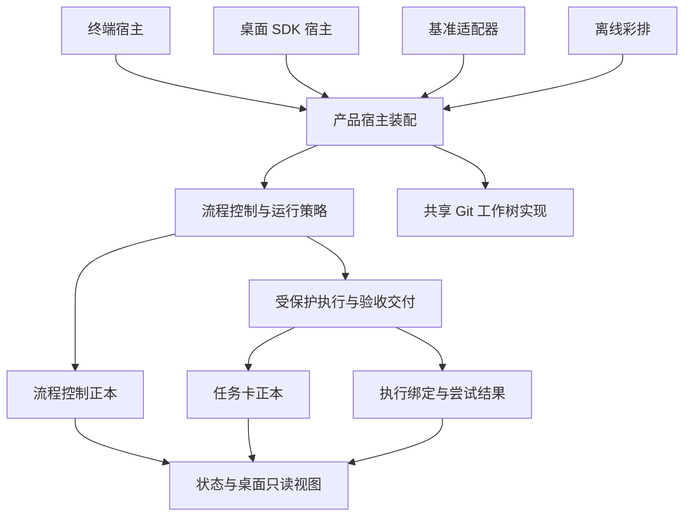

# 目标架构与实施分路

日期：2026-10-29。方案来源：[任务书](../../plans/未完成/2026-10-28-整体深度审核与架构重整任务书.md)。当前阶段和验收结果只在[执行总册 §10.22](../../plans/未完成/2026-10-17-Harness完善与工作台迭代执行计划.md#1022-2026-10-28-整体深度审核与架构重整)维护。本文规定实施边界；设计目标不等于已经实现或验收通过。

## 1. 汇总判断与主控复核

问题重点是无人值守策略缺位、宿主装配不一致、程序手续交给模型，以及测试没有覆盖相同配方和宿主的完整组合。采用共享产品宿主、结构化结果、统一推进入口和离线整链彩排；保留独立审核、执行互斥、身份与版本核对。不能通过自动接受所有偏差、强行清锁或把进程退出记成业务成功来缩短链路。

### 1.1 审核来源

| 报告 | 在本方案中的用途 |
|---|---|
| [A1 失败考古](审核/A1-失败考古.md) | 历史故障 O-01—O-18、运行前沿与证据限制 |
| [A2 协作核心](审核/A2-协作核心.md) | 停点 S1—S21、状态归属、调用链与重复手续 |
| [A3 宿主与生命周期](审核/A3-宿主与生命周期.md) | 宿主差异、工作树副本、环境变量和锁的用途 |
| [A4 基准 harness](审核/A4-基准harness.md) | 基准工具的正式位置、观察与终止分离、环境检查 |
| [A5 模型交互面](审核/A5-模型交互面.md) | 实际声明与允许调用不一致、回执与审核参数问题 |
| [A6 验证体系](审核/A6-验证体系.md) | 测试基线、现有整链测试边界与新彩排设计 |
| [A7 工程卫生](审核/A7-工程卫生与流程.md) | 活跃代码迁移、历史保留、文档归属和检查入口 |
| [A8 外围模块](审核/A8-外围模块.md) | 保留用户需要的能力，按角色控制装载与旁路影响 |

审核报告是调查材料，其中的建议不自动成为定案。主控核查了以下当前源码与现场：

| 已确认事实 | 直接证据 | 实施结论 |
|---|---|---|
| 裁定可能转人工，恢复工具要求真实界面确认 | `PAO/packages/coding-agent/src/pao/workflow/control.ts:1682` 的 `requestRuling`；`workflow/tools.ts:733` 的 `confirmHumanAction` | 新运行须显式声明策略；不能仅凭 `hasUI=false` 获得人工权限 |
| 审核理由、字数与引用格式合并成一句报错，工具参数没有展示相同约束 | `workflow/control.ts:1024`；`workflow/minister.ts:643` | 复用同一约束定义，返回具体字段错误；保留有效性检查 |
| 工作流部长的调用白名单在 `tool_call`，与实际激活集合分开 | `src/pao/index.ts:309`；A5 的 r37 激活记录 | 角色工具声明、激活、调用授权来自同一策略；测试最终会话装配 |
| 内核、桌面和基准对子配置目录采用不同变量 | `src/config.ts:546`；`desktop/apps/desktop/electron/application/app-store.ts:5264`；`benchmark-child-entry.mjs:5` | 产品装配统一解析；两个变量冲突时明确报错，不静默选一个 |
| 内核只在注入时安装完整工作树宿主，缺省为单根适配器 | `src/pao/index.ts:189`；`worktrees/types.ts` | 迁移现有宿主的无界面实现，保留能力检查，禁止用单根适配器冒充隔离审核 |
| 观察代码抛错会取消正在执行的作业 | 旧 `benchmark/bench_controller.py:656` 起的 `except Exception` | 区分观察失败与完整性、预算、用户停止；观察失败不能直接取消作业 |
| 当前适配器在业务未完成时抛错，阻止外层把它当成功 | `benchmark-sdk-host/benchmark-organized-adapter.py:239`；r37 `control-status.json` | 保留真实错误，不采用无条件退出 0；业务、进程、评分分别报告 |

代码图查询：`codebase-memory-mcp cli index_status --project D-AI-workspace-pao-dev-PAO` 返回 ready，但索引时间为 2026-10-23，存在未纳入和部分解析项。已查询 `trace_path --function-name requestRuling`，再以当前源码补核关键入口；不能把这份图当作当前全部调用已覆盖的证明。实施前刷新受影响仓索引。

### 1.2 不采纳的审核建议

| 建议来源 | 不采纳的做法 | 替代决定及原因 |
|---|---|---|
| A2 §4.1、A1 §4 | 主控超时默认继续；主会话重启自动接管 | 超时明确终止，停止未确认则保留占位；重启继续走人工恢复，遵守架构 §32.3、§33.3 |
| A3 §4.3 | 关闭永不抛错、无论子进程是否停止都释放写锁 | 返回/传播真实关闭失败；只释放已证明安全的资源，未停止进程仍持有写保护 |
| A3 §4.3 | 立即把所有文件锁改为进程内队列 | 当前部长、工人仍跨进程写状态；先明确写入归属和真实并发调用，不能先删跨进程互斥 |
| A3 §4.1 | 删除 `processInvocation` 注入点，改用全局入口变量 | 保留现有可信宿主注入接口，统一产品默认装配；避免把依赖倒转成隐式全局环境 |
| A4 §4.2 | 适配器永远退出 0，业务失败也照常评分 | 非完成结果不记通过；补评必须单独选择并标明半成品。本轮 P5 仍要求业务完成后真实评分 |
| A4 §4.2 | 完整性错误也一律只告警 | 冻结输入损坏、身份改变仍停止相关写入并保留证据；普通观察失败只影响可观察性 |
| A5 §3、§4 | 自动截短审核理由；缺失偏差处理项时也生效 | 返回可定位错误让调用者改正，缺项不能部分交付；程序不能改变模型判断的含义 |
| A2/A5 | 按工具数量目标删除旧公开工具和回执解析 | 先新增窄结果通道并证明等价，再让旧入口调用同一实现；已有名称、参数及旧回执仍兼容 |
| A2 §4.5 | 直接删除 v1、旧实例与所有旧落盘物 | 先搜索真实调用、隔离副本验证，再移除失去用途的写路径；历史读取与原件保留 |
| A1 §4 | 当前流程登记过的产物都不再让地图过期 | 仅按已声明覆盖范围与消费关系判断。覆盖内变化仍须核验，不能简单排除自身修改 |

## 2. 目标边界与状态归属

先复用现有扩展工厂、`PaoExtensionOptions`、`PaoWorktreeHost`、`completeDispatchedTask` 和控制入口。新增模块用于隔离已存在的装配差异、状态迁移与结果写入，不增加通用插件框架。

| 事实 | 唯一维护者 | 其他模块怎么用 |
|---|---|---|
| 任务目标、约束、当前卡状态及当前尝试号 | 卡片模块，现有卡文件 | 按公开读取函数消费，不在新状态文件另设第二个卡状态 |
| 冻结配方、节点轮次、判定、待决原因与运行策略 | 流程控制模块 | 视图派生状态；人读文案不参与分支判断 |
| 执行根、工作树身份与冻结输入绑定 | 现有不可变 `ExecutionBinding` | 以 key/ref 和摘要引用，保留不可变语义，不把可变结果塞进绑定记录 |
| 每次尝试的模型结果、程序采集事实、验收与交付进展 | 卡片模块新增结构化尝试结果 | 卡正文由此生成；旧卡经单一旧格式读取器读取，不能多处再用正则解析 |
| Git 基线、模型原生会话和命令原始证据 | 各证据产物 | 保留用途与引用，不能仅因含相同摘要就认定是重复状态而删掉 |
| 工作树生命周期与占用 | 共享宿主实现、现有执行保护 | CLI、桌面、基准复用，同一状态存储有跨进程写保护 |
| 基准作业阶段、观察错误、停止与评分 | 基准运行记录 | 报告和一屏状态从运行记录生成，不能由快照反推“成功” |

默认不整体替换卡目录和用户数据布局。结构化尝试结果放在既有卡目录之内，先在隔离新实例使用；路径、格式版本、旧字段读取和回退由 I1 提交契约清单后再实施。若实际需要移除旧持久化字段或移动用户目录，回到 P2 集中确认，不借内部重构执行不兼容迁移。

流程新增结果维度区分 `completed`、`failed`、`canceled`、`stop_unconfirmed`。这是结果报告契约，不直接把卡的五态或旧控制文件的 `版本: 2` 强行改写；已有旧格式缺失新字段时采用原有人值守解释。新格式须显式版本，不能把未知格式当旧格式补默认成功。

## 3. 无人值守策略：唯一需要用户决定的行为

建议：**显式无人值守的新实例，将验收范围内的普通偏差交给主控模型一次结构化裁决；程序自动完成已确定的交付、交卷和续跑。必须由人授权的动作、无法证明安全的现场、裁决超时均明确终止，不自动放行。** 有人值守和旧实例保留原行为。无人值守是开始任务时的授权范围，不能由模型在中途自行开启或扩大。

普通偏差仍必须逐项有处理依据，包括 `fail`、`not_run`；模型说“未运行”不等于通过。配方中事先明确列为仅供说明的检查，只记录为未验证，不冒充机械验收。缺失必须检查、成果版本不明、越界修改、外部发送/付费或用户要求人工确认，不能按普通偏差接受。

可选的更保守方案：无人值守遇到任何需要裁决的偏差都终止。实现更简单，但真实模型诚实报告 `not_run` 时仍会频繁结束，不能解决当前主要使用问题。

这里改变了“谁可以替人处理普通验收偏差”的行为。用户于 2026-10-29 在 P2 问题中选择“按推荐方案实施”，已批准上述裁决范围；不是模型在运行中自行扩大权限。无需额外批准本地提交：本轮默认保留工作区改动和原基线，不批量代交此前未提交的修改，不推送。

### 3.1 状态迁移与停点出口表

下表中的“终止”表示业务失败/取消有结论；不代表进程已经停止，也不意味着释放写占位。停止证明单独记录。

| 当前状态/事件 | 程序动作与下一状态 | 有人值守出口 | 无人值守出口 | 截止后的动作 |
|---|---|---|---|---|
| 新建，前置未满足 | 等待依赖，不启执行 | 依赖满足后驱动 | 相同 | 总预算到则取消并停写 |
| 需要人工确认的配方 | 启动前检查运行能力与策略 | 人在界面确认 | 启动前拒绝，不伪造授权 | 无中途无限等待 |
| 部长启动/握手 | 记录启动阶段，有限预算 | 报错并可人工重开 | 明确启动失败 | 停子进程；未停保持占位 |
| 拆解完成/零卡 | 验证声明、地图与前置后转执行或完成 | 相同 | 相同 | 不补造地图或零卡理由 |
| 有效工人结果，机械验收全过且无待决 | 验收→交付→交卷→续跑 | 程序执行 | 程序执行 | 某步失败记录可恢复阶段 |
| 自报 fail/not_run 或部长 hold | 合并为一个绑定当前尝试的待决项 | 原主控/人按原契约处理 | 按用户确认策略交主控裁决，或终止 | 主控未答则失败结束 |
| 验收未过/范围内可修缺陷 | 真实失败留档，按既有返修规则处理 | 原主控/部长决定返修 | 仅在冻结配方允许的次数与范围内返修 | 达上限则失败结束 |
| 部长请求普通裁定 | 与同一节点、轮次的待决合并，禁止叠加暂停 | 主控或人 | 主控处理普通裁定；需人权限则终止 | 未答则失败结束 |
| 审核 pass | 绑定当前成果版本，结束或推进 | 相同 | 相同 | 版本改变使旧判定失效 |
| 审核 change | 校验回边，返修原任务 | 相同 | 相同，受预算与回边次数限制 | 超限失败结束 |
| 审核 reject | 记录拒绝和证据 | 人可明确撤回后重开 | 失败结束 | 不自动改成 pass |
| 地图过期/版本不明 | 受影响派发停发并复核 | 原规划部长复核 | 有预算则同一合法路径复核，否则失败 | 不能跳过内容版本检查 |
| 地图交接缺失/部长未结束拆解或未交判定 | 不推断节点完成，重入原合法部长任务 | 原部长补齐，主控可停止 | 在原预算内补齐，否则失败 | 不能用零卡默认值冒充完成 |
| 返修写入中断 | 保留记录和部分成果，禁止再次派发 | 人核查后重放已确认阶段 | 失败结束并请求人工核查 | 不自动清除中断标记 |
| 实例派卡或回边累计额度耗尽 | 不接受再次推流绕过额度 | 人决定另建任务或调整范围 | 失败结束并报具体上限 | 不重置累计计数 |
| 在途卡挡住恢复/返修，或迟到结果 | 先核对当前尝试及真实进程状态 | 已停止且身份匹配后按原入口处理 | 运行中等待原预算；未知则停止未确认 | 迟到结果只留档，不改变新尝试 |
| 判定缺理由/引用，或零卡审核缺未验证说明 | 明确指出字段错误，原判定不生效 | 原审核者修正 | 在原预算内修正，否则失败 | 保留零卡未验证事实和引用要求 |
| 旧 owner 不符、宿主关闭/重启 | 停新派发、停止子执行、保留现场 | 人核查并显式恢复 | 终止并交待恢复现场；不自动换 owner | 未停则 `stop_unconfirmed` |
| 活进程、锁损坏、状态不明 | 保持写保护 | 人核查 | `stop_unconfirmed`，要求人处理 | 禁止清锁后重派 |
| 观察器异常 | 记录观察失败，不改变业务状态 | 报警并可重查 | 同左，之后继续观察 | 作业仍受原总预算约束 |
| 身份变化/冻结输入损坏 | 停相关写入，保留真实错误 | 人核查 | 失败/停止未确认 | 不作为普通观察错误忽略 |
| 全节点完成 | `completed`，确认执行已停止后收证 | 相同 | 相同 | 之后才进入 P5 官方评分 |

运行预算沿用现有配方/控制器预算作为上限；待决项必须有明确截止，默认不晚于该上限。具体默认时长在真实离线计时后确定，不为解决超时直接普遍调长。自动检查遍历实际登记的停点和迁移处理器；另用行为测试触发每种出口，不能只检查文档表格里“有一格文字”。

## 4. 程序手续与兼容策略

1. **结果提交**：优先复用 `pao_submit_receipt` 的类型与验证逻辑，给 worker 装载仅提交当前任务结果的窄入口。卡号、尝试、执行根由宿主绑定；worker 无改卡、验收、交卷或再派发权限。相对产物路径必须通过该 attempt 的 `ExecutionBinding` 解析；已有绑定损坏、身份冲突或旧尝试时拒绝，禁止回退主目录借同名产物。程序采集实际路径、命令、退出码、用量；模型只交判断、说明和未验证项。旧文本回执经同一验证器转换，保留历史兼容。
2. **验收裁决**：在现有卡与流程控制入口内增加一次性处理当前待决项的路径。程序绑定实例、轮次、尝试和引用；模型逐项给依据。全部输入先校验，缺项或旧尝试不生效；不允许部分落卡后假称整体成功。
3. **交付推进**：复用 `completeDispatchedTask` 收拢主控、部长、直接任务和工作流的完成路径。Git 提交与多文件更新不能承诺整体数据库式回滚；用已有可恢复记录保留每一步结果，重放不得重复提交或重复唤醒。
4. **审核提交**：同一参数约束供工具说明和控制层使用，给出具体错误；保留 `pao_submit_decision`、当前参数、引用及结果三态。先修可见性与错误定位，再评估是否还需要新的公开工具。
5. **工具装载**：工作流部长声明的工具集合就是该角色静态允许的集合；动态状态仍可合理拒绝某次调用。有人值守部长保留既有业务能力；不把“声明集合=所有时刻均成功”当作测试要求。
6. **宿主装配**：共享无 Electron 的工作树与进程装配。桌面保留自身目录适配，CLI/基准使用产品默认存储；子进程用同一真实入口，不复制宿主源码。环境从现有需要的变量开始明确解析，不贸然采用会丢失代理/证书/认证的环境白名单。
7. **基准入口**：开发根新增 `bench/`，这是仓内工程目录，不是独立新项目。使用现有 Python/Harbor 依赖和标准库；配置先复用当前 JSON，避免无需求再增 TOML/YAML/事件回放框架。一个入口支持 `doctor / prepare / run / status / collect / score / report / clean`。真实运行、评分、容器网络和清理仍受各自授权限制。

## 5. 实施分路与互斥写入范围

2026-10-30 按用户要求进一步拆成[详细小任务](实施任务拆分.md)：每个子代理回合只完成一个有独立验收的任务，主控审核后再派下一项。下表负责分路归属，具体派发要求以小任务为准。

路径缩写：K=`PAO/packages/coding-agent`，D=`desktop/apps/desktop`，B=`.pao/地图简报与部门协作-20261020/benchmark`，H=`.pao/协作机制重构-20261023/benchmark-sdk-host`。新增路径是实施位置设计，不表示文件已经存在。

| 分路 | 独占可写范围 | 必须交付 | 本路验收 |
|---|---|---|---|
| I1 流程与验收收敛 | K/src/pao/workflow/{control,auto,driver,host-bridge,tools,minister,recipe}.ts；该目录新增 transition/policy 模块；K/src/pao/cards/{verifier,receipts,delivery,handoff,tools}.ts 及新增尝试结果模块；K/src/pao/worker/post-dispatch.ts | 停点策略、单一待决、结构化尝试结果、验收交付恢复；保留公开契约 | 原卡/控制/验收/交付/工作流测试；策略出口与重放、旧尝试拒绝 |
| I2 产品宿主与生命周期 | K/src/pao/worktrees/ 无工具定义的实现；K/src/pao/host/；K/src/pao/worker/{lock,lifecycle,parent-lifecycle,cleanup,session-bridge}.ts；D/electron/platform/worktrees/ 中 Git 与 PAO 宿主实现 | 共享无界面 Git 宿主、统一子进程装配、准确停止证据 | 真实临时 Git、父子 IPC、并发工作树、停止失败保留占位；清理与派发竞态、未知状态保留、用户工作树不删除 |
| I3 角色工具与提示 | K/src/pao/role.ts；K/src/pao/worker/{receipt,dispatch-core,runner}.ts；新增窄结果工具模块；K/src/pao/dept/ 提示相关文件 | 工人结构化结果通道；角色声明与授权对齐；精确任务提示 | 真实会话装配的角色工具快照；结果参数、旧文本兼容与越权拒绝；旧/坏执行绑定不能借主目录产物 |
| I4 正式基准工具 | 开发根 bench/（除 I5 专属 rehearsal/）；迁入 B/ 中控制、准备、启动、观察、公共实现和自身测试 | 一个入口、同源配置与配方、可靠报告、网络选择与资源归属 | 无模型/无 Docker 的自测；准备产物实际导入；故障注入检查 |
| I5 彩排与故障矩阵 | bench/rehearsal/；K/test/pao/ 下新增 rehearsal/fault 测试和 fixtures；独立的 G2 计数工具 | 同配方、同产品入口、真实子进程与 Git 的脚本化模型彩排；O-01—O-18 映射 | 正常链≤10分钟，审核提交绑定当前成果的结论且流程正常完成；失败场景有明确结论与停止证据 |
| I6 文档与工程整理 | README.md；plans/ 文档；.pao/ 本轮报告及历史索引；三仓 .gitignore 的本轮必要条目 | 总册状态加链接；活跃源码与留档分开；安全的杂项处理清单 | 链接/入口与实际一致，历史原件和用户改动仍在 |

上述花括号用于列举文件，不是可直接执行的 PowerShell 命令。

**主控独占整合点**：K/src/pao/index.ts、index 导出与 CLI/SDK 入口、K/src/pao/worker/index.ts、workflow/plan-tools.ts、卡片类型与状态机、执行绑定与基线、桌面/状态读模型、D/electron/application/app-store.ts、desktop/packages/pi-sdk-driver/、三仓 package/锁文件及构建脚本、既有共享测试文件。各路提交接口需求，由主控顺序修改。I1 与 I3 不同时修改 minister/卡工具；I2 不更改 I1 的完成规则；I5 不顺手修产品源码。新增交叉文件也须先分配所有者。

执行依赖：产品写入前，I5 先保存可回放的实际工作区源码与配置快照（包括必要未跟踪文件，不只记录 HEAD），将计数脚本绑定该快照，并在快照上复现旧失败、保存基线。快照完成后 I1/I2/I3 按接口并行，I4 同时迁基准工具，I6 整理文档；旧运行基线可在不再变动的快照上继续测量。主控整合 I2 产品入口后，I4/I5 切同一入口；I1/I3 接通结构化结果后运行完整彩排；最后移除已被替代且无调用的实现。

`dispatch-brief/`、`intake/`、`fanout/`、`collab/` 的地图、简报、唯一引用和版本影响事件由主控独占核查与整合：默认复用原实现，必须运行现有快照、覆盖范围、契约影响事件和共同完成入口的回归。若发现必须改动，由主控单独修改，不让 I1/I3 各维护一套引用或路径解析。

在开始产品改动前，主控先记录四个窄接口的实际签名与调用者：运行策略解析、尝试结果提交、待决裁决、产品宿主创建。签名使用已有类型，避免各路分别发明同名状态与第二套抽象。

## 6. 保留、替换与删除顺序

| 保留 | 替换/收拢 | 满足条件后删除 |
|---|---|---|
| 四部门流程、独立审核、真实 Git 与内容基线 | 桌面已有无界面宿主迁入共享实现 | 活跃源码中的 `benchmark-worktree-host.mjs` 副本及其打包任务 |
| 卡片中文/英文契约、公开工具名、现有用户目录 | 文本结果改为窄工具优先，旧解析统一到单一适配 | 新通道不再使用的提示与重复解析；旧回执仍需的部分保留 |
| 人工授权、未知现场保留、真实关闭错误 | 多步 owner 办理收为一个受保护操作 | 没有调用的旧内部转发与重复状态写入 |
| `ExecutionBinding` 不可变、输入快照、必要 StopProof | 验收读取集中到结构化结果和统一旧读取器 | 各业务层对卡正文重复正则回读 |
| 上游锁、卡/预算/执行根互斥 | 仅证明语义一致的锁别名或重复实例 | 失去用途且已过并发用例的别名/回落 |
| 全部历史运行、冻结输入、此前用户未提交成果 | 新基准源码迁 bench/，旧目录入口只指向新实现 | 旧目录活跃源码仅在调用全迁完后收起；冻结历史中的副本不改 |

不按文件名批量清理 `$null`、NUL、pip-cache、临时脚本或旧工作树。这些不是本轮创建物；I6 先核对来源与引用，能安全收起时保留原件和归属说明，确需删除历史另行确认。不能用 `.gitignore` 隐藏仍在执行的源码或未完成报告。

## 7. 验收指标与真实限制

当前完整内核测试证据来自 2026-10-29 07:57—08:22 的既有运行：240 文件中 214 通过、26 失败；2,781 用例中普通通过 2,699、预期失败 2、失败 80。四部门真实集成文件在导入阶段失败，未执行用例。本轮只补跑根类型检查（2处测试接口失配，退出1）与 integration 类型检查（退出0），未把旧 `tsc.log` 的命令路径错误当作源码类型结论。详见 A6；这些是实施前基线，不能宣称产品已全链通过。

### 7.1 G2 的可比较口径

不能把 A2 的“18 个检查点”直接当成 18 次跨角色交接，也不能把“报告少几份”当成产品状态减少。I5 在修改前先用同一完整脚本保存以下数值，之后用相同输入计数：

| 指标 | 基线口径 | 目标 |
|---|---|---|
| 跨角色/进程交接 | 工具/RPC 跟踪中分别计跨角色边界、跨进程边界及去重合计；同角色跨进程也计入。重试和地图召回单列 | 故障恢复脚本中可由程序消除的交接至少减少一半；正常链总交接不增加。若全链总数无法明显下降，G2 仍未达标，需回看设计 |
| 可变状态文件种类 | 一次四节点两卡运行实际写出的事实正本，区分状态、不可变输入、原始证据和派生视图 | 相同计数口径减少至少 25%；不以删除证据充数。A2 的约17类仅为调查种子，不是已核实的新基线 |
| 模型固定手续 | 排除编码/专业判断，数模型为启流、抄身份、验收、交付、交卷、推流等调用 | 正常实施交付链原有多步办理收为0次额外 owner 手续；有普通偏差时1次结构化裁决；全链手续至少减少50% |

目标是验收门槛，不是已实现的收益。没有同口径修改前后数据，不报告 token、费用、CPU 或成功率下降。

### 7.2 历史故障矩阵

以 [A1 §5](审核/A1-失败考古.md#5-离线验证方式历史故障矩阵种子清单) 的 O-01—O-18 为编号正本，I5 每项记录“旧实现离线复现结果/新实现通过结果/实际命令与证据/无法离线复现的原因”。历史运行记录不能代替旧代码先红后绿。O-07 不接受 A4 的无条件成功评分；O-15 不采用自动重启续跑；O-16 按 §3 的显式裁决范围处理而非无条件放行；期望按本文的真实失败和人工恢复策略执行。

本机彩排必须覆盖：参数缺失与乱序、旧文本围栏、真实 not_run 待决、引号、覆盖内外地图变化、审核副本增加证据、真实子进程退出/握手/父亡、未知占位、观察失败、人工门、显式恢复。真实系统内存不足、Docker 引擎崩溃、供应商断流概率不能由本机桩证明消除；故障注入只能证明处理路径。Linux 容器彩排与官方评分保留为独立、需授权的集成层。

### 7.3 检查顺序

1. 按 A6 区分真实用例失败、超时、装载失败和检查命令错误；修复真实基线问题，禁止删除断言或单纯加长所有超时。
2. 每路定向真实行为测试通过后主控审核差异；共享入口改动运行 `npm run check:pao:kernel` 及成员包 `check:gates` 相关关口。
3. 最终运行内核 PAO 全套、根类型与集成类型检查、基准自测、离线彩排，检查必须通过，与基线相比新增失败为零；既有未修失败须逐项列明且不能据此封板 P4。命令按 README 和实际 package scripts，不凭报告旧命令猜测。
4. 桌面宿主受影响后运行类型、构建、对应真实 Electron 与隔离发行验证，原有界面未提交改动不混入重构。
5. 用户 2026-10-30 最新批准真实模型调用、允许重试并要求完整跑完一次，覆盖此前同日不跑真实测试决定。必要离线门通过后，由主控独占执行 P5 第一题及必要隔离容器网络；失败先补离线复现、修复再重试，直至组织结束且官方评分实际执行。正式 PAO_HOME 不操作，额度、并发、停止保护不放宽；脚本模型或模拟资源操作不能写成真实通过。

## 8. 回退与决策记录

三仓 HEAD 与 2026-10-28 基线一致：开发根 `6fee6ee9`，内核 `247bceb5`，桌面 `7df6974d`；修改前 diff 正本仍在 `基线/`。HEAD 一致不代表工作区没有后续改动，实施前须查看实际 diff。保留用户已有修改，不把历史修复作为本轮新增。

新状态格式与新基准先在隔离现场运行，正式 PAO_HOME 不迁移。每批记录具体修改与验证入口；不能用整仓 reset 回退。新的存储契约与桌面读取在同一整合批次落地，旧运行可读，旧发行物保留。

用户已确认 §3 的无人值守裁决范围。I1—I6 在该范围内实施；人工授权不改成自动接受。2026-10-30 最新真实模型与必要隔离容器网络授权见 §7.3；正式现场迁移仍未授权。
