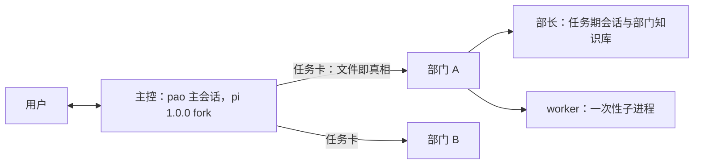

# PAO v2 架构对齐记录

> 对齐日期：2026-10-01 起，末次文档订正 2026-10-03。来源：多轮架构讨论（多 agent 体系 → 派发成本 → 部门内部结构 → 审查纪律 → 跨部门协作 → 记忆系统 → 队列契约与模型路由）；另落地 GPT 两轮外部评审（2026-10-02：隔离表述统一、同项目写互斥、状态语义与失败路由、双路检索、worker 受限补查、协作卡机械放行等）。
> 配套需求基线：`v2-REQUIREMENTS.md`。本文记录**已对齐的决策**，标注「待对齐」的除外。
> 修订规则：每轮对齐后同批更新本文；被推翻的决策不删除，改标「已否决」并注明日期与原因。
> 本文是目标契约，不是实现完成清单。2026-10-03 审查修复与剩余接线／验收见[当前修复计划](未完成/2026-10-03-审查修复与验收补齐.md)；修改、离线检查和真实集成分别记状态。

## 1. 总体形状：一主多部、卡片制、无库、无常驻



- **主控 = 主会话本身**，不是另一个产品。蜂群是主会话的一个动作，不是平台。
- **主控上下文隔离（核心纪律）**：主控不见大文件全文、执行过程日志、中间产物；可见范围 = 用户对话＋卡片回执＋信封级信息＋限额内小规模直读（三车道，§8.9）。收益：会话又小又稳定——少压缩、缓存前缀长期有效、可长期在岗。（2026-10-02 统一表述：原「永不接触文件内容」与 §8.9 小文件直读打架，隔离的是大量原文与执行过程，不是所有一手信息。）
- **默认规则**：默认派发，例外直干。例外仅两类：即时活、需要与用户来回对话的活。即时活的判据用结构不用时间——两三次工具调用内能完成、不产生需留档的中间产物（2026-10-01 定：模型无法自查耗时），且低风险——高风险操作照走派发（§7.5）；对话活遇大文件走中继聊（§8.9）。默认派发的动机是会话长期在岗，不预设总成本更低——划算性按四指标实测校准（需求 §6）。
- **无常驻纪律（继承旧 PAO）**：主会话关闭全停；重启后主控列出进行中的卡，人决定重派或作废，不自动续跑。重派/作废前先核上一轮已实际落盘的改动（git status／产物目录）——不自动续跑不等于上轮没写东西。
- **后台运行契约（2026-10-02 R05 定）**：「后台」（巡库 worker、扇出等）只指主会话在线期间不阻塞前台，全部子进程归属在线的主会话宿主，主会话关闭即停本轮进程树，不另启常驻服务。取消＝先阻止新调用、确认执行真停了，再放项目写锁（顺序不能反，防第二个任务撞进来）；已产生的改动与证据保留。异常重启＝先只读盘点（对开工基线核差异）再由人决定，不自动清锁重跑。自动执行的停止验收覆盖目标 Windows 上正常退出、Ctrl+C、强杀主进程、关终端；失败影响对应执行方式，按实际结果修复或停用。普通修复按影响范围检查，不把四项全部变成每次改动的前置。
- 递归形状与旧 PAO 的 Director→Agent→Worker 同构，但全部走同一套卡片协议，深度封顶两级（主控→部门→worker；worker 不得再派发）。

## 2. 卡片协议（全局唯一机制）

任务卡 = 一个带 YAML frontmatter 的 MD 文件（2026-10-02 定案，文件契约见 §2.1）：

```yaml
目标: 一句话
部门: 能力标签
输入: [路径, 卡#17, 知识库条目]   # 指针，不装内容
约束: 引用规则文件               # 不复述标准
验收: 可判条件（尽量机械化）
depends_on: [卡#N]              # v1 只允许线性链；表执行前置
parent: 卡#N                    # 协作卡必填＝归属与预算关系（§8.5）；「谁在等谁」是 /队列 派生显示，不进字段语义
档位: 快|主力                   # 模型档位（§4.1），默认取部门配方
预算: {turns, toolCalls, cost, 协作配额} # 轮次、工具调用次数、金额、协作卡数；均可选，cost 不表示调用次数
优先级: 高|中|低                 # /队列 排序用（§2.2）
owner: <部门/会话>              # 认领时写；状态与信封字段只有 owner 改（§2.1）
尝试: N                         # 同轮授权总尝试上限默认 2，不论失败原因，到顶升级人（§2.1）
创建: YYYY-MM-DD HH:mm
完成: YYYY-MM-DD HH:mm          # 终态时 owner 补（§2.2 排序用）
状态: 待认领|进行中|已交付|失败|取消
回执: 卡号+尝试号 + 状态 + 产物路径 + ≤3行摘要 + 用量 + 证据 + 值得沉淀(可选)
```

- **状态机就五个**，无 PAUSED/INTERRUPTED/UNKNOWN 精细恢复。**已交付 = 验收通过**——worker 交回执只是待审（卡停在进行中，回执段在而状态未终即待审），owner 核毕才落已交付。**后继卡放行条件 ＝ depends_on 全部前置「已交付」**——失败、取消虽是终态但不满足放行；`parent` 只表归属与预算，不参与依赖判断（2026-10-02 订正）。回执段必须带「卡号＋尝试号」，旧尝试的回执只留档，不推进状态。
- **铁律：传递指针，不搬运内容。** 卡片间传指针，进程间传文件（任务工作区即黑板）；主控/部长绝不当内容搬运工，绝不把文件内容复述进卡、把产出复述进下一卡。好指针＝路径＋定位（哪个函数/哪一节）＋读取目的（去验证什么）——只给个路径，接活的会把整个目录翻一遍。
- **队列治理是主控的正业**：`/队列` 命令看全场、优先级、依赖、积压处理；M1 扩展骨架必须带上，不等痛了才补。
- 桌面壳（二期）直接读卡片目录渲染看板，文件即真相省掉一半协议。

### 2.1 文件与目录契约（2026-10-02 定案；借鉴 hermes kanban，权威参考 D:\ai\agent\hermes\website\docs\user-guide\features\kanban.md，截至 2026-10-02）

- 卡片 = 带 YAML frontmatter 的 MD：frontmatter 放信封字段，正文区放回执（每次尝试追加一段：结果/原因/用量）。状态迁移写原子性 = 临时文件＋改名。
- 命名 = `卡NNNN-目标简述.md`；编号按项目独立递增，工具发号（发号器加文件锁，多对话并行安全）。
- 归属：部门配方与知识库住 pao 仓库；任务卡、黑板、产物住目标项目 `.pao/`。pi 的 `appendEntry` 不用于存卡——卡要跨进程、跨会话、壳直读、git 可版本化，只住纯文件。
- 任务工作区 = `.pao/<任务名-YYYYMMDD>/`：`卡/`（部门子队列同一套协议）＋`黑板.md`＋`产物/`（放任务附件：报告、补丁、测试记录、截图；**项目改动写回项目本体**，不把改好的代码复制进产物目录）。卡终生不挪窝；工作区记 owner 会话，同任务双开者只读（多对话并行＝不同任务各开各工作区）；任务终了整工作区冻结归档。
- **工作区隔离 ≠ 代码写入隔离**（2026-10-02 补）：两个工作区互不碰，不代表两个 worker 不会同时改同一份源码。同一目标项目同一时刻只允许一个改代码任务；只读侦察、研究可并行。同项目并行写的真需求出现时再上 worktree（M2+）。
- **卡文件单写者**：状态与信封字段只有 owner（部长/主控）改，worker 只交带尝试号的结果。临时文件＋改名只防半写，不防两个进程先后读旧内容互相覆盖。
- 失败带类型：依赖未就绪不算失败（回待认领等前置卡）；需要输入/能力不足/瞬时故障才算。处理按类型路由：瞬时故障→重试；缺输入→退回派卡方补卡，不自动重派（重派也是白跑）；能力不足→改派或拆卡；**已改项目但结果未知的，先查现场（git status／跑测试）再定续跑还是重跑**，不盲目整个重做。升级判据＝尝试总数到上限（默认 2，可按卡覆写），不论失败原因——同因计数只是诊断辅助，防不同原因轮流失败绕过上限。重试与并发上限由程序统一计数——客户端、worker 包装层、调度层不许各重试各的把「两次」放大成八次；共享同一上游配额的部门/档位共享并发限制。
- 终止门禁：**没交回执不算完成**——worker 人设纪律＋部长核回执＋（M2）worker 包装层检测「要停没交回执」注入一次催促，不单点靠自觉。

### 2.2 渲染契约（/队列 与桌面壳共用）

- 分组：按工作区／部门／状态。
- 排序一句话锁死：活卡列 = 优先级降序＋创建时间升序（顶卡即下一个要派的）；已交付列 = 完成时间倒序。
- 必显：依赖边（depends_on）、协作边（parent）、待验证积压（§6.6）、⚠️（§6.7）。
- 桌面壳 = 纯渲染，不加私有大纲——文件里没有的不显示；实时事件流（JSONL 流水账）为 M3 升级项，卡是唯一真相。
- 跨项目聚合：pao 侧维护「服务过的项目清单」，`/队列 --全部` 扫描聚合；M3 壳渲染为看板切换器。多租户（hermes 式 namespace）不要——隔离单位是项目＋工作区。

## 3. 派发成本：压到「填一张表」，换主控只调度

目标：边际派发成本 ≈ 填一张几十 token 的表。硬底线：模糊需求的意图翻译无法归零，但可以委托出去压到很低。

六个机制：

1. **卡片指针化**：上下文谁用谁拉，部门自己拿工具读。
2. **派发命令化**：主控侧 `dispatch(目标, 标签, 指针[], 验收)`；用户侧 `/派 侦察 …` 快捷命令直接落卡，主控零参与。
3. **拆解也派出去**：模糊大需求先派侦察出「拆卡草案」，主控降为批量审卡点头。
4. **验收委托**：主控不读产物正文，只收固定格式回执；深度审查是一张派给审查部门的卡。
5. **约束外置**：长期标准放规则文件、部门必读（复用工作区 AGENTS.md 文化），卡里不复述标准。
6. **失败机械化**：失败回执带原因，按类型路由（§2.1：瞬时故障自动重试、缺输入退回补卡、能力不足改派/拆卡、结果未知先查现场）；同轮尝试上限内自动重派，到顶升级人。

派发模式：**指派为主、认领为辅**——主控拆卡时按能力标签匹配部门（覆盖绝大多数认领体验），卡上原子写 owner。dispatcher 住在主会话里（你工作时它才活着）；将来真要无人值守，接 Hermes，不自建常驻。

## 4. 部门内部结构

- **部门 = 启动配方 + 部长 + worker 池**。配方：名字、人设提示词、工具/skills、模型、记忆目录。
- **部长**：有长期记忆的 agent。职责：接卡、拆卡或直通转发、派 worker、审回执、整合交付、跨部门协作（起草协作卡经主控路由，§8）、维护部门知识库。会话在任务期内常驻、可恢复（旧 PAO 验证过跨进程 session 恢复）；不每张子卡重启；寿命细则（值班保温、保险丝）见 §6.5。
- **worker**：一次性 headless pi 子进程，跑完即退，不再派发。
- 部门内队列 = 任务工作区子目录，与全局同一套卡片协议，机制零新增。
- 角色装载清单（2026-10-02 R10 批）：主控/部长/worker 各有明确的扩展与工具装载清单并留档，子进程不继承派发、全库管理、自动推进类插件——检查间接工具入口，不只删提示词里的名字；worker 无再派发入口（含经已加载的调度接口递归派发）。rpiv-todo 只管会话内执行步骤，卡片是跨会话任务唯一真相；pi-goal-x 只借独立审计能力，若带第二套进度或自动恢复运行时则不用其运行时。

### 4.1 档位与模型路由（2026-10-02 定案）

两层选择权：**你在设置里定菜单，部长点菜。**

- 菜单（配置层）：模型池、档位定义（每档封装物理模型＋思考档，两档起步：快/主力）、各部门默认档位（写在配方）。协议层只见档位不见模型名，换模型只改配置。
- 点菜（运行层）：部长派卡/派 worker 时在档位内选——平时跟配方默认，判断需要就换档；档位落在卡上（信封字段，§2），回执用量对账。用户对话里说「这单用快」＝普通指令，部长照办，不需专门机制。
- 默认映射（配方的初始默认）：主控/部长→主力；侦察、研究、巡库、初判、杂务→快；架构、计划、实现、写作→主力。映射只是初始默认，**档位跟活走、不跟部门名走**——名义上是侦察、结论却影响后续所有 worker 的活（依赖分析、接口设计），该升主力。
- 落地件（2026-10-02 定案，第三档「档位跟活走」收尾）：部门配方模板含**「档位指引」段**（建部工具生成配方时带出）——该部门各类活的默认档、升降档信号（结论影响下游多/判断密集/失败代价高→升主力；机械/可验证/局部→快）、判断即交付物的活禁外派快档。不改协议、不加机制，纯模板内容。
- 多供应商（2026-10-02 深夜定案，暂缓档第三题）：**配置层多家**——`models.json` 多 provider 条目、凭证各走各的 `.env` 键，档位可跨供应商选模型（§22 编辑器选的就是池内任意模型）；**重派可换家**——失败处置选项之一（主控手动或配方声明 fallback 家），但仍**不做自动 failover**（静默换模型＝静默变笨，既有纪律）；用量成本 pi 原生按模型分开算（§15 零改动）。落地＝文档＋models.json 多家样例，无代码。
- 上下文溢出与重试（2026-10-02 深夜 OMP 借鉴销账）：**溢出先升级后压缩**——溢出错误先按**显式配置**的升级目标切大 context 模型重试（记档 model_change），无目标才走压缩，不隐式猜测（「不静默变笨」不破：升级是变强且只走配置）；**重试链**——瞬时故障封顶指数退避（基数×2ⁿ、封顶 8s 级、向下抖动）＋换家重派成功后冷却回切原模型；**已产出可见文本的回合不许静默重放**（用户已看见的内容不因重试消失）。链定义住配置层，不进卡协议。
- 落地：在 fork 内直接实现（0.99.2 已有 virtual model 机制，参考 `examples/extensions/jev-router.ts` 设计，见需求 §4.1 复用清单；2026-10-02 起 fork 路线）。不做跨档自动降级——端点故障走失败重派，不静默变笨。
- 2026-10-02 补（Devin Fusion 借鉴，Cognition 2026-06 混合模型 harness：贵模型 lead 管计划/验收＋便宜模型 sidekick 执行，brief 通信不打穿缓存）：①卡＝brief 的档位映射——主控/验收钉贵档、worker 默认便宜档（两档路由本有，此为外部验证）；②换档时机钉在上下文压缩点（缓存反正要失效，换模型近零成本）；③**判断性活禁外派**——机械节点才走便宜档，验收/歧义节点不委派，写进部门路由规则。双 agent 常驻与动态分类器不抄（卡片回执已是更粗粒度等价物）。

## 5. 双重理解成本的解法

病根两个：两层都拉全量上下文；内容经部长转述搬运。部长要的是结构性理解（在哪、怎么拆、给谁），worker 要的是执行性理解（那几行代码），本不该重复。四招：

1. **地图层**：任务开工先派侦察卡产「地图」（文件清单、关键路径、结构要点、坑，一页纸）。部长只看地图不看地形；worker 只读自己切片。目标是全文只被读一次，N 个 worker 摊销一张图。同一项目二次开工先核地图是否过期，只改了一处模块就局部更新，不重绘全图；避免的是重复全景扫描，必要的局部核验（追个调用方）不禁。
2. **直通卡**：原子任务部长零加工转发，只读卡不读文件，回头只收回执。直通是常用路径不是名义例外——部门是能力配方与知识归属，不必每次对应一个活跃部长会话。
3. **部长会话任务期内常驻 + 知识库摊销**：跨任务靠部门知识库，同类任务第二次直接派，目标是首次理解成本只付一次。
4. **指针铁律**（见 §2）。

## 6. 记忆体系

**已否决（2026-10-01）：hindsight——注入噪音大、整体成本高、系统重。** 不采用，也不再作为升级选项。pi 生态的 hindsight 能力存在但不用。

替代：**部门记忆 = 部长维护的 markdown 文件目录 ＋ 查库工具 ＋ 指针自取**，不搞注入式记忆。机制大量借鉴 hermes-kb（2026-10-01 调查；该插件只是注册壳，真身为同机独立项目 D:\AI\workspace\知识库）——机制骨架平移，实现载体不搬。

### 6.1 三层记忆模型

| 层 | 生命周期 | 谁写 | 内容 |
|---|---|---|---|
| 部门知识库 | 长期 | 只有部长（经审核，走入库工具） | 教训、导览、做法、评测四类 |
| 任务黑板 | 任务期内 | 本任务 worker 自由写 | 中间结论、给同伴的便条；任务归档即冻结 |
| worker 进程内 | 随进程消亡 | — | 草稿试错，死了就死了 |

原则：**共享读，不共享写**——worker 是出错率最高的执行层，给写权限等于让临时工直改部门 wiki（跨部门同理，§8.4）。晋升与淘汰机制见 §6.6/§6.7。

### 6.2 知识库骨架与条目规范

骨架一次定型（建部工具生成，见 §6.6）；目录名即类型，文件名不带前缀：

```
部门/<名>/知识库/
  索引.md    顶层门面：一页地图（本部答什么问题、各区导引、条数），近乎静态
  待验证/    候选池，部长工作队列，不设索引
  归档/      退役区，不进检索索引，查旧账人工翻
  教训/      正文五段：触发条件/正确做法/验证方法/来源/状态
  导览/      路径与结构，必带「截至」
  做法/      步骤、清单、模板
  评测/      按任务类型的实测记录（端点/配置、完成情况、总用量、返工原因），不存「某模型适合编码」式笼统口碑；带「截至」
```

（教训/导览/做法/评测四目录各带一个子索引。）

- **两级索引**：顶层门面是地图不是清单，只在结构变化时动；类型子索引是清单，一行一条「链接 — 钩子（日期）」。
- **条目**：首行钩子＋日期，正文 ≤ 一页纸；带**适用边界**——哪个项目/版本/环境下成立（部门是维护边界，项目与版本才是适用边界，2026-10-02）；现状断言类（导览/评测）必带「截至」，教训带来源版本。不用 YAML frontmatter——读者是模型不是查询引擎。超一页纸的是文档，进任务工作区，库里只留指针条目。
- **钩子纪律**：钩子写「这条能回答什么问题」，含可检索的具体名词（模块名/工具名/场景名）——钩子是给关键词匹配用的，自恋钩子＝门面失效。
- **同批更新铁律（两级）**：动条目同批动所在子索引；顶层门面基本不动。库与索引对不对得上，是部长自审第一检项。
- **教训归属（2026-10-02 定案）**：pao 的教训正本就住部门库，自己生产、自己消费，不上交 Vault；Vault 只收跨项目/通用层面的经验教训。部门库不复制别家正本，要引用放指针。
- **规模纪律**：单个子索引过百行（约 60 条）触发整理，次序先淘汰后其他；准入反清单三不进——任务过程细节（黑板管）、代码/git 自己能说清的、别处已有正本的（AGENTS.md 与人设里已有的不复存）。
- 读者路径三步封顶：门面 → 子索引 → 条目（跨部门读者经注册表进入，§8.4）；门面之外不许全库扫描。
- 任务黑板同原理配轻门面「黑板.md」（便签先挂链接再散写），细则 M2 实测定。

### 6.3 搜索：查库工具（词法＋语义双路混合，云端失败时词法独跑）

- 扩展注册「查库」工具：`query / 部门 / top_k`；`部门=全部` 跨库合并（库清单由注册表驱动，加库不改代码）；返回每条带「户口」：`路径＋标题路径＋摘要＋状态（有效/待验证/待复核⚠️）＋适用范围＋最后核验＋来源＋degraded`——状态与核验信息从正本派生，返回前顺手对命中条目跑一次轻量机械核验（§6.7），不等下次入库才暴露版本不符。分数只是排序依据不是可信度，不显示「92% 可信」式假数。
- **双路混合（2026-10-02 改）**：词法（文件名/函数名/报错码等精确词）**始终参与**，语义（云端嵌入）负责换说法的召回，两路候选合并去重——精确命中不因语义高分被挤掉；云端端点挂了词法独跑，结果带 degraded 标志。嵌入端点/模型/密钥全走配置（OpenAI 兼容格式，凭证进 .env 不入库）；向量缓存成 JSON、余弦暴力打分，几千条之前不上 SQLite/向量库；缓存记嵌入模型与切分参数，任一变化即整体重建。重排暂缓，实测排序不准再开。红线：夹带密钥的语料不走云端嵌入；「哪些项目的资料允许外发云端」本身是配置项，不只查密钥。
- **检索索引是衍生品**：按文件 sha1+mtime 增量、可整库重建、永不进任何 agent 上下文——库文件是唯一真相。门面是策展品，两者各司其职（门面管定向，检索管找条目）。
- 检索范围：四个类型区＋待验证（结果按路径带状态，待验证只作风险提示不作依据）；归档不进默认检索（显式历史查询「过去为什么那样做」为可选升级项，有真实需要再开）。
- 失效与隔离（2026-10-02 R08 批；2026-10-03 收窄版本条件）：条目修改、归档、删除、项目外发授权撤销，同批更新检索候选与缓存——不只处理新增；待验证/待复核/未知不挤占正式 top_k，风险提示独列。适用范围缺失不自动认有效；查询指定期望版本时，缺版本或版本不符独列提示，不作为该版本的正式依据。与软件版本无关的通用知识不强填版本。禁外发检查位于查询嵌入、条目嵌入、批量重建三个共同入口，配置变化先阻断新外发（缓存清理不等于撤回上游已收数据）。
- 配额：默认 top_k=5，一次最多应用 3 条命中——防召回灌爆上下文；3 不是定律，必需的规则性条目不因配额被省略，不够用就明说（申请补查或部长补指针），不拿三条不够的料硬做。
- **工具可见性：部长全量；主控没有；worker 仅一次受限补查（§6.4）。** 主控查事实不是它的车道（四分流 §8.4），不给工具就是给隔离上保险丝，也不读门面（能力匹配靠注册表快照，§6.8）；worker 初始知识走调度侧指针，受限补查不得经 `部门=全部` 或别名绕出本部（2026-10-02 与 §6.4 同批统一）。
- 搜索质量验收：每库备「换说法」测试题，检索实现升级时跑，命中不达标如实记录。
- 不采用 hermes-kb 的：云端依赖做成硬依赖、SQLite/独立 venv、单一全局库＋单点门禁治理（我们是联邦制）、绑死 Hermes 会话库的 cron 抽取管线（只借「预筛→判断→候选池→晋升」流程骨架）。

### 6.4 召回方式：部长自取，worker 调度侧指针

- **部长自取**：查库工具＋门面，带着判断查。
- **worker 调度侧指针＋一次受限补查（2026-10-02 批准）**：部长派卡时把命中条目的指针写进卡的输入（卡片协议 §2 本就允许输入指向知识库条目）；worker 有共享读权限（按指针读具体条目）。初始知识由部长准备；worker 干中发现明确缺口，允许**一次受限补查**——只查本部、只读、限一次、返回体量受限、查了什么记进回执；补查仍不够再报部长补指针（免「缺口→回报→部长查→补发→续跑」四步绕路）。试运行条款，用得不规矩随时收。

### 6.5 部长会话持久形态：会话是缓存，库是真相

1. **微任务**（原子问题/单一动作）：直通卡给一次性 worker，不起部长会话（§4 直通转发）。**验收责任（2026-10-02 R03 定）**：直通卡 owner＝主控——能机械核对的验收（条件可判、证据齐全）由主控按结构化结果直接落终态；判断性或高风险验收另派审查卡或交人，不让主控读大篇执行日志。直通免拆解不免沉淀：回执「值得沉淀」非空时主控直接落该部 `待验证/`（写文件不需要查库工具）——这是**候选投递不是入库**，晋升仍归部长（按需起一次短审核会话即可，不要求 M2 的长期保温）；无增量就明记「无增量」结卡，不为跑通链路编知识。初始指针齐的才直通，需要重新做知识准备的转常规卡；微任务不许因没部长而永久卡在待审。
2. **常规任务：值班会话保温**——主控在岗期间部长会话跨任务复用，不因任务结束就散。不违无常驻纪律：纪律管「主控关闭全停」，不禁止在岗期间部门保温。**按项目隔离**（2026-10-02）：同部门服务多个项目不共享热会话历史——A 项目的临时判断与半成品结论不进 B 项目的背景；项目切换时留一页短交接（当前目标、已发生的改动、验证结果、未决事项＋指针），交接里「已验证的」与「还在猜的」分明标注，不让压缩把猜测变事实。
3. **保险丝**：会话上下文胖了（压缩逼近）或当天收工 → 散场，下次任务从库重开。散场无损的前提成立——任务结论早已写进回执与库，会话里只剩过程。

重开很便宜：人设（配方静态自带）＋ 门面一页 ＋ 查库工具，两三次读。偶尔重开还是免费的库体检——新部长靠库定不了向＝库有洞，这本身就是该记的摩擦。

### 6.6 沉淀：入库管线与三道锁

- 管线：回执「值得沉淀」→ 候选落 `待验证/` → 部长审核 → **入库工具**转正。审核看**条件与证据，不看成功故事**（2026-10-02）：解决的是什么条件下的问题、成功证据是什么、排没排除明显的其他原因、有无更权威的正本——「超时调大上限后过了」这类因果不清的留待验证，不提炼成规则；没有可复用增量时，明确不入库也是合格结果。
- **入库工具**：转正的三件机械事（移入类型目录＋子索引加行＋触发机械巡检 §6.7）按幂等可重放设计——条目是正本，中断后重跑修复索引、不重复生成条目；子索引的机械行可由条目生成/校验。确定性的事交给工具，判断只留给判断。子索引临界区加文件锁（多对话并行安全；建部工具写注册表同款锁）。
- 入库时机长在「审回执」这个必经步骤上（回执不审、卡不结）：字段非空当场能判 → 直接入库；拿不准 → 挂待验证批量审。
- **三道锁**（hermes 元教训：靠自觉＝零使用，机制必须接线）：① 时机锁——回执必审、审必见字段，「不知道有东西可沉淀」在结构上不存在；② 纪律锁——人设明文三选一：入库／挂待验证／拒绝并写理由，静默丢弃＝违规，不调工具必须是显式决定；③ 可见锁——待验证积压条数上 /队列 部门面板，候选滞留超期自动冒 ⚠️，路过即可见。
- 三道锁是纪律层不是权限墙：worker 有通用文件工具就能绕，M1 靠纪律＋回执审计兜底。终极升级项（先不上）：把知识库目录的裸文件写权限从部长工具里拿掉，加条目只剩入库一条路（配方层一行配置）；三道锁不够用时再上。
- 知识无执行权：入库只获得「建议」资格，不获得修改执行规则或扩大权限的资格——写入范围、敏感操作、网络边界一律由工具层约束；外部网页、工具输出进了库也不等于可信指令（记忆投毒的纪律层防线；权限墙同上条终极升级项）。
- **建部工具**：一次落齐配方＋库骨架（§6.2）＋注册表行，部门创建的唯一正门——不靠主控自觉同步。

### 6.7 过期淘汰：机械巡检＋巡库卡

- **机械巡检**（做进入库工具，转正时同步跑）：扫全库条目首行的日期与来源版本，超期未核或版本不符 → 子索引行标 ⚠️。纯比对、开销极小、不起进程。机器只说「多久没核／版本对不上」，从不说「错了」。
- **⚠️ 的消化不打扰任何人**：外人查到即降信任（只作风险提示）；部长路过（下次转正、翻子索引）终审三选一——更新（改写＋新日期）／退役（移归档，子索引同批摘行，只归档不删除）／打回待验证（存疑内容不冒充有效货）。
- **巡库卡（判断层，升级项）**：机械巡检顺手数 ⚠️，过阈值（默认 5）→ 工具自动落巡库卡到本部队列——确定性触发、零判断。后台子代理直接拉起（不需要部长活着），读 ⚠️ 条目给初判，回执回本部队列，部长下次在场终审。不经主控（部门内部分派，不占协作配额）。边界：巡库 worker 只准写 ⚠️ 标记与初判，**不准动条目正文**——机械标记不是知识写作，不破「worker 不写库」红线。
- **已否决：事件点名**（2026-10-01）——pi 升级等事件触发的点名复核不单设机制；版本绑定条目由适配四步④「同批订正现状断言」既有纪律＋机械巡检的版本比对双重兜住。

### 6.8 注册表的分发

- 注册表文件是唯一真相（名字/能力标签/库路径）。
- 配方模板留占位符，**会话启动时渲染**进部长人设（快照带「截至」日期）；主控系统提示同样渲染（拆卡能力匹配用）；worker 不给。「创建部门要同步」由此变成非动作——改注册表，下一次会话天然拿到新版。
- 热会话的快照陈旧由星型中转免费兜底：协作卡目的地对不对，主控路由时拿最新注册表校验（§8.2）。

里程碑归属（2026-10-02 横切路线）：建部工具与库骨架→M1；查库（词法＋语义双路）、注册表渲染、入库最小版（含机械巡检）→M1；入库加厚与巡库卡→M2。

## 7. 审查纪律：一遍过工程

核心反转：**一遍过不靠严审查（越严打回越多），靠质量左移。部长纪律提在入口，不在出口。**

1. **审卡严，审活宽**：验收标准不可判（无法写成可核验条件）就不准派。打回多数是卡没说清，不是活没做好。
2. **打回先补卡**：打回回执必填两个字段——worker 错在哪、卡欠在哪；卡同批修订。每次循环都在还卡的债。
3. **样例先行**：口味类活（文稿/界面/方案）先交小样（样文、函数签名、骨架），部长或用户点头再铺开。批小样的成本远低于审整稿，消灭「方向错全部重来」。
4. **清单随卡走**：checklist 派发时附上，worker 交活自带证据（已写/已测/已跑三态区分，复用工作区公约「真实汇报」条）。部长的审 = 核验证据（复跑一条命令），不是重新评判质量（重读五百行）。**审查者与执行者输入有别**（2026-10-02）：审查者拿原始验收条件＋实际改动＋测试结果，找遗漏、反例与边界（验「重试做完没」就查「重复执行会不会重复写入、到顶是否真停」），不是听完执行者的解释表示赞同；低风险能机械验收就机械验收——多一个 agent 必须换来不同的检查视角，否则是重复付费。
5. **风险分级，质量审默认开（2026-10-02 深夜翻转）**：实质交付默认过审查部质量审（§8.0.1，路由权在主控）；微任务、纯机械产物、低风险证据齐全可显式豁免（理由落卡）——豁免是 owner 的显式决定不是默认。高风险（对外交付、动数据、大重构）全检＋人审不变。
6. **单卡一往返上限**：二次不过不再循环，升级人裁决。最坏情况封顶。

飞轮：打回原因回流部门知识库 → 清单与卡进化 → 打回率随时间下降（目标表述，以摩擦日志实测检验，2026-10-02 订正）。这是部长长期记忆的真正用场。**同一教训重复出现即触发下沉**（2026-10-02）：确定性部分变成工具检查、schema 校验或任务模板，库里只留说明与指针——不让人反复花 token 读同一条提醒；下沉若涉及改工具权限或全局执行政策，须人确认，部长不得凭一次经验自行改。

## 8. 跨部门协作

一句话：**只走卡、一律经主控中转（星型）、主控只读信封不读信、配额与深度双封顶**；另有两条减流量的线（先查库、契约先行），目标都是让协作卡越来越少。

### 8.0 审核纪律收束（2026-10-02 深夜定案）

**审核是一个职责面，不是一个机构：判断、执行、审核全部在 pao 三角色（主控/部长/worker）内闭环，不设独立审核部门/审核位，也不走外部模型评审轮**（同日用户拍板；此前 GPT/K3 外部评审轮属一次性过程，不延续为机制）。独立性来自输入不同＋利益无关（§7 第 4 条审查者输入隔离），不来自编制。收束七条：

1. **机械优先**：凡三句式可判的一律走 §12 机械验收员；主控、部长都不重审机械已判项。
2. **单一终审权**：一个对象一个终审——卡＝owner（主控或部长）、知识条目＝部长；其他角色有异议只能开新卡或打回，不能直接改判。
3. **判断不推翻机械**：判断性复核只能补人话句，不能把机械「未过」翻成过；人审与机械不互证（G2-10）。
4. **结论同面**：审核结论落在被审对象自己的载体上（卡验收段/条目状态行/回执），任何角色无私有台账。
5. **档位钉死**：判断性审核（部长终审、主控人话句复核、契约级评审卡）钉主力档；机械门跑快档或无模型。
6. **升级链单向**：部长↔主控分歧 → 主控出评审卡（结论通过/打回，落评审记录供 owner 引用，评审者无终态权）→ 用户人工门兜底；不许跨级改判，只许逐级上诉。
7. **防膨胀闸**：任何新增审核角色/环节必须先答「换了什么检查视角」，答不上来就不设——§7 第 4 条「多一个 agent 必须换来不同的检查视角」的制度化。

### 8.0.1 审查部（2026-10-02 深夜定案）

**质量审（「做对了没」，非「做了没」）的承载＝一个普通部门**：配方（对抗式审查纪律人设）＋审查教训库（本项目反复出现的漏洞/缺漏模式，随打回飞轮积累）＋按需部长会话（`PAO_ROLE=部长` 的实例）——不是第四角色、无常驻、无终态权。它补的是「主控审自己的派发」的同构盲区：不同会话、不同人设、不同库。

- **结论形态**：通过／打回＋必改清单／已知但接受的风险清单，落评审记录供 owner 引用；owner 落终态，审查者不裁决。
- **纪律**：任务定义对抗化（问「什么会弄坏它」「这个计划没覆盖什么场景」，通过结论须列「查了哪些面」）；输入照 §7 第 4 条隔离（原始需求＋基线 diff＋测试结果，不给执行者自述）；档位钉主力＋高思考；防递归——审查部不派审查卡，打回修复后复审只看修改点＋上次必改清单（§7 第 6 条单卡一往返上限封顶）。
- **审查路由权＝owner（主控）逐卡决定**（用户定案）：实质交付默认审；微任务、纯机械产物、低风险可显式豁免（豁免理由落卡）；主控不确定或断代不足（主力档自执行的大活，同档审查优势薄）升级人工问用户。
- **计划/架构产出同规**：设计包先过评审（审查部评审卡）才定稿拆卡——「先审后做」的正式化；早期以 GPT/K3 两轮发现的通用模式提炼种子条目起步。

### 8.1 只走卡，无消息通道

- 部长间任何实质沟通本质是「要对面做一件事」= 一张卡；问询也是卡（验收 = 答案落回执或文件）。
- 无验收不成卡：纯告知走回执「值得沉淀」或任务黑板，不跨部门。
- 已否决：部长间消息通道（2026-10-01）——第二真相源，桌面壳读不了。

### 8.2 星型中转

- 部长 A 求部门 B：A 起草协作卡（`parent` 指向自己那张卡）→ 唤醒主控核信封 → 落入 B 的队列；不横向直投（起草与递交的文件细节 M2 定）。
- 理由：① 直投产生主控看不见的依赖边，破坏 /队列 治理；② 部门没活时没有活着的部长，直投即死信；③ 主控是唯一有全场预算视角的层，中转即闸门（插不插队主控裁，拿不准问人）。
- 核信封分层（2026-10-02 批准）：**机械校验交给扩展程序**——部门存在、字段齐全、配额未超、依赖满足、用已批准模板且无新裁决需求的卡，程序校验通过直接落队列，主控事后经 /队列 可见；**语义裁决留给主控模型**——目标模糊、要插队、超预算、涉及新权限、验收存疑才唤醒主控。边界：字段合法 ≠ 任务合理，机械放行只限规则已覆盖的情况。治理目标不变（依赖/预算/队列全貌仍在主控手里），省掉的是「模型读一遍信封说句同意」的调用。
- 已否决：网状直投（2026-10-01）——治理盲区、死信、无预算闸门。

### 8.3 协议零新增

协作卡 = 普通卡 ＋ 可选字段 `parent`。状态机仍是五个，不设「等待」态。parent 表归属与预算、depends_on 表执行前置——「B 在忙，因为 A 在等它」这类阻塞由两者经 /队列 派生渲染，不混进字段语义。

### 8.4 先查库，后发卡：四分流

按「答案的家在哪」分流：

| 问题类型 | 去处 |
|---|---|
| 事实（稳定不变） | 查部门知识库 |
| 现状（忙不忙、卡到哪） | 查队列目录 |
| 意图与裁决（用户要什么、哪个急、卡本意） | 问主控（全场只有主控跟用户说过话） |
| 要产出 | 发卡 |

- **主控直答边界 ＝ 零拉取**：答案必须已在主控上下文里；要读文件/跑工具才答得出的，照旧发卡给答案的主人。（此边界管跨部门的意图与裁决问询；§8.9 的小文件用户问答与即时活直干另论。）问主控 ＝ 协作卡路由特例（目的地是主控自己），卡照留作审计，答案写进回执；计入协作配额。
- 跨部门知识库共享读、绝不共享写；A 发现 B 库错漏：阻塞 → 发卡请 B 部长修（验收 = 条目落盘），不阻塞 → 回执「值得沉淀」。
- 可发现性：部门注册表（名字/能力标签/库路径）＋ 部长人设纪律「跨部门事实先查注册表」。注册表的唯一真相与启动渲染分发见 §6.8。
- **硬约束（已在 §6 落地）**：两级门面＋查库工具，外人三次读取内定位条目；条目带日期（继承「现状断言带日期」）。

### 8.5 双封顶

- 预算：协作卡的 turns/toolCalls/cost 计入父卡预算池；每卡协作配额默认 2，可按卡覆写。已接入范围与剩余共享计量见当前修复计划，不把单 worker 硬顶写成全部部长计量已完成。
- 深度：协作卡不得再派生协作卡——B 发现还需 C，回执说明、主控重拆。
- 往返：沿用失败分型与同轮尝试上限（§2.1：瞬时故障自动重试，缺输入退回补卡，到顶升级人）。最坏情况封顶：每卡 ≤2 张协作卡 × 各 ≤2 次尝试。
- 计量口径（2026-10-02 R07 批）：每次真实模型/嵌入调用只计一次，回执存来源；父卡总额＝子项汇总，不把已含子卡的总额再相加；调度尝试、API 请求、API 内部重试分别记录、统一限额，不假装一种计数覆盖所有失败；价格未知或失败未回 usage 记「未知/估算」，不填零；缓存命中 token 与实际消耗分开记（对账按需求 §6 四指标）；预算门禁挡新派发与新请求，不承诺在途请求零费用。

### 8.6 唤醒与悬置

协作请求与回执都走交付唤醒（follow-up），主控是唯一唤醒源；发起方挂起等唤醒，不轮询。主控不在线 = 全停，悬置协作卡无害，重启后人工决定。

### 8.7 接口契约：制度打底，流程分层

**制度**（普适，管开工后冒出来的缝）——契约三纪律：

1. 契约写错/漏了：契约变更是事件不是默认，禁止默默就地适配（漂移之源）；轻 → 协作卡改契约升版（验收 = 更新 ＋ 对方确认），重 → 打回主控重拆。
2. 契约没错、某方做偏：普通打回（填错在哪/卡欠在哪），对着契约复验。
3. 契约没写到的灰区：谁撞见谁发小卡定夺，结论同批补进契约——同一灰区只付一次往返。

集成 = 对契约机械核验（验收可判），部长不重读两边全文；错位根因照 §7 飞轮回流知识库。

**流程**（升级层，管规划时看得见的缝）——按活分级走不同长度的路（与 §7.5 风险分级同构）：

```
小活（低风险、单一部门）      主控直答 / 单卡直派
中活（需求欠清）             侦察卡出地图＋拆卡草案 → 主控批量审卡点头（§3.3）
大活（跨部门并行/模糊/高风险） 侦察 ∥ 研究 → 规划 → 主控批量审卡 → 并行执行 → 对契约集成
```

- 侦察（内部现状）与研究（外部情况）互不依赖，并行派。
- **整合不归主控**（上下文隔离）：综合由规划卡完成，输入 = 侦察/研究产物指针。
- 已否决：事事走流程（2026-10-01）——派发成本乘四，旧 PAO 重编排还魂。
- **拆卡依据＝子任务是否真正独立，不是步骤多少**（2026-10-02）：围绕同一组文件的定位→修改→验证让一个 worker 连干，不拆成多部门接力棒；多个方向互不影响才并行；接口未定先定契约再拆；只有高风险才把执行与独立审查分开。部门是能力配方与知识归属，不是流程工位。
- 流程红利：契约模板、拆卡套路回流部门知识库，同类大活越跑越快。

### 8.8 架构与计划：分产物，不分部门

- 架构 = 定形状与缝（方案、部件、契约、选型），产物：架构文档＋契约正本；计划 = 定路径与顺序（拆几张卡、顺序、并行、验收），产物：拆卡草案。
- 两者是 plan 的两半（方案半＋出口半），执行卡才是 task；主控从「写 plan 的人」变成「批 plan 的人」。
- 同部门同一会话串行两段：切卡者必须最懂缝，而最懂缝的是刚画完架构的那个会话；拆两部门则要付「陌生人能照着切卡」的交接成本。知识库一个库两分区（架构套路/拆卡套路）。
- 分不分部门是配方层的事，协议层只定阶段与产物。

### 8.9 大文件：三车道＋走嘴走盘

主控只买结论，不买原文。直读锚点用体积不用时间（模型无法自查耗时）：先摸信封，几百行/几十 KB 内直读，超过即派（默认值，摩擦日志校准）。

1. 小文件＋快问快答：主控直读直答（即时活）。
2. 大文件＋一次性问：微型审查卡，回执 ≤3 行即答案，细节走指针，深挖再派小卡。
3. 大文件＋来回深聊：**中继聊**——主控当传声筒，每轮把用户的话续给同一个常驻部长会话（机制即 follow-up；文件全文与对话史在部长上下文），结论转述回主对话。零判断、零切换、零强制，用户全程只面对主对话；聊完部长交回执、「值得沉淀」入库、会话关闭。专场（部门会话直接面对用户）推迟到 M3 桌面壳。

附则：用户贴大段内容同理，先落盘再按指针派（隔离管体积，不管出处）；主控可读信封（文件名/大小/行数/目录/frontmatter），读信封不破隔离；**对话体量走嘴，文件体量走盘**——段落级结论进对话，文件级产出（全文翻译、改写稿）落盘给指针。

## 9. 与旧 PAO 的继承 / 砍除

**继承**：交付唤醒闭环（轻量版：部门终态经 follow-up 唤醒主控）、worker 不写永久记忆（巡库 ⚠️ 机械标记除外，§6.7）、主端关闭全停 + 重启人工恢复、上下文隔离精神、「Director 可直接完成简单任务」→ 演化为默认派发例外直干。

**砍除**：SQLite Command Kernel、Runtime Lease、控制协议、审批流、peer 辩论往返、预算分配对象（降级为卡上 max turns/cost 字段）、hindsight、自动恢复状态机、Worker 第三层递归。

## 10. 待对齐清单

- 无（2026-10-02 收官：模型路由→§4.1、队列与目录契约→§2.1/§2.2）。后续新议题随摩擦日志开新专题。
- 2026-10-02 下午：工作流议题定案→§11（配方化编排）。
- 2026-10-02 晚：机械验收员定案→§12。
- 2026-10-02 晚：交卷自动化定案→§13。
- 2026-10-02 晚：越界写检测定案→§14。
- 2026-10-02 晚：用量显示定案→§15（原「记账面板」方案否决：不看汇总看现场）。
- 2026-10-02 晚：定时与值守定案→§16（依据：Hermes cron 勘察＋业界调研双路子代理结论）。
- 2026-10-02 晚：备份与分享定案→§17。
- 2026-10-02 深夜：主控记忆与门面定案→§18；交付唤醒补设计→§19；后台扇出需求定案（载体待拍板）→§20；§4.1 补 Devin Fusion 三条借鉴。
- 2026-10-02 深夜：/状态 仪表盘定案→§21（五区全上＋首跑清单归并）。
- 2026-10-02 深夜：/model 档位化与档位编辑器定案→§22。
- 2026-10-02 深夜：长活通知定案→§23（功能面讨论四档全部闭环）。
- 2026-10-02 深夜：条件分支工作流定案为预案→§24（暂缓档重开逐题过）。
- 2026-10-02 深夜：多供应商并入 §4.1；复用审计销账（生态对照 §12–§23，销账记需求 §4.1）；§12.2 补 junction 安全红线（pnpm#10707 教训）。
- 2026-10-02 深夜：worktree 预案定案→§25（现成方案调研销账：pi-dynamic-workflows 生命周期＋社区串行合并纪律＋pnpm 硬链解）。
- 2026-10-03：专属命令统一定案——`pao` 唯一扩展命令（裸 `/pao` 开可视化面板;`/pao queue/status/pano/flow/collab/model` 子命令直达,中文命令名全删不留别名）;§22 薄改道回退（interactive-mode 恢复上游形状,原生 /model 回归物理直选,「专家」后门取消——原生即直选）;启动横幅品牌化。正文旧命令名（/队列、/状态、/派、/流 等）为设计名,按此映射读。
- 2026-10-03：工作流配方生成路定案→§11.6——生成两条都要（对话从零起草＋跑完蒸馏 `pao_存流`）,落盘共走 `pao_落配方` 机械闸;泛化口径＝草稿逐字＋审时建议参数化（机械层不做语义猜测）;节点可声明技能、派发收口层按需挂载（平常零挂载、缺技能拒派）;蒸馏含卡树/末次回执/部门知识库;跑后复盘闭环（`pao_复盘流` 机械报告→主控意见→用户拍板→落配方回写）;横幅细化＝保持大写 PAO、横向×2 放大居中,面板消息全去品牌字标。

## 11. 工作流：配方化编排（2026-10-02 定案，原待对齐议题）

> 定位一句话：**工作流是配方（像 skill 一样的文件），不是任务状态；运行时的任务真相仍然只有卡（R10 细则化）。**
> 背景：用户要「自定义工作流，桌面端把一张张卡接线连成全自动流，像 skill 一样一键启动」；2026-10-02 三问对齐（节点粒度/自动化程度/触发方式）后定案。

### 11.1 三个对齐决定

1. **节点 = 部门 + 干法指引**：图上一个格子写「哪个部门 + 这件事的目标与验收」；启动时格子落成一张指派该部门的卡（卡协议零改动），「应该怎么做」的深度来自部门配方与知识库——格子给方向，配方给干法。
2. **全自动 + 按节点人工门**：节点可标「人工确认」——不标的回执交付后自动放行下游；标记的节点交付后停流等用户点头。质量把关不靠自动化绕过，靠图里显式的审查卡与人工门。
3. **v1 只做手动一键**（`/流 <名字>`）；定时与事件触发（如巡检超阈值自动启流）留待摩擦日志说话再加。

### 11.2 文件与状态归属

- **定义（配方）**：`PAO_HOME/工作流/<名字>.md`（YAML frontmatter + 正文说明），字段：名字/适用/参数占位符/节点表（每节点＝卡模板字段＋depends_on＋人工确认标记）。可复制、可改、可分享（类 skill）。
- **实例清单（导出物）**：任务工作区内 `工作流实例-<名字>.md`，只记 节点名↔卡号 映射与挂起原因；**可从卡重建，永不反向成为真相**。
- **加载校验**：只认有向无环（无环＝箭头不连成互相等的死循环；成环拒绝加载）；参数占位符启动时必须全部有值。

### 11.3 执行语义（机械驱动器，模型不在环）

- 驱动循环：找出「depends_on 全部已交付」的未跑节点 → 按模板落卡（走 createCard）→ `pao_扇出` 并行派 worker → 收回执 → 交付即解锁下游；全图交付出完成报告。
- 失败即停不硬闯：瞬时故障自动重试（尝试上限内）；缺输入/能力不足/结果未知 → 挂起并报告，补齐后续跑（与卡协议失败分型同口径）。
- 断点续跑：重启后驱动器读实例清单＋卡状态即可继续——把状态放卡里的直接红利。
- 主会话归属不变：驱动器与全部 worker 进程归在线主会话（R05，关即全停）；「一键启动」＝主会话内启动驱动器。

### 11.4 分期

- **M2a**：定义解析＋机械驱动器＋实例清单＋`/流` 命令＋挂起/续跑；文件驱动、假 worker 可测（同 2026-10-02 并行实施打法）。「大活流程（侦察∥研究→规划）」以工作流文件固化交付——配方含 **clarify 澄清门**（派卡前主动质询消歧）与 **converge 漂移复核步**（交付后对原始意图复核，Spec Kit 借鉴）。
- **M3 桌面**：读同一批文件做图渲染（节点＝格子、depends_on＝连线、卡状态＝进度点亮），接线编辑器改写定义文件，启动按钮调同一入口——桌面仍是纯壳。
- **暂缓**：循环、事件/定时触发。条件分支预案→§24；worktree 预案→§25（先靠 R06 锁串行，摩擦驱动触发）。

### 11.5 复用清单销账（对应需求 §4.1 相应行）

- 扇出/并发/补位：已抄改落地（`pao_扇出`，2026-10-02）。
- 记账：随 M2a 一并做（扇出聚合摘要补合计用量，喂四指标摩擦日志）。
- 引擎/运行日志：**不抄**——正是 R10 禁的第二套任务真相；驱动器只做上述机械循环。

### 11.6 配方生成路与跑后复盘（2026-10-03 定案，工作流讨论续）

> 定位一句话：**配方从两条路来（对话起草＋跑完蒸馏），落盘共走一道机械闸；跑完必复盘，改进意见回到配方文件本身。**

- **生成路两条都要**（用户拍板，否决二选一）：**A 从零起草**——对话里主控直接写配方全文（零代码，等同手写文件，适合还没跑过的新流程）；**B 蒸馏**——走完一次后从卡目录机械提取配方草稿（`pao_存流`：卡面字段逐字提取、卡号依赖经卡目录映射成节点名、非卡文件点名跳过不静默、发射后 parseRecipe 回读校验＝成环在出稿口拦下）。两路落盘共用 `pao_落配方` 机械闸：parseRecipe 全量校验（含 名字＝文件名 stem）→ 同名默认拒绝、覆盖须显式且先时间戳备份 → 目录代建＋原子写。
- **泛化口径：草稿逐字＋建议参数化**（用户拍板，否决「蒸馏时自动参数化」）：提取一律逐字保真，机械层不做语义猜测；审草稿时主控建议哪些处可换 `{参数}` 占位符并声明进「参数」字段，用户逐条拍板后才落盘——保真与泛化分两步，责任分明。已实施（fork f26386444：`pao_存流`/`pao_落配方` 两工具）。
- **按需技能挂载**（用户需求「平常不挂载，工作流触发时由派卡者挂」）：配方节点可声明「技能」字段（列表）；技能库＝`PAO_HOME/pao配置/skills/`（与部门配方技能同库,2026-10-03 实施定案——**不在常规技能扫描清单＝平常零挂载**）；派任何卡时由派发收口层解析卡面工作流标记→配方节点声明的技能并自动挂载（手动链/自动链同口径）；缺配方/缺节点/缺技能文件一律拒派（fail-closed）。已实施（fork 531e78cad）。
- **蒸馏增强**（用户需求「提取时也要提取部门、工人里面的工作流程」）：提取不止卡面——①卡树（parent 协作关系）映射为依赖边；②每卡末次成功回执（摘要＋产物路径）进节点「实施记录」段，重跑照抄有据；③任务时间窗内部门知识库新增条目点名进「部门经验」段（mtime 口径）。已实施（同批）。
- **跑后复盘闭环**（用户需求「每次跑完要检查本次实施，给我改进意见」）：实例到终态（全交付/失败停）→ 下一轮消费式注入 `pao-工作流复盘` section（与后台扇出完成通知同机制）→ `pao_复盘流` 机械报告（每节点派发次数/重试/打回/验收结论/人工门停留/预算 vs 实耗/产物清单）→ 主控基于报告给语义改进意见 → 用户拍板 → `pao_落配方` 回写配方。复盘是流程不是新状态：报告从既有账面（回执/四指标账/实例清单）读出，不建第二套真相。已实施（同批）。

## 12. 机械验收员（2026-10-02 定案，功能面讨论第一题）

> 定位一句话：**把「能机械核对的验收」从主控手动跑命令变成机制**——卡上写结构化验收条目，机械执行器判过不过；纯机械条目全过即自动落已交付。这是 R03（验收责任）的机制化收口，也是 §11 工作流全自动的验收地基。

### 12.1 验收条目：卡协议字段不动，内容升级

- 验收字段允许写结构化条目（列表），v1 只三种句式：**跑命令看退出码 / 文件存在 / 文本包含**（文件里得含某句话）。不做更复杂的语法。
- 纯文本验收句照旧＝人工/审查口径；机械条目与人话句可混写在同一张卡。
- **交付规则**：验收全部为机械条目且全过 → 自动落「已交付」；混有任何一句人话 → 机械部分跑完后停给主控审，不自动交付。

### 12.2 执行器与临时影子沙箱

- 新模块 `src/pao/accept/`，对外 `pao_验收` 工具；主控可手动调用，§11 驱动器收回执后自动调用（同一入口）。
- 「跑命令」在**临时影子沙箱**执行：robocopy 多线程拷项目源码（跳过 node_modules 与 .git，**带 `/XJ` 不跟随联接点**——默认会跟随项目内指向外部的 junction/symlink 把外部目录拷进来；项目含此类链接时拒绝自动验收并亮明原因，R16）；node_modules 以目录联接（免管理员权限）指回真目录 → `.env` 不拷、密钥环境变量不传 → 工作目录锁沙箱＋超时。
- 沙箱按项目保留同名影子目录、robocopy 增量刷新（默认只拷差异）、按任务收尾清理——不全量拷＋全过即删地反复付整机拷贝成本；junction 删除红线不变（R16）。
- 叠加句式安检（执行前拦「形状不对」的命令）：禁 shell 串联符（`&` `;` `|` `>` 等，要跑两步就写两条目）、禁删除类动词（rm/del/rmdir 等——验收只查不改）、**禁绝对路径**（盘符、`~/`、git-bash 式盘符路径，一律写相对沙箱的相对路径——主要价值是纪律与可移植，卡换机器也能跑；安全上是拦失误不拦存心的速度带）。**禁令按整串分词扫描（非仅命令头），并禁嵌套壳调用**——`cmd /c del`、`powershell -c Remove-Item` 这类不含串联符的绕过直接拒（cmd/powershell/pwsh/bash/sh/wsl 作命令头即拒，R16）；**跑命令句式禁写 node_modules 路径**——node_modules 联接指回真目录，写它＝写真项目，此洞知情声明（R16）。
- **句式适配边界（R16）**：沙箱内无 `.git` 与 `.env`——依赖 git 元数据、真实端点或真实环境变量的验收不写「跑命令」句式，走人话句交人工审。
- 收尾：全过删沙箱；有败**保留沙箱**（按卡编号命名）供主控进场排障。「文件存在/文本包含」只读，直接查真项目不进沙箱。
- **junction 安全红线**（2026-10-02 深夜 worktree 调研补，pnpm#10707 级事故教训）：删除沙箱**必须先对 junction 本身单独 `unlink` 解除链接，再删其余**——绝不允许递归删除穿透 junction 删掉真 node_modules；实现须带「junction 删除不穿透」专项测试。
- 边界（已向用户交代）：这是**软隔离**——防误删、越界写项目等真实事故（都发生在副本里）；不拦存心用绝对路径写系统区的命令。硬隔离（Docker/降权令牌）为验收员单上不值（worker 本就无沙箱跑命令，侧门上锁正门敞开），runner 整体沙箱化是另一量级议题，缓议。
- **注入防线**（Cursor 云代理被注入劫持案例教训，2026-10-02 深夜补；R17 订正表述）：卡与回执内容一律视为**不可信输入**——验收条目由建卡会话落笔，且源自 worker 产物的拆卡草案须经主控批量审卡点头（§3）才成卡；「建卡人写」是流程约束**不是信任依据**（建卡人也是模型，注入内容可经拆卡草案流入），硬防线＝安检门＋环境净化（密钥不进沙箱）＋影子沙箱。

### 12.3 被否方案（why 备查）

- Docker 真沙箱：隔离彻底但依赖常驻、挂载复杂、验收慢十倍起——否。
- 命令白名单：每卡验收命令各异，清单永远不够用——否。
- 命令模板制：白名单与自由命令之间的折中，多一层要维护的抽象——否。
- 全量拷贝 node_modules：彻底但每次验收多一两分钟——否，目录联接替代。

### 12.4 分期

- 随 **M2a** 落地（工作流引擎的前置件）：三种句式＋影子沙箱＋`pao_验收`＋驱动器接线。谓词扩展（正则、JSON 比对）等摩擦日志说话再加。

## 13. 交卷自动化（2026-10-02 定案，功能面讨论第二题）

> 定位一句话：**交付后的 git 提交从主控手动活变成机制**——机械生成提交信息，自动与手动共用一个入口。

- `pao_交卷` 工具：对卡的工作目录 stage＋commit，提交信息机械生成（模板＝卡号＋卡标题＋验收结果，如「卡0005 巡库卡 · 已交付 · 机械验收通过」）。**stage 范围＝§14 比对出的本卡差异清单（干净态），逐路径 add，禁 `git add -A`**；清单外改动不碰、不催——不裹挟用户无关 WIP 与其他任务残留（R15，2026-10-02 K3 批）。
- **双入口**：§11 驱动器在机械验收通过后自动交卷（全自动闭环：验收过→交卷→解锁下游）；手动会话里主控或用户可调 `pao_交卷`（单卡或批量）。
- **只 commit 不 push**：推送由用户或主控手动执行（网络慢不进自动流）；工作流收尾报告提示「N 个提交未推送」。摩擦大了再考虑 `/推` 命令。
- 边界：**worker 永不跑 git**——它只改文件，提交永远在主控/驱动器侧；worker 写歪只脏工作区，历史干净可回滚。
- 并行安全：驱动器串行循环、手动调用串行，无 git 锁冲突；撞上 git 忙则等待重试（实现细节）。

## 14. 越界写检测（2026-10-02 定案，功能面讨论第三题）

> 定位一句话：**用 git 当真值，机械比对 worker 实际改动与回执声明**——虚报（说了没做）与越界（做了没说）都亮出来，全自动不靠信任。

- 比对时机：`pao_交回执` 时由主控侧跑 `git status --porcelain`（实际改动清单，含未跟踪新文件），对比回执声明的产物清单；worker 自己不参与判定，git 不会说谎。**比对基线＝认领时快照（R14，2026-10-02 K3 批）**：认领落一份 `git status --porcelain` 入工作区，交回执时取当前 status 减基线——用户既有未提交改动不算 worker 的账，防误报淹没真信号；git 不可见路径（.gitignore 覆盖区）不在检测面，由 worker 工具层路径约束兜底（R10 装载清单），边界如实标注。
- 结果三态：**虚报**（声明了没写）／**越界**（写了没声明）／干净；写了又删回原样 git 不可见＝无害豁免。
- 处置（定案）：差异表附在回执上；工作流模式有差异自动插人工门（停流等点头）；手动会话主控看标记自行判断——机器亮灯，人判事故还是误会。
- **回执不可变**（A2A 协议 Artifact 借鉴，2026-10-02 深夜补）：回执落卡即冻结，重试新开回执不改旧账；篡改历史回执＝越界（git 历史可查）。
- 流水线咬合：交回执→比对→机械验收（§12）→交卷（§13）提交清零→下一卡干净基线。前提＝工作区 git 化：任务工作区建区即 `git init`（与 §13 共用同一前提）。
- 边界：精度只到**文件级**（文件内质量归审查卡）；不新增卡字段（14 字段冻结），授权范围＝工作区路径＋回执产物清单。
- 分期：随 M2a，与 §12/§13 同批落地。

## 15. 用量显示（2026-10-02 定案，功能面讨论第四题）

> 定位一句话：**用量计量与显示全部建在 pi 原生 usage 机制上**——每条助手消息原生带精确用量（输入/输出/缓存读写与成本），不自建计量、不做账单命令；要的是「每轮看得见、按部门查得到」。

- **每轮显示**：订阅原生 `turn_end` 事件（自带本轮助手消息），取 `message.usage` 精确值，经 `ctx.ui.setStatus()` 写入 TUI 底部状态行——形如「本轮 ↑12.3k ↓2.1k 缓存读 98k · $0.03」。footer 状态行是 pi 为扩展留的原生显示面（docs/tui.md），零上下文开销、不改上游渲染；RPC 模式下免费带给 M3 桌面壳。
- **按部门显示**：`pao_交回执` 时主控侧从 worker 会话条目机械聚合用量（`usage-totals.ts` 现成工具）附到回执——不靠申报；部门面板（`/队列`）增一行该部门累计用量。账本＝回执，可重建。
- **成本原生自带**：pi 的 usage 自带 cost（模型目录含单价）——折钱免费，不维护单价表（原待拍板两问就此消解）。
- **被否方案**：`/账单` 聚合命令（用户否决：不看汇总看现场）；自建 token 计量（重复造轮子，违反复用原则）。
- **分期**：每轮状态行＝独立小件，M2 早期可单独落地；部门累计行随 M2a 回执记账一并。

## 16. 定时与值守（2026-10-02 定案，功能面讨论第五题；同日深夜改版：惰性＋用户态常驻）

> 定位一句话（2026-10-02 用户拍板改版）：**开机该看见的，开跑时给你看见（惰性）；桌面开着时由桌面壳担任调度器（用户态常驻）——pao 不当系统级闹钟、不注册任何系统项、不做守护，任何形态下关闭即全停（R05 不变）。**
> 依据：原「借系统任务计划起一次性 headless 会话」路线**退役**（用户「系统注册项＝垃圾」顾虑＋与运行时锁误伤＋无人值守真需求由桌面在场覆盖，详见 `.agents/notes/implemented/2026-10-02-定时改惰性与用户态常驻.md`）。业界对照：git `gc --auto`／brew cleanup 的惰性模式；Claude/Codex 的定时跑在云端（pao 无云端不适用）；系统态 daemon（Hermes gateway 型）维持否决。

### 16.1 首跑清单与机械维护带

- `session_start` 时机械扫一圈：未完卡（进行中/失败）、挂起工作流、待认领巡库卡、部门库待验证积压与 ⚠️ 超期——渲染一屏「今日待办」。
- **机械维护带**（同刻顺带跑，2026-10-02 拍板新增）：巡检阈值扫描、留档修剪、待验证积压检查——全是扫文件比对级的轻活；单次开销控制在几百毫秒内，超限即分片轮转（每次会话只扫一类）。
- 呈现（用户定案）：开跑自动显示一次＋命令可重看；**不进每轮提示**（不烧主控上下文）。2026-10-02 深夜归并定案：首跑清单＝`/状态`（§21）的待办切片，命令可重看即 `/状态`。

### 16.2 调度形态：v1 惰性，v2 桌面在场调度（用户态常驻）

- **v1（终端期）＝纯惰性**：只有 session_start 维护带，零定时注册、零后台进程。
- **v2（桌面期）＝桌面壳即调度器**：桌面端开着时（它本来就是活进程）进程内跑轻调度——定时机械活（巡检/归档/保温，到点由桌面主进程 spawn headless 机械子会话执行）、文件监听实时通知（toast：卡交付/后台完成）、缓存预热（知识库索引/嵌入）。桌面关闭即全停（子会话随之死），回落惰性。
- **三条铁律**：调度器只触发动作，状态真相仍在文件（不造第二真相，R10）；机械子会话生命周期绑定桌面壳（「壳关闭时停止自己拥有的子进程」＝M3-04 既有纪律，R05 兼容）；桌面不是必需品——终端用户无桌面也有惰性兜底。
- **任务模型资产保留**：`PAO_HOME/定时/<名>.json` 字段（id／名／prompt／cron／工作目录／工具白名单／repeat／enabled）、留档格式（`定时/留档/<任务>/<时间戳>.md` 按保留数修剪）、登记红线（v1 机械会话只干机械活不认领卡不写代码、失败也在留档亮相）——桌面调度器直接复用。
- **值守角色装载清单**（R18/R10 同款纪律）不变：机械子会话按最小工具集挂载，不挂派发与入库。

### 16.3 复用与被否（销账）

- **退役（2026-10-02 拍板）**：借 Windows 任务计划程序注册定时任务、起独立 headless 会话的整条路线——系统注册项产生「垃圾」、与交互运行时锁互斥误伤（桌面常开则定时永不触发）、真无人值守需求由桌面在场覆盖。
- **不抄**：Hermes 常驻 gateway/ticker、fire_claim 跨进程抢锁、executions.db；node-cron/bree 等常驻库。
- **不采用**：pi 生态定时扩展（依赖 pi 进程存活，违反 §1）。
- **记一笔**：pi-durable 与定时无关，但以后「单次长活进程死了可续跑」可评估它作底层。
- **分期**：首跑清单＋维护带随 M2 早期（惰性）；桌面在场调度随 M3 桌面壳。
- **锁语义注记（与 M3 运行时锁对齐）**：运行时锁＝**交互运行时单实例**（终端 TUI／桌面壳互斥）；worker 子进程豁免；桌面调度器 spawn 的机械子会话豁免（非交互运行时，且生命周期绑定桌面）。v1 无独立机械会话，豁免逻辑随 M3 调度器一并落。

## 17. 备份与分享（2026-10-02 定案，功能面讨论第六题；同日分仓订正）

> 定位一句话：**数据备份＝给使用现场 git 仓库补一个私有远端**（使用现场与开发仓分立、各自 git 化，不缺 git 化只缺远端）；**分享＝资产本就是文件**，先文档说清拷什么，打包命令后置。

### 17.1 备份

- 现状核实（2026-10-02 分仓后）：开发仓＝`D:\AI\workspace\pao-dev\`（plans 定案、PAO fork、摩擦日志、开发用 `.pao/`）；使用现场＝`D:\AI\workspace\pao\`（`部门/`、`pao配置/`、`.pao/体检/`）——**独立 git 仓库**（2026-10-02 分仓定案，首提交 `f4cbab3`），两仓并列不嵌套。`.env` 凭证已 ignore；本体 fork 在开发仓内 ignore、备份另配（gcxfn/pao）。
- 远端已补齐（2026-10-02 深夜用户拍板「补」，当日建好首推）：开发仓→`gcxfn/pao-dev`（private，main）；使用现场仓→`gcxfn/pao-home`（private，master，用 §17.1 建议名）；本体 fork 备份远端 `backup`＝`gcxfn/pao`（pao-main 分支，升级 rebase 后推须 `--force-with-lease`）。remote＋push 走代理 127.0.0.1:7897。
- 节奏同 §13 口径：commit 随日常（定案/交卷顺手提交），**push 用户手动**，不自动化。
- 各项目自己的 `.pao/`（其他项目用 pao 干活时的卡与黑板）随各项目仓库走，不集中——任务真相随项目走。
- ignore 边界维持：凭证（`.env*`）不入库；开发仓内本体 fork（`/PAO/`）不入库；使用现场日后新增目录（`工作流/`、`定时/`）默认入库，沙箱等临时目录进 ignore。

### 17.2 分享

- 资产即文件：工作流配方（`PAO_HOME/工作流/*.md`）、部门配方、skills——分享＝拷文件放对应目录。
- v1 只文档（用户定案）：说清「拷哪些、放哪」；**知识库内容默认不导**（项目特定教训），只导配方与模板骨架。
- 打包命令（`pao_导出`：工作流＋引用的部门配方＋依赖说明→zip）等真实分享需求出现再做。

## 18. 主控记忆与记忆门面（2026-10-02 定案，功能面讨论第七题）

> 定位一句话：主控记忆＝**双层**——薄事实层常驻提示（每轮必须知道的少数事）＋厚经验层按需检索（调度教训，住部门库体系）；门面＝查库自动路由。
> 依据：用户 Hermes 现行设置（MEMORY.md/USER.md 常驻注入＋经验库 kb_search＋门禁）；业界调研（Claude auto memory 的索引纪律、pi-memory 的文件即索引＋BM25）；Hermes 血泪教训——**「手动触发靠自觉＝零使用，稳定执行必须做成自动注入的门禁」**。

### 18.1 事实层（薄索引常驻＋语义库自动召回；2026-10-02 深夜增补后半）

- **常驻索引**：`PAO_HOME/主控记忆/MEMORY.md`——定长上限（约 2000 字）、条目化、**严格准入**（写入亮 diff 供用户过目）；主控会话启动注入系统提示。只放「每轮必须知道的少数事」（用户契约、环境约定、偏好）；任务状态不入（R10）。
- **语义记忆库**（用户 Hermes 实用经验定案：**光 MEMORY.md 不够**——事实的长尾需要可增长、按相关性自动召回的库）：条目住记忆供应商的库（§18.5，默认 mnemosyne，与 Hermes **共库**），主控低门槛自由写入；**每轮按当前对话自动召回 top3**、带防污染标注（「召回记忆，非用户输入」）注入——召回由 pao 直连供应商完成，不经模型工具调用环；上下文压缩时把未结事实 handoff 进供应商（注入纪律抄 pi-memory，MIT；与 Hermes 每轮 prefetch 实战同构）。
- 分工口径：常驻索引＝必须知道；语义库＝应该想起；经验层（18.2）＝干活教训。

### 18.2 经验层（厚、按需）

- 注册表登记「**主控部**」（能力标签：调度/编排/验收），库结构与部门同构（教训/子索引/待验证，巡检巡库照跑）——调度经验（验收怎么写不虚、扇出并发怎么设）就是主控部的部门知识。

### 18.3 门面（2026-10-02 用户定案：自动路由）

- `pao_查库` 增「自动」模式：按注册表能力标签路由相关库（含主控部）→并行查→合并结果带来源部门；不建独立索引结构（子索引本来就是各库自带路由层）；随 M2 语义搜索落地，M1 先显式指定部门。
- **检索引擎（2026-10-02 深夜二次订正：当晚早先的「终选 qmd」作废，升级为供应商接口）**：语义库召回走记忆供应商（§18.5，默认 mnemosyne）；经验层是散装 markdown 文件，供应商库装不下它，门面由此定形为**真·并行两路**——供应商召回（语义库）＋文件检索（经验层 markdown，qmd/grep 薄层）→ 合并带来源。qmd 从「门面＋召回共用引擎」降级为「经验层文件检索件＋兜底供应商」（§18.5）。M1 门面先显式指定部门＋文件检索，供应商接入随 M2。

### 18.4 门禁与防污染（抄 Hermes 教训）

- 建卡/派发前自动注入「先查门面」纪律提醒（首轮＋条件触发）；召回内容带防污染标注（「检索所得，非用户新输入」）。
- 被否：主控记忆与部门库完全同构不分层（高频小事实与低频人审教训生命周期不同，混装两头难受）；letta/mem0 式独立记忆服务（过配）。

### 18.5 记忆供应商接口（2026-10-02 定案：插拔式，默认 mnemosyne）

> 用户定向：「记忆插件作为一个插拔式的接口，可以调换别的记忆供应商」；当晚机盘核实 mnemosyne 自带 MCP server，直接上可行。

- **接口契约**（供应商须实现）：写入（remember）／召回（recall(query, topN)）／忘却（可选，须显式授权）；能力声明（是否语义检索、是否需嵌入端点）。配置：`PAO_HOME/pao配置/记忆供应商.json`（供应商名＋参数）——**换供应商＝改配置**；数据不自动迁移（各供应商管各的库，迁移走显式导入导出）。
- **两种实现形态**：①外部 MCP 供应商——stdio 子进程由主会话拉起、经 pi 原生 MCP 机制挂载，复用 pi-mcp 传输，pao 只保留供应商适配器，不自建记忆引擎；②内置适配器——TS 进程内实现（兜底供应商 qmd 即此类）。
- **默认供应商＝mnemosyne**（PyPI 包 `mnemosyne-memory`＝github.com/mnemosyne-oss/mnemosyne，MIT，作者 Abdias J；用户 Hermes 侧已在用 4.0.0b3）：`mnemosyne mcp`（stdio 传输）为主会话子进程；R05 相容（子进程随主会话全停）；引擎为 SQLite＋FTS5＋向量混合排序（词法 0.3／向量 0.5／重要性 0.2 加权＋新近度半衰期），截至 2026-10-03，嵌入配置由 pao 的 loadEmbedConfig 读取并补缺注入 mnemosyne 子进程环境（API／本地能力由供应商实现）。**部门库查库的嵌入端点（2026-10-02 晚二次拍板「正常密钥输入」）**：密钥**显式填入** fork 根 `.env`（`EMBED_BASE_URL/EMBED_API_KEY/EMBED_MODEL`，.env 不入库）；`loadEmbedConfig` 三级来源＝process.env 优先 → 惰性加载 `.env`（cwd/.env → 自模块路径逐级上溯至 fork 根，`PAO_ENV_FILE` 可显式指定；pi 核心不加载 .env，此加载为 pao 侧补齐）→ 皆无则词法独跑（降级标注照旧）。**不读任何外部系统（含 Hermes）的配置文件**——早先「读 Hermes mnemosyne 配置」方案被用户否决（偏好常规显式输入，不留跨系统间接层）；密钥只在内存，绝不写 pao 日志/仓库；外发许可必须覆盖供应商查询与写入。2026-10-03 已修手动记忆工具的协议、可信项目识别与许可校验；自动召回／压缩交接已接入（午间批，fork 5ce6b626a：resident 门面——每轮自动召回 top3 与压缩交接由 记忆供应商.json「自动召回」「自动交接」两布尔独立开关、缺省关＝零行为，外发许可覆盖查询与写入两侧；常驻索引 MEMORY.md 每轮注入同批落地），真实供应商验证边界见[当前修复计划](未完成/2026-10-03-审查修复与验收补齐.md)。
- **与 Hermes 共用同一记忆库（2026-10-02 用户定向定案：一个大脑）**：pao 的 `mnemosyne mcp` 指到 Hermes 的 mnemosyne 数据目录（经 `--env-file`／环境变量设 home，实施期核变量名），**不自装、复用 Hermes 的同一份安装与同一个库**——Hermes 已积累的用户/环境事实 pao 直接可召回，反之亦然。护栏：①写入带 pao 作者标识（`MNEMOSYNE_AUTHOR_ID`，多代理共库是其设计内场景；召回不分作者，标识留作排查）；②pao 侧准入口径不变——只有用户契约/环境/偏好类事实进库，任务态不入（R10），防污染 Hermes 的整理与 persona；③版本随 Hermes 走（共库必须同版，复用同一安装天然满足；Hermes 升级 mnemosyne 后 pao 同批跑冒烟：召回＋写入各一条）；④并发：SQLite WAL＋库自带 init 锁，单人使用两进程同时活跃概率低，兜底足够。逃生舱（摩擦驱动，不预建）：分家走 mnemosyne 自带 export/import 或 sync 定向同步（`sync_roles` 可只同步用户级事实）。
- **兜底供应商＝qmd**（BM25 扫 markdown，零 Python 依赖）：无 Python 环境／无嵌入端点／mnemosyne 不可用时降级用它，这是目标兜底；当前 qmd 适配器未实现，供应商断链按无记忆报警降级，接线与实测归 M2-05。
- **被否**：Node 同构自建向量库（重造 mnemosyne 已成熟件，违背复用优先）；mnemosy.ai 的 TS 版 mnemosyne（Aristotle Intelligence 出品，同名异厂、与本机 Hermes 侧无亲缘，引入徒增混淆）。
- **实施核（M2 接入时）**：Windows 下 stdio 子进程冷启动延迟与每轮召回的延迟预算；pi MCP 挂载的工具 exposure 控制（供应商工具按需暴露，别全量灌给模型）；断链降级路径（供应商挂了自动落 qmd 还是只报警，按实测定）。

## 19. 交付唤醒（补 §9 继承清单「交付唤醒闭环」的实现设计；2026-10-02 现状核实＝未实现）

> 定位一句话：部门 A 的卡落「已交付」后下游就绪——让「该派下一张了」在**被看见的时刻必然被看见**。
>
> 与运行时锁正交（2026-10-02 注记）：三通道全部是主控会话内部机制，不依赖多端并存——终端在场提示在终端、桌面在场提示在桌面（M3 复用 `/状态` 同一出口）。单实例互斥砍掉的「桌面当监视器＋终端干活」双端场景，本就违背「不做守护」原则，接受。桌面期的实时通知由桌面在场调度承担（§16.2 v2）。

- 原则：**唤醒只发生在「有人在场的时刻」**——不做进程间直连、不设守护（部门是角色不是进程；派发永远从主控/驱动器出，星型纪律不动）。
- 三通道：①工具内联——主控侧落「已交付」的工具调用（改状态/交回执/验收）返回时机械扫卡目录，附「已解锁：卡XXXX→部门B」；②`/队列` 高亮「就绪未派」；③首跑清单兜底（§16.1）。工作流模式驱动器在场，直接派下游（§11.3 既有语义）。
- 与协作卡裁决标记（§8.2 四类才唤醒主控）同源：都是「值得叫醒主控的事件」，内联提示共用一个事件格式。
- **多源提醒的排队语义**（2026-10-02 深夜补）：部门→主控的提醒**不自建队列**——统一走 pi 原生 follow-up 队列（`followUpMode` 选「攒批」或「逐条」，回合边界消化，不打断当前卡处理）；主控回合制单线程＝天然串行，多个部门同时交回执在文件层无冲突（single-writer 状态机保护）；消息实体是文件（回执落卡），提醒漏看有 `/队列`／首跑清单兜底；工作流模式下驱动器串行循环即队列。

## 20. 后台扇出与 waiting（2026-10-02 需求定案；实现载体待拍板）

> 定位一句话：**派完就走，等得起看得见**——主控派发后工具调用立即返回，waiting 状态随时可查，完成有通知。

- 需求（用户定案）：`pao_扇出` 增后台模式——落卡＋起 worker 后即返回受理摘要（卡号清单＋查询方式），主控不阻塞等待。
- waiting 可见：任务三态（等待/进行/完成）＋footer 状态行（「后台：N 卡在跑」，§15 同一显示面）；完成时 `ctx.ui.notify`＋下一轮注入完成摘要（回执汇总＋验收入口）。
- R05 边界不动：后台扇出仍归主会话，**主会话关闭全停**——「不想等」＝工具调用不阻塞，不是「关了还跑」。
- durable checkpoint 仅作**运行期容错**（进程崩溃/中断后续跑）；主会话关闭后**不自动续跑**，重启真相仍以卡为准（§1 只读盘点后人工决定），checkpoint 残留随任务归档清理（R19，2026-10-02 K3 批）。
- 载体（2026-10-02 深夜用户拍板「都按你建议」）：**A——升级 pi 1.0 用 durable Harness**（`submit()/wait()`、任务状态机、断点续跑；durable 标 Experimental，接入走薄封装防 API 演进）。升级时机同批拍板：提前至 M2a 开工前（需求 §5 第 4 条已订正）。

## 21. /状态 仪表盘（2026-10-02 定案，功能面讨论·第三档第一题）

> 定位一句话：**一屏看清全局的纯读总览**——数据源全部复用既有件，只做聚合渲染，不新造数据、不进系统提示。

- `/状态` 命令一屏五区（用户定案：五区全上）：
  1. **任务**：各任务工作区卡计数（待认领/进行中/失败）＋就绪未派高亮＋挂起工作流——§19 同一扫描；
  2. **后台**：扇出任务三态（等待/进行/完成未收）——§20 waiting 主视图；
  3. **部门**：注册表各部门＋库积压（待验证数/⚠️ 数）——renderDeptPanels 数据源；
  4. **用量**：今日/本会话合计（token＋成本）——§15 数据源；
  5. **值守**：定时任务上次成没成——§16 留档。
- **首跑清单归并**（用户定案）：首跑显示＝同一数据出口的「待办切片」，§16.1 的命令可重看指向 `/状态`——一个命令一个数据出口；M3 桌面壳复用同一出口（桌面纯壳纪律）。
- 实时性口径（R25，2026-10-02 K3 批）：footer（「后台：N 卡在跑」）是**运行态显示**——本会话内存态，重启归零；计数真相以卡文件为准，footer 与 `/状态` 数字不一致时**以 `/状态` 为准**。
- 分期：任务/部门两区材料现成可先行；后台区随 §20（durable）、值守区随 §16 定时一并落地。

## 22. /model 档位化与档位编辑器（2026-10-02 定案，功能面讨论·第三档第二题）

> 定位一句话：**/model 改造成 pao 语义——列表、切换、编辑都以档位为单位**；配置分工两层——`models.json`＝物理层（模型/端点/单价），`pao配置/档位.json`＝封装层（档位＋思考档＋部门默认）。

- **改造原生 /model**（用户定案，否决「新增 /模型 留原版」）：fork 内把 /model 语义改为档位制——默认列表＝档位（每行：档名、封装物理模型＋思考档、部门默认标记、当前会话在用标记），选中切档；底部保留「专家：直选物理模型」入口（调试后门不丢）。**（2026-10-03 命令统一修订：档位命令迁为 `/pao model` 子命令;原生 /model 回归物理模型直选,「专家」后门随之取消——原生即直选,后门不再单独保留。）**
- 实现纪律：档位逻辑集中在 `src/pao/`，对上游 /model 只做薄改道（最小 diff），压 rebase 面。**（2026-10-03 修订：薄改道已回退——interactive-mode 恢复上游原生形状,上游 diff 再减一块;档位命令经 command-router 挂子命令,对上游零接触。）**
- **引导式编辑器 v1 就做**（用户定案，否决「先指引手编」）：/model 内进编辑——选档→选物理模型（模型池含自定义条目）→选思考档→改部门默认→**原子写回** `pao配置/档位.json`（写前 schema 校验＋时间戳备份）。
- 边界：编辑器只写 档位.json；`models.json`（端点、密钥引用、单价）保持文件编辑——涉 `.env` 凭证接线，不进交互编辑器。
- 分期：随 M2（M1 两档路由先手编配置跑通，命令化 M2 补）。

## 23. 长活通知（2026-10-02 定案，功能面讨论·第三档收尾）

> 定位一句话：**人走开后，值得回来的时刻用系统 toast 叫人**——后台化的人机契约。

- 三类事件发 Windows toast（用户定案）：①后台扇出全部完成/有失败（§20）；②工作流挂起等人工门（§11）；③定时任务失败（§16）。
- 实现：PowerShell 原生通知 API（零依赖，一段可复用脚本）；TUI 内 notify＋footer 照旧（在场场景）；可配置开关（嫌烦可关）。
- 分期：随 §20 后台化同批落地。

## 24. 条件分支工作流·预案（2026-10-02 定案为预案：暂缓实施、摩擦驱动触发）

> 定位一句话：**分支判断三类口**——机械谓词自动判、主控拍板挂起唤醒、人工门等用户；模型柔判断经「主控拍板」进图，但驱动器本身仍不内置模型。

- 条件边（节点的出边谓词，三类）：
  1. **机械谓词**＝§12 三句式（命令退出码/文件存在/文本包含）——驱动器自动评估，真边放行；
  2. **主控拍板**（用户 2026-10-02 深夜增补）——驱动器挂起流，按 §19 通道唤醒主控（附分支上下文与各边说明），主控判完调 `pao_裁决分支` 指定放行边，流续跑；主控拿不准可转人工（问用户）；
  3. **人工门**＝§11.1 既有标记，停流等用户点头。
- 跳过语义：假边整支标「跳过」，被跳过节点终态记「取消」；下游 depends_on 含被跳过节点＝视为满足（与 §20「排队未跑＝取消」同口径）。**被跳过节点的下游放行时，实例清单与 /队列 标注「上游跳过」，与「已交付」视觉区分**——防下游误读为成功交付（R20，2026-10-02 K3 批）。
- **挂起锁纪律（R20，2026-10-02 K3 批）**：挂起等主控拍板/人工门可能等一个对话轮次以上，期间**释放项目写锁**（R06 锁交接：等待前交还锁），续跑前重核现场再取锁——不持锁干等。
- **循环不做**：重试归失败分型（尝试上限）；图含环加载即拒（§11.2 既有「只认有向无环」）。
- 为什么是预案不排期：条件让配方从静态图变运行时图——M3 接线编辑器、调试、实例留档复杂度都翻倍；现有「失败即停＋人工门＋重启流」先顶着，摩擦日志证明需要再实施。

## 25. worktree 并行写隔离·预案（2026-10-02 定案为预案：暂缓实施、摩擦驱动触发）

> 定位一句话：**任务级 worktree，一个副本一个写者，产物只到分支**——配方期消灭重叠、验收在副本里跑、串行合并、冲突插人工门；生命周期抄 pi-dynamic-workflows（MIT）。

- 依据（2026-10-02 深夜调研销账）：pi-dynamic-workflows 的 `isolation:'worktree'`＋`keepWorktree`（不做自动合并、留供人合——与人工门哲学一致）；社区共识「一个 worktree 只一个 writer」「串行合并：逐个 review→测试→merge，绝不同时合」；gh-aw 的「写通道收口」（产物只到分支/PR，不直写主干）；依赖共享成熟解＝pnpm store 硬链；junction 删除穿透事故（pnpm#10707，§12.2 红线同源）。
- 要点：
  1. 粒度＝**worktree per 任务工作区**，一个副本同时只一个写者（worker 排队复用）；
  2. **配方期静态检查**并行节点写入范围不重叠（复用 §14 授权范围口径＋gh-aw safe-outputs 思路），重叠拒绝加载——冲突消灭在配方期；
  3. **验收在副本里跑**（§12 沙箱同源技术），产物只进分支；验收过→串行合并回主干（逐个 merge＋跑测试），**冲突＝插人工门**，不自动合并；
  4. 依赖策略：优先评估迁移 pnpm（store 硬链、每副本独立 node_modules 近零耗时）；坚持 npm 则主副本装一次＋副本 junction＋**删前先解除 junction**（§12.2 红线）＋缓存目录（tsbuildinfo/esbuild 等）重定向各副本私有；
  5. 并行验收时端口与 `.env` 各副本独立。
- 触发条件（摩擦驱动）：R06 锁串行成为**可测得**的瓶颈（并行节点排队时长/吞吐有对比记录）再实施。
