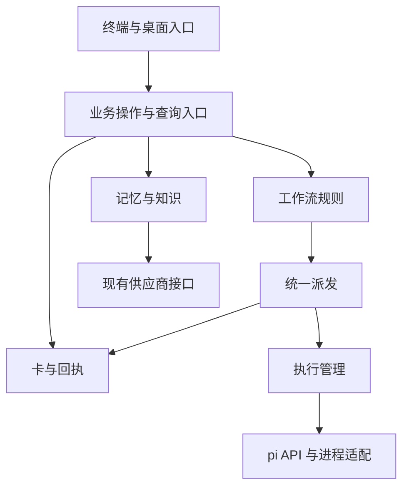
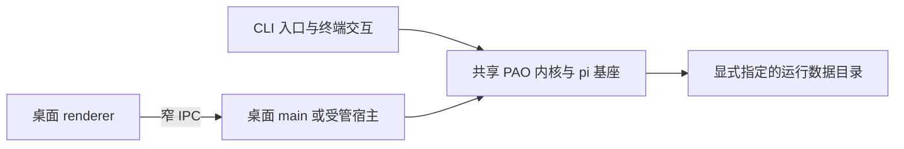

# PAO 整体模块化重构总计划

日期：2026-10-05。状态：**已完成（2026-10-06）**——13 任务全部通过完整审查链，交付结论与遗留总表见 `../../.pao/整体重构-20261005/交付报告.md`，检查点时间线见同目录执行记录。适用：开发仓、PAO 内核与桌面端；Windows 为本轮运行验收目标。

## 1. 目标、事实与授权

目标是在保留已确认功能与数据的前提下，让模块职责清楚、实现可替换、终端和桌面共用业务规则，并减少对 pi 原有源码的修改。可插拔不等于引入插件框架。

用户已确认：可以提出功能精简建议，但删除能力、改变使用流程仍须逐项决定。用户明确纠正：工作流与画布当前没有在进行；旧文件中的“实施中”不是存在活动开发者或进程的证据。当前工作区仍有未提交成果，必须保留并核查，不能按废弃代码处理。

本计划是重构任务与状态的唯一执行正本。产品行为继续引用 [需求](../v2-REQUIREMENTS.md)、[架构](../v2-ARCHITECTURE.md)及[工作流与看板需求](存档-收编-2026-10-07/2026-10-05-工作流与看板形态重构需求.md)。旧[后续执行总册](存档-收编-2026-10-04/2026-10-04-后续执行总册.md)保留未完成产品事项与历史证据，不自动并入本轮范围。本文提出的内部结构为实施目标，不冒充现状。

### 1.1 范围

- 纳入：现状基线、模块依赖、派发与生命周期、卡与工作流边界、pi 适配、记忆等独立模块、终端与桌面接入、相关验证与文档收敛。
- 不纳入：重新开发整个 pi、升级 pi、替换桌面技术栈、重新设计 UI、新增供应商、增加并发规模、自动恢复、常驻服务、数据库迁移、无差别全库改名或格式化。工程命名按 T11 分模块迁移，属于本轮范围。
- 现有未完成功能：只修重构所必需的接线和回归；独立新功能继续留在原产品计划，不以“顺便完成”扩张本轮。
- 保留：卡文件与回执、配方与冻结快照、流程实例控制数据、会话记录、用户配置、现有可用入口与错误语义。协议的中文键不得因代码英文化改名。

### 1.2 一次 goal 启动后的执行范围

用户使用第 10 节文本启动后，可连续完成本计划内的本地代码修改、必要测试、离线构建、文档和隔离数据验证，不逐任务询问是否继续。当前请求仅编计划，不等于已启动该 goal。

未经单独授权不得 push、发布、提交既有他人修改、删除功能、破坏性迁移、修改全局工具链或系统服务、改正式 PAO_HOME 配置或共享记忆、调用收费模型。已有授权只能引用有明确范围与额度的记录，不能把旧计划笼统当作本轮费用许可。默认保留未提交修改，不自动 commit；用户另行授权提交后，只提交本轮可归属改动。

文档冲突处理：本计划中用户新确认的命名、内嵌内核及宿主分离要求优先于旧文档相反描述；T01 同步订正需求与架构正本。其他产品语义不变，不能把重构计划当作任意改变行为的授权。

## 2. 现状证据与复用选择

编制时只读调查发现下列入口；执行时完整调用关系与最新状态在 T00 复核，不凭文档推断已经通过。

| 位置（相对 PAO/packages/coding-agent/src/pao） | 已知问题或可复用基础 | 本轮处理 |
|---|---|---|
| worker/dispatch-core.ts | 同时解析工作流、档位、技能、预算、认领、写锁与派发；反向导入 workflow/control、driver、minister、recipe | 保留统一派发能力，拆出工作流解释与通用执行 |
| worker/index.ts | 导出、默认运行器、退出、扫描、工具注册、通知混合 | 按实际生命周期与入口职责拆分，不另建运行器 |
| workflow/auto.ts | v1/v2 推进分支共处，调用统一派发核心 | 保留兼容入口，分开版本解释，复用执行链 |
| cards/ | 已有类型、文件、状态机、回执、验收等模块 | 保留，限制其他模块绕过其写入口 |
| memory/memory-vendor.ts、memory/index.ts | 已有接口、管理器及 gbrain/mnemosyne 实现 | 复用接口，禁止另建供应商框架 |
| index.ts、role.ts | 已有角色装配与工具限制 | 保留角色权限，收敛装配与销毁 |
| desktop/、status/、panorama/ | 已有查询与汇总入口 | 统一数据来源，保留页面必要投影 |

桌面核查入口：`桌面端/packages/pi-sdk-driver/src/pao-*.ts`、`apps/desktop/electron/platform/pao/`、`apps/desktop/contracts/`、`apps/desktop/src/features/{canvas,workboard}/`。目录列表不是完成清单。

复用依据：需求 §4.1、当前 pi 源码与类型、项目已有运行器/卡读写/供应商/桌面 IPC。优先使用现成能力，本轮不引入第三方运行时或新依赖。若确有缺口，先查本机已有包，再查公开方案，记录许可证与维护情况；不能仅为拆文件新增依赖。

pi 修改归因必须同时看提交历史和差异。已查到相对本地 `v1.0.0` 标签的原有源码差异涉及 agent、ai、coding-agent、tui；不能把所有差异都归为 PAO 自定义，更不能批量还原。

## 3. 目标架构

### 3.1 职责与依赖

图表示依赖，不要求给每个方框建立目录或类。保留已有目录，逐项迁移。应用入口是调用函数，不是新增服务、总线或第二运行时。

| 边界 | 唯一职责 | 禁止承担 |
|---|---|---|
| 工作流 workflow | 配方解释、冻结快照、节点与轮次、依赖、审核分支、暂停恢复判断 | 管进程树、直接写 UI 状态 |
| 卡 cards | 卡协议读写、合法状态变化、回执追加、验收与交付契约 | 根据页面状态猜执行结果 |
| 派发 dispatch | 校验请求、预算与并发准入、认领及执行编排 | 理解具体工作流配方格式、绘制提示 |
| 执行 worker/host | 子进程或会话启动、事件读取、取消、停止确认、资源回收 | 决定业务验收通过、读取页面状态 |
| 适配 | 将已有 pi/系统/供应商接口映射为内部调用 | 复制模型循环、会话历史或重试引擎 |
| 查询 status/desktop | 读取权威数据，生成界面所需结果 | 写业务状态、维护独立进度正本 |
| 装配 index/role | 创建实例、绑定依赖、按角色注册、统一销毁 | 业务判断、文件格式解析、大段渲染 |

### 3.2 数据归属

| 数据 | 权威来源 | 其他模块允许做什么 |
|---|---|---|
| 任务执行与验收结果 | 卡与不可变历史回执 | 查询；调用卡接口请求变化 |
| 工作流定义 | 可编辑配方 | 编辑时校验；启动时冻结 |
| 实例节点、轮次与分支控制 | 既有实例清单及冻结配方 | 经工作流入口操作，不能当缓存删除 |
| 对话和工具事件 | pi 会话 | 订阅/查询，不另造持久化会话引擎 |
| 在途进程与停止状态 | 现有运行器登记 | 只表运行期事实，不替代卡的业务终态 |
| 页面选择、布局、未保存编辑 | 桌面 UI 状态 | 保留现有持久化边界，不据此推进任务 |
| 记忆与知识 | 既有供应商与部门库 | 经既有许可入口读写，不另建副本 |

### 3.3 接口设计要求

以下是语义约束，名称供实施参考；先复用现有类型，不整体改公共签名。

- `DispatchRequest`：必须能关联项目、卡路径、操作者/会话、尝试与执行身份、取消信号、已解析的档位/技能等执行参数。工作流解释函数产生必要上下文，但执行层不接收完整配方后再自行解析。
- 工作流派发校验不能只在界面或预检查执行。所有可派出工作流卡的入口，在实际启动前重核实例、轮次、owner、暂停、冻结版本。可在装配处注入小型校验函数；普通卡走原校验，工作流卡缺校验器时拒绝，不能默认放行。
- 保留一个受保护的派发入口。单卡、扇出、自动链、部长相关入口调用它或明确复用同一准入步骤。不要把三个入口改成各自的一串低层函数。
- 预检查与启动共享纯校验，但启动必须在取得所需锁后重核可变条件。不能把检查结果当永久许可；沿用已有锁顺序，不自行增加全局大锁。
- 执行结果区分成功、失败、取消、未知；退出码 0 不是验收通过。回执关联完整卡身份与尝试/执行身份，迟到旧回执不推进新轮次。
- 停止操作可重复调用；先阻止新派发/请求，再停止受管进程，确认停止后释放写锁。超时或无法确认时保留不确定状态和证据，不伪报已停。
- 现有 runner 停止链通过 `StopProof` 向锁模块证明已停止；沿用其生成与校验，不伪造证明、不改为布尔值、不新增裸 kill 后直接放锁路径。权限检查保留拒绝优先语义：worker 禁派、部长必须有正确 `PAO_DEPT` 且仅本部门、主控按现有权限派发。
- 对外错误保留可定位原因；查询失败不能变成空列表。不得用 catch 返回默认成功掩盖依赖错误。
- 可选模块沿已有配置与角色装配。未启用不产生后台工作；启动失败按现有降级契约显式显示。不得新增一套 feature flags、容器或动态插件协议。

### 3.4 开发仓、共享内核、CLI 与桌面（用户补充定案）

`pao-dev` 是开发源码及工程文档项目，不是日常 PAO_HOME。CLI 与桌面是共享内核的两个独立宿主。“桌面纯壳”限制的是业务重复，不代表它必须连接外部 CLI；桌面发行物必须内嵌内核及所需运行依赖。

- 内核负责会话/业务能力，宿主负责启动、退出、入口参数与 UI。CLI 的 argv、stdin/stdout 呈现、终端信号处理不得成为桌面使用内核的前提。
- 使用现有 SDK 和 package exports 建立内核公共入口，不导入 `cli.ts` 或终端交互模块获取业务函数；不依赖全局 `pao` 命令。公开入口导入无启动副作用。
- 桌面可在 main 或现有受管子进程内加载内核，沿用已验证方案，不为“分离”新建网络服务。若 worker 要子进程，复用 pi 正式 headless 能力或内嵌执行入口；入口路径从当前安装产物解析，不从开发仓硬编码。不能以取消子进程来削弱隔离和停止机制。
- 两个宿主共享实现与协议，分别持有会话实例；不共享全局可变单例。配置/存储/日志位置在装配时显式传入，同项目锁与会话控制规则照旧。
- CLI 可独立构建和运行，无 Electron/React 运行依赖；桌面内嵌准确匹配的 fork 内核，不需要用户安装 CLI。内部内核副本是构建产物，不是另一份手工维护源码。
- 现有 `vendor-pao-kernel.mjs` 和 SDK driver 为复用起点，不据文件存在声称独立打包已经验收。核查 workspace link、版本解析、package exports、打包路径和后代进程入口。

### 3.5 命名、目录与文档要求

中文不是技术错误；本项目选择英文工程命名是为了统一工具和协作约定。面向用户的说明继续中文。

| 对象 | 规则 | 迁移边界 |
|---|---|---|
| 自有源码/测试/脚本/工程目录 | ASCII 英文，通常 kebab-case；测试沿 `.test.ts`/`.spec.ts` 本包惯例 | 每模块一批，同批修改 import、脚本与测试引用 |
| 变量/函数/参数 | camelCase；含义清楚，不用拼音缩写 | 内部符号可迁移，不修改序列化字段 |
| 类型/类/组件 | PascalCase；组件文件按所在包既有约定 | 不为统一风格批量改上游文件 |
| 常量 | 普通不可变变量 camelCase；既有全局常量约定 UPPER_SNAKE_CASE | 不把所有 const 都改大写 |
| 协议/配置/存储字段/工具名 | 既有中文外部契约保留；内部英文通过明确映射读取 | 需要修改外部契约时另行决策与迁移，不全局替换 |
| README/贡献/安全/许可入口 | README.md、CONTRIBUTING.md、SECURITY.md、LICENSE 等标准名 | 有实际用途才建；不预建空壳文档 |
| 产品说明、计划、历史日志 | 内容中文，已有中文历史路径保留 | 新工程说明采用英文主题文件名，引用同批更新 |
| 上游 fork 内目录与包名 | 保留上游约定 | 不为整齐增加无意义 upstream diff |

目录目标：保留开发根名 `pao-dev`；自有桌面仓目录 `桌面端/` 迁为 `desktop/`，T11 单独处理并核实未提交文件、嵌套 git、工作树、链接、构建脚本与依赖路径。`PAO/` 暂保留为上游 fork 边界，不为大小写改为 `pao/`；以后确需迁为 `pi/` 必须有明确收益和独立迁移任务。暂不合并 Git 仓库，不建立第二份源码。不要凭概念图新建空 `packages/core`/`apps/cli`，先在现有 fork 包内分 exports 与入口即可。

README 分工：

- 开发根 `README.md`：项目定位、开发仓与 PAO_HOME 区别、内核/CLI/桌面关系、首次开发步骤与命令导航；根当前缺 README，需要补齐。
- fork `README.md`：保留上游说明、许可证和来源，在显著位置链接 PAO 开发/运行说明，不用 PAO 产品文案覆盖全部上游文档。
- desktop `README.md`：桌面开发、测试、内嵌内核更新、打包及独立运行；区分 CLI 用法，不要求全局装 CLI。
- 非显然模块的 README 或现有架构段：职责、公开入口、依赖、错误/生命周期、测试入口。简单目录不强制建 README，避免复制类型声明。
- `AGENTS.md` 放工作约束；架构正文维护设计；计划维护状态；日志保存证据。一个命令的详细用法有唯一出处，其他位置链接。

其他工程要求：严格类型与运行时输入校验分开；跨进程输入不能仅依赖 TypeScript 类型。公共 API 使用明确 exports，禁止消费者导入私有实现路径。依赖由各仓现有锁文件与包管理器控制，不借本轮改包管理器；运行依赖和开发依赖分清。配置启动时按真实需求校验，密钥不入日志。错误保留原因与关联身份，清理资源有明确责任人。测试验证行为与边界，不仅匹配新函数名。构建输出不混入源码，发行物不能意外依赖本机绝对路径。保留第三方许可与来源。

## 4. 执行纪律与留档

本计划逐任务状态只使用：未开始、进行中、已实现待验证、通过、受阻。受阻项记录原因、影响和下一步；不把“已实现”写成通过。

实施记录统一放开发根 `.pao/整体重构-20261005/`，仅三个长期记录：`现状与基线.md`、`执行记录.md`、`交付报告.md`；测试原始日志放其 `日志/`。临时脚本与隔离现场放 `D:/AI/workspace/临时文件夹/整体重构-20261005/`，说明用途/输入/输出。测试数据使用隔离 PAO_HOME，不污染正式现场。下文“三仓”均指开发根、PAO 内核、桌面源码仓，不包括正式使用现场。

每次开始或上下文恢复：读本计划、执行记录最后检查点、目标仓 status/diff 和待改源码，再继续最早可执行任务。不要根据聊天摘要重做已通过任务。

每个任务执行循环：确认前置 → 查调用链 → 确定本次文件范围 → 复用已有关键行为测试，缺必要覆盖才补测 → 小步修改 → 定向验证 → 必要集成验证 → 审 diff → 记录状态和下一步。一次只推进一个共享核心写入任务；可并行只读调查或不共享文件的测试，串行是默认，子代理不是完成计划的前提。

检查点必须包含任务号、三个仓 HEAD、本轮文件列表、开工已有修改与本轮修改的区别、命令及退出码、日志路径、未验事项、下一条具体动作、仍活跃的本轮进程。只有测试/构建确实依赖版本确认时记录构建身份，不额外保存全库校验副本。

遇到问题先定位。连续两次相同修复无效时停止猜改，补最小复现与原因分析；仍能做独立任务则继续。需要产品取舍、付费、正式数据修改时提交具体问题，冻结相关分支，继续默认保留路线。不得为维持连续 goal 绕过检查。

## 5. 任务清单与顺序

默认顺序 T00 → T01 → T02 → T03 → T04 → T05 → T06 → T07 → T08 → T11 → T12 → T09 → T10。T11/T12 为本次补充任务，保留原编号以免旧引用失效。内部命名随 T02—T08 分模块迁移，T11 做目录迁移与漏项收口。每项通过后才启动依赖它的任务；没有必要修改的模块可以“核查通过”，必须附证据，不为完成任务制造改动。

| 编号 | 状态 | 前置 | 交付 |
|---|---|---|---|
| T00 | 通过（2026-10-05） | 无 | 工作区与行为基线；证据=.pao/整体重构-20261005/现状与基线.md §①—⑦ 与其 日志/ |
| T01 | 通过（2026-10-05） | T00 | 模块/数据/上游改动清单与当前文档对齐；边界表落 v2-ARCHITECTURE §27；证据=现状与基线.md T01 章 |
| T02 | 通过（2026-10-06） | T01 | 卡与工作流边界及派发上下文 |
| T03 | 通过（2026-10-06） | T02 | 单一派发链与入口一致性 |
| T04 | 通过（2026-10-06） | T03 | 生命周期与停止链收敛 |
| T05 | 通过（2026-10-06） | T04 | 工作流版本解释与推进分离 |
| T06 | 通过（2026-10-06） | T01、T05 | pi 适配面归因与必要缩减 |
| T07 | 通过（2026-10-06） | T01、T04 | 独立模块装配与可替换接口 |
| T08 | 通过（2026-10-06） | T03—T07 | 终端、桌面统一接入 |
| T11 | 通过（2026-10-06） | T08 | 英文工程命名、目录迁移与 README；证据=执行记录 CP30—CP35、日志 T11-*/T11续-*/T11修-* |
| T12 | 通过（2026-10-06） | T11 | 内核/CLI/桌面入口与发行分离；证据=执行记录 CP36—CP39、日志 T12-*/T12续-*/T12修-* |
| T09 | 通过（2026-10-06） | T12 | 全链验收与有限结构检查；证据=执行记录 CP39—CP42、日志 T09-*/T09b-*/T09修-* |
| T10 | 通过（2026-10-06） | T09 | 文档收口与最终交付；证据=执行记录 CP43/CP44、交付报告阶段11 章＋最终导航＋遗留与用户决策总表 |

### T00：保护现状并建立基线

1. 读取三仓与相关子目录 AGENTS、两份产品定案和当前产品计划。核实各目录的 Git 根、独立仓/受管工作树身份与 .git 形态，记录实际分支/HEAD、暂存/未暂存/未跟踪文件；以当前工作区为功能输入，不把 HEAD 当作唯一成果。
2. 不 stash/reset/clean，不自动提交旧修改。对本轮即将改动且已有修改的文件保留可恢复副本或补丁；未跟踪文件必须单独保留。只备份将改文件，不复制凭证或整个 node_modules。
3. 检查真实进程与占用，不能仅凭旧日志宣称别人在开发，也不能结束用户独立会话。默认在当前工作区工作；若用隔离工作树，明确转入哪些已保留成果，不能遗失未提交实现。
4. 核实 Node/npm/pnpm、本地测试工具、代码图 CLI、基线文件及构建入口。参考旧报告 `代码图恢复记录.md` 的 CLI 形式；工具参数以现场 help 为准，图异常边须读源码确认。
5. 在隔离环境运行 §6 基线检查；建立真实可用功能清单。环境失败、旧失败、产品失败分别记录，旧测试数量不是当前豁免。

验收：可以准确重建开工状态；每个相关失败有原始日志；不存在“历史报告绿所以当前绿”的结论。基线关键主链不能运行时先窄修或阻塞相应任务，不大规模开始搬代码。

### T01：确定模块归属和上游修改清单

范围：文档与源码只读调查；必要文档在现有架构正文维护。

1. 列全部 `src/pao/` 模块及桌面 PAO 相关入口，记录公开入口、数据读写者、跨模块依赖、当前测试。每个模块都归入 §3 职责；未涉及的模块记“保留”。
2. 核实真正 pi 基线及 upstream 提交关系，按差异块分类：上游继承、PAO 接线、平台修复、产品定制、无关或待归因。记录文件/符号、原因、消费者、回归验证与处理建议；不能只统计文件数。
3. 将目标边界补入 `v2-ARCHITECTURE.md`，标明目标/未完成；旧“fork”定案继续有效，公开 API 优先与保留 fork 不冲突。只订正实际冲突，不重写无关产品行为。
4. 功能精简候选只登记待决定，默认全部保留。登记本轮不接管的旧产品缺项。

验收：所有模块有归属，核心链有可核查调用路径；下游任务文件清单与现状相符。不要新增总架构框架代码。

### T02：分开工作流解释与通用派发输入

范围：`worker/dispatch-core.ts`、`workflow/{control,driver,minister,recipe}.ts` 的必要调用处和对应测试；优先新增工作流内的小解析模块，目录名不整体迁移。

1. 抽出工作流标记、冻结配方、实例/轮次/owner/暂停检查及技能解析，归 workflow；通用档位解析归 routing，避免 worker 知道配方版本。
2. 定义最小输入/校验回调，沿 §3.3 保留派前最终重核；查齐单卡、扇出、自动链等所有调用方。
3. 卡认领、状态变化、回执追加仍使用 cards 原入口，不复制写文件方法。

验收：worker 通用派发不再直接导入 workflow 实现；直接派工作流卡也不能绕过实例校验；普通卡行为不变；暂停后、旧轮次、错误 owner、冻结版本身份不匹配时拒绝启动。仅编辑了最新配方不应使合法旧实例失效，旧实例仍使用原快照。

### T03：保留唯一派发事务顺序

范围：`worker/dispatch-core.ts`、`worker/index.ts`、`fanout/execute.ts`、`workflow/auto.ts`、相关 host 调用方。

1. 按“参数准备、准入、认领、启动、结果处理”拆职责，复用已有锁、预算与登记，不新造 DispatchManager。
2. 保留 `executeDispatch` 或同等单一受保护入口；接口改动同批迁移所有真实调用者。
3. 用故障注入覆盖锁等待期间取消、认领后启动失败、回执写入失败、并发额度耗尽；资源释放顺序必须保持原有安全约束。

验收：同样请求从单卡/扇出/工作流发出得到相同准入判断；同项目写互斥有效；共享预算不重复放大；失败不留假成功或无主锁；worker 无递归派工入口。

〔T02 遗留输入 2026-10-06：owner 重核目前仅自动链生效（workflow/auto.ts 注入点），单卡（worker/index.ts:742）与扇出（fanout/execute.ts:209）注入未传 owner，与 §3.3「所有入口重核 owner」字面不符——本任务统一入口准入判断时先查清单卡/扇出派发是否绑定实例与 owner 语义，再收口（R5 审查 P2 裁定）。另：v1 卡缺 PAO_HOME 跳过节点校验的既有放行行为已在 T02 钉测试，v1 语义去留随 T05 定案。〕

### T04：生命周期与停止

范围：`worker/index.ts`、`worker/runner.ts`、worker 停止/父进程生命周期相关模块、`host/host.ts`、装配入口。

1. 从注册入口拆出进程生命周期、静默扫描与通知。复用现有运行器登记；不合并语义不同的部长会话与一次性 worker，只共享真正通用的停止原语。
2. 会话内只创建所需一份运行实例；订阅、定时器、子进程必须有明确销毁者。禁止跨会话默认单例串状态。
3. 重复取消/退出、启动中取消、取消后迟到事件、父死路径均保留证据；停止无法确认不释放给新写者。

验收：Windows 正常退出、Ctrl+C、仅强杀父进程、关闭终端四场活任务验证，检查工具后代也停止；桌面正常关窗与 main 强杀另验；独立对照会话不受影响。不得用空闲进程、父 PID 消失或关闭 ConPTY 自身的树杀结果替代所有场景。无法完成的环境项明确受阻。

### T05：工作流内部整理

范围：`workflow/{auto,driver,control,tools,host-bridge}.ts` 与配方/快照必要接口。

1. v1/v2 各自解释控制语义，共用受保护派发；版本判断集中，旧实例未知版本明确拒绝自动恢复，保留原件。
2. 推进只计算合法后继与执行请求；验收、回执与进程停止调用相应模块。工具注册只解析输入、调用业务并格式化返回。
3. 读取运行实例必须使用冻结配方；编辑配方不改变旧实例；暂停/恢复、审核退回、人工门、循环上限与跳过均按既有契约。

验收：定向覆盖串行、并行、失败停流、审核三态、旧轮次事件、人工门与旧实例读取。保留原有数据格式；不以整理版本分支为由删除 v1。

### T06：缩减 pi 原有源码修改

范围：T01 已归因清单中的单个差异组；禁止一次还原整个目录。

1. 每组依次评估配置、公开 API、已有扩展事件；可迁出时先实现 PAO 接入并验证，再移除旧接线。
2. 不能迁出且确有需要的修复保留，说明升级验证；非 PAO 历史差异不擅动。不为去掉少量改动复制 pi 模型循环、重试、MCP 或会话管理。
3. 每迁一组跑对应回归，保留原生 pi 能力与 PAO 角色隔离；禁止 `pao update`、rebase 或升级来凑“减少 diff”。

验收：每个相关差异组都有处理结论与证据；移出的业务只存在一个实现；残余修改有必要性说明。不设任意百分比目标，无安全可迁项可以保留并说明。

### T07：独立模块与装配

范围：`memory/knowledge/routing/context/output-pruning/usage/notify/patrol/healthcheck/preflight` 以及 `index.ts/role.ts/runtime`；依 T01 清单逐模块核查，避免全域同批改写。

1. 复用现有供应商接口；只在发现真实泄漏或重复时调整。供应商特有错误/配置在适配器内处理。
2. 清理装配入口中的业务逻辑，归还模块；跨模块需要共享的纯规则由实际负责模块导出，不倒进万能 shared。
3. 检查启用/未启用/配置坏/服务不可达/销毁，沿现有策略明确降级；不假造记忆，不额外请求模型。
4. 上下文优化、费用统计、巡检保持原默认值与触发条件。可替换接口不等于改变运行策略。

验收：至少用现有两个记忆适配器的确定性契约测试验证同一接口，明确是模拟供应商；真实在线验证单独授权。模块关闭不产生自己的请求/定时任务，不能削弱仍启用功能的权限限制。

### T08：终端与桌面共用业务

范围：PAO `desktop/status/panorama`、工具与命令入口；桌面 driver、platform/pao、contracts、相关页面。

1. 列出启动、停止、确认、恢复、查询的终端/桌面调用链；把重复业务判定移到已有 PAO 入口，页面保留交互校验。
2. 同会话单控制方、不同会话隔离；跨进程消息必须校验身份、项目、轮次与请求关联。响应丢失先查询，不能自动重发写请求。
3. 复用现有 IPC 与 schema，不让 renderer 导入内核文件/进程 API。展示模型可以不同，但业务字段来自同一权威数据。
4. 保留画布/看板当前成果，不重新设计布局；启动失败不落假实例，旧实例图不随配方变动，拖动不能绕过卡状态规则。

验收：真实 Windows Electron 覆盖打开、查询、启动、取消、确认、旧请求、切会话与重启读取；可用隔离本地执行器但必须标为非真实供应商。原有界面能力不丢；当前未完成功能仍如实列出，不能把重构当产品全量完成。

### T11：工程命名与文档收口

1. T01 冻结命名清单：范围为 `src/pao/` 与桌面 PAO 自有源码、测试、脚本，区分内部标识符、外部协议、上游源码和历史资料；T02—T08 分模块迁移，T11 将清单剩余项逐模块处理。同批引用方必需改动纳入，不扩大到无关上游标识符或全部历史资料。不对中文文案做机械“非 ASCII 禁令”。
2. 每次符号迁移使用语言工具或明确范围替换，检索所有引用并运行类型与对应行为测试。卡字段等外部中文键保留显式映射；不添加无人使用的双名兼容层。
3. 迁移 `桌面端/` 为 `desktop/` 前确认没有占用源目录的开发进程，保存全部未提交/未跟踪成果清单；绝对源与目标路径须在开发根内，目标不存在。用同一 PowerShell 原生 Move-Item 操作，禁止复制后递归删除或跨 shell 删除；若为受管工作树则使用对应工具，不能直接移动破坏登记。源是独立 Git 仓时保留完整 .git。
4. 同批更新当前开发脚本、workspace link/overrides、打包脚本、父仓 ignore、有效文档与工具配置中的旧路径。历史日志不改；机器外部任务或应用绑定无法迁移时先保留原目录并将目录迁移标受阻，禁止以过渡双副本假装完成。
5. 本计划前述 `桌面端/` 是编制时路径，迁移后任务路径与命令统一解析为 `desktop/`，同批更新有效引用。不移动使用现场，不改全局 CLI 垫片；如旧垫片受影响则提出具体授权。
6. 按 §3.5 补根 README、订正两子仓 README 和必要模块文档；核实每条安装/构建/运行命令，未实际执行的步骤明确标注。不要给每个函数写一份文档。

验收：T01 冻结清单内的中文内部标识符已迁移；保留项必须属于外部契约、上游代码或经用户决定的例外，不能仅以“以后再改”豁免。外部中文协议可读写且旧数据不变；迁移前后的 Git 身份、未提交内容和未跟踪成果一致；无有效脚本依赖旧桌面路径；从 README 可定位各入口并执行最小开发检查。迁移不含删除历史资料。

### T12：内嵌内核与两种宿主独立交付

范围：fork 的 SDK/package exports/CLI 装配；desktop driver、内核物化与打包脚本、会话启动及 worker 路径解析。T06 已进行接口迁移，本项验证并补齐宿主边界，不重新开发 SDK。

1. 列出内核导出、CLI 入口、桌面宿主入口；将 CLI 专属参数解析、终端输出与信号装配留在 CLI，将共用业务从 CLI 导出依赖中移除。两入口只负责装配，不互相 import。
2. 桌面经 SDK 加载内嵌内核。受管子进程可以使用内嵌 pi 无界面执行能力，但不得调用全局 `pao`/`pi` 或桌面用户 CLI 配置来隐式启动。检查 worker 和部长的路径兜底，而不只看桌面主会话。
3. 保留两个宿主的生命周期语义与同会话互斥；不得为内嵌而把所有会话变成进程级全局对象。包公开接口同源码/构建/安装形态对应。
4. 复用现有打包方式；内核及运行依赖版本从已验证构建解析，避免 link 指向开发仓才可运行。CLI 不携带 Electron/React；桌面安装不要求全局 CLI。分别记录构建命令和依赖来源。
5. 在隔离目录验证两种发行产物，不移动或删除真实开发仓来测试：在独立环境或复制安装产物中屏蔽开发仓解析路径和全局 CLI PATH，观测所有加载/启动路径。无此环境则标独立运行未验，不拿开发态通过替代。

验收：导入内核不启动终端或产生宿主副作用；CLI 无桌面依赖能运行；桌面无全局 CLI、无开发仓路径也能启动会话、执行隔离工具并停止后代；缺内嵌依赖明确报错，不暗退到机器上的另一个 pi。模型响应可用明确标注的本地 fixture，但进程/文件/安装路径须真实。打包成功本身不算独立运行通过。

### T09：综合验收与结构防退化

1. 对本轮触及的边界复用现有结构检查；必要时用现有脚本体系加入有限依赖断言：通用执行不导入 workflow、底层不导入 UI、renderer 不越权。允许明确列出的装配文件，不做全库自研分析平台。
2. 跑 §6 门与 §7 场景，核对开工失败集合；每个新增失败必须修复或确认阻塞，不能重写基线变绿。
3. 记录相同业务在不同入口的关键判断一致、保留数据可读、停止无后代、可选功能不干扰主链的证据。

4. T04 的停止验收属于当时检查点；T06/T08/T12 后若改变生命周期、进程入口或打包路径，须在最终产物上复验受影响场景，不能拿旧产物结果覆盖最终状态。

验收：必要门通过，真实与模拟分别标注；不存在用跳过替代通过。代码审查重点看安全检查是否随拆分丢失、接口是否只换名而仍反向依赖。

### T10：交付

1. 订正架构正文的目标/实现状态；本计划逐项关闭，旧产品计划只更新确实受影响项，不扩大完成声明。
2. 给出最终模块图、上游差异处置清单、验证入口、遗留与用户决策。收敛重复文档，不删除历史证据。
3. 清理仅本轮创建且确认无用的进程和临时缓存；保留有用途的脚本、日志与成果。未授权不提交或推送。

验收：下一模型仅凭本计划、架构及交付记录能定位模块并执行验证；goal 完成条件按 §9，不以时间/上下文耗尽宣告完成。

## 6. 检查与构建命令

> 路径注记（2026-10-06 归档时补）：本表「桌面端」工作目录自 T11 起已迁移为 `desktop/`（git 历史完整保留），执行时按新路径进入；命令本身不变。

下列入口于编制时从 package.json/脚本核实；T00 再核命令和环境，不在编计划时运行。PowerShell 每条命令显式指定工作目录；不依赖错误 shell 的命令拼接。

| 工作目录 | 命令/入口 | 用途与限制 |
|---|---|---|
| PAO/packages/coding-agent | `npx vitest run test/pao/ --maxWorkers=4` | PAO 模块回归；本地 vitest 不存在时不默许 npx 下载 |
| 同上 | `npx vitest run test/pao/<实际文件>.test.ts --maxWorkers=1` | 定向验证；文件名先查目录，不照抄占位符 |
| PAO | `npm run build:offline` | 按兄弟包顺序构建，供正式入口验证；不刷新模型目录 |
| PAO | `node scripts/check-baseline-failures.mjs --save-log <绝对日志路径>` | 隔离非 e2e 回归，比原基线，不修改失败集合 |
| PAO | `npm run check` | 脚本含 `biome --write`；脏工作区不能直接全仓执行，按下文处理 |
| 桌面端 | `pnpm check:architecture`、`pnpm typecheck`、`pnpm test:baseline` | 分别为边界、类型和仓库基线；T00 记录原有问题 |
| 桌面端 | `pnpm --filter @pi-gui/desktop run build` | 只构建桌面，不顺带构建营销站点 |
| 桌面端 | 现有 Playwright unit/core 入口 | 先读 apps/desktop/README 与 tests/AGENTS，选择相应文件；真实 Electron 与供应商测试分开 |

`npm run check` 的处理：先读取准确脚本；在原工作区使用本地 biome 的无写入检查加其余同等子检查（依赖、导入、安装锁、类型、browser-smoke），只格式化本轮文件。若需要完整执行带 --write 的命令，在保留全部被测成果的隔离副本中执行并审查它产生的差异，不能把全仓改写带回。不以此跳过任何检查项。

所有测试用隔离配置与假凭证，不加载正式端点；核实测试是否会因环境变量触发在线调用。全量 baseline 脚本的默认基线是否存在必须先查，缺失时报受阻，不自动创建一个全绿基线。类型错误按当前证据处理，不沿用旧“某一错误可豁免”的事实。

基线判定：PAO 模块门与本轮相关新测试必须通过；历史失败集合门仍须按原基线通过。桌面及其他检查若开工已有无关失败，逐项保留同环境复现和归因证据，本轮不得新增或扩大；“没改该文件”不能单独证明无关。未知原因、重构相关或阻断必需流程的失败不能豁免。不得通过增加基线失败项取得通过，也不把修完所有无关上游缺陷变成本轮目标。

模块门在核心批次后运行；全仓门在基线和最终集成运行，改变跨包接口时加跑。未有新改动或新疑点不重复全量。计时失败先单文件隔离复查并保留原失败，不增加超时或删断言来变绿。

## 7. 必须保持的行为与验收场景

| 场景 | 可观察结果 | 最低证据 |
|---|---|---|
| 普通卡经单卡与批量启动 | 准入一致、无重复认领、回执归属正确 | 确定性集成测试 |
| 工作流暂停/旧轮次/错误 owner | 所有入口拒绝错误派发 | 真实业务入口测试，不只测 helper |
| 同项目竞争写锁 | 第二写者不能提前启动；取消等锁无泄漏 | 真子进程或跨进程锁测试 |
| 预算耗尽与重试 | 主控/部长/worker 限制不绕过；共享配额不放大 | 明确假供应商计数测试 |
| 启动中/运行中取消 | 无新请求；实际停止后才放锁 | 真子进程心跳/文件写入观测 |
| 迟到回执与旧确认 | 保留证据，不推进新尝试或新轮次 | 集成测试 |
| 配方编辑后读取旧实例 | 使用原快照，历史状态不变 | 隔离文件与桌面读取测试 |
| 记忆关闭或不可达 | 主会话按契约可用，错误如实呈现 | 接口测试；真实供应商另验 |
| 终端/桌面同会话控制 | 单控制方；不同会话互不串状态 | RPC/桌面集成 |
| Windows 退出 | 受管工具后代停止，对照会话存活 | T04 活任务矩阵 |
| 一次实际编码任务 | 修改、回执、验收可对照 | 真实供应商需独立费用授权；无授权不得冒充完成 |

供应商真实任务属于条件验收：未授权时可完成本地重构验证，但报告必须明确“真实供应商验证未执行”，不宣称生产全面验收。历史在线证据只能支持未改变的行为；改变请求/上下文链后不能直接复用旧结论。

## 8. 功能精简候选与默认决定

| 候选 | 要核查什么 | 未获决定时 |
|---|---|---|
| 每类任务都经过部长 | 真实任务的收益、额外会话/费用与失败面 | 保留，不改默认派发策略 |
| 旧 v1 控制路径 | 是否仍有旧实例、是否能只读兼容或显式迁移 | 保留可用行为，不偷偷删分支 |
| 自动巡检与上下文优化 | 当前启用情况、真实收益、是否主要增加维护成本 | 保持默认值，只整理接口 |
| 备用记忆适配器 | 真实消费者和维护成本 | 保留，不新增供应商 |

每个候选只能在有证据后向用户提出“保留/简化/移除”的具体建议、影响与恢复办法。没有答复按默认保留完成重构，不让候选讨论无限阻塞主线。

## 9. 完成判定

必需：任务表 T00—T12 共 13 项逐项通过；所有触及能力保持行为；约定依赖方向有检查证据；派发和停止验证有效；CLI 与内嵌内核桌面各自独立运行有证据；命名/目录迁移与 README 验收通过；当前构建可运行；本轮新增失败为零；上游差异处置可追溯；未提交旧成果完整保留；架构和执行记录一致。

可明确排除而不阻塞本地重构完成：尚未批准的功能精简、独立产品缺项、没有费用授权的在线任务、发布与 push。必须逐项列明，不能将其计为通过。

不可排除：重构引入的回归、无法证明的数据保留、停止/锁/权限缺陷、必需 Windows 集成未验证、关键检查缺失。出现这些情况只能报告未完成及具体阻塞，不得标完整 goal 达成。

若全部剩余任务依赖同一外部条件，记录最小解除条件并向用户报告，不空转重试。任务的“受阻”是本计划状态；goal 工具的状态变更遵守所在平台规则，不能擅自标暂停或完成。

## 10. 执行需遵守的纪律

> 以该计划为任务与验收正本，按 §5 的依赖顺序推进全部 13 项任务，遵守 §1.2 授权边界。保护已有成果，默认保留功能；自主完成范围内修改、测试和构建，不逐项等待许可。每项更新状态与执行记录，中断后从检查点续接；仅阻塞依赖用户决定的部分，其余继续。不得削弱检查或扩大范围，只有满足 §9 才标记完成，并交付验证证据和未验事项。
主控对话在每完成一个阶段后向用户汇报一次，用户批准后再进行下一阶段。任务的具体实施由主控对话按计划书派发任务给子代理（并行不超过2），代码实施的子代理应加载ponytail fullskill。代码实施或修复完毕后再派发审查子代理（同样并发不超过2），审查子代理应加载ponytail reviewsill，对实施的代码做对抗性审查和过度设计审查，在审查子代理完成后主控应整合审查子代理结果并进行需求性审查。对代码的实施和修复均审查通过后方结束当前阶段。

本节供用户另行启动，本次文档审查不启动重构。持续执行受工具与资源限制；需要决定或环境阻塞时如实报告，不将未验内容算作通过。
