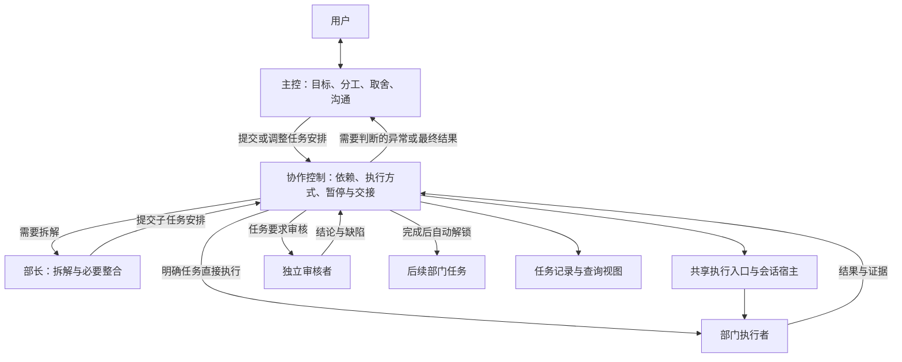

# 多部门协作与主控减负重构总计划

日期：2026-10-23。本文在原讨论稿原位扩充，作为本轮方案的唯一维护处。用户已批准 §1.2 的四项机制定案，并授权按计划实施、接受为达成目标进行大规模重构。当前实施与验收状态只看执行总册 §10.21；正式数据迁移和付费重测另行授权。保留原文件名以维持已有链接。

[既有执行总册](../未完成/2026-10-17-Harness完善与工作台迭代执行计划.md)仍是项目执行入口。本文定义目标、机制、批次和验收；讨论定案后将批次接入总册，不在两处重复维护执行状态。

归档日期：2026-11-02。归档原因：讨论稿，已由执行总册 §10.22 重整方案承接。

## 1. 目标与已确认决定

### 1.1 本次要达成的结果

保留专业部门和多部门协作，让模型集中处理理解、实现和判断，让程序承担确定的流程操作。主控能掌握全局，但正常交接不需要它反复介入；部门能独立完成工作，但不用每次经历完整组织层级。

这不是一次只保留旧行为的代码整理。允许调整内部职责、会话生命周期、工具接口和工作流推进方式，必要时重写相关模块。重构成本不作为保留无效机制的理由；每一个新机制仍须说明必要性，不能用另一套庞大框架替换现有复杂度。

### 1.2 用户已确认的机制决定

| 决定 | 实施含义 |
|---|---|
| 简单任务允许部门直接完成 | 不强制先启动部长再转交工人；需要拆解和协调时才启用部长 |
| 独立审核按任务需要启用，明确要求时必做 | 可以没有独立审核环节，但不能绕过用户要求、任务要求或明确配方中的审核节点 |
| 验收范围内缺陷返修，新增改进另列任务 | 审核不能无限扩大原任务；原范围内新发现的缺陷仍需处理 |
| 可接受大规模重构 | 不受原 A—F 小范围补丁方案限制，以最终目标结构安排改造 |

2026-10-23，用户进一步批准以下四项机制，后续实现以此为准：

| 机制定案 | 执行边界 |
|---|---|
| 主控负责判断，程序负责正常手续 | 主控确定目标、验收、分工和重要取舍；普通派发、交接、状态记录由程序完成，需要判断的阻塞才交主控 |
| 部长按拆解与协调需要启用 | 目标明确且一个执行者可完成时直接执行；需要拆解、多人协调或成果整合时启动部长，由主控安排时一并判断，不额外调用模型分类 |
| 既定范围内自动交接与返修 | 按已确定依赖自动推进；审核发现范围明确的缺陷直接交回原任务。范围变化、方案冲突、权限问题或触及既有限制时停止相关推进，交主控判断；需要用户授权的事项仍交用户 |
| 提示词按职责与需要装载 | 常驻保留职责、关键约束和任务要求；专业方法按需读取；程序可可靠检查的手续由程序执行，删除重复叙述，保留有效保护 |

### 1.3 机制定案的具体设计与实施建议

- 主控负责目标、分工、取舍与用户沟通；程序负责正常推进和执行手续。
- 部门支持直接执行与部长拆解两种工作方式，共用一条受保护执行路径。
- 卡片成为程序维护的任务记录，不再是模型必须手工操作的一套流程。
- 正常完成、依赖解锁与验收缺陷返修由程序衔接；需要判断的异常再交主控。
- 结果默认简短，详细证据按需读取；主控和执行者都不常驻加载全部协作规则。
- 返修优先延续原执行者的任务上下文，但每次执行仍有独立尝试身份和现场核对。

上述设计落实 §1.2 的机制定案；会话恢复、迁移和接口等技术细节仍须按后文调查与验证，不能视为已实现。固定返修轮数、额外预算上限、自动评分和常驻无人值守均不由本文默认新增；现有有效限制与授权继续生效。

## 2. 事实依据与调查限制

### 2.1 已确认的事实

| 事实 | 对重构的意义 |
|---|---|
| 单卡、批量派单和工作流已经共用 `worker/dispatch-core.ts` 的派发核心 | 保留并扩展这个公共边界，不另造派发器 |
| `workflow/tools.ts` 已拦截不具备独立审核隔离能力的宿主 | 保留保护，把同一检查前移到实际装配和运行准备阶段 |
| 已有绕过部长的部门 worker 直派路径 | 收敛默认选择和入口，不再新增一种“部门执行进程” |
| 配方的 `审核: true` 尚未强制要求 `只读: true`，实际独立审核路径要求两者同时成立 | 统一配方、临时计划、启动和验收对独立审核的解释 |
| 本次基准启动失败后，模型继续用普通任务卡推进 | 固定实验方式必须由运行程序保障；提示词不能承担执行前提的最终约束 |
| 本次存在有效报告却缺规范回执，最终由主控核查并补状态 | 优先减少交接协议依赖模型自觉的部分，定位现有恢复机制的具体缺口 |
| 主控有大量协调调用和长上下文 | 测量实际注入内容与无判断价值的唤醒，不能只看提示词文件长度 |
| 用户暂停后，代码正式评分为 0 | 只能证明当前代码未通过测试，不能推出所有协作机制无效 |

证据：[运行中检查](../../.pao/地图简报与部门协作-20261020/benchmark/real-run-20261023/框架耗时检查/初步检查.md)、[有效直接评分](../../.pao/地图简报与部门协作-20261020/benchmark/real-run-20261023/直接评分-修正环境/评分结果.md)。运行中检查是历史快照，其中等待自然结束的安排已被用户立即暂停指令取代。

### 2.2 仍需在实施首批查明的内容

- 各角色真正发送给模型的系统提示词、规则、工具定义和动态消息分别占多少；静态文件大小不等于实际输入。
- 哪些状态存在同义重复，哪些是不同事实；不能把所有状态合成一个“完成”。
- 原执行者会话在现有 worker 和宿主上的可恢复程度；不能把部长会话可恢复等同于 worker 已支持恢复。
- 哪些地图、简报和审核材料对具体任务有必要；不能按文件名批量删除。
- CLI 能复用桌面哪些工作树底层能力，哪些生命周期与打包依赖必须拆开。

调查属于定向源码与运行证据核对，未逐行审完全仓。本文不声称现有提示词长度是本次耗时或失败的唯一原因。

源码核对入口：部门直派见 `PAO/packages/coding-agent/src/pao/worker/index.ts` 的 `pao_accept_task`；角色与提示装配见 `pao/role.ts`、`pao/index.ts`；配方分层加载见 `pao/worker/dispatch-core.ts`、`pao/host/host.ts` 与 `pao/dept/index.ts`；独立审核声明见 `pao/workflow/recipe.ts` 和 `pao/workflow/plan-tools.ts`。以上 `pao/` 路径均相对于 `PAO/packages/coding-agent/src/`。这些结论来自静态阅读，未据此宣称端到端行为已验证。

## 3. 目标结构

“协作控制”是对现有 workflow、cards 和执行衔接职责的收拢，不意味着新增常驻服务、通用消息总线或第二套调度平台。采用普通模块调用和现有宿主事件；只有恢复所需的结果与待处理状态落盘。

依赖方向：CLI／桌面 → 共享内核协作入口 → 工作流与任务规则 → 受保护派发 → 会话／进程宿主。执行层不读取工作流内部状态，仍通过窄回调获得必要上下文；界面不复制状态流转规则。

## 4. 职责重划：谁判断，谁操作

| 参与方 | 保留的判断与工作 | 移出的职责 |
|---|---|---|
| 主控 | 理解用户意图、确定范围与验收、选择部门、处理冲突、调整方案、解释结果 | 逐张认领卡、格式修复、正常回执转述、例行推流、重复查进度 |
| 部门直接执行者 | 在明确范围内实现与验证，报告真实结果和阻塞 | 为启动自己先经过部长；维护全局工作流状态 |
| 部长 | 复杂任务拆解、子任务分工、技术冲突裁决、必要成果整合 | 简单任务转述；每次完成后机械补卡或复制工人报告 |
| 独立审核者 | 对约定版本和验收范围给出通过、缺陷或无法判断的结论 | 修改被审成果；无限补充优化目标；宣布整个运行已结束 |
| 协作控制程序 | 任务记录、依赖推进、执行身份、结果收集、规则执行、异常分流 | 代替模型解释模糊需求、凭文件存在判成功 |
| 执行宿主 | 启动与停止进程／会话、隔离、用量和日志采集 | 业务验收与部门专业判断 |
| 状态界面 | 展示已保存事实和操作结果 | 独立推断成功、保存另一份任务状态 |

主控仍有按需读取原始证据的能力。默认摘要不能变成“主控永远不能核查”的硬禁令；读取大材料时可以委派定向分析，不要求先走一套固定中继仪式。

## 5. 按任务选择协作规模

### 5.1 三种形态，共用执行与结果协议

| 形态 | 适用情况 | 模型参与方式 |
|---|---|---|
| 部门直接完成 | 目标、范围、交付与验收已清楚 | 主控安排一次 → 对应部门执行；需要审核时再接审核 |
| 部门内部拆解 | 有多个独立交付物、确需并行或技术整合 | 部长拆解 → 程序派发子任务 → 必要时部长整合 |
| 跨部门工作流 | 有明确专业依赖或跨部门并行 | 主控提交依赖安排 → 程序按结果推进，各节点再选择直接或拆解 |

部门直接完成不是主控亲自做全部工作，也不是取消部门。执行者仍加载该部门的专业配置、模型路由和权限；只是省掉没有实际拆解价值的一层会话。

现有实现中，“部门”提供专业配方、权限和任务归属，实际直接执行者是该部门的 worker；本计划沿用这一基础，不为名称另加一层模型或进程。

### 5.2 选择方法

优先使用用户明确要求和已确认配方，其次由主控在已有决策轮次选择，不另启动一个“选择执行模式”的模型。未显式要求拆解且工作明确时，优先直接执行。已有固定流水线不能为了减少动作而自动跳过节点；改变该配方须作为方案调整记录。

直接执行遇到真实复杂度时，先提交拆解建议，程序在边界处转换为部长处理；不得偷偷创建递归工人。已经产生的代码和尝试结果保留，新执行先核对现场。

### 5.3 拆任务原则

按能独立验收的交付物拆分，不按“读文件、想方案、改代码、跑测试”强制拆成四个部门任务。侦察只解决关键未知，规划只解决真实取舍；不为每项明确修改固定增加两轮前置模型调用。

同一目标、同一批文件、同一套验证尽量放在一个任务中。互不重叠且能独立验证的工作才并行。涉及同一执行根的写入继续串行或使用受管隔离目录；多部门本身不等于必须并行。

## 6. 面向模型的动作与面向程序的手续分开

### 6.1 主控的常见协作动作

主控日常只需要：提交／调整任务安排、查看摘要或指定证据、处理待裁决事项。用户明确暂停、恢复或取消时，程序通过共享入口直接执行；无需先让模型生成一段内部命令。

提交安排一次表达：目标、验收、部门、输入位置、依赖、必要的审核要求及已有授权范围。程序在同一业务入口完成校验、任务记录和受理。复杂安排可批量提交，不能让部分成功被包装成全部成功；受理结果逐项明确。

工具名称与字段在实施设计时核对现有接口后确定。优先在原入口内聚合操作，不同时新增另一套“高级任务工具”；旧工具暂作薄适配，不能保留两份规则。

### 6.2 执行者的常见协作动作

执行者保留读写与验证工具、一次结果提交、必要时报告阻塞。卡片编号、owner、尝试号、进程状态、日志位置和原生用量由程序绑定，不要求模型复制填写。

模型负责程序无法推断的内容：工作摘要、是否完成任务的自报、必要偏差和未解决问题。程序对照实际改动、验证与审核证据确定下一步；模型自报成功不直接产生“验收通过”。

### 6.3 一次交接应包含什么

| 内容 | 维护方式 |
|---|---|
| 本次目标、范围、验收 | 引用当前有效任务定义，不在每份材料重写 |
| 输入与上游结果 | 精确位置、当前版本与必要摘要 |
| 本次执行结果 | 程序事实＋模型摘要，区别来源 |
| 验证、审核、改动 | 引用本次尝试实际证据 |
| 阻塞或待决策 | 明确问题、影响和推荐处理方式 |

卡片继续可读、可查，但不要求模型手写 YAML、嵌入身份注释或靠复制恢复命令维护协议。底层为兼容而保留的字段，由程序生成和解释。

## 7. 主控与各角色提示词重构

### 7.1 四层内容

| 层次 | 放什么 | 加载时机 |
|---|---|---|
| 角色常驻 | 职责、授权边界、事实与成功表述要求、必要工具用法 | 对应角色启动 |
| 当前任务 | 目标、范围、验收、已确认决定、当前阻塞 | 每项任务或有效变更 |
| 专业资料 | 部门方法、技能、相关仓库约束与技术资料 | 当前工作需要时 |
| 异常指导 | 该错误的原因、现场位置、可选动作 | 异常实际发生时 |

平台上级指令、用户明确约束和实际适用的项目规则始终遵守，不能用“精简”删除。只整理 PAO 自己控制的重复注入与流程说明。仓库、任务和技能内容不能自行扩大工具权限。

### 7.2 主控常驻内容

主控需要知道自己的职责、哪些事项需要用户决定、如何表达任务安排、怎样获取状态与证据，以及完成结论的证据要求。移出常驻内容的包括：全部部门详细干法、每种卡片状态转换表、所有恢复命令、子进程字段格式、罕见故障手册和历史修复经过。

给主控一份简短部门能力目录；选择某部门后才读取必要配置。不把所有专业方法和所有工具完整参数预先塞入每次请求。工具隐藏不是权限隔离，实际调用仍在执行边界检查。

### 7.3 部长、执行者与审核者

部长仅加载本部门拆解与整合所需规则，不加载全局主控手册。执行者只加载当前任务专业方法和有效约束，不加载全局派发、推流与状态补救工具。审核者加载验收范围、被审版本和审核方法，不默认继承被审执行者的完整推理历史。

常驻短规则与详细文件不能出现互相冲突的两份要求。已有摘要页和按需加载机制优先复用；不要另外造提示词编译框架。

### 7.4 上下文增长处理

稳定角色前缀与动态任务内容分开。程序替换最新状态摘要，不把同一完整状态以新消息无限追加。仅保存阶段性决定和必要差异；完整日志留证据位置，不作为默认交接正文。

复用 pi 会话、原生压缩与 PAO 现有压缩前留档能力，不新建“摘要 agent”逐轮调用。压缩前保留用户最新决定、授权、未完成事项与证据引用。省略的材料仍可找回；压缩后的摘要不能扩大授权。

### 7.5 如何证明提示词真正变轻

记录实际请求中的系统规则、项目规则、工具定义、专业资料、动态状态和历史消息组成；能准确取得 token 时用实际 token，否则报告字符量并标明近似。缓存读取、输入和输出分开，不把累计缓存量当独立内容。

不设武断的统一长度上限。固定模型、配置和任务要求比较前后；检查缩减是否集中在重复流程说明，同时确认关键约束未遗漏。长材料变短但成功率或边界遵守下降，不能验收。

## 8. 程序自动推进，主控只接需要判断的事件

### 8.1 正常链路

1. 接受安排，保存目标、依赖和必要审核要求；检查宿主与输入能力。
2. 依赖满足后，走现有受保护派发入口，生成执行身份、认领、基线和日志记录。
3. 执行者交结果；运行器采集退出、用量与证据，校验和记录回执。
4. 运行必要验证；按既定要求启动审核，或进入交付判断。
5. 验收范围内有可定位缺陷，返给原任务执行者；通过则交付并解锁下游。
6. 无需判断的中间完成更新查询视图；整体完成后通知主控或用户。

正常部门 A → 部门 B 的交接不经过一次主控模型转述。主控主动询问仍能随时查询；用户明确要求阶段播报时按约定通知，不将“减少唤醒”解释为静默不报进度。

### 8.2 必须交给主控的事项

- 缺失信息会改变目标、范围或验收，无法从现有输入获得。
- 部门间结论冲突，或两个实现方案需要实质取舍。
- 需要增加权限、扩大范围、产生外部影响或改变用户已确认要求。
- 宿主能力不足、执行结果未知，或恢复证据无法证明可以安全继续。
- 已有重试／回边限额用尽，或同一问题多次出现而没有新的依据。

最后一项先形成明确异常，复用既有上限与控制；不借本文新增自动停机阈值。没有既定处理规则的专业问题不能让程序自行裁决。

### 8.3 不用轮询模型维持进度

程序事件与已有宿主回调承担通知。需要检测长时间无活动时，复用现有监督计时和真实活动记录；提醒不等于模型必须醒来重读全部材料，也不凭静默直接判失败。

主控一次收到同一任务的一组相关变化，避免逐条消息分别启动推理。关键失败及时报告，不为合并通知拖延暂停或阻塞信息。

## 9. 任务、执行、验收和工作流的状态归属

不引入一个包含所有细节的超级状态机，也不新建第二份任务数据库。先使用现有文件存储与锁、原子写入；需要字段调整时按既有协议演进。

| 事实 | 唯一维护职责 | 不能推导成什么 |
|---|---|---|
| 任务目标、范围、进度、交付 | 任务／卡片模块 | worker 退出不代表任务交付 |
| 某次执行的启动、停止、退出、身份 | 运行器与进程登记 | 正常退出不代表代码正确 |
| 模型的完成自报与偏差声明 | 本次结果记录 | 自报不能覆盖真实失败 |
| 回执记录是否成功 | 回执落盘入口 | 落卡不代表验收通过 |
| 检查、审核与被审版本 | 验收记录 | 旧版本通过不能覆盖新改动 |
| 部门依赖、轮次、暂停与待裁决 | 工作流控制 | UI 显示不能修改流程真相 |
| 汇总状态和进度展示 | 只读投影 | 展示缓存不能变成另一写入入口 |

默认列表只展示用户可理解的主要进度与阻塞；技术细分放详情，不能为了界面简短丢弃底层事实。

可靠交接复用操作身份、锁和已有结果留档。结果已保存而下游尚未推进时，应能查明并重复处理已有结果而不重复执行；两次收到同一结果不能多开任务。若现有跨文件更新不足以保证此行为，只增加与该交接有关的最小待处理记录，不扩展为通用事件溯源系统。

## 10. 回执与成功判定减负

保留 `parseWorkerFinalResult`、runner 的受控恢复以及 `appendDispatchReceipt → appendReceipt` 的现成链路，按实际缺口整理。不能因为接口较多就把各层职责揉成一个函数。

程序自动绑定可确定字段，减少模型提交字段；不向旧调用方伪造缺失的业务声明。已有直接交回执入口也必须经过相应证据检查，不能只保护自动路径。

格式错误时，先区分可由程序补足的运行事实与必须询问模型的业务内容；复用现有格式恢复，只补缺失交接，不重新执行整个任务。恢复失败保留产物、日志与未知结果，不以“文件存在”补成功。

worker 当前目录校验与落卡时按尝试执行根复核覆盖不同入口；去重前证明覆盖范围等价。回执记录与任务状态改变保持不同职责，由协作控制按证据编排顺序。

需要独立审核时，最终成功必须满足该审核要求；不需要时，模型完成自报也不能替代已约定的可执行验收。报告长度、生成地图、提交回执本身均不作为代码质量证明。

## 11. 审核、返修与检查复用

### 11.1 独立审核何时启用

优先服从用户明确要求、任务验收和固定配方。没有明确要求时，由主控在安排任务时结合实际风险和需要独立判断的程度选择，记录简短理由；不另调用一位模型决定“要不要审核”。

风险需要专业判断而主控信息不足时，可先侦察，不能用默认关闭掩盖不确定性。按需审核不改变现有明确审核节点，也不降低权限、身份和改动边界检查。

统一“独立审核”的机器声明：明确声明独立审核时，配方与临时计划入口均须验证只读、合法隔离和独立判定要求。当前 `审核: true` 与 `只读: true` 未成对校验的缺口必须补齐。旧配方先分类检查；语义不完整时报告并要求明确转换，不能静默把旧节点改成普通验收或假定隔离已具备。

### 11.2 审核输入和输出

审核者得到目标、验收、当前被审成果版本和必要验证，不默认收到作者完整对话。结果分为：通过、验收范围内缺陷、证据不足无法判断。每个缺陷说明关联验收、位置、影响和依据；改善建议单列，不自动成为当前阻塞。

复杂审核允许专业报告；普通审核不强制长报告、额外地图或多份相同结论。需要执行验证时，用合法隔离副本，不能修改被审成果后声称原版通过。

### 11.3 返修与会话复用

可定位、范围明确的缺陷直接交回原任务；主控不再复述一次。优先恢复该执行者的会话，传入新增缺陷、相关证据和当前版本变化。不能把审核者会话改成作者会话，也不把原执行者的上下文交给独立审核者作为结论来源。

上下文可以延续，执行尝试不能混同：每次重新认领、核对实际代码、权限、预算和暂停状态。会话不可恢复、任务已改派或版本变化过大时，使用简短任务交接启动新执行者，并说明原因。

原验收之外的改进仅进入待办建议，不能自动开始新工作。没有新增改动或新证据时，不重复启动同一审核；重复缺陷但无法确定处理方案时交主控裁决，不靠不断新增返修卡绕过既有限制。

### 11.4 验证结果按实际版本复用

复用现有成果版本与基线标识，不为每条测试新增一套摘要体系。只有能够确认检查范围、代码、环境和命令仍适用时复用结果；无法确认则重跑相关检查。测试未覆盖的依赖变更不能被误判为“不相关”。

不先做通用测试缓存系统。第一版只减少同一任务、同一有效版本内已确认的重复调用，保留输出与失败原因。

## 12. 宿主能力、隔离、停止与恢复

CLI 与桌面是平级宿主，必须共用业务规则，按实际能力装配。正式启动和预检查使用同一份能力判定；有能力不等于启动一定成功，实际创建和运行失败也要显式停止。

独立审核、并行写入等要求隔离时，必须具备真实受管目录和完整必要基线。单目录不能冒充隔离副本。Git worktree 不等于进程安全沙箱，不能因此放宽目录访问权限。

桌面已有工作树管理与 `PaoWorktreeHost` 适配优先拆出可复用部分；CLI 只接入与其环境相符的底层能力，不导入 Electron 或桌面全局状态。不具备时明确拒绝需要该能力的安排；普通单目录任务仍可使用合法路径。

暂停区分：立即停止正在运行的执行，与当前任务结束后不再启动后续。沿用实际支持的操作语义，新增操作需明确说明，不能同名混用。取消顺序保持先阻止新派发、确认进程停止，再释放写入锁；现有成果和日志保留。

首批专门核对三处恢复边界：桌面 `(target, requestId)` 控制请求记录目前只在内存中，跨重启不得据此承诺去重；当前尝试的普通非终结重复回执尚未完全去重；取消中 `abort()` 抛错存在尽力结算为空闲的路径，必须核实进程实际状态，避免界面显示空闲而仍有执行。仅对确需跨重启恢复的控制请求持久化必要身份与结果，复用现有存储，不新增通用请求账本平台。

桌面 JSONL 单写租约与内核 PAO 会话锁分别保护不同写入边界，保留两者；不能因名字相近而合并。工作树恢复只在目录、Git 来源、分支、登记和基线匹配时成立；旧版登记能否迁移仍需核对，不能从当前版本支持推断历史版本可直接恢复。

主控宿主关闭全停、异常重启先盘点现场并由人决定恢复的现有约束不变。任务执行中的自动交接不等于重启后自动续跑。恢复要核对实例、owner、尝试和实际目录，不自动清锁重跑。

## 13. 代码改造地图与删除清单

下表为职责级改造目标，具体文件拆合由调用链核对决定；不按行数机械拆文件。

| 现有区域 | 保留与复用 | 重构／替换目标 |
|---|---|---|
| `pao/index.ts` 与角色装配 | 公共装配入口、原生扩展钩子 | 按角色与任务装载，收拢重复注入来源 |
| `dept/` | 专业配置、模型与技能关联 | 部门执行不以部长会话存在为前提 |
| `workflow/recipe.ts`、模板与计划入口 | 依赖、参数、审核、人确认要求 | 表达直接执行或拆解；明确旧配方解释与默认值 |
| `workflow/control.ts`、`auto.ts` | 实例身份、依赖、轮次与暂停 | 正常交接统一推进，不靠主控反复调用 |
| `workflow/minister.ts`、`host-bridge.ts` | 复杂任务拆解与必要整合 | 取消简单节点强制部长路径，缩小回执转述 |
| `worker/dispatch-core.ts` | 权限、认领、基线、并发、写锁的共享核心 | 让新执行方式仍走同一保护链，整理必要输入 |
| `worker/runner.ts`、`receipt.ts` | 生命周期、日志、用量、解析和恢复 | 减少模型填写的程序事实，支持安全的会话延续 |
| `cards/` | 任务与回执记录、验证与交付 | 由业务入口自动维护，避免模型手工串操作 |
| `dispatch-brief/`、上下文与角色规则 | 精确输入、版本、必要侦察、按需能力 | 简单任务不强制全套材料，消除同义重复注入 |
| `status/`、通知与监督 | 真实来源、错误展示、现有计时 | 一份摘要，多端展示；需要决策才唤醒模型 |
| 桌面 driver、Electron 宿主与 CLI | 现有 SDK、隔离与进程能力 | 薄适配共享协作入口，不各实现一套推进 |
| benchmark 控制脚本 | 原测试环境、原评分与证据 | 统一启动、暂停、当前成果评分和阶段状态 |

必须在替代路径完成验证后删除的内容：简单节点的强制部长转交；正常结果靠主控转述与推流的依赖；无用途的重复报告／同义状态写入；被新入口取代的业务实现；为已移交程序的手续而存在的提示词段落。

暂不能按名称删除：旧公开工具、历史配方版本、执行根校验、回执未知态、隔离与恢复校验。对每个删除候选搜索调用、导出、字符串与测试引用；同批改调用者并验证，不用长期双轨代替重构。

## 14. 存量兼容、迁移与回退

### 14.1 先区分内部替换和外部兼容

内部编排与提示词可以大改；公开工具、中文卡字段、用户配置、已有任务和会话记录是外部契约。默认保留读兼容与必要薄适配，不因英文重命名或新架构批量替换持久字段。

不要求同时维护两套可写运行引擎。旧入口应委托同一新业务实现；旧运行实例如不能无损接续，保留只读查看并明确阻止不安全恢复，不能悄悄解释为新实例运行。

### 14.2 迁移步骤

1. 盘点真实数据格式和调用者，保留当前源码及未提交修改；不把脏工作区当可清理缓存。
2. 在隔离 PAO_HOME 和复制样本中生成迁移预览：能直接兼容、需转换、不能安全恢复三类。
3. 对需要转换的记录保留原件，核对任务身份、依赖、尝试、证据、暂停与审核要求；失败保持原件，不部分伪成功。
4. 旧实例切换前确认没有热进程或在途写入；不自动迁移仍运行的冻结基准实例。
5. 新代码与新写入格式分别标明版本兼容关系。回退程序前确认是否能读新数据；不能时只回退代码并拒绝续写不是可用回退方案，需恢复匹配的数据副本。
6. 正式 PAO_HOME 的修改单独预览、明确授权后执行。本轮不操作正式现场。

旧配方中的明确审核、人工确认和回边限制必须原样保留；历史默认不能在读取时被新默认悄悄改变。对新建任务可以使用新机制，旧任务升级采用明确转换并留依据。

## 15. 分阶段实施工作包

大规模重构按目标结构推进，仍分批建立可验证的完整链路，不要求一次提交全部替换。

| 阶段 | 工作内容 | 产物与退出条件 |
|---|---|---|
| P0：基线与影响面 | 核对代码图、真实调用者、提示词组成和三类执行链；记录旧行为与保护 | 状态／规则归属清单、旧新调用关系和可重复基线；不提前引入新框架 |
| P1：公共任务入口 | 一次受理任务安排，自动维护卡片并绑定执行上下文；主控工具收敛 | CLI／SDK 的直接任务完成闭环；失败真实、重复请求不重复运行 |
| P2：部门直接执行 | 专业配方与执行宿主解耦；简单任务不启动部长 | 一个部门直接完成并交付；真实进程验证权限、停止和证据 |
| P3：复杂任务与跨部推进 | 部长只拆解和整合；依赖满足后程序自动交接 | 复杂子任务和跨部门完整链；正常交接无主控转述 |
| P4：回执、审核与返修 | 程序事实自动绑定，审核按要求，缺陷回原任务；实现会话延续 | 正常、缺回执、迟到、重复、返修与被审版本检查通过 |
| P5：提示词与上下文 | 角色常驻缩减、专业资料按需、动态状态替换、通知分类 | 实际请求组成可比较；关键规则遵守，主控无需流程手册维持运行 |
| P6：宿主与界面统一 | CLI／桌面共用装配、隔离能力、暂停恢复和查询 | 真实 CLI 与 Electron 验证；发行物不依赖开发仓绝对路径 |
| P7：迁移和删除旧路径 | 隔离样本预演，薄适配切换，删除失去用途实现与提示词 | 兼容、恢复和回退证据；无第二可写业务正本 |
| P8：完整实测与交付 | 基准控制器整合，先一题完整运行，再按授权扩展 | 流程、动作成本、资源和任务质量分别报告 |

P0 的能力检查复用、启动失败停止与基准可观测性先补齐，避免后续验证继续在错误宿主上浪费模型调用。P5 的测量在 P0 开始，但批量删提示词应随程序承担职责之后进行，不能先删说明留下无人执行的规则。

P6 的必要隔离能力可作为 P3／P4 的前置子包提前交付，不等到末期才发现宿主不支持。P7 的兼容方案从 P0 设计，每批都有对应检查，不在最后才考虑存量。

并行边界：任务／状态、宿主执行、提示词装载、桌面接入可以分工调查与实施；共享类型与跨模块接口由主整合者统一修改，避免同一边界多方抢改。主代理必须核对最终差异，不能只合并各代理通过结论。

## 16. 验收场景与必须保留的保护

| 场景 | 预期行为 | 验证层次 |
|---|---|---|
| 明确单部门任务 | 无部长会话，执行完成后自动记录并交付 | 单元＋真实子进程＋真实模型样本 |
| 复杂部门任务 | 部长按需拆解，工人不能递归派发 | 真实进程权限与完整子任务链 |
| 两部门依赖 | 上游有效完成后下游启动，中间无需主控推流 | 确定性夹具＋真实模型流程 |
| 独立审核必做 | 未审核不能交付，审核版本对应当前成果 | 独立副本＋真实 Git 验证 |
| 不要求独立审核 | 不自动新增审核者，仍执行约定验收 | 夹具＋行为检查 |
| 审核发现范围内缺陷 | 原任务返修，保留尝试记录；优先原会话 | 可恢复与不可恢复两条真实路径 |
| 审核提出额外改进 | 另列建议，不扩张原验收、不自动开工 | 任务／结果协议检查 |
| 执行退出但缺回执 | 保存实际成果，恢复失败标未知，不补成功 | 既有故障注入＋真实进程 |
| 同一结果重复／旧结果迟到 | 不重复执行、不覆盖当前尝试 | 并发与持久化恢复检查 |
| 暂停与取消 | 不再新派发，确认停进程后释放锁 | Windows 实际进程树验证 |
| 主控退出、异常重启 | 全停留证，重新打开先盘点，不自动续跑 | 按生命周期改动覆盖实际退出方式 |
| 宿主缺隔离能力 | 模型启动前明确拒绝，实际创建失败也停止 | 实际装配预检与失败路径 |
| 旧数据与新代码 | 可读兼容明确，不能恢复的记录解释原因 | 隔离样本迁移与回退 |
| 桌面运行 | 与 CLI 同一规则，操作与状态有真实反馈 | 真实 Electron 与相关发行包验证 |
| 环境错误与代码不通过 | 分别标记，不将环境错误当有效评分 | 原评分镜像与素材校验 |

复用既有 `worker-dispatch-*`、`cards-receipts`、`dispatch-receipt-recovery-evidence`、`workflow-*`、工作树与 Electron 检查；新增测试用于新行为和真实边界，不用匹配源码文字代替行为验证。

已核对的工程入口包括：PAO 根的 `npm run check`（含写入式格式整理，执行前核对修改范围）、coding-agent 的 `test` 与 `check:gates`；desktop 根的 `check:architecture`、共享包构建和 desktop 包的类型／构建及 Playwright。实施时按真实影响选取精确命令，不能把“已写进计划”报告为“已运行”。不为一次局部修改每次重跑全仓。

## 17. 动作成本、提示词与质量如何衡量

### 17.1 先定义计数口径

模型调用、工具调用、会话启动、跨部门交接、主控被动唤醒、主控裁决、重新读取材料和重复验证分别统计。一次交接引发几次工具调用可以比较，但不能把所有工具调用都认定为浪费。

实际用量与费用沿用供应商原生数据，缺失记未知。延迟区分排队、模型响应、工具执行和协调等待；暂时无法拆分的部分不编造数值。

### 17.2 可确定的结构验收目标

- 简单部门任务不启动部长；不产生独立的“是否需要部长”模型调用。
- 正常依赖交接无需主控模型唤醒；程序维护卡片不消耗额外模型轮次。
- 明确的范围内返修不要求主控重新转述或重新规划；不存在已确认的冲突时直接交回。
- 同一角色不因多条注入路径收到同义流程规则；常驻内容不包含所有部门详细方法。
- 正常结束不以生成长报告、地图和多份重复摘要为条件。
- 回执、尝试、取消、隔离、未知结果和审核版本等必要保护继续通过验证。

这些目标只适用于约定条件满足的正常路径；异常核查、真正的专业整合和用户要求的人工确认不应为了达标省略。

### 17.3 实测比较

选择明确单部门、需要拆解、多部门依赖／返修三类代表任务。离线夹具用于重复测量协议动作，真实模型样本用于检验指令遵守和实际交付，正式基准用于任务质量。

前后保持模型、思考档位、工具权限、任务输入和可比环境一致，保存源码与配置身份。旧实测因流水线未启动且人为暂停，只作为故障样本，不能作为同条件速度对照。需要有效旧基线时，明确修复环境前提或只做可比子链比较。

一次样本只能报告本次观察；扩大真实样本需要相应授权。最终同时报告成功率、验收结果、人工介入、动作数量、上下文用量和耗时，不以 token 下降掩盖质量退化，不预设无依据的节省百分比。

## 18. 基准运行与评分控制

基准控制器只管理实验启动、环境、停止、评分和证据，不实现第二套产品工作流。固定配方要求在调用模型前核验；无法启动就报告环境／能力错误，禁止模型自由换成另一实验方式继续。

提供明确的查看状态、立即暂停、当前任务结束后暂停后题和提交当前成果评分操作。尚未支持的操作应明确拒绝，不用模糊的 running 或成功文案掩盖。

当前成果评分先停止相关写入、核对固定产物，再在保留原镜像素材的独立环境执行原测试；评分过程不需要继续模型。区分“中途成果评分”“原流程正常结束评分”和“评分环境无效”。官方隐藏测试不能提供给做题 agent，不能降低检查通过标准。

原冻结运行与历史结果只读保留，新源码测试另建运行标识，不修改旧证据来制造重构成功。

## 19. 风险与处理

| 风险 | 处理方式 |
|---|---|
| 删除提示词后规则无人执行 | 先让程序承担职责，再删对应流程说明；保留行为验证 |
| 自动推进导致误交付 | 区分执行、结果记录和验收，明确审核与版本绑定 |
| 主控被隔离得无法判断 | 摘要默认、证据可取；重大冲突仍送主控 |
| 原会话延续带入过时现场 | 保留上下文但重新核认领、版本、权限与预算 |
| 自动返修无限循环 | 保留现有限制，不允许新建卡绕过；新增停止策略单独定案 |
| 为简化引入更大的运行平台 | 复用文件、锁、宿主和 SDK；新增模块须证明真实职责缺口 |
| 新旧双轨长期存在 | 公共入口逐批切换，旧接口薄适配；验收后删除替代实现 |
| 为降低协作次数过度合并任务 | 按独立交付物拆分，保留有收益的专业分工和并行 |
| 正式数据无法回退 | 隔离预演，保留原件，匹配代码和数据版本后再切换 |

## 20. 复用依据与本轮边界

需求与来源优先看 [需求复用清单](../v2-REQUIREMENTS.md) 和现有 pi SDK：会话、扩展钩子、工具装载、原生压缩、使用量与 RPC／进程能力已有实现。本计划复用现有受保护派发、回执解析、卡片存储、工作流控制、工作树接口、监督和测试，不引入新的工作流依赖、数据库、消息中间件或插件框架。

此前 [全域简洁性重构](../已完成/2026-10-22-全域简洁性审查与重构实施计划.md)偏向保留行为下消除具体重复；本计划允许改变协作机制，因此范围更大，不据此否定此前全部修复。原 A—F 候选已吸收进本文的机制、工作包与验收，不再作为另一份实施清单并行维护。

本计划已经获准进入实施；机制定案归架构正本 §33，工作包状态归执行总册 §10.21，不在 AGENTS 中堆积本次计划。正式 PAO_HOME、其他项目、发布与付费重测不因接受重构规模而自动获得授权。

## 21. 定案与启动实施前的核对

已经确认的产品决定与四项机制定案见 §1.2，不重复询问。本次“批准”对应四项机制；不据此把全部技术细节标成已验收，也不视为启动正式数据迁移或付费重测。函数、字段和文件拆分等普通技术选择由实施者处理。

实施首批确定真实调用与迁移影响后，如发现必须改变公开兼容、现有重启纪律、预算语义或用户已确认流程，再提出具体取舍。没有这类冲突的普通技术选择由实施者完成。

2026-10-23 实施首批已通过本机 `codebase-memory-mcp.exe cli` 取得 PAO 和 desktop 代码图及关联调用。索引存在部分解析和未纳入条目，仍须核对当前源码与真实调用者，不能据此声称影响面已全覆盖；具体命令和索引事实归本轮实施记录。

完成标准是：多部门按需要协作，主控把注意力用于判断；正常交接靠程序可靠完成；模型负担和动作成本有可比证据下降，任务质量与有效保护不退化。
