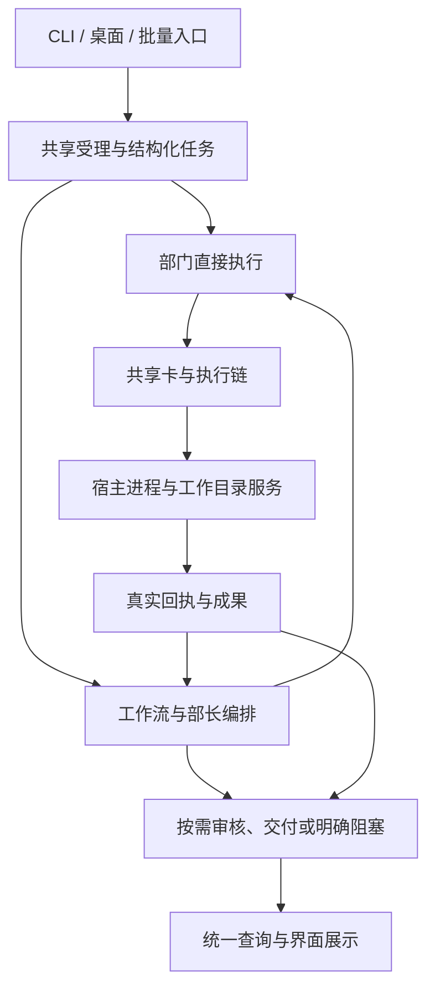

# PAO 整体审核与稳定性修复计划书

日期：2026-10-25。用户决定继续优化现有 PAO，要求从整体架构、模块、接入及可持续开发集中审核，再形成完整修复计划。本修订吸收关键业务链、三类宿主和共享运行器的实际代码审查结果。实际 pi 合并和 PI-Desktop 迁移继续暂停。

本文沿用既有集中治理计划的路径，是[协作重构总计划](2026-10-23-多部门协作实现收敛重构讨论稿.md)的整体审核与修复实施正本，不重新制定部门机制。具体代码证据和审读范围归[整体审核发现](../../.pao/协作机制重构-20261023/系统稳定性治理-20261025/整体审核发现.md)；当前执行状态只维护在[执行总册 §10.21](../未完成/2026-10-17-Harness完善与工作台迭代执行计划.md)。本文描述待实施工作，不表示修复已经完成。

归档日期：2026-11-02。归档原因：已由 §10.22 整体深度审核与架构重整承接。

## 1. 本轮交付目标

围绕已经支持的部门协作方式，把正常路径、故障分支和恢复交接集中查清，在公共边界修复，再按固定场景验收。不能保证软件以后没有任何缺陷；本轮应交付可核对的覆盖范围、已修问题、验证证据及未通过项，不能用测试数量或某次任务得分代替。

保留三种使用方式：部门直接完成、部长拆解后执行、多部门按依赖协作。独立审核按任务需要启用，明确要求时必做；验收范围内缺陷回原任务，新增改进另列。程序办理正常手续，主控处理判断与取舍。

本轮不增加新的权限边界、违规终止措施、自动续跑政策或通用调度框架，不迁移正式 PAO_HOME，不改隐藏测试或用其指导模型作答，不混入无关桌面改动。

## 2. 已有证据及问题分类

本轮审查时三仓HEAD分别为开发根`41e186e9`、内核`000647340`、桌面`fdeaa98f`，均另有未提交修改；仅HEAD不足以代表当前工作目录。内核`4d5877a62`的当前尝试回执与返修、`000647340`的关闭确认及公共进程入口，以及桌面`fdeaa98f`的关闭失败保留与工作树字节基线已有前轮代码审核，不重复当成未修问题。已有检查只对其当时输入有效，当前整合影响面仍须核对。

r18已取得原版官方奖励0.0，随后本题结束，不启动r19刷分。其模型执行因监督查询错误取消，最终组织与工作树归档不完整，因此不能称正常协作整链通过；当时4只本轮容器和后台进程已由主控另行核实停止，自动化已删除。该记录用于定位接入与取证问题，不用于证明全部产品模块有错，也不能据137或ENOMEM单独认定OOM根因。

| 类别 | 本轮处理方式 | 不能混同的结论 |
|---|---|---|
| 协作机制 | 核查任务、卡、执行身份、回执、审核版本、暂停及裁决的衔接 | 进程退出不等于业务交付，回执存在不等于审核通过 |
| 宿主与生命周期 | 核查 SDK、CLI、桌面装配、子会话、关闭和恢复 | 会话空闲不等于所有执行已经停写 |
| 测试运行器 | 核查准备、预检、观测、评分、收尾与采样 | 容器运行不等于业务推进，环境错误不等于 0 分 |
| 任务成果质量 | 按任务验收和真实评分记录 | 过滤器缺陷不自动归因于协作接口；流程通也不能证明代码正确 |

r12 原试次评分环境异常、奖励缺失保持原记录；停止后对冻结成果的官方补评为 0。本轮不得将该补评改写成完整流程成功，也不以反复刷分验收稳定性。

## 3. 先集中调查，再成组修复

### 3.1 按接口核查整条链

每条交接查五件事：谁维护事实、什么条件允许推进、失败在哪里暴露、重复处理是否会重复执行、怎样在保留证据的情况下恢复。已有状态不能因为名字相似就合并。

| 交接 | 必须明确的事实与边界 |
|---|---|
| 接收任务 → 选择部门 | 部门简介来自系统当前配置；结构化派发三入口共享解释，不靠模型手工补运行身份 |
| 派发 → 真实执行 | 实例、owner、角色、轮次、attempt、工作目录和预算一致；启动失败显式返回 |
| 执行 → 回执 → 交付 | 产物、回执、验收属于不同事实；迟到、重复、缺失、写入失败有明确处理 |
| 交付 → 审核 → 返修 | 审核针对当前版本；原卡返修保留历史；不能把旧回执当新尝试完成 |
| 节点结束 → 下游启动 | 依赖和地图版本合法；普通进展不反复唤醒主控；同一结果不重复派发 |
| 阻塞 → 裁决 → 恢复 | 停因和待处理事项可查询；旧裁决不清除新暂停；显式推进可重新检查实际成果 |
| 业务终局 → 宿主退出 | 收齐已受理工作；主动取消仍有效；确认停写后释放占用并收尾 |
| 异常退出 → 重新打开 | 先盘点身份、目录和实际进程；不自动清锁重放，不承诺跨重启自动续跑 |

### 3.2 修复原则

先修同类故障共同经过的边界，替换后删除失去用途的重复判断；不要在每个调用者再补一套规则。保留身份、锁、取消、版本和未知结果等有效保护。无需增加永久规则的问题，不往提示词和 AGENTS.md 追加禁令。

调查输出区分已确认缺陷、待核实风险、既有证据覆盖。不能仅因缺少某个名字的测试就判定代码有错。不同子代理的写入范围必须分开，跨模块修改由主控整合。

## 4. 固定验收场景

先给下列场景映射已有测试和证据，只补真实行为缺口。离线替身是按预定内容回应的模拟模型，能验证程序衔接，不能证明真实模型会正确选工具。

| 场景组 | 要覆盖的组合 | 通过条件 |
|---|---|---|
| 正常协作 | 单部门直派、部长拆解、多部门依赖；按需审核及强制审核 | 经真实公共入口到交付；不靠主控手工改状态推进 |
| 审核与返修 | 当前版本拒绝、原卡返修、会话失效、地图过期、重复与迟到回执 | 返修身份和累计尝试正确；只推进合法的新结果 |
| 判断与恢复 | 证据不足、请求裁决、裁决期间新增暂停、只修改成果后显式推进 | 阻塞明确；原授权内可恢复；不能把未知改成成功 |
| 故障与并发 | 认领后启动失败、结果落盘失败、依赖交接间中断、重复事件、取消与完成竞态 | 不重复开工、不丢原始异常；已有成果可查，恢复不重做已完成工作 |
| 生命周期 | 正常 print、主动停止、子进程异常、宿主关闭、重新打开 | 按对应语义结束；真实停写与占用释放一致；重开先盘点 |
| 运行器 | 安装/预检失败、模型失败、业务阻塞、容器存活但停链、评分失败、真实 0 分、观察器退出 | 分类准确且有责任方和可处理原因；采样/收尾不会制造成功 |
| 入口一致 | CLI 和桌面相同任务调用共享内核；能力不足提前拒绝 | 宿主只做适配；同一业务规则不在两边分叉 |

## 5. 验证顺序与停止条件

1. **代码与契约审核。** 主控使用 code-simplicity 阅读实际实现、调用者及最终差异，不能只看子代理报告或测试结论。
2. **定向离线验证。** 在隔离数据目录中使用已有 SDK/RPC、真实文件/Git/进程边界，注入明确故障；优先复用 `workflow-four-department-real`、`workflow-direct-real`、`dispatch-fault-injection`、`host-rpc-background-real`、`runtime-shutdown-window` 与控制器检查。文件名中的 real 不代表真实模型，逐项注明边界。
3. **当前源码整合检查。** 跑实际受影响类型、依赖和入口检查。既有全仓类型错误如实列明；不能绕过检查后宣称全仓通过，也不运行会覆盖无关脏文件的全仓自动格式化。
4. **必要真实宿主验证。** 无模型验证不能替代真实 CLI/桌面退出及恢复表现。机器重启须具备专门可执行安排，未验证则保持未验，不用应用重开替代。
5. **受控真实模型整链。** 前述必要场景通过后，才使用当时仍有效的授权、模型与第一题范围。当前历史选择为所有角色 MiniMax high、仅 html-js-filter；其他付费范围不扩张。不把真实任务当成发现确定性接线错误的第一工具，不更改原题或官方测试。

任一阶段发现新缺陷，只重跑受其影响的检查；与当前源码和环境仍对应的通过证据继续有效。若真实模型出现离线测试没覆盖的行为，先查它属于模型决策偏离还是程序未处理的合法输入，再扩充该接口的行为覆盖；不直接加一条提示词或盲目重跑。

本轮集中治理完成需要：已确认阻断缺陷清零或有明确排除理由；场景矩阵每项有证据或清楚标记未验；没有冒充运行的陈旧状态；收尾能核实实际资源；主控代码审核通过。若真实整链或必要生命周期仍未通过，只能交付阶段结果，不能宣称全部解决。

## 6. 测试运行器的收敛范围

共享 `prepare_run.py`、`launch_run.py`、`watch_run.py` 和 `runner_common.py` 已取代新运行入口中的逐轮字符串替换，当前prepare使用显式来源配置，未动态装载历史dispatch。保留这些已完成收敛；历史逐轮脚本仍在工程留档中，文档入口尚需标清现役与历史。

后续使用上述现役共享入口，以本轮目录和受限配置作为输入；冻结时复制实际版本进独立运行留档。历史冻结实例保持原样。当前仍需修复来源清单先写后覆盖、verifier身份推导、完整集合停写、畸形奖励及首错取证等公共缺口，详见第9、11节。复用现有 `bench_controller.py` 与公共模块，不再新增一套状态机。

统一处理：当前容器范围、预检与模型状态区分、业务阻塞及无进展提示、控制器异常、真实停写核对、奖励缺失及评分异常、采样退出。观察失败要留下可处理异常；业务阻塞不直接当模型失败，也不因无事件自动取消有合法活动的请求。不以新循环层级掩盖原链停滞。

## 7. 交付与未完成事项

按共同原因分组提交，报告实际复用和删除的旧路径、修改范围、主控审核、必要检查与未验项。任务书、调查与审核证据归 `.pao/协作机制重构-20261023/系统稳定性治理-20261025/`；只在执行总册更新当前进度，不再复制第二套状态表。

本轮不自动验收整体 token/费用下降、实际操作系统隔离、外部冻结首配方对照及机器重启；必须有对应真实证据才改原结论。稳定性与模型负担是不同指标，保留 P5 现有未验状态。

## 8. 整体审核扩展：从故障修复转为可持续开发

用户在 r18 收尾后要求覆盖整体架构、模块、接入与可持续开发。该要求扩大审查范围，但不表示已有缺陷均已证明，也不取消第1节的权限边界。真实跑题暂不恢复；不以模型更换代替代码与接入验收。沿用本计划，不再建立相互重复的整改总计划；状态仍只维护在执行总册。

### 8.1 审查范围与应交付证据

| 方面 | 要回答的问题 | 交付与验收 |
|---|---|---|
| 产品与协作机制 | 三种协作方式分别何时使用？是否把简单任务强迫走四部门？哪些手续可由程序完成？ | 保留用户定案；逐项核对实际入口，删除无真实用途的永久规则，不新增权限与终止框架 |
| 架构与模块 | 工作流、卡、执行、宿主、展示的业务事实分别由谁维护？是否存在循环、全局实例和重复判定？ | 根据真实调用链列公开接口、状态正本和职责冲突；模块多或文件长不单独作为重构理由 |
| 接入与装配 | CLI、桌面、基准的必要能力是否一致？父子角色是否来自同一装配契约？ | 每个受支持入口实际建立角色，缺能力在派发前拒绝；不要求不同宿主使用同一启动命令 |
| 状态与持久化 | 实例、轮次、attempt、回执和审核版本如何对应？多文件更新中断如何盘点？ | 正常、重复、迟到、半写入、并发取消与恢复的行为证据；禁止靠模型修改控制文件补流程 |
| 生命周期 | 谁启动、持有、唤醒、取消和回收子角色？退出与停写是否一致？ | 正常完成、取消、关闭失败、重新打开分别验证；保留首次错误与后续清理错误 |
| 成果与工作树 | 原始输入、工作目录、产物、整合提交和审核证据能否逐一对应？ | 合法输入字节保持、隔离与回收、当前版本审核及返修证据；不得读取隐藏答案辅助作答 |
| 提示词与工具 | 部门简介是否动态组装？模型应做的判断与程序应做的手续是否混杂？ | 核查最终实际提示词及工具集合；不以提示词新增禁令修补程序缺口，不把模板测试当真实模型表现 |
| 模型与协议 | 已支持供应商的消息、工具参数、取消及错误是否忠实传递？ | 按实际支持范围核查协议适配与错误；模型能力差异、接口缺陷和任务质量分开归因 |
| 观测与费用 | 进程活、业务进展、阻塞、完成如何区分？用量覆盖范围是否明确？ | 首次错误有原始详情；请求数不由回执数冒充；费用未知保持未知；不建立第二份业务状态正本 |
| 测试与检查 | 验证用的是产品最终入口、冻结安装结果，还是替代实现？检查自身会不会失真？ | 复用已有场景，补实际边界；正常链和故障链映射到具体入口，检查失败不改源码伪装通过 |
| 构建与发布 | 源码、dist、vendor、依赖锁和最终安装包是否匹配？干净环境能否重建？ | 明确构建输入与产物对应关系，校验最终发行物；不能仅凭某个文件较新就宣布全部源码已构建 |
| 开发与维护 | 三仓修改如何整合提交？临时实现怎样进入长期维护？上游 fork 如何保持边界？ | 保存现有未提交成果；分清活动实现与冻结留档，收敛正式脚本和文档入口；pi合并/迁移继续暂停 |

### 8.2 执行与审核责任

1. 主控先登记受支持入口、模块边界和实际源码/产物基线，区分深入审读、图查询、静态扫描、抽样与未读范围。保留无关在途修改，不靠清空工作树得到假干净。
2. 子代理按明确模块调查和实现；跨模块契约、最终来源选择、状态归属和合并验收由主控负责。主控不得只复述“测试通过”。高风险变更在实施者自查之外有独立代码审查。
3. 每个发现必须有代码位置、受支持的触发方式、已证实或待核实分类、修复归属和验证边界。已修问题不重复算当前缺陷，初步猜测被推翻须删除结论。
4. 修复以公共原因分批，旧路径确认失去用途后同批退出活动入口；冻结记录保持只读。允许调整较大结构，但不以全面审查为由改写正常的上游模块或引入新框架。
5. 模型名称不构成故障原因证据。不通过未经授权的付费对照来判断子代理优劣；已有记录只能证明某个实施和审核环节漏检。更换模型不降低主控验收标准。

### 8.3 恢复真实模型验收前的条件

- 最终正式装配经过真实准备、安装、启动、派发、返修、交卷及退出检查；固定回应明确标注为模拟模型，但文件、Git、进程和RPC使用实际实现。
- 同一组构建输入与最终产物可以对应；检查入口不修改无关源码，必要的构建/运行依赖明确。
- 真实阻断缺陷已经修复并审查；未验项列明影响，不把未知当成功。用户操作系统重启等单独授权边界继续有效。
- 首次错误、取消结果、归档完整性、评分状态和实际停写均可分别查证。容器之外，产品自身的CLI和桌面生命周期也须覆盖。
- 恢复真实模型验证时明确该次要验证的剩余模型行为，不再用真实题目发现确定性的装配错误。已取得的 r18 官方0分不因此重刷；新的真实验收安排需有明确目标与有效授权。

整体审核完成的含义是审查范围和处理结果可核对，已确认的阻断问题得到处理，必要验证成立；不承诺以后永不出现缺陷，也不承诺单次大重构自动解决尚未证明的问题。

## 9. 本轮审核结论及修复优先级

### 9.1 共同原因

已有公共业务入口、卡与流程正本、工作树接口和生命周期接口，架构基础可以继续使用。本轮暴露的共同问题是：公共边界的失败语义不完整，装配来源与最终产物没有始终对应，验证有时复用了实现的错误预期，部分维护证据尚未进入长期入口。局部修复正确，不代表最终产品接入已成立。

前18轮包含安装失败、装配错误、探针契约错误、业务停链、观察器错误和实际作答质量等不同情况，并非18次同一条件下的正常模型完成。应按共同边界归并处理；不能用轮数归因模型能力，也不能用更换子代理替代主控整合审查。

### 9.2 已确认项与待核实项

以下编号引用审核发现正文；P1是恢复整体验收前需处理的高影响项，P2是相应边界的质量与维护项。尚未现场触发的静态路径明确保留这一限制。

| 证据项 | 优先级与性质 | 必须取得的修复结果 | 负责批次 |
|---|---|---|---|
| K1批量受理占位异常逃逸 | P1，代码缺陷 | 每条请求有真实结果，失败不丢整批汇总，不绕过账或重复建卡 | W1 |
| K2原子写退回普通复制 | P1，关键正本保证不足 | 替换失败保留完整旧正本，显式报错；不承诺未经验证的断电安全 | W1 |
| K3释放锁覆盖业务首错 | P2，代码路径成立 | 主错与清理错同时可查，释放失败不被吞掉 | W1 |
| A3/A4模块降级、宿主实例 | 待核实；已排除部分初步疑点 | 核实三入口和父子角色必要能力；正确的显式注入与可选降级保留 | W2 |
| 工作流、返修、恢复、工作树 | 关键覆盖复核，不能先称缺陷 | 已有身份、版本与中断保护在最终入口成立；新问题有证据后再改 | W3、W4 |
| A2源码与桌面内核产物对应 | P1，构建保护范围不足 | 部分构建、旧残留不能静默进入最终包；完整产物可追溯 | W6 |
| R3/R4冻结混合来源、SDK旧bundle风险 | P1/P2，来源与维护缺口 | 每个目标唯一来源，派生过程明确，源与产物可核对 | W6 |
| R1观察器漏verifier及集合不完整 | P1，当前公式错误已确认 | 真实角色名称匹配；应有身份未发现保持未知，不签全停写 | W7 |
| R2畸形奖励冒充可用 | P1，代码缺陷 | 有限数值、真实0、缺失和坏格式分开，原始结果保留 | W7 |
| R5首错与清理取证 | P1/P2，真实缺失及覆盖风险 | 原始命令错误与业务、取消、清理、收证错误可同时定位 | W7 |
| A1检查未采样disconnect | P2，检查缺陷 | 检查能被真实副作用反例触发，声明范围准确 | W8 |
| R6重复配置校验、最终入口测试缺口 | P2，维护现状 | 同一契约一处维护；真实最终装配进入长期无模型验证 | W6—W8 |
| check隐式改源码、未提交跨仓成果、活动入口混杂 | 维护问题 | 检查无隐式改写，按边界整合提交，现役入口清楚 | W0、W8、W9 |

A3已有启流前人工门与独立审核能力检查，A4主装配已正确传递同一host；这两项目前不构成删除可选降级或默认公开接口的理由。P5工具声明和模型负担另行量化，不因精简文字或流程完成宣称收益。

## 10. 修复后的职责与用户体验

### 10.1 每个事实只由一个模块维护

| 归属 | 负责 | 其他层只做什么 |
|---|---|---|
| intake与task-book | 任务字段归一、受理身份与重复请求判据 | CLI、桌面、批量搬运参数和展示结果 |
| workflow | 冻结依赖、节点、轮次、暂停、审核与裁决 | 主控做业务判断，宿主不复制推进条件 |
| cards | 卡状态、尝试、当前回执、交付与成果关联 | 运行器不把进程退出写成审核通过 |
| worker与host | 真实执行、角色会话、取消、停止确认 | 工作流调用公开结果，不读取私有进程表推断业务完成 |
| worktrees | 工作目录身份、输入基线、隔离、整合与回收 | UI和模型使用公开动作，不猜路径或手写目录状态 |
| runtime与core生命周期接口 | 在途活动、结果通知与宿主关闭衔接 | CLI、RPC、桌面遵循各自交互，保持相同业务含义 |
| 宿主适配 | 配置真实能力、父子入口、界面与进程 | 复用共享内核，不复制协作规则 |
| benchmark | 冻结输入、执行实验、观察与原版评分收取 | 不代替产品状态，不以评分推断协作成功 |

箭头表示公开交接，不是新增全部必须经过的流程。简单任务直接派给相应部门；明确有依赖、分工或拆解需要时再用工作流。四部门基准配方不变成所有任务的产品默认。

### 10.2 用户能观察到的变化

1. 一次便捷派发就得到已受理、延后或拒绝的真实结果；失败说明出在哪一步，已有卡号不丢失。
2. 启动前能说明这次任务需要的宿主能力是否具备；可选功能缺失不拖垮普通使用。
3. 运行中分清正在请求模型、正在执行工具、等待依赖、等待审核和需要处理的阻塞；没有新事件时不制造假进度。
4. 暂停推进、取消在途执行、关闭会话分别有准确名称和结果；停止未确认不会显示已安全结束。
5. 审核查看当前成果与当前尝试；返修回原任务，范围外建议不自动扩大任务。
6. 完成后能找到成果、审核、错误与用量覆盖情况；未知费用不显示成免费。界面沿用现有区域，不建设新的总控大屏。

## 11. 分批修复任务书

每批先复核证据仍对应当前源码。实施者只能修改分配文件；需要跨入其他批次时由主控处理交接，避免同时修改同一文件。本节作为详细派发依据，实际实施状态维护在执行总册；真实跑题不随代码实施自动恢复。

### W0：固定整合基线与覆盖清单

**目标：** 使后续审核对应一组确切输入，保存所有在途成果。

**主控负责，先于所有代码修改。** 读取三仓HEAD、差异和未跟踪文件归属；用现有Git与摘要方式保存修改前内容，区分本轮、其他在途和历史冻结。代码图用于影响面，当前文件用于核实事实。列出CLI、桌面、SDK、benchmark及父子角色的最终入口与真实依赖，不新建环境管理框架。

交付一张“入口—业务调用—产物—证据”表，并为第12节每行登记已有证据、对应源码及缺口。原提交中的正确修复先复用；根仓尚未整合的适配器、kit和manifest不能被当成彼此独立的可提交补丁。

**验收：** 受审源码可还原，未提交内容不丢失；每个后续任务有唯一可写范围和基线。此批不重建、不跑模型、不触碰正式PAO_HOME。

### W1：受理失败、状态写入与错误传播

**范围：** 内核`pao/intake/accept.ts`、`intake/ledger.ts`、`shared/atomic.ts`、`shared/lock.ts`及直接受影响测试。其他调用者只在确实需要适应公共失败语义时列明后修改。

**实施顺序：**

1. 用现有受理入口构造占位锁失败、坏账和账写失败反例，保留当前不符合逐条返回契约的证据。
2. 将单条错误边界覆盖完整受理阶段；返回原始原因、已创建卡身份、派发是否受理的真实已知值，保留pending防重复保护。
3. 清理失败作为附加问题返回；不能伪称占位撤回成功。建卡后转正失败保持可查，禁止直接删除占位后盲目重新建卡。
4. 核查仓内成熟原子替换实现，修复关键正本写入的普通复制回退；替换失败保留旧文件和可定位错误。按代码图逐类查调用者，不给每个模块再造写文件函数。
5. 公共锁包装保留业务与释放错误的组合；沿用已有锁策略，不借机更改超时、并发或权限。

**删除与复用：** 复用createCard、withFileLock及既有原子写入口，删除被替代的失败分支；不增加数据库、自动修复账或通用事务层。

**验收：** K1—K3反例转为通过；批量结果逐条完整；真实隔离文件与并发读检查证明旧正本不被部分覆盖；锁四种成功/失败组合正确。断电与系统崩溃未测则单列，不以单元模拟冒充。

### W2：主控、部长、工人和三类宿主的装配一致性

**范围：** 内核`pao/index.ts`、`host/host.ts`与`host/tools.ts`、`worker/index.ts`的装配段、`runtime/background.ts`、`worktrees/host.ts`；桌面driver的`npm-package-fallback.ts`、`session-supervisor.ts`、`runtime-supervisor.ts`；SDK host factories。主控协调跨仓差异，同一文件只交一位实施者。

**实施顺序：**

1. 建立能力清单：真实进程入口、工作目录、角色配置、IPC、取消、后台通知、关闭确认分别由谁提供。复核已有人工门/独立审核能力检查，保留普通CLI单根目录支持。
2. 沿主控到部长、部长到工人的真实启动调用，核对同一构建、同一角色身份来源、同一取消与用量衔接；避免子角色悄悄回落另一套入口。
3. 针对模块注册失败，确认业务工具是否真正可用及错误是否可查；只有确有必要能力缺口才在现有受理/启流边界补检查。可选降级仍有效，不建立通用能力注册平台。
4. 使用显式注入的会话host复核双会话隔离；确认默认公开工具接口的用途，缺少误用证据就保留。
5. 将基准宿主确实需要的接线集中到既有factory与processInvocation；宿主特有的UI、进程方式和超时参数保留在适配层。

**验收：** 两个不同会话并行时不覆盖通知、不停止彼此执行、不串模型配置；父子真实Node/RPC/IPC走最终入口；缺必要能力在受理或启流时明确拒绝。模拟模型只提供固定回应，真实文件和进程不替换。CLI、桌面、基准可有不同启动命令，但共享业务契约。

### W3：工作流、卡、审核、返修与恢复的一致性

**范围：** `workflow/control.ts`、`auto.ts`、`host-bridge.ts`、`driver.ts`、`review.ts`及`cards`当前回执/返修/交付边界。W2拥有总装配文件，W3不得并行改总装配。

**实施顺序：**

1. 从三种正常协作方式分别跟踪实例、owner、节点、轮次、attempt、回执、成果与判定，列明每次迁移的唯一写入者。
2. 检查重复事件、迟到回执、原卡新尝试、成果修改后的旧审核、地图升版与下游交接；核查已有修复，缺口成立才修改公共迁移函数。
3. 在创建卡后保存控制失败、返修多卡中途失败等真实文件边界注入异常；保留孤儿发现、先固定暂停及原卡累计基线，不能从卡反推一份新控制正本。
4. 核查暂停与裁决竞态：旧裁决不能清除新增暂停；显式恢复先盘点在途卡与实际执行，不自动清锁或重放。
5. 核对终局通知、主控唤醒、已读及重复结束；后台端口计数表示活动，不替代卡的业务状态。仅修存在证据的通知丢失或重复处理。

**删改边界：** 业务推进规则留workflow，执行事实留cards/worker，宿主与观察器不抄一套。允许将同一规则分散的重复实现收回原模块，不全库改名、不改卡字段协议。

**验收：** 正常直派、拆解、多部门依赖均可交付；拒绝后原卡返修、地图复核和显式恢复使用真实工具；重复/迟到不二次开工，半更新明确阻塞；旧版本审核不放行新内容；范围外建议不自动派单。不能用手改控制文件补完成功链。

### W4：工作目录、成果证据与桌面操作

**范围：** 内核`worktrees`与`cards/baseline.ts`、`execution-context.ts`、交付整合接口；桌面`platform/worktrees`及公开PAO查询/动作桥。保留已审过的原始字节基线修复。

**实施顺序：**

1. 对照原始输入、执行目录、分支/内容树、产物、整合提交与审核引用，确认每个身份来自公开结果而非按文件名猜测。
2. 核对普通单根执行与独立审核副本的支持差异；独立审核能力不足提前拒绝，不能退到可写主目录冒充隔离。
3. 核对创建后装配失败、取消未确认、目录仍在使用、整合冲突、输入字节异常和回收失败；只有真实停止与必要成果保留成立才回收。
4. 桌面沿已有控制桥读取内核真值，保留用户所见节点/轮次关联校验。界面文字准确区分暂停推进与停止进程，不复制业务状态机。

**验收：** 干净与合法脏输入不被擅自改写；真实Git证据能对应交付；整合失败保留成果与冲突原因。实际Electron在隔离用户目录验证查询、暂停/恢复、审核与关闭失败展示；不能用浏览器假页面或纯unit替代。

### W5：提示词、便捷派发与模型接入

**范围：** `dept/render.ts`、`dept/index.ts`、`intake/task-book.ts`、角色提示模板、`context`请求度量、模型路由与请求预算适配；W1拥有accept/ledger，W5的调用调整由主控顺序整合。

**实施顺序：**

1. 从最终实际请求捕获主控、部长、工人的系统提示、工具声明与重复上下文；字符、字节、token和费用分别记录，不能互相替代。
2. 保留系统动态组装部门名称和简介、完整干法按需读取；把已由程序办理的身份复制和手续从模型任务中移走，删去重复说明前先核对是否属于不同角色必要信息。
3. 便捷派发继续共用TaskBookSchema和normalizeTaskBook；旧字段兼容只在归一层，冲突明确拒绝，交付物与验收不丢失。
4. 主控提示明确给相应部门派发；部长按本任务的能力与依赖决定直做或拆卡，多部门任务由共享工作流处理。用可观察工具动作验证该行为，保留用户暂缓新增权限与终止措施的决定。
5. 对现已支持协议核对模型名/别名、思考强度、消息、工具参数、流式结束、取消、错误及用量未知。优先复用pi现有供应商实现；硬请求预算目前仅验证openai-completions，支持边界写清，其他协议不靠默默绕过变成支持。

**验收：** 部门配置改变后下一次请求准确刷新；三入口的同一任务得到相同业务字段；真实角色工具和必要提示来自最终装配。简洁性依据实际重复与请求度量，不能以“英语一定更省”或短提示模板宣称P5通过。真实模型行为与整体费用收益单独保留待验。

### W6：构建、冻结与最终产物来源

**范围：** 桌面`vendor-pao-kernel.mjs`及对应构建/打包入口；根仓`prepare_run.py`、SDK构建脚本与来源清单。`runner_common.py`的配置契约修改归W7，W6只在既有入口调用。

**实施顺序：**

1. 优先让正式物化调用受控成功构建，或消费现有构建产生的有效记录；记录本次实际构建输入与输出，包含被使用的兄弟运行时。Git提交号只能辅助，不能代表未提交工作树。
2. 替换“src最大mtime与dist最大mtime”的充分性判断。清理/重建仅限当前明确生成目标，使用暂存产物后替换，防止源码删除后的旧dist混入；不删除用户文件或无关发行物。
3. prepare先形成现有装配表，每个最终目标决定唯一来源，再复制。源模板、派生kit的模型覆盖参数、最终摘要分别记录；同一目标重复来源直接拒绝，不再先写后覆盖。
4. 将Node、系统依赖、模型数据与元数据的选定来源、声明摘要、最终目标补进现有source-manifest；无法核实的来源保持unknown，不伪造上游URL或发布日期。
5. SDK工作树bundle使用当前构建脚本增加无覆盖检查方式，在允许的工作区临时目录重建并核对产物；保留已有受管副本字节校验，不另造打包器。
6. 复用最终发行物已有内核版本、依赖解析与导入检查，补源码—dist—vendor—包内代码的内容对应。无需再复制依赖扫描实现。

**验收：** 改源未构建、部分构建、删除源文件、兄弟运行时变化、bundle未更新、同目标重复来源分别失败；完整构建及唯一装配通过。最终安装结果与受审输入可反查，不以最终文件存在或版本号相同代替内容一致。历史冻结目录不修改。

### W7：运行观察、错误、评分与用量证据

**范围：** 根benchmark目录的`watch_run.py`、`bench_controller.py`、`runner_common.py`、`launch_run.py`、`map_bench_pao/usage.py`及对应测试。模型agent业务改动需由主控另行核实归属，不能带入未审修改。

**实施顺序：**

1. 复用compose_project的角色参数，纠正verifier项目推导；测试用真实Harbor格式的独立预期，不能再次从错误实现生成期望。
2. 区分本阶段计划身份、实际已创建身份、实际发现身份及缺失身份。只有当前阶段应核实集合完整且实际停止时才能签发停写；没有创建过正式试次不强造身份，查询失败不等于停止。上一轮复核使用同一规则。
3. 控制器局部保留命令、返回码、stdout/stderr和阶段；业务、取消、清理、归档错误共存，最终异常保留首错。必要日志遵循凭证不出argv和报告。
4. 奖励解析只接受明确存在的有限数值，拒绝布尔、字符串和非有限值作为官方奖励。原文件不改，坏结果标明malformed，缺失保持未知，真实0有效。
5. 冻结的题目/模型/重试策略由runner_common一处维护；控制器继续负责实际文件、Harbor结构、挂载及运行事实，避免把不同检查职责强行合并。
6. 启动回执记录实际控制器image ID、解释器位置及可验证版本身份；镜像tag只作名称，不冒充内容。来源变更明确留证，不无条件阻止合法重建。
7. 修正未知sessions布局误归main；用原生会话事件去重汇总，空日志、缺字段、未知请求数和费用保留未知。收证不完整、采样错误及资源观察范围分别说明。

**验收：** 无模型、无Docker故障夹具覆盖缺失verifier、查询失败、并发收尾、预检失败、控制器崩溃、坏奖励、多重异常、镜像身份变化和未知会话；再在隔离环境验证必要真实进程边界。r18冻结与官方0保持原件；任何离线回放不能升级为正常作答成功。

### W8：长期验证、检查自身与开发入口

**范围：** PAO与desktop的package scripts、对应CI/检查脚本和定向测试；benchmark长期验证入口与README导航。不并行改W6构建实现、W7运行逻辑。

**实施顺序：**

1. 修复导入副作用探针的实际采样，使用带disconnect/stdin副作用的真实模块反例；对非TTY能验证的范围准确声明。导入检查不强行以process.exit代替自然退出安全的证明。
2. 核对全部既有架构检查与等价覆盖，将真正缺失的必要检查纳入正确层级。跨三仓的检查在具备三仓的整合入口运行；单仓CI不能因缺旁仓而被错误设计成必败，也不能静默跳过关键约束。
3. 分开只读check与显式format/fix，提交钩子不隐式改全仓。正式调整脚本与调用者后验证，不把临时HUSKY=0当长期方案。
4. 在现有离线回归里增加一条真实prepare输出→真实setup→真实adapter/父类→当前内核→父子RPC的零模型链；不得中途手动换activation、kit或套占位父类冒充最终接入。
5. 复用已有workflow-direct-real、workflow-four-department-real、intake-completion-real、dispatch-fault-injection、host-rpc-background-real、runtime-shutdown-window等测试；按真实边界说明哪些模型是假、哪些文件/进程/Git是真。
6. 现役文档只指共享入口；旧逐轮脚本标明历史，不为整理擅改只读冻结件。临时脚本转长期代码需确认归属、参数、调用者和维护入口，避免新增一份永久禁令文档。

**验收：** 检查失败确实能拦相应坏行为；检查前后受审源码字节不变；同一最终装配可离线重复验证，model_calls=0。修改业务后只重跑受影响检查，完整整合关口跑约定集合，不无目的累计测试次数。

### W9：主控整合、真实宿主验收与提交交付

**主控负责。** 各批通过代码审核后顺序整合公共调用者；核对实际最终差异、默认值、错误、兼容和废弃路径，实施者自报通过不能直接改总册状态。

1. 按第12节矩阵消费对应最终构建的证据，核心故障修复、接入正确、真实宿主表现分别判定。
2. 实际CLI验证正常完成、主动取消、子进程失败与重新打开；实际Electron验证受影响动作及关闭失败。机器重启、宿主故障等未具备真实验证时明确保留未验。
3. 按共同边界分别提交三仓，根提交引用确切内核/桌面版本或现有联动记录；只提交本轮文件。检查暂存差异、必要检查和可回退关系；不推送、发布或混入pi升级。
4. 交付成果、审核结论、已删重复路径、真实验证与未验清单；同步README的现有导航和总册§10.21，不复制另一份状态账。
5. 真实模型只用来验证剩余的模型派发与协作行为，安排在整合通过后。r18的真实0已结束，不为获得好分重复第一题；新实验需有明确验证目的和届时有效授权。本轮计划不启动任何付费实验。

**验收：** 所有P1已修并审查，矩阵必验项有对应证据，发行物内容匹配；没有靠手工改状态完成的成功链。若真实宿主或整链仍未通过，只交工程阶段结果，不能称PAO全部稳定或P5通过。

## 12. 固定验收矩阵与证据要求

本表在实施前映射已有测试，不以每行新增一份测试或一个审批步骤。每条结果记录源码/产物身份、入口、真实与模拟边界、预期与实际、原始输出和未验项；状态只写执行总册。

| 编号 | 场景与实际边界 | 核心判据 | 负责 |
|---|---|---|---|
| S01 | CLI、桌面、批量受理同一任务 | 共享业务字段；逐条失败有完整结果；不重复建卡 | W1/W2 |
| S02 | 占位/写账/撤回失败与重复提交 | 原错误和已创建身份可查；坏账不绕过；未提交派发不说已运行 | W1 |
| S03 | 关键正本替换失败与并发读 | 旧内容完整；失败显式；不退回部分覆盖 | W1 |
| S04 | 主错与锁释放错四组合 | 两个错误都可定位，成功/失败语义准确 | W1 |
| S05 | 部门直做、部长拆解、多部门依赖 | 真实公共入口到交付；简单任务不强制四部门 | W2/W3 |
| S06 | 两会话与父子角色真实RPC/IPC | 不串实例、不回落旧装配；身份、取消、后台结果一致 | W2 |
| S07 | 缺人工门/独立审核能力及模块失败 | 必要能力提前明确拒绝；普通可选功能合理降级 | W2/W4 |
| S08 | 迟到、重复、旧尝试回执与新成果旧判定 | 不重复推进、不拿旧审核放行新版本 | W3 |
| S09 | 地图过期、返修、范围外建议 | 原部长复核、原卡新尝试；额外建议不自动扩任务 | W3 |
| S10 | 建卡映射或多文件返修中断 | 原件保留、阻塞可查；不按半更新状态派发 | W3 |
| S11 | 裁决与新增暂停竞态、显式恢复 | 旧裁决不清新停因；恢复先核身份与在途状态 | W3 |
| S12 | 工作树创建/整合/回收失败 | 输入和成果保留；停止未确认不释放占用 | W4 |
| S13 | CLI正常结束、主动停止、异常和重开 | 在途工作与关闭含义一致；重开不盲重放 | W2/W9 |
| S14 | 真实Electron查询/控制/关闭失败 | 显示与内核事实一致，错误可处理，无虚假关闭成功 | W4/W9 |
| S15 | 源变、部分构建、删除源与旧bundle | 不发布陈旧或混合产物；最终包可反查 | W6 |
| S16 | 冻结来源、派生配置、离线依赖与镜像身份 | 每个最终目标唯一来源；unknown不变成功 | W6/W7 |
| S17 | 导入副作用反例与只读检查 | 坏行为使检查失败；check不修改受审源码 | W8 |
| S18 | 最终prepare→setup→adapter→RPC零模型 | 全部消费同一输出，无中途替换，实际依赖可加载 | W6/W8 |
| S19 | 预检失败/缺身份/查询失败/评分容器存活 | 生命周期与业务分别记录，集合不全不签停写 | W7 |
| S20 | 0、缺失、坏奖励、多重异常和部分归档 | 原奖励与错误保留；缺失不补0；全停与归档完整分开 | W7 |
| S21 | 部门简介刷新、JSON任务兼容与协议支持 | 最终提示准确；字段冲突拒绝；支持边界明确 | W5 |
| S22 | 原生用量、未知角色、工具声明和真实模型动作 | 下界与总量分开；不把字符缩减当降费；P5独立判定 | W5/W7/W9 |

机器重启、在途宿主故障、实际OS隔离、外部首配方对照和P5真实模型质量/费用对照仍为独立未验事项，不在本表用离线模拟替代。没有这些证据时不能升级相应旧结论。

## 13. 实施依赖、子代理与主控审核方式

### 13.1 顺序与并行

1. W0固定基线后，W1、W2、W6、W7可在不重叠文件上分别开始；W7配置契约与W6调用接口由主控先约定。
2. W3、W4先复核现有证据，在W1公共失败语义确定后实施必要修改；W2总装配文件只由其唯一实施者或主控修改。
3. W5可独立审提示与最终请求，涉及受理调用的修改等待W1，涉及装配等待W2。未经证明的收益不作为并行改动理由。
4. W8复用各批真实边界，集中补长期入口；不能先写一个替代实现的“全通过”测试再让各批迁就它。
5. W9按依赖顺序整合、审核和提交，最终真实宿主验证消费同一受审构建。

并行代理数量由可分离边界决定，不机械为每个小项开一个代理。后续子代理沿用用户当前DeepSeek high偏好；若实际工具不支持该选择，主控如实说明，不悄悄替换。主对话负责最终代码审核与验收，模型名称不降低任何一项标准。

### 13.2 每份派发任务必须包含

- 业务目标、支持的触发条件、对应发现编号与当前证据，说明哪些尚待核实。
- 精确可写文件、只读依赖、不得触碰区域及与相邻批次的交接接口。
- 本节实施顺序、必须保留的公开接口与保护、拟复用及拟退出的旧路径。
- 可执行的正反验收、真实/模拟边界、失败时保留内容及不能作出的结论。
- 交付实际差异、调用者变化、验证命令与退出码、证据位置、未验项和新增复杂度理由。

不得把“尽量简洁”“测试全绿”当完整任务边界；不得授权子代理改正式配置、历史冻结、隐藏测试或全局服务。

### 13.3 主控必须实际审什么

主控审最终实现与调用者，重点核对身份来源、状态迁移、默认值、异常覆盖、取消、恢复、构建输入和最后一个调用入口。独立预期不能从实现同一错误公式生成；测试源码也属于审查范围。

每批给出“接受、返修、保留未验”结论。返修仅限验收范围内缺陷，新增改进另列。已通过证据仍对应当前输入且无新疑点时不重复运行；跨批整合改变了依赖时重验受影响项。

不再以“子代理已完成但主控没有收取”作为等待状态：实施中使用可等待的完成通知；交付后由主控收差异和证据，完成代码审核再推进下一依赖，不永久轮询空任务。

## 14. 提交、兼容、回退与交付标准

### 14.1 兼容与回退

公开工具名、卡字段、持久化格式和旧字段兼容保留；确有必要调整公开契约时先列迁移影响，不把改名藏在重构里。已生成历史记录只读，新发现用新的审查证据说明，不回写历史使其看似正确。

优先不改持久化格式，回退按公共边界提交执行。任何已写入的新格式若旧版不能安全读取，必须先准备显式兼容或阻止旧版写入；不能依赖清数据回退。提交前核对本轮范围，不整仓stage，不撤销其他开发中的改动。

### 14.2 完整交付

交付应包括已审代码与分组提交、最终构建及来源证据、第12节实际结果、真实CLI/Electron表现、错误与恢复说明、必要入口文档，以及明确未验事项。计划正本沿用本文件，发现正本沿用整体审核发现，状态正本沿用执行总册；不再建立互相复制的总计划或进度表。

完成标准是：已确认P1处理完且代码审核通过，必要正常与故障场景成立，源码与最终入口对应，失败能保留事实并给出可处理结果，历史与用户数据得到保留。若只完成工程检查，报告就写工程检查通过；真实整链、重启和模型负担分别凭实际证据验收。

实施按以上批次推进，真实跑题继续保持结束状态，pi升级和pi-desktop迁移继续暂停。
